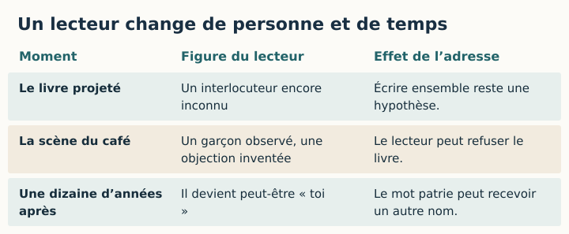

# BEL A/L — Grec moderne (commentaire et traduction) 2019 · Corrigé brut

*Corrigé rédigé par IA, non officiel. Signalez toute erreur.*

**Rédaction** · GPT-6.2 Astra Ultra · vitesse non renseignée

[Sujet officiel](https://www.ens-lyon.fr/sites/default/files/2019-10/2019%20Commentaire%20et%20traduction%20en%20LVE.pdf#page=10) · [Rapport du jury](https://www.ens-lyon.fr/sites/default/files/2019-10/grec_moderne%202019%20internet.pdf#page=1)

Le texte provient de Γυρεύοντας στην εξορία την πατρίδα σου de Yannis Kiourtsakis (2014). La traduction s’en tient aux lignes 15 à 41. Le rapport du concours identifie l’ouvrage et propose une version du passage. Une seule copie ayant été rendue, le jury omet toute appréciation individuelle.

## Commentaire

### Πότε βρίσκει ο λόγος τον αναγνώστη του;

Πριν μάθουμε ποιο βιβλίο θέλει να γράψει ο Γιάννης Κιουρτσάκης, ακούμε μια αντίρρηση στην ίδια του τη δυσκολία. «Κι όμως», πρέπει να το γράψει. Η μικρή φράση μάς βάζει στη μέση μιας συζήτησης που φαίνεται να έχει αρχίσει πριν ανοίξουμε το βιβλίο. Στη συνέχεια ο συγγραφέας ανακαλεί ένα προηγούμενο έργο που δεν γεννήθηκε ποτέ, συστήνει έναν νεαρό που πιθανότατα δεν θα το διάβαζε και φτάνει να μιλά σε κάποιον που το διαβάζει αυτή τη στιγμή. Πώς γίνεται η αποτυχία της πρώτης συνάντησης να αποτελεί όρο της δεύτερης;

Η πρώτη αλλαγή δεν αφορά ακόμη τον τόπο ή την εξορία, αλλά τον τρόπο της γραφής. Αν ένας τόπος αποκτά ψυχή από τους ανθρώπους του, δεν είναι δυνατόν να μιλήσει κανείς για την πατρίδα χωρίς να απευθυνθεί σε άνθρωπο. Η πρόταση στενεύει προοδευτικά το πεδίο της. Από τον κόσμο μας περνά σ’ έναν άνθρωπο και από το αόριστο πρόσωπο στο «εσένα». Αυτό το πρόσωπο παραμένει άγνωστο. Ωστόσο η προσωπική προσφώνηση του παραχωρεί από την αρχή μια δύναμη που δεν θα είχε αν ήταν απλώς ο μελλοντικός αγοραστής του βιβλίου. Η σημασία των δύο βαριών λέξεων, πατρίδα και εξορία, θα κριθεί από το αν μπορούν να πουν κάτι σε μια συγκεκριμένη ζωή.

Η ανάμνηση του παλιού τίτλου δείχνει τι έχει αλλάξει στη στάση του συγγραφέα. Ο τίτλος εκείνος είχε τη βεβαιότητα μιας κρίσης για τον άλλον. Ο ίδιος ο αναγνώστης δεν είχε ακόμη μιλήσει και το βιβλίο του ανακοίνωνε ποια ήταν η πατρίδα του. Η σημερινή διατύπωση κρατά τις δύο λέξεις αλλά θέτει σε κίνηση μια αναζήτηση. Στην παρένθεση, ο γράφων δυσκολεύεται μάλιστα να χαρακτηρίσει το νέο τόνο. Η απορία που αναγνωρίζει στον τίτλο ακούγεται στην ίδια τη φράση με την οποία τον εξετάζει. Και όταν αναρωτιέται για τη σχέση ανάμεσα στην απελπισία και την ελπίδα, αποφεύγει να εγκαταστήσει, στη θέση της παλιάς βεβαιότητας, ένα εξίσου βέβαιο αισιόδοξο δίδαγμα.

Από πού θα έβρισκε λοιπόν τους συνομιλητές του; Η εικόνα της καφετέριας απαντά χωρίς να εξαλείφει τη δυσκολία. Τα σκισμένα τζιν, τα ορθωμένα μαλλιά, τα κινητά στο αυτί επιτρέπουν έναν γρήγορο χαρακτηρισμό ολόκληρης της παρέας. Ένα βλέμμα, όμως, σταματά την περιγραφή. Ο νεαρός δεν έχει πει τίποτε για την πατρίδα. Αυτό που ακολουθεί το επινοεί ο συγγραφέας, και το σχόλιο για τις χίμαιρες του μυαλού του φανερώνει ακριβώς το σημείο στο οποίο περνά από την παρατήρηση στη μυθοπλασία. Δεν διάλεξε μάλιστα κάποιον που θα επικύρωνε τις σκέψεις του. Έβαλε στο στόμα του αγνώστου την πιο στοιχειώδη αντίρρηση: αν δεν αισθάνομαι εξόριστος, γιατί πρέπει ο δικός σου τίτλος να με αφορά; Χρειάζεται φαντασία για να αφήσει ο συγγραφέας τον αναγνώστη του να διαφωνήσει.

Η απάντηση που πλάθει είναι εξίσου παράδοξη. Ο υποψήφιος αναγνώστης καλείται να μην ανοίξει το βιβλίο, αν οι λέξεις του δεν ανταποκρίνονται καθόλου στην εμπειρία του. Η προτροπή προστατεύει την ελευθερία του απέναντι σ’ ένα συγγραφέα ο οποίος, στην πραγματικότητα, γράφει και τις δύο πλευρές του διαλόγου. Στη συνέχεια οι προϋποθέσεις πολλαπλασιάζονται. Θα χρειαστεί ίσως να περάσουν χρόνια, να αλλάξει ο τρόπος που αισθάνεται, να βρεθεί τυχαία στον δρόμο του ένα ανάλογο βιβλίο. Ακολουθώντας την υποθετική αυτή διαδρομή, η ανάγνωση παύει να είναι συνάντηση που το έργο μπορεί να διατάξει. Η δυνατότητα της αποτυχίας της αποτελεί μέρος της αξίας της.

Έπειτα η αφήγηση εκτελεί η ίδια το άλμα που είχε αφήσει εκκρεμές. Τα χρόνια πέρασαν. Ο νέος κοντεύει τα τριάντα, ή μάλλον εσύ κοντεύεις τα τριάντα. Η διόρθωση από το τρίτο στο δεύτερο πρόσωπο είναι ίσως το πιο τολμηρό σημείο του αποσπάσματος. Ο άγνωστος της καφετέριας θα μπορούσε να είναι ο σημερινός αναγνώστης. Θα μπορούσε επίσης να είναι κάποιος άλλος που του μοιάζει. Στο χέρι του έχει πτυχίο, αλλά η αξία του πτυχίου ως υπόσχεσης εργασίας έχει γίνει αβέβαιη. Η οικονομική βοήθεια των γονιών και οι δουλειές του ποδαριού τον κρατούν προσωρινά στον τόπο του. Η ξενιτιά παρουσιάζεται συγχρόνως ως διέξοδος και ως καινούργια αβεβαιότητα. Η χώρα μπορεί επομένως να γίνει ξένη πριν ακόμη φύγει κανείς από αυτήν. Η εξορία εδώ ονομάζει και μια ρωγμή ανάμεσα στην κατοικία και στην αίσθηση ότι μπορεί κανείς να σχεδιάσει τη ζωή του εκεί.

Ο συγγραφέας διακινδυνεύει πάλι να προβάλει στο «εσύ» ό,τι ο ίδιος επιθυμεί να βρει. Δεν παρουσιάζει όμως την υποθετική αυτή βιογραφία ως πιστοποιημένη μαρτυρία. Οι ερωτήσεις και οι επιφυλάξεις παραμένουν. Προσφέρει ακόμη στον αναγνώστη το δικαίωμα να αλλάξει το όνομα της αναζήτησης και να μιλήσει για νόημα ζωής αντί για πατρίδα. Έτσι μπορεί να του παραδώσει κάτι χωρίς να υπαγορεύσει τη μορφή που ο άλλος θα του δώσει. Το αγέννητο βιβλίο ξαναγεννιέται όταν παραιτείται από την αξίωση να έχει ήδη αποφασίσει τι αισθάνεται ο άνθρωπος που το ανοίγει.

## Version française

C’est donc dans ce livre à jamais resté à naître, et qui pourtant renaît sous une autre forme dans celui d’aujourd’hui, que j’aurais engagé la conversation avec toi, lecteur inconnu. Je rêvais d’une œuvre que nous écririons ensemble, si tant est que pareille chose soit possible. Je cherchais à tisser un réseau de dialogues avec une multitude d’interlocuteurs imaginaires que m’inspiraient des amis, des connaissances et des inconnus, ainsi que leurs façons de voir le monde (n’est-ce pas ainsi que travaille le romancier ?). L’idée naissait du spectacle de la vie quotidienne. Dans un café bruyant, par exemple, j’observais une bande de jeunes gens d’environ dix-huit ans, en jeans rapiécés ou troués, les cheveux en pointes, le portable collé à l’oreille. Puis le regard sensible d’un adolescent retenait mon attention, et je l’imaginais (vois quelles chimères se forge un écrivain !) qui d’avance contestait mon titre. « Mais je ne me sens pas du tout en exil, et le mot de patrie ne me dit pas grand-chose non plus. » Et je me voyais lui conseiller de ne surtout pas se donner la peine d’ouvrir le livre… quand il paraîtrait. « À quoi bon le lire, si la vie que tu mènes ne te laisse ni le moindre sentiment d’avoir une patrie ni le moindre goût d’exil ? Puisses-tu être heureux comme cela. Mais attends peut-être quelques années. Qui sait ? Un jour, il se peut que tu ressentes les choses autrement. Et alors, si par un hasard sur un million tu trouves sur ton chemin un livre comme celui-là, il n’est pas impossible qu’il ait quelque chose à te dire. »

