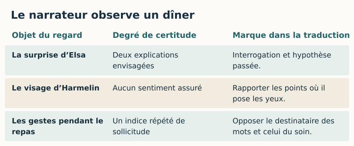

# BEL A/L — Italien (thème Lyon) 2019 · Corrigé brut

*Corrigé rédigé par IA, non officiel. Signalez toute erreur.*

**Rédaction** · GPT-6.2 Astra Ultra · vitesse non renseignée

[Sujet officiel](https://www.ens-lyon.fr/sites/default/files/2019-10/2019%20Epreuves%20de%20sp%C3%A9cialit%C3%A9.pdf#page=12) · [Rapport du jury](https://www.ens-lyon.fr/sites/default/files/2019-10/ITALIEN_2019_0.pdf#page=5)

Le thème italien de quatre heures, sans dictionnaire, porte sur la scène du dîner entre Elsa, Harmelin et le narrateur dans La Passante du Sans-Souci de Joseph Kessel (1936).

## Proposition de thème

Elsa aveva forse capito male ciò che le avevo comunicato per telefono, o forse non le avevo spiegato abbastanza chiaramente che anch’io sarei stato presente alla cena? In ogni caso parve sorpresa di vedermi, e persino imbarazzata dalla mia presenza. Ebbi l’impressione che, se l’avesse prevista, non avrebbe accettato con tanta facilità la proposta del dottore.

Doveva aver preso l’abitudine di parlare in un certo tono con gli uomini che la invitavano. Non riusciva a concepire che Harmelin potesse interessarsi a lei in un altro modo. Ero un testimone inutile, e tanto più importuno in quanto i nostri rapporti costituivano per Elsa un intralcio a ciò che pensava di dover subire o di poter intraprendere.

Del resto, lo avvertii subito, ogni minimo pretesto le bastava per irritarsi. Se infatti, dopo le mie minacce, aveva rinunciato agli stupefacenti, in compenso beveva in modo spaventoso. Prima ancora che cominciasse il pasto ordinò sei bevande diverse, tutte però a base di alcolici molto forti. I suoi nervi non reggevano un assalto così rapido e violento. Si arrabbiava, gemeva, rideva, s’inteneriva, senza motivo né spontaneità.

Di tanto in tanto scrutavo Harmelin per capire se fosse ancora sensibile al fascino che Elsa aveva esercitato su di lui. Ma non riuscivo a leggere nulla sul suo viso, più calmo e più serio del solito. Notai soltanto che a volte il suo sguardo si posava, e si tratteneva piuttosto a lungo, sui gomiti ormai lucidi della camicetta da pochi soldi che Elsa portava, sulle sue mani gonfie e sulle borse sotto gli occhi.

Intanto Harmelin parlava in abbondanza e sosteneva da solo quasi tutta la conversazione. Sembrava rivolgersi soprattutto a me. Eppure, di continuo, una frase piena di dolcezza, una gentilezza premurosa, un gesto sollecito e rispettoso rivelavano che il suo pensiero era costantemente rivolto a Elsa.

