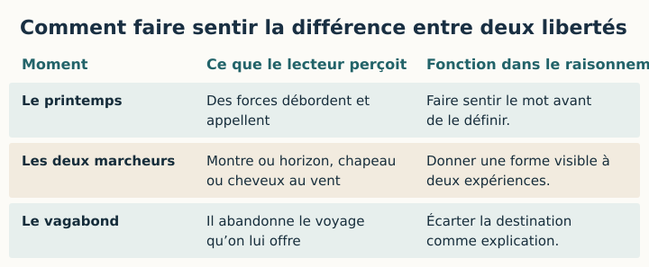

# BEL A/L — Russe (commentaire et traduction) 2019 · Corrigé guidé

*Corrigé rédigé par IA, non officiel. Signalez toute erreur.*

**Rédaction** · GPT-6.2 Astra Ultra · vitesse non renseignée

[Sujet officiel](https://www.ens-lyon.fr/sites/default/files/2019-10/2019%20Commentaire%20et%20traduction%20en%20LVE.pdf#page=16) · [Rapport du jury](https://www.ens-lyon.fr/sites/default/files/2019-10/RUSSE_2019_0.pdf#page=1)

La consigne limite la version à la distinction initiale des deux termes et à la réfutation qui se termine à la ligne 49. La note du sujet prescrit de faire suivre le mot français « liberté » de la translittération russe pertinente. Le commentaire couvre tout le texte, chanson liminaire et dialogue final compris.

## Préparer l’épreuve

Ne pas commencer par un dictionnaire. Se demander où, au moment de l’énonciation, la narratrice reconnaît mal le printemps, puis à quels indices son souvenir reconnaît le printemps du Nord. Le passage du bruit de l’eau et des oiseaux à l’appel d’un mot confère à la distinction abstraite une origine sensible.

Dans la version, placer côte à côte les accessoires du promeneur en ville et ceux de l’inconnu dans le vent. Garder les mains, le chapeau, l’horloge, puis la tête nue et les bras qui saluent l’oiseau. Suivre enfin la négation portant sur les motifs du départ. Des sanctions existaient en Russie aussi et tous les voyageurs n’étaient pas malheureux chez eux. Le mot воля désigne ici l’appel ressenti au départ ; traduire par « volonté » romprait la double désignation prescrite.

## Commentaire

### Куда зовёт слово, которого нельзя перевести?

Рассказчица начинает не с определения воли. Сначала двое никак не могут решить, какое сейчас время года. Один объявляет лето, другой называет май и весну. Наблюдений хватает для обеих версий, потому что жара, снег и затопленные печки сменяют друг друга почти без перехода. Но в памяти, обозначенной словами «у нас», северная весна была событием. Как получается, что спор о погоде приводит к разговору о странничестве и о непереводимом слове? Тэффи строит свое рассуждение так, чтобы читатель прошел путь от звука и движения к понятию, а затем снова вышел за пределы готового определения.

Северная весна собирается из множества глаголов. Текут соки, летят птицы, звенит лед. Перед нами не перечень примет, по которым натуралист устанавливает время года. То, что накопилось за зиму, стремится наружу, и почти каждая строка передает движение, встречающее ответ в другом месте. Журавли летят треугольником, но тот же рисунок видится сердцем, поднявшимся над землей. Зрительное подобие оказывается способом наделить само пространство телесным волнением. И ночью избыток света не дает этому волнению улечься. День может потускнеть и порозоветь, но отказывается уйти. Обычный порядок чередования нарушен как раз на той родине, где весну нельзя было спутать с другим временем года.

Человек тоже ищет отклика. Сравнение с поэтом, у которого есть образ и нет еще рифмы, особенно точно. Рифма не создает первый образ заново, но отсутствие второго звука заставляет чувствовать незавершенность первого. Влюбиться или написать стихи оказывается мало. Перечисленные ранее шорохи и звоны возвращаются как зов на простор. В строке о вольной воле слово как будто рифмуется с самим собой, отзываясь и на новгородскую песню в начале текста. Заключить из этого, что воля означает возможность заниматься поэзией или беспрепятственно выбирать любимого человека, значило бы свести избыток к одной из доступных возможностей. Слово появляется там, где ни одна из них не исчерпывает впечатления.

В следующем движении эссе голос почти деловито отделяет волю от свободы. У свободы есть юридическая сторона, а также перевод на другой язык. Но прежде чем согласиться с общим правилом, читатель получает два вопроса. Что именно он видит, когда слышит о свободном человеке или о человеке на воле? Свободный господин идет по городу, смотрит на часы, располагает временем, может зайти в ресторанчик. Даже глаголы дают ему возможность спокойно довести одно действие до конца и приступить к другому. Интересно, что он тоже гуляет без особого дела и даже свистит. Чтобы различить двух людей, недостаточно сказать, что один трудится, а другой отдыхает. Первый свободно пользуется возможностями, заранее предоставленными устройством города. В этом и шутливая прелесть его портрета, и его предел.

Второй человек появляется после изображения горизонта. У него даже нет имени или общественного обозначения, равного учтивому слову «господин». Головной убор исчезает, обе руки заняты приветствием птице, прохожий не смотрит под ноги. Ветер сносит волосы на глаза, а рассказчица неожиданно объясняет это тем, что для таких людей он всегда попутный. Так работает улыбка Тэффи. Если человек не выбрал обязательного маршрута, то откуда бы ни дул ветер, он может идти вместе с ним. Ни часы, ни направление улицы ему не нужны. И вместо прогулочного свиста получается дикий оклик летящей птице. Два снимка дали читателю почувствовать различие, которого не передаст механическая замена одного русского существительного другим французским словом.

После картин идут короткие суждения, похожие на тезисы. Свобода относится к правовому положению человека, воля названа чувством. Однако из фразы о детях старой России, к которым причисляет себя рассказчица, было бы поспешно выводить строгое правило о каждом русском. За обобщением слышится память поколения и утрата прежнего «у нас». Когда вместе названы крестьянские дети, дети богатых семей и интеллигенции, утверждается возможность общего опыта вопреки различиям воспитания, а не тождество их действительных судеб. Далее рассказчица испытывает собственное объяснение возражениями. Может быть, в других государствах строже следят за порядком или человеку незачем покидать обеспеченный дом? Запреты на бродяжничество существовали и в России, а дома не всем было плохо. Ни закон, ни материальная нужда сами по себе не устанавливают, почему человек двинулся в путь.

Последним подвергается проверке самое привлекательное объяснение, любовь к путешествиям. Можно купить бродяге билет, снабдить деньгами, выбрать для него красоту Кавказа или Крыма. Он сойдет где-нибудь в Курске и пойдет пешком в Архангельск. Смех рождается из несоизмеримости удобства, которое ему приготовили, и объяснения, которое он на ходу придумывает. Где-то, говорят, дешево продают деготь. Зачем он нужен? Даже для самого странника он остается случайной отговоркой. Зато направление, которого не удавалось обосновать, становится совершенно ясным в последней фразе. Нужно идти, куда глаза глядят. До этого мы видели человека, который не смотрел под ноги. Теперь понимаем, что его взгляд устремлен не к заранее купленному месту назначения. Слово, объявленное непереводимым, оказалось доступно читателю как ритм речи, как жест, как отказ от расписания и как неожиданная шутка путника.

## Version française

La liberté (volja), c’est tout autre chose que la liberté (svoboda).

La liberté (svoboda), c’est la liberté, au sens de l’état légal du citoyen qui n’a pas enfreint la loi régissant le pays.

« Liberté » (svoboda) se traduit dans toutes les langues et tous les peuples comprennent le mot.

« Liberté » (volja) est intraduisible.

Quand on vous dit « un homme libre », que vous représentez-vous ? On se représente ceci. Un monsieur marche dans la rue, son chapeau un peu repoussé sur la nuque, une cigarette aux dents, les mains dans les poches. En passant devant chez l’horloger, il jette un coup d’œil à l’heure, hoche la tête, il a encore du temps, et s’en va par exemple au parc, sur les remparts. Il flâne un peu, crache son mégot, sifflote et redescend dans un petit restaurant.

Et quand on dit « un homme en liberté (volja) », qu’est-ce qu’on voit ?

Un horizon sans limites. Quelqu’un s’avance, sans chemin ni route, à grandes enjambées, sans regarder où il met les pieds. Il est tête nue. Le vent lui ébouriffe les cheveux, les lui rabat sur les yeux. Sur les yeux, car pour les gens de son espèce le vent souffle toujours dans leur dos. Un oiseau passe, les ailes largement déployées, et lui, cet homme, lui fait signe des deux bras, lance après lui un cri sauvage et libre, et se met à rire.

La liberté (svoboda) est conforme à la loi.

La liberté (volja) ne tient compte de rien.

La liberté (svoboda) est la condition civile d’un être humain.

La liberté (volja) est un sentiment.

Nous autres Russes, enfants de la Russie d’autrefois, nous naissions avec ce sentiment de liberté (volja).

Qu’ils fussent enfants de paysans, de riches familles bourgeoises ou de l’intelligentsia, quelle que fût leur vie, quelle que fût leur éducation, ils comprenaient et ressentaient l’appel de la liberté (volja).

Des milliers de vagabonds répondaient à cette voix, tels qu’on n’en voit dans aucun autre pays. Et si l’on n’en voit pas ailleurs, ce n’est pas, comme on le prétend, parce que l’ordre y serait plus strict et l’existence plus assurée, de sorte qu’on n’y aurait ni la possibilité ni aucune raison de quitter le nid familial. Chez nous aussi, on traitait durement les vagabonds. On les arrêtait, on les condamnait, on les ramenait au lieu de leur résidence. Et parmi ceux qui avaient quitté leur maison, tous n’y avaient pas eu la vie dure. Ce n’est donc pas là qu’il faut chercher la raison.
