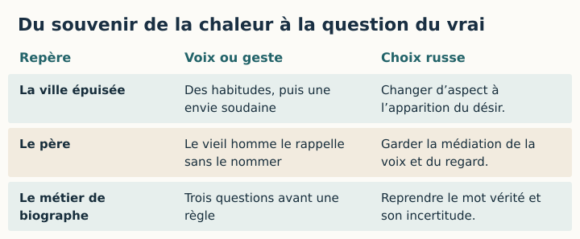

# BEL A/L — Russe (thème Lyon) 2019 · Corrigé brut

*Corrigé rédigé par IA, non officiel. Signalez toute erreur.*

**Rédaction** · GPT-6.2 Astra Ultra · vitesse non renseignée

[Sujet officiel](https://www.ens-lyon.fr/sites/default/files/2019-10/2019%20Epreuves%20de%20sp%C3%A9cialit%C3%A9.pdf#page=13) · [Rapport du jury](https://www.ens-lyon.fr/sites/default/files/2019-10/RUSSE_2019_0.pdf#page=5)

Le thème de quatre heures, sans dictionnaire, provient de La Légende de nos pères de Sorj Chalandon (2009). Le narrateur biographe s’interroge sur la manière dont le vieil homme raconte sa guerre.

## Proposition de thème

Уже несколько дней я закатывал рукава рубашки и расстёгивал ворот. Все встречные, казалось, искали воды. Женщины отложили сумочки ради бутылки, которую держали обеими руками. День угасал, жара не спадала. Молодые мужчины ходили обнажёнными по пояс. Девушки, бросив туфли на тротуаре, опустили ноги в фонтан. Мне захотелось позвонить Люпюлин. Услышать её голос, услышать от неё слово ободрения или совет. Она мне нравилась. С ней мне становилось спокойнее. В тот вечер, пока я шёл по изнемогавшему городу, мне нужна была именно она. Потому что вот в чём дело. Что-то было не так. Ведь Бёзабок уже увлёкся этой игрой. Он курил свою сигарету, пил воду и рассказывал о своей войне, но не так, как рассказывают, когда вспоминают.

Во время наших первых встреч старик напоминал мне отца. Беспрестанно. Об отце говорили мне и голос его, и глаза. О нём говорили и его колебания, и вспышки раздражения. Оттого-то мне и не терпелось. […]

Правда. Это слово пришло мне в голову чуть раньше, когда я садился в гостиной у старика. Всё, о чём он рассказывал, было правдой? Могло быть правдой? А могло и не быть? И что с того? В конце концов, не всё ли мне равно. Моё дело как биографа было выслушать и передать, найти другие слова, в которые можно облечь слова, искать образы, краски, звуки и чудеса. Моё дело было принять каждую фразу за правду. Журналистом я уже не был, историком тоже не был и уж подавно не был судьёй. Не моё это дело — сомневаться. Я казался себе несправедливым. Бёзабок не приходил за мной. Он ни у кого ничего не просил. Как и мой отец, он прожил до сегодняшнего дня, ни на что не притязая.

