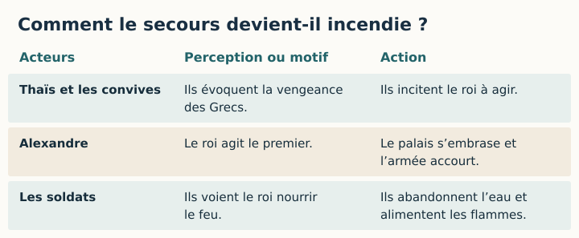

# ENS de Lyon · BEL A/L · Version latine 2019 — Corrigé guidé

*Corrigé rédigé par IA, non officiel. Signalez toute erreur.*

**Rédaction** · GPT-6.2 Astra Ultra · vitesse non renseignée

Quinte-Curce, « La destruction de Persépolis ». Épreuve de spécialité, trois heures.

## Version française

Dès le jour, Alexandre prenait place à des banquets auxquels assistaient des femmes. Ce n'étaient certes pas de celles qu'il eût été sacrilège de déshonorer. C'étaient, de fait, des courtisanes accoutumées à vivre avec des hommes en armes avec plus de liberté qu'il ne convenait. L'une d'elles, Thaïs, elle-même prise de vin, assure qu'Alexandre s'acquerra la plus grande reconnaissance de tous les Grecs s'il ordonne de mettre le feu au palais des Perses. C'est ce qu'attendent, dit-elle, ceux dont les Barbares ont détruit les villes. À cette prostituée ivre qui donne son avis sur une affaire si grave, un convive puis un autre, eux aussi alourdis par le vin, donnent leur assentiment. Le roi, lui aussi, montra plus d'empressement que de patience. « Pourquoi donc, dit-il, ne vengeons-nous pas la Grèce en portant les torches au pied de la ville ? » Le vin avait échauffé tous les esprits. Les voilà donc qui se lèvent, ivres, pour incendier la ville qu'ils avaient épargnée quand ils étaient en armes. Le premier, le roi lança le feu dans le palais, puis ce fut le tour des convives, des serviteurs et des courtisanes. Le palais, construit en grande partie en cèdre, prit feu rapidement et propagea l'incendie au loin.

À cette vue, l'armée, qui campait non loin de la ville, crut le feu accidentel et accourut pour porter secours. Mais une fois parvenus à l'entrée du palais, les soldats voient le roi en personne qui entasse encore des torches. Abandonnant alors l'eau qu'ils avaient apportée, ils se mirent eux-mêmes à jeter du bois sec dans le brasier. Telle fut la fin de la capitale de tout l'Orient, où tant de peuples allaient autrefois demander justice, patrie de tant de rois, jadis la seule terreur de la Grèce, elle qui avait mis sur pied une flotte de mille navires et les armées dont l'Europe fut submergée.

## Construire la traduction

**Reconstituer le discours indirect.** La note invite à restituer *Alexandrum initurum esse*. Thaïs assure qu'Alexandre gagnera la reconnaissance des Grecs. Dans la proposition suivante dont dépend *expectare*, ce sont les habitants des villes détruites qui attendent la vengeance. Le roi ne redevient sujet d'une intervention personnelle qu'à sa question.

**Prendre en compte le jugement du narrateur.** Les termes qui caractérisent les courtisanes et opposent leur conduite à ce qui « convient » appartiennent à la voix de Quinte-Curce. Ils préparent la présentation d'un avis formulé en état d'ivresse et de l'accord tout aussi peu réfléchi des convives.

**Suivre les deux mouvements de l'armée.** *Fortuitum ratus* donne la raison pour laquelle les soldats apportent de l'eau. Le sujet d'*aggerentem* est le roi, qu'ils voient continuer à nourrir les flammes. L'ablatif absolu *omissa aqua* signale alors qu'ils abandonnent l'eau et inversent leur rôle.

**Construire la période finale.** *Regia* rassemble les appositions qui suivent. *Unde* introduit la justice autrefois rendue aux peuples. *Molita* attribue à la capitale, par métonymie, la levée de la flotte et des armées. Le changement d'échelle fait du banquet une catastrophe historique.

[Sujet officiel, passage p. 3](https://www.ens-lyon.fr/sites/default/files/2019-10/2019%20Epreuves%20de%20sp%C3%A9cialit%C3%A9.pdf#page=3)
