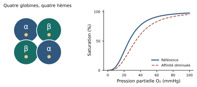
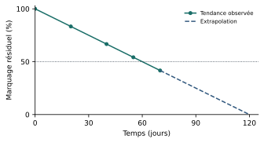
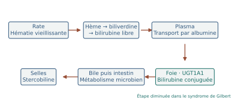
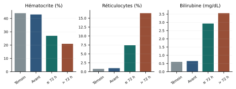
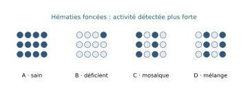
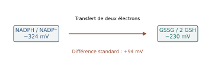
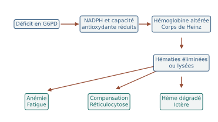

# ENS de Lyon — Second concours, Biologie-biochimie 2019 · Corrigé partiel guidé

*Corrigé rédigé par IA, non officiel.*

**Rédaction** · GPT-6.2 Astra Ultra · vitesse non renseignée

**Couverture.** Les questions 1 à 19, 21 à 25 et 27 à 30 sont traitées, soit 28 sur 30. Les questions 20 et 26 sur les effets expérimentaux de composés oxydants sont exclues. La synthèse du favisme suit ses conséquences cliniques et le rôle protecteur du glutathion.

## I. Structure et fonction de l’hémoglobine

### Question 1 — HbA, de la structure à la livraison d’oxygène

> [!INDICATION]
> Passer de la poche de l’hème à l’interface des sous-unités, puis du poumon au tissu.

#### Solution

**Quatre sous-unités et quatre sites de fixation.** L’hémoglobine A majoritaire dans l’hématie adulte est un tétramère soluble $\alpha_2\beta_2$. Les deux types de chaînes ont un repliement globine riche en hélices α. Chaque chaîne forme une poche autour d’un hème b, protoporphyrine IX contenant un ion ferreux Fe(II). Quatre azotes de la porphyrine et l’histidine proximale coordonnent le fer. La sixième position reçoit réversiblement une molécule de dioxygène, stabilisée par l’environnement de l’histidine distale. Un tétramère peut donc transporter quatre molécules de dioxygène. L’oxygénation physiologique est réversible, tandis que l’oxydation durable en méthémoglobine Fe(III) empêche la fixation normale à ce site.

**Les sites communiquent.** Dans la forme désoxygénée, le fer se trouve légèrement hors du plan de la porphyrine. La fixation du dioxygène le rapproche de ce plan et déplace l’histidine proximale avec son hélice. Le mouvement se transmet aux interfaces entre sous-unités. L’équilibre entre conformation T, de faible affinité, et conformation R, de forte affinité, se déplace vers R. Les premières fixations favorisent les suivantes, d’où une saturation sigmoïde en fonction de la pression partielle du dioxygène.

**Un transport réglé le long de la circulation.** Au poumon, où la pression partielle en dioxygène est élevée, l’hémoglobine se charge. Dans les tissus consommateurs, où celle-ci est plus faible, elle libère du dioxygène. La pente de la courbe dans cette zone amplifie la livraison pour une variation modérée de pression. Une augmentation de $\mathrm{CO_2}$ et une baisse du pH stabilisent la forme T, ce qui facilite le déchargement dans un tissu actif (effet Bohr). Le 2,3-bisphosphoglycérate, métabolite de l’hématie, stabilise également la forme désoxygénée par sa fixation dans la cavité centrale. Au poumon, l’oxygénation facilite en retour la libération des protons et d’une partie du dioxyde de carbone transportés.

## II.A. Bilirubine et syndrome de Gilbert

### Question 2 — Un pigment issu de l’hème

> [!INDICATION]
> Chercher quatre cycles azotés reliés et les comparer à un noyau porphyrinique.

#### Solution

La bilirubine est un tétrapyrrole linéaire. Ses quatre cycles à azote rappellent les quatre pyrroles de l’hème, cette fois après ouverture du cycle et libération du fer. L’hème de l’hémoglobine des globules rouges vieillissants est donc une source plausible majeure. La biliverdine est un intermédiaire de ce catabolisme. La globine, de nature protéique, est recyclée en acides aminés.

### Question 3 — Solubilité du diglucuronide

> [!INDICATION]
> Comparer les groupes hydrophiles exposés au solvant.

#### Solution

Chaque résidu glucuronique apporte plusieurs hydroxyles et un carboxyle ionisable. Ces fonctions augmentent les liaisons hydrogène possibles avec l’eau et les interactions ion–dipôle. La bilirubine conjuguée est donc beaucoup plus hydrosoluble que la bilirubine non conjuguée, ce qui facilite son excrétion dans la bile.

### Question 4 — Activité de l’UGT1A1

> [!INDICATION]
> Relier le donneur activé, le substrat et l’organe qui sécrète la bile.

#### Solution

La transférase utilise l’UDP-glucuronate comme donneur et transfère successivement des résidus glucuroniques aux fonctions propioniques de la bilirubine. Le diglucuronide porte deux liaisons ester à des glucuronates. On attend une activité importante dans les hépatocytes, au niveau du réticulum endoplasmique, avant sécrétion canaliculaire du pigment conjugué.

### Question 5 — Un polymorphisme régulateur

> [!INDICATION]
> La position négative se situe en amont du premier nucléotide transcrit.

#### Solution

L’ajout d’un motif TA concerne le promoteur, au voisinage de sa boîte TATA. Il peut diminuer l’efficacité d’initiation de la transcription. La quantité d’ARNm puis d’enzyme baisse, tandis que la séquence des acides aminés reste identique. On peut comparer, chez des sujets génotypés ou dans des échantillons hépatiques comparables, l’abondance d’ARNm UGT1A1 ramenée à un transcrit de référence, puis l’activité de conjugaison. L’hypothèse prédit en moyenne moins d’ARNm et d’activité pour le promoteur à sept répétitions. Des groupes comparables pour les autres facteurs d’expression limitent les interprétations concurrentes.

## II.B. Renouvellement des hématies

### Question 6 — Renouvellement des hématies

> [!INDICATION]
> Distinguer la disparition de la moitié d’une population d’âges mélangés et la durée de vie individuelle.

#### Solution

Chez les deux volontaires, le marquage résiduel décroît presque linéairement, d’environ 100 % initialement à près de 40–45 % vers 70 jours pour la série la plus longue. Les nouvelles hématies non marquées remplacent progressivement les anciennes. Une extrapolation de ces droites jusqu’au voisinage de zéro donne un ordre de grandeur de **110 à 125 jours**, usuellement environ 120 jours. La valeur à 50 % vers deux mois signifie qu’il reste la moitié du marquage initial. Les cellules marquées ayant déjà des âges variés au départ, cette durée de demi-disparition ne mesure pas directement la vie entière d’un globule rouge.

### Question 7 — Reconnaître l’érythrophagocytose

> [!INDICATION]
> Examiner le relief de surface et l’enveloppement progressif par des prolongements cellulaires.

#### Solution

Les images en relief et la profondeur de champ sont caractéristiques de la microscopie électronique à balayage. Une cellule de la rate, compatible avec un macrophage, étend sa membrane autour d’une hématie, qui devient progressivement englobée. Cette érythrophagocytose fournit un mécanisme d’élimination des hématies vieillissantes et rend leur hémoglobine accessible au recyclage. Les images montrent des étapes compatibles avec ce mécanisme. Elles n’établissent pas, à elles seules, l’âge des globules rouges représentés.

## II.C. Origine et devenir des pigments

### Question 8 — Pigment fécal

> [!INDICATION]
> Raccorder l’itinéraire biliaire au métabolisme intestinal.

#### Solution

La stercobiline conserve quatre noyaux pyrroliques reliés en chaîne. Elle dérive de la bilirubine excrétée dans la bile. Le contenu biliaire atteint l’intestin où les enzymes du microbiote transforment les pigments, notamment par déconjugaison et réduction vers les urobilinogènes. Des produits réduits sont ensuite oxydés en pigments, dont la stercobiline qui colore les selles. Une diminution de l’arrivée des pigments biliaires peut donc décolorer les selles.

### Question 9 — Trajet de la bilirubine

> [!INDICATION]
> Situer la conjugaison entre le transport sanguin et la sécrétion biliaire.

#### Solution

Les macrophages, notamment spléniques, éliminent les hématies sénescentes. L’hème de leur Hb donne de la biliverdine puis de la bilirubine non conjuguée. Peu soluble, celle-ci circule liée à l’albumine jusqu’au foie. Dans l’hépatocyte, UGT1A1 forme la bilirubine conjuguée, sécrétée dans la bile puis déversée dans l’intestin. Les transformations intestinales conduisent entre autres à la stercobiline fécale. Dans le syndrome de Gilbert, l’activité de conjugaison est réduite. La bilirubine **non conjuguée** augmente dans le plasma et peut donner un ictère. Le schéma situe ce défaut en aval de la production de pigment.

## III.A. Manifestations du favisme

### Question 10 — Une crise hémolytique

> [!INDICATION]
> Comparer les deux moments aux valeurs initiales des sujets atteints puis aux témoins.

#### Solution

Avant la crise, hématocrite, réticulocytes et bilirubine sont proches des valeurs des témoins. L’hématocrite passe ensuite de 43 % à 27 %, puis à 21 %. Les réticulocytes montent de 1 % à 7,4 %, puis à 16,4 %, et la bilirubine de 0,65 à 2,93 puis 3,56 mg/dL. La perte d’hématies et la production accrue de pigment sont compatibles avec une hémolyse aiguë. La hausse des réticulocytes évoque une réponse régénérative de la moelle. Leur pourcentage dépend aussi de la diminution du nombre total d’hématies. Les trois mesures convergent davantage que chacune prise isolément.

### Question 11 — Origine globulaire de la sensibilité

> [!INDICATION]
> Changer le donneur et le receveur séparément. Distinguer marqueur des hématies transfusées et hématocrite du receveur.

#### Solution

Dans la figure 7, chez les receveurs sains, le marqueur porté par des globules rouges de donneur déficient diminue nettement plus vite dans les trois séries exposées que chez le témoin non exposé. Dans la figure 8A, quand le donneur est sain, les décroissances des globules transfusés restent proches chez les différents receveurs. Pourtant, dans la figure 8B, l’hématocrite propre du receveur atteint et exposé tombe d’environ 46 % à 30 % avant de remonter. Les cellules sensibles sont donc surtout les hématies déficientes du sujet, même lorsqu’elles circulent dans un autre organisme. Leur destruction apporte davantage d’hème à dégrader et, par suite, de bilirubine, à l’origine de l’ictère.

### Question 12 — Fatigue et urines foncées

> [!INDICATION]
> Ne pas confondre les deux pigments sanguins susceptibles d’être évoqués devant des urines colorées.

#### Solution

L’anémie diminue la quantité d’hémoglobine disponible pour transporter le dioxygène, expliquant la fatigue. Si une partie de l’hémolyse est intravasculaire, l’hémoglobine libérée au-delà de la capacité de son système de capture peut passer dans l’urine et la brunir. La bilirubine non conjuguée circulant liée à l’albumine se filtre peu. La coloration des urines est compatible avec une hémoglobinurie, qu’une analyse permettrait de confirmer.

## III.B. Génétique du déficit

### Question 13 — Une transmission liée au sexe

> [!INDICATION]
> Les hommes possèdent habituellement un seul chromosome X.

#### Solution

La surreprésentation masculine des formes graves évoque un allèle déficient porté par le chromosome X. Un homme hémizygote exprime directement l’allèle présent sur son unique X. Chez une femme hétérozygote, une fraction des cellules exprime un allèle fonctionnel, ce qui atténue souvent la manifestation. La seule différence de fréquence entre hommes et femmes suggère cette localisation sans la démontrer.

### Question 14 — Fréquences attendues

> [!INDICATION]
> Calculer les probabilités séparément dans chaque sexe avant de les combiner.

#### Solution

Notons $X^d$ l’allèle déficient de fréquence $p$ et $X^+$ l’autre de fréquence $1-p$. Avec union aléatoire et mêmes fréquences dans les deux sexes, les hommes sont $X^dY$ avec fréquence $p$ (déficit) ou $X^+Y$ avec fréquence $1-p$. Chez les femmes, les fréquences sont $p^2$ pour $X^dX^d$, $2p(1-p)$ pour $X^dX^+$ et $(1-p)^2$ pour $X^+X^+$. Dans le modèle récessif simple, $p^2$ femmes seraient atteintes et $1-p^2$ auraient un phénotype suffisant. Certaines hétérozygotes ont en réalité une activité intermédiaire ou basse, comme le montrent les questions suivantes. Ces fréquences sont conditionnelles au sexe.

### Question 15 — Lecture de la distribution d’activité

> [!INDICATION]
> Utiliser d’abord les hommes, dont chaque phénotype correspond à un seul allèle.

#### Solution

L’histogramme masculin est bimodal, avec un petit groupe d’activité très faible et une majorité autour de 8–9 unités. Sous le seuil de 5, on compte approximativement 55 à 60 hommes sur 500, d’où $p\simeq0{,}11$ à $0{,}12$. Un comptage au voisinage de 60 donnerait 0,12. Le modèle récessif strict prévoit alors seulement $450p^2$, soit environ 5 à 6 femmes homozygotes déficientes. Or la distribution féminine présente plusieurs classes peuplées entre 2,5 et 5 unités, avec déjà davantage de femmes que ce total. Le décalage suggère que des hétérozygotes ont, elles aussi, une faible activité moyenne. La hauteur d’une barre est un effectif par classe, et non une fréquence allélique.

### Question 16 — Mosaïque cellulaire

> [!INDICATION]
> Comparer le sang de la femme C au mélange artificiel D de cellules des deux hommes.

#### Solution

Dans A prédominent les hématies foncées, à forte activité détectée. Dans B, de nombreuses hématies sont claires, à activité faible. C contient les deux aspects, et ressemble à D, le mélange à parts égales des deux sangs. Cela évoque deux populations cellulaires chez l’hétérozygote, plutôt qu’une même activité moyenne dans chaque hématie. L’inactivation précoce de l’un des deux X dans chaque cellule précurseur est héritée par ses descendantes. La proportion des lignées exprimant l’un ou l’autre X peut varier, expliquant le continuum d’activité dans le sang total et les cas sous le seuil. Le cliché C ne permet pas de fixer un rapport exact de 1 à 1.

### Question 17 — Répartition des mutations

> [!INDICATION]
> Comparer les marques situées au-dessus et au-dessous de la carte d’exons, et leur couleur.

#### Solution

Les variants familiaux se répartissent dans de nombreux exons et sont en majorité des substitutions faux-sens. Les formes sporadiques graves représentées en rouge se concentrent particulièrement dans la région de l’exon 10, et un groupe est aussi présent près de l’exon 13. Des délétions et un décalage du cadre sont plus rares sur la carte. Une telle concentration est compatible avec un rôle important de ces régions dans la structure, l’assemblage ou l’activité de G6PD. Les variants familiaux conservent en général une activité suffisante pour être transmis. L’absence d’activité totalement nulle parmi les cas recensés suggère qu’une perte complète peut être très sévère ou sous-représentée. La carte seule n’attribue pas un site catalytique précis à un exon et comporte un biais de recrutement.

## III.C.1. Observations cellulaires

### Question 18 — Du corps de Heinz à la cellule mordue

> [!INDICATION]
> Suivre une zone rigide lors du passage à travers un filtre tissulaire.

#### Solution

L’hémoglobine dénaturée précipite près de la membrane et forme un corps de Heinz. Dans les passages étroits de la rate, la région rigide se déforme mal. Un macrophage splénique peut retirer l’inclusion avec une partie de la membrane et du cytoplasme. Si la cellule résiduelle recircule, la perte locale dessine l’encoche de la *bite cell*. Une hématie plus altérée peut être retenue et éliminée entièrement.

### Question 19 — Lien avec le phénotype

> [!INDICATION]
> Relier filtration splénique, durée de vie et production de pigment.

#### Solution

Le déficit rend l’hématie plus vulnérable aux altérations oxydatives de l’hémoglobine. Les inclusions rigidifient sa membrane et favorisent une élimination prématurée. Il en résulte une chute de l’hématocrite, une réponse médullaire en réticulocytes et une production accrue de bilirubine, donc une anémie régénérative accompagnée d’ictère. Les deux aspects de la figure 12 situent la déformation de membrane au cours de la crise.

## III.C.2. Pouvoir réducteur

### Question 21 — Nature du NADPH

> [!INDICATION]
> Distinguer le coenzyme et les électrons qu’il transporte.

#### Solution

Le NADPH est la forme réduite du nicotinamide adénine dinucléotide phosphate. Il cède un pouvoir réducteur équivalent à deux électrons. La branche oxydante de la voie des pentoses phosphates en produit, et la synthèse des acides gras l’utilise pour des réductions biosynthétiques. Il alimente aussi la défense antioxydante. L’équation imprimée correspond au bilan de la branche oxydante jusqu’au ribulose-5-phosphate, avec deux NADPH. La G6PD catalyse seulement la première réaction, qui produit un NADPH.

### Question 22 — Pourquoi les hématies sont vulnérables

> [!INDICATION]
> Relier l’absence d’organites à la production de NADPH et au renouvellement des protéines.

#### Solution

L’hématie humaine mature a perdu son noyau, ses ribosomes et ses mitochondries. Elle ne renouvelle pratiquement plus une G6PD instable, et ses possibilités de production mitochondriale de NADPH sont absentes. La branche oxydante de la voie des pentoses phosphates est sa principale source de NADPH. Par ailleurs, le transport continu du dioxygène et la présence d’hémoglobine exposent la cellule aux espèces oxydantes. Les hématies vieillissantes sont particulièrement sensibles si leur réserve enzymatique baisse.

### Question 23 — Croissance des lignées étudiées

> [!INDICATION]
> Comparer chaque groupe aux deux contrôles dans la même moitié de la figure 14.

#### Solution

Dans les deux ambiances présentées, les trois lignées déficientes forment moins de clones que les cellules témoins et les deux lignées témoins ayant subi la manipulation. Dans l’ambiance la moins riche en oxygène, l’efficacité augmente pour les différents groupes et la survie des lignées déficientes est meilleure qu’à gauche, tout en restant inférieure aux témoins. La cohérence des trois lignées appuie le lien avec le déficit en G6PD et une moindre tolérance de la contrainte oxydative. Le nombre final de clones intègre la survie et la prolifération. Les moyennes de trois expériences avec écarts-types ne suffisent pas à calculer une significativité à partir de la figure seule.

### Question 24 — Survie, glutathion et rapport rédox

> [!INDICATION]
> Lire A, B et C dans cet ordre pour distinguer association, compensation et mécanisme proposé.

#### Solution

Dans A, la courbe des cellules témoins reste élevée tandis que celle des cellules déficientes baisse fortement sous la contrainte oxydative. Dans B, une disponibilité accrue en glutathion réduit restaure largement la survie des cellules déficientes dans la comparaison indiquée. C montre un rapport NADPH/NADP⁺ plus faible dans ces cellules dès la condition de référence, puis très bas sous contrainte. Les témoins conservent davantage de pouvoir réducteur. Ces observations sont cohérentes avec un rôle de la G6PD dans le maintien du glutathion réduit. L’amélioration de survie ne démontre pas à elle seule toutes les étapes entre les deux coenzymes.

### Question 25 — Sens du transfert d’électrons

> [!INDICATION]
> Le donneur réduit appartient au couple dont le potentiel standard est le plus négatif.

#### Solution

Le NADPH peut réduire le glutathion disulfure. La glutathion réductase catalyse $\mathrm{GSSG+NADPH+H^+\longrightarrow 2\,GSH+NADP^+}$. La différence des potentiels biochimiques standards est $-230-(-324)=+94\ \mathrm{mV}$. Pour deux électrons, $\Delta_rG^{\circ\prime}=-2F\Delta E^{\circ\prime}\simeq-18\ \mathrm{kJ\,mol^{-1}}$. Le sens proposé est thermodynamiquement favorable dans les conditions standards biochimiques. Le glutathion réduit peut ensuite participer à l’élimination des peroxydes.

### Question 27 — Synthèse clinique du favisme

> [!INDICATION]
> Relier le déficit enzymatique aux observations sanguines et à la couleur des tissus.

#### Solution

L’exposition alimentaire évoquée dans le cas clinique s’accompagne d’une charge oxydative. Dans une hématie déficiente en G6PD, la moindre réserve de NADPH limite la régénération du glutathion réduit. La protection des protéines et de la membrane devient insuffisante. L’hémoglobine altérée précipite, des inclusions de Heinz apparaissent, et les hématies lésées sont détruites ou éliminées par la rate. La baisse de transport d’oxygène explique la fatigue, la compensation médullaire augmente les réticulocytes, et le catabolisme accru de l’hème augmente la bilirubine, à l’origine de l’ictère. La figure fait apparaître séparément les trois conséquences cliniques.

### Question 28 — Hypothèse sur la sensibilité médicamenteuse

> [!INDICATION]
> Distinguer origine dans l’hématie et identification chimique d’un mécanisme.

#### Solution

On peut proposer que la primaquine ou certains de ses métabolites imposent aux hématies une charge oxydative que les réserves réductrices limitées ne peuvent compenser. Les comparaisons croisées situent bien la susceptibilité dans les hématies du donneur. Elles n’identifient pas l’intermédiaire chimique responsable ni son mécanisme exact. C’est une hypothèse physiopathologique compatible avec la vulnérabilité observée en situation alimentaire.

## III.C.3. Gènes et environnement

### Question 29 — Addition de deux causes d’ictère

> [!INDICATION]
> Comparer production de bilirubine et capacité d’élimination.

#### Solution

Chez le nouveau-né, la conjugaison hépatique est encore immature. Une destruction accrue d’hématies due au déficit en G6PD augmente en amont la formation de bilirubine. Si une activité réduite d’UGT1A1, comme dans le syndrome de Gilbert, s’ajoute à l’immaturité du foie, la capacité de conjugaison diminue encore. La bilirubine non conjuguée peut donc s’accumuler davantage. La production et la clairance changent dans des sens qui se renforcent.

### Question 30 — Répartition géographique

> [!INDICATION]
> Comparer les points d’estimation aux zones colorées de la carte et distinguer corrélation et cause.

#### Solution

Les fréquences élevées se rencontrent notamment dans des régions d’Afrique, autour de la Méditerranée et en Asie du Sud ou du Sud-Est. De nombreux points se situent dans des pays d’endémie palustre ou d’élimination récente du paludisme. Une hypothèse est qu’un avantage de survie face à certaines formes graves du paludisme ait contribué historiquement à maintenir des variants de G6PD malgré leur coût clinique, avec des effets susceptibles de varier selon le variant et le génotype. L’origine multiple des mutations, les migrations, la dérive et la répartition inégale des prélèvements peuvent aussi intervenir. Une superposition géographique à l’échelle des pays ne démontre pas la causalité pour un individu.
