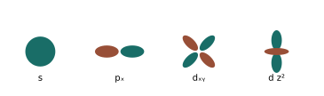
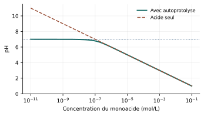
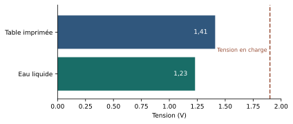
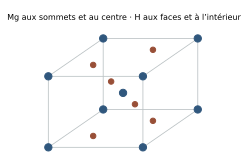
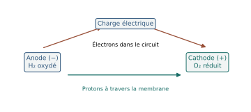
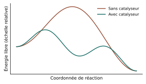
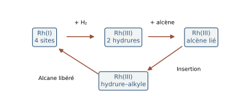

# ENS de Lyon — Second concours, Chimie 2019 · Corrigé partiel brut

*Corrigé rédigé par IA, non officiel. Signalez toute erreur.*

**Rédaction** · GPT-6.2 Astra Ultra · vitesse non renseignée

**Couverture.** Sur les 66 questions, 62 sont entièrement traitées. A9 expose la définition générale de la constante d’équilibre. A8, A12 et A13 relatives au procédé de séparation isotopique sont exclues.

## A.I. L’élément hydrogène

### Question A1 — Élément et atome

Un élément chimique est défini par son numéro atomique $Z$, nombre de protons de son noyau. Un atome est une entité individuelle composée d’un noyau et, à l’état neutre, de $Z$ électrons. Un même élément peut être représenté par plusieurs isotopes et se rencontrer sous forme d’atome, d’ion ou dans une molécule.

### Question A2 — Trois isotopes de l’hydrogène

Le protium $^1\mathrm H$ possède un proton et aucun neutron, le deutérium $^2\mathrm H$ un proton et un neutron, le tritium $^3\mathrm H$ un proton et deux neutrons. Chacun porte un électron s’il est neutre. Protium et deutérium sont stables, le tritium est radioactif.

### Question A3 — Conséquences isotopiques

Leur charge nucléaire et leur configuration électronique fondamentale sont les mêmes. Leur masse, leur spin nucléaire et leur stabilité nucléaire diffèrent. Dans des molécules analogues, le changement de masse modifie fréquences de vibration, énergies de point zéro et parfois constantes d’équilibre ou vitesses de réaction. La chimie électronique qualitative reste proche.

## A.II. Orbitales atomiques

### Question A4 — Équation de Schrödinger

Dans $\widehat H\lvert\Psi\rangle=E\lvert\Psi\rangle$, $\widehat H$ est l’opérateur hamiltonien, somme des opérateurs d’énergie cinétique et potentielle, $\lvert\Psi\rangle$ un état propre stationnaire et $E$ sa valeur propre d’énergie. Pour un hydrogénoïde l’énergie potentielle est coulombienne. La représentation de position du vecteur d’état est la fonction d’onde.

### Question A5 — Fonction d’onde

En représentation de position, $\Psi(\mathbf r)$ est une fonction généralement complexe, normalisable et de carré intégrable pour un état lié. La probabilité de présence dans un volume $V$ vaut $\int_V|\Psi|^2\,\mathrm d^3r$ et l’intégrale sur tout l’espace vaut un. Une surface renfermant 99 % de cette probabilité est un choix de représentation de l’orbitale.

### Question A6 — Orbitales s, p et d

Pour $\ell=0$, on écrit s, avec une seule composante de symétrie sphérique. Pour $\ell=1$, on écrit p, avec trois orbitales réelles $p_x,p_y,p_z$, chacune à deux lobes de phases opposées séparés par un plan nodal. Pour $\ell=2$, on écrit d, avec cinq orbitales. $d_{xy},d_{xz},d_{yz}$ portent leurs quatre lobes entre les axes concernés, $d_{x^2-y^2}$ les aligne sur x et y, et $d_{z^2}$ comporte deux lobes axiaux et un tore équatorial. Les couleurs des lobes codent un signe de fonction d’onde. Les éventuels nœuds radiaux dépendent du nombre quantique principal.

### Question A7 — Approximation de Born–Oppenheimer

La masse du proton est environ 1836 fois celle de l’électron, et les autres noyaux sont encore plus lourds. Les noyaux se déplacent donc généralement plus lentement que les électrons. On résout d’abord le problème électronique pour des positions nucléaires fixées, puis le mouvement des noyaux sur la surface d’énergie obtenue. Le modèle à noyau fixe n’exige pas que tout mouvement nucléaire disparaisse réellement.

## A.III. Relations thermodynamiques générales

### Question A9 — Définition générale de la constante d’équilibre

Pour une réaction formelle $\sum_i\nu_i A_i=0$, avec $\nu_i>0$ pour les produits et $\nu_i<0$ pour les réactifs, le quotient de réaction est $Q_r=\prod_i a_i^{\nu_i}$. À l’équilibre il vaut $K^\circ(T)$. On prend par exemple $a_i\simeq p_i/p^\circ$ pour un gaz idéal, $a_i\simeq c_i/c^\circ$ pour un soluté idéal et $a_i=1$ pour un corps pur dans son état standard. Cette réponse se limite à la définition générale.

### Question A10 — Enthalpie libre de réaction

À température fixée, $\Delta_rG=\Delta_rG^\circ+RT\ln Q_r$. À l’équilibre $\Delta_rG=0$ et $Q_r=K^\circ$, d’où $\Delta_rG^\circ=-RT\ln K^\circ$. Le sens spontané pour une composition donnée dépend de $Q_r/K^\circ$.

### Question A11 — Approximation d’Ellingham

Sur un intervalle de température sans changement d’état, on suppose que $\Delta_rH^\circ$ et $\Delta_rS^\circ$ varient peu. Il vient $\Delta_rG^\circ(T)\simeq\Delta_rH^\circ-T\Delta_rS^\circ$. Sur chaque intervalle l’enthalpie libre standard est donc approximativement affine en la température absolue.

## A.IV. Acidité en solution

### Question A14 — Proton hydraté

L’ion est l’ion oxonium, ou hydronium, $\mathrm{H_3O^+}$. L’écriture $\mathrm H^+(aq)$ désigne plus généralement le proton solvaté. Dans l’eau réelle, des groupes de plusieurs molécules d’eau se partagent cette charge.

### Question A15 — Autoprotolyse

L’autoprotolyse s’écrit $2\mathrm{H_2O}\rightleftharpoons\mathrm{H_3O^+}+\mathrm{OH^-}$. Dans le solvant eau dilué, $K_e\simeq a(\mathrm{H_3O^+})a(\mathrm{OH^-})$. L’eau joue le rôle d’acide dans une molécule et de base dans l’autre.

### Question A16 — Échelle usuelle à 25 °C

À 25 °C, $pK_e=14$, donc $\mathrm{pH}+\mathrm{pOH}=14$ et la neutralité se trouve à 7. L’intervalle conventionnel des solutions aqueuses où les activités des ions majoritaires ne dépassent pas approximativement un est 0 à 14. En eau pure le pH est précisément voisin de 7 à cette température. Les bornes 0 et 14 ne sont pas universelles pour les solutions concentrées.

### Question A17 — Échelle à 0 °C

Avec $K_e=2\times10^{-15}$, $pK_e=15-\log_{10}2\simeq14{,}70$. L’intervalle usuel devient approximativement $[0,14{,}70]$ avec les mêmes conventions. La neutralité de l’eau pure se situe à $pK_e/2\simeq7{,}35$.

### Question A18 — Formule du pH

La relation thermodynamique est $\mathrm{pH}=-\log_{10}a(\mathrm{H_3O^+})$. En solution aqueuse suffisamment diluée, on emploie $\mathrm{pH}\simeq-\log_{10}([\mathrm{H_3O^+}]/c^\circ)$ avec $c^\circ=1\ \mathrm{mol\,L^{-1}}$.

### Question A19 — Portée de l’approximation

La définition en activité demeure valable dans la convention de pH adoptée. L’approximation par la concentration suppose que le coefficient d’activité est voisin de un. À force ionique élevée il faut tenir compte de ce coefficient, $a=\gamma c/c^\circ$. Dans un autre solvant, les équilibres et l’échelle conventionnelle changent aussi.

### Question A20 — Acide ou base forts

Un acide fort transfère pratiquement quantitativement son proton à l’eau dans le domaine étudié. Une base forte prélève pratiquement quantitativement un proton à l’eau ou fournit quantitativement l’ion hydroxyde en se dissociant. La force concerne l’équilibre de la transformation, la concentration concerne la quantité de soluté par volume.

### Question A21 — Deux exemples

L’acide chlorhydrique en solution aqueuse diluée est un exemple d’acide fort, $\mathrm{HCl+H_2O\rightarrow H_3O^++Cl^-}$. Une solution d’hydroxyde de sodium, sel dissocié en $\mathrm{Na^+}$ et $\mathrm{OH^-}$, est un exemple de base forte.

### Question A22 — Acide fort dilué jusque près de la neutralité

Pour un monoacide fort entièrement dissocié de concentration $c$, sans autre soluté acido-basique, l’électroneutralité donne $h=c+[\mathrm{OH^-}]$ où $h=[\mathrm{H_3O^+}]$. Dans l’approximation idéale, notons $K_w=K_e(c^\circ)^2$. On obtient $h^2-ch-K_w=0$, donc $h=(c+\sqrt{c^2+4K_w})/2$ puis $\mathrm{pH}=-\log_{10}(h/c^\circ)$. La formule tend vers le pH neutre lorsque $c$ tend vers zéro.

### Question A23 — Hypothèses simplificatrices

L’acide est monoprotonique et totalement dissocié, et aucun autre équilibre n’apporte une quantité significative d’ions. On suppose les activités assimilables aux concentrations réduites. Si $c\gg\sqrt{K_w}$, l’autoprotolyse contribue de façon négligeable à $h$. Ces dernières conditions imposent un domaine intermédiaire de concentrations.

### Question A24 — Formule usuelle d’un monoacide fort

Sous les hypothèses précédentes, $[\mathrm{H_3O^+}]\simeq c$ et $\mathrm{pH}\simeq-\log_{10}(c/c^\circ)$. Pour une solution trop diluée on reprend le calcul complet, et pour une solution concentrée on raisonne en activités.

## B.I. Électrolyse de l’eau

### Question B1 — Électrolyse

Une électrolyse est une transformation d’oxydoréduction forcée par une source d’énergie électrique. Une oxydation se produit à l’anode et une réduction à la cathode. Le générateur impose le sens non spontané dans les conditions considérées.

### Question B2 — Bilan de l’électrolyse de l’eau

Le bilan est $2\mathrm{H_2O(l)}\longrightarrow2\mathrm{H_2(g)}+\mathrm{O_2(g)}$. Quatre moles d’électrons circulent dans le circuit pour un avancement d’une mole en prenant ces coefficients.

### Question B3 — Bilan enthalpique et entropique

Avec les coefficients de B2, $\Delta_rH^\circ=2\times0+0-2(-285)=+570\ \mathrm{kJ\,mol^{-1}}$. En prenant les **nombres imprimés** pour les entropies et en les lisant en J/K/mol comme l’exige leur ordre de grandeur, $\Delta_rS^\circ=2(130)+205-2(189)=+87\ \mathrm{J\,K^{-1}\,mol^{-1}}$. L’entête imprime kJ/K/mol, et 189 correspond approximativement à l’entropie molaire de la vapeur, alors que l’enthalpie de formation fournie est celle de l’eau liquide. Pour un jeu cohérent de données liquides, $S^\circ(\mathrm{H_2O(l)})\simeq70\ \mathrm{J\,K^{-1}\,mol^{-1}}$, ce qui donnerait près de $+325\ \mathrm{J\,K^{-1}\,mol^{-1}}$.

### Question B4 — Sens de l’échange d’énergie

La transformation est **endothermique**, car $\Delta_rH^\circ>0$. Elle augmente aussi l’enthalpie libre dans les conditions standards, ce qui requiert une fourniture de travail pour l’imposer. Selon les conditions de fonctionnement, ce coût peut être réparti entre travail électrique et transferts thermiques.

### Question B5 — Énergie libre à 25 °C

Avec la lecture numérique explicitée en B3, $\Delta_rG^\circ=570-298{,}15\times0{,}087\simeq544\ \mathrm{kJ\,mol^{-1}}$. Si l’on emploie à la place l’entropie de l’eau liquide, le résultat est proche de $570-298{,}15\times0{,}325=473\ \mathrm{kJ\,mol^{-1}}$ pour deux moles d’eau. Le signe et la conclusion sur la spontanéité demeurent identiques.

### Question B6 — Travail électrique réversible

La valeur minimale du travail électrique apporté à température et pression fixées vaut $\Delta_rG=Q\,U_\mathrm{rev}$ pour le sens électrolytique. Pour une mole d’avancement, $Q=nF$. Dimensionnellement, $\mathrm{C\,mol^{-1}}\times\mathrm{J\,C^{-1}}=\mathrm{J\,mol^{-1}}$. Si l’on définit à la place une force électromotrice algébrique de pile, la convention correspond à $\Delta_rG=-nFE_\mathrm{pile}$.

### Question B7 — Tension réversible

À partir de la valeur calculée avec la table, $U_\mathrm{rev}=544000/(4\times96500)\simeq1{,}41\ \mathrm V$. La valeur thermodynamique ordinaire pour l’électrolyse de l’eau **liquide** à 25 °C avec les activités standards est voisine de $473000/(4\times96500)=1{,}23\ \mathrm V$. La différence vient des données d’entropie examinées en B3.

### Question B8 — Rendement de tension

En supposant un rendement faradique égal à un, $\eta=U_\mathrm{rev}/U_\mathrm{applique}$. Avec les résultats de l’annexe, $\eta=1{,}41/1{,}9\simeq74\,\%$. Avec la tension réversible cohérente pour l’eau liquide, $1{,}23/1{,}9\simeq65\,\%$. Il s’agit du rendement rapporté au travail réversible, distinct d’un rendement exprimé avec le pouvoir calorifique du gaz.

### Question B9 — Origine des pertes

Les résistances des conducteurs, de l’électrolyte et de la membrane dissipent de la chaleur par effet Joule. Les transferts de charge aux électrodes et le transport des espèces donnent des surtensions. Des réactions secondaires, des fuites de gaz ou les auxiliaires peuvent encore réduire le rendement global.

### Question B10 — Contraintes d’un système énergétique

Le bilan dépend du coût et de l’origine de l’électricité, de la disponibilité d’une eau adaptée, des matériaux d’électrode, de la durée de vie de la membrane et des pertes en charge. La séparation du combustible et du comburant, l’étanchéité, puis le stockage et le transport du gaz imposent des équipements et des contrôles adaptés. La chaîne complète se juge au service rendu par unité d’énergie initiale.

## B.II. Hydrure de magnésium

### Question B11 — Maille cristallographique

Une maille est un volume géométrique défini par trois vecteurs de translation indépendants. La répétition de son contenu par les translations du réseau engendre le cristal. Une maille conventionnelle peut contenir plusieurs motifs élémentaires pour rendre la symétrie plus visible.

### Question B12 — Attribution des couleurs

Les sphères vertes, aux sommets et au centre de la maille, correspondent au magnésium. Les sphères claires, plus petites, représentent l’hydrogène. Ce choix fournit le rapport $\mathrm{Mg:H}=1:2$ attendu pour l’hydrure.

### Question B13 — Population de la maille

Les huit Mg de sommet comptent chacun pour $1/8$, et le Mg central pour un, soit $8/8+1=2$ Mg. Pour H, deux positions intérieures et quatre positions sur les deux faces de base donnent $2+4/2=4$ H. La maille contient donc deux unités $\mathrm{MgH_2}$. Les atomes des mailles voisines doivent être pris en compte pour l’environnement local d’un atome de bord.

### Question B14 — Coordinences

Chaque Mg est entouré de six H dans un octaèdre déformé. Chaque H a trois Mg pour proches voisins. Les nombres de contacts obtenus par les deux comptes se recoupent, $2\times6=4\times3=12$ par maille.

### Question B15 — Nature des liaisons

Le modèle dominant est celui d’un solide ionique, $\mathrm{Mg^{2+}}$ et $2\mathrm{H^-}$ par formule. La cohésion s’explique largement par les interactions électrostatiques à l’échelle du réseau. La structure étendue et les coordinences ne correspondent pas à des molécules isolées H–Mg–H, même si une liaison réelle peut comporter une part de covalence.

### Question B16 — Densité de l’hydrure

$V=a^2c=(452\times10^{-12})^2(302\times10^{-12})=6{,}17\times10^{-29}\ \mathrm{m^3}$. Avec $Z=2$ et $M=26{,}3\ \mathrm{g\,mol^{-1}}$, $\rho=ZM/(N_A V)\simeq1{,}42\times10^3\ \mathrm{kg\,m^{-3}}$. La densité relative à l’eau vaut environ 1,42, sans dimension.

### Question B17 — Fraction massique stockée

La fraction massique vaut $2/26{,}3=0{,}0760$, soit **76 g d’hydrogène par kilogramme de cristal**. Ce calcul stœchiométrique représente une capacité idéale entièrement mobilisable.

### Question B18 — Comparaison volumique

Le solide idéal contient $1416\times0{,}0760\simeq108\ \mathrm{kg\,m^{-3}}$, soit 108 g/L d’hydrogène. Le cylindre indiqué correspond à $42\ \mathrm{kg\,m^{-3}}=42\ \mathrm{g\,L^{-1}}$. L’hydrure présente ici une capacité volumique environ 2,6 fois plus élevée. La masse du contenant et le volume libre dans un lit d’hydrure ne sont pas inclus.

## B.III. Pile à combustible

### Question B19 — Pile à hydrogène

Dans une pile à membrane échangeuse de protons, **anode négative** côté hydrogène, $\mathrm{2H_2\rightarrow4H^++4e^-}$. Les électrons vont de l’anode à la cathode par la charge extérieure. Les protons traversent la membrane dans le même sens géographique. À la **cathode positive**, $\mathrm{O_2+4H^++4e^-\rightarrow2H_2O}$. Le bilan est $\mathrm{2H_2+O_2\rightarrow2H_2O}$. Une pile alcaline est une autre possibilité cohérente, avec les ions hydroxyde passant de la cathode vers l’anode et des demi-équations adaptées.

### Question B20 — Autonomie et volume minimal

À raison de 1 kg pour 100 km, 400 km nécessitent 4 kg de dihydrogène. La quantité correspond à $4/0{,}108\simeq37\ \mathrm L$ de cristal compact idéal, contre $4/0{,}042\simeq95\ \mathrm L$ de gaz aux conditions de la comparaison. Les 37 L sont du même ordre qu’un réservoir automobile de quelques dizaines de litres. Le dispositif solide réel est plus volumineux et plus lourd que le cristal seul.

## C.I. Hydrogénation hétérogène

### Question C1 — Addition organique

Une addition fixe deux atomes ou groupes sur les deux extrémités d’une liaison multiple. La composante $\pi$ disparaît et deux liaisons $\sigma$ sont créées, sans rupture du squelette reliant les deux substrats carbonés de la liaison. Par exemple, $\mathrm{RCH=CHR'+H_2\rightarrow RCH_2CH_2R'}$.

### Question C2 — Liaisons hydrogénables

Les doubles liaisons C=C et les triples liaisons C≡C sont des substrats classiques. Un alcyne peut s’arrêter à l’alcène ou donner l’alcane selon la sélectivité. Certaines liaisons multiples à hétéroatome, notamment C=O et C=N, peuvent également être réduites avec des catalyseurs adaptés.

### Question C3 — Profil énergétique catalysé

Le catalyseur propose une autre suite d’étapes par adsorption de H et du substrat, transferts successifs, puis désorption. La barrière déterminante est plus petite que pour le chemin non catalysé. Les intermédiaires peuvent créer plusieurs minima relatifs. Les états de départ et d’arrivée restent les mêmes, donc $\Delta_rG^\circ$ et la constante d’équilibre sont conservés. L’axe horizontal est une coordonnée de réaction, distincte du temps.

### Question C4 — Catalyseurs hétérogènes

Le palladium sur charbon, le platine solide ou supporté et le nickel sont des exemples de catalyseurs hétérogènes d’hydrogénation. Solide et substrat appartiennent à des phases distinctes. La surface accessible et l’affinité des réactifs pour cette surface contribuent à l’activité.

### Question C5 — Face d’addition

L’hydrogénation hétérogène usuelle d’un alcène donne préférentiellement une addition **syn**. Les deux atomes d’hydrogène sont délivrés sur la même face de la double liaison adsorbée. Si les deux faces sont énantiotopiques dans un environnement achiral, il n’existe pas de préférence absolue pour l’une d’entre elles.

### Question C6 — Origine de l’addition syn

L’alcène se lie à la surface métallique par une face de sa liaison $\pi$. Le dihydrogène est adsorbé puis dissocié à la surface. Les transferts successifs s’effectuent du côté en contact avec le métal, si l’intermédiaire reste dans la même orientation jusqu’au deuxième transfert. Cela explique la préférence syn observée.

### Question C7 — Deutération du Z-but-2-ène

Le produit est le **méso-2,3-dideutériobutane**, $\mathrm{CH_3{-}CHD{-}CHD{-}CH_3}$. Les deux D s’ajoutent sur la même face de l’alcène Z. Les deux centres du produit possèdent des configurations opposées, $(2R,3S)$ ou $(2S,3R)$ avec la numérotation inversée. Les deux descriptions représentent la même espèce achirale par symétrie.

## C.II. Hydrogénation homogène

### Question C8 — Catalyse homogène de Wilkinson

Le catalyseur accélère la réaction tout en étant régénéré au bilan. Le complexe de Wilkinson est $\mathrm{RhCl(PPh_3)_3}$, d’où provient par substitution d’une phosphine le complexe solvaté $\mathrm{RhCl(PPh_3)_2(S)}$ figurant à l’entrée de la boucle. L’addition oxydante de $\mathrm H_2$, l’insertion de l’alcène et l’élimination réductrice consomment l’alcène et le dihydrogène, libèrent l’alcane et rendent le complexe actif.

### Question C9 — Définition d’un complexe

Un complexe de coordination associe un ou plusieurs centres, ici le rhodium, et des ligands liés à ces centres. Une phosphine ou une molécule de solvant donne par exemple un doublet à une orbitale du métal. Une liaison $\pi$ d’alcène peut aussi se coordonner par ses deux carbones.

### Question C10 — Degrés d’oxydation du rhodium

$\mathrm{PPh_3}$, le solvant et l’alcène sont des ligands neutres. Le chlorure, chaque hydrure et l’alkyle valent formellement $-1$ chacun. Le précurseur et le complexe solvaté sont donc Rh(I). L’addition de $\mathrm H_2$ conduit à Rh(III) dihydrure. La coordination de l’alcène garde Rh(III), de même que l’insertion qui remplace alcène et hydrure par un alkyle. L’élimination de l’alcane ramène Rh(I).

### Question C11 — Géométries dans le cycle

Le précurseur Rh(I) $d^8$ à quatre ligands et le complexe solvaté correspondant sont approximativement **plans carrés**. Le complexe Rh(III) dihydrure, lié en outre à Cl, à deux phosphines et au solvant, possède six directions, donc une géométrie octaédrique déformée. Quand le solvant est remplacé par l’alcène $\eta^2$, celui-ci occupe un site et l’environnement reste pseudo-octaédrique. Le complexe hydrure–alkyle représenté avec le solvant est également hexacoordonné, pseudo-octaédrique. Les espèces intermédiaires éventuellement pentacoordonnées ne sont pas individualisées dans le schéma.

### Question C12 — Sélectivité entre deux doubles liaisons

La double liaison de la chaîne supérieure, du côté de l’ester méthylique, est hydrogénée. La double liaison de la chaîne inférieure, portant le substituant voisin OAc représenté OCOMe, demeure. Le processus choisit donc un **site d’hydrogénation entre deux alcènes** de la même molécule. La géométrie apparente des deux sites est différente, Z dans la chaîne supérieure et E dans l’inférieure, et leurs voisinages sont aussi différents. Le schéma ne suffit pas à attribuer la préférence à un seul de ces paramètres.

### Question C13 — Identifier le site réduit

La RMN du proton permet de compter les H vinyliques, de mesurer leur couplage et, avec des corrélations COSY, de rattacher la paire restante à sa chaîne. On peut ainsi distinguer le substrat, les deux isomères de position monohydrogénés et le produit complètement hydrogéné. L’IR seul est beaucoup moins discriminant entre deux alcènes de même formule et des carbonyles déjà présents dans les deux chaînes.

### Question C14 — Résultats RMN attendus

Le substrat présente quatre H vinyliques, deux de chaque chaîne. Le produit dessiné en conserve deux dans la chaîne inférieure, avec un grand couplage vicinal trans typiquement de l’ordre de 12 à 18 Hz. La chaîne supérieure donne maintenant deux méthylènes aliphatiques. Dans le régioisomère opposé, les deux H vinyliques conservés appartiendraient à la chaîne supérieure, avec un couplage cis souvent plus petit, autour de 6 à 12 Hz. Le produit entièrement saturé n’en présenterait plus. Les corrélations aux protons voisins, notamment vers le voisinage du CH portant OAc, lèvent une ambiguïté si les déplacements se chevauchent. Aucun spectre de ce mélange n’est fourni.

### Question C15 — Principe de la RMN

Un champ magnétique statique sépare les niveaux d’énergie de spin des noyaux $^1\mathrm H$. Une impulsion radiofréquence excite l’aimantation. La tension détectée pendant son évolution et sa relaxation donne après transformée de Fourier un spectre de fréquences. Le blindage électronique déplace chaque résonance selon l’environnement local. Les déplacements en ppm se lisent par rapport à une référence, relativement à la fréquence de l’instrument. Les intégrales, dans des conditions appropriées, comptent les protons équivalents. Les couplages scalaires scindent les signaux et renseignent sur leurs voisins et leur géométrie. Une carte COSY révèle les paires de protons couplés.

### Question C16 — Séparation des produits

Pour les régioisomères du dessin, on peut rechercher des conditions de chromatographie sur silice ou de chromatographie liquide haute performance donnant des rétentions différentes. Les quantités à isoler et la résolution obtenue guident le choix. Une phase stationnaire chirale serait indiquée pour séparer spécifiquement deux énantiomères dont les interactions avec un milieu achiral sont identiques.

### Question C17 — Mise en œuvre de la séparation

Une chromatographie sur couche mince permet de choisir un éluant qui sépare effectivement les taches. On dépose ensuite le mélange en bande étroite en tête d’une colonne de silice équilibrée avec cet éluant. On fait passer l’éluant et on recueille des fractions successives. Une CCM de contrôle identifie les fractions homogènes. On réunit les fractions du même produit, on élimine l’éluant et on vérifie l’identité par RMN. Si les deux produits coéluent sur silice, on change la phase et le système d’élution ou l’on passe en chromatographie liquide préparative.

### Question C18 — Contrôle de l’énantiosélectivité

Un ligand chiral énantiopur autour du métal rend diastéréoisomères les deux états de transition menant à deux énantiomères. Une différence d’énergie d’activation favorise alors l’une des voies. Le choix de l’architecture et de la configuration du ligand peut influencer le sens et l’amplitude de cette préférence. L’excès énantiomérique se vérifie par une méthode capable de distinguer les deux énantiomères, par exemple une chromatographie chirale.

## C.III. Sélectivité entre sites alcéniques

### Question C19 — Deux hydrogénations

Avec Pd sur charbon, l’hydrogénation hétérogène réduit les **deux** doubles liaisons C=C du cycle de gauche. La double liaison voisine de la lactone à droite demeure. Avec le complexe de rhodium en phase homogène, seule est réduite la double liaison supérieure du cycle gauche. La double liaison inférieure de ce cycle et la double liaison de droite subsistent. Les carbonyles figurent toujours dans les deux produits.

### Question C20 — Choix des sites

On observe une sélectivité de site, ou régiosélectivité au sens du choix entre positions alcéniques. Le catalyseur au rhodium distingue les deux alcènes du cycle gauche. Le palladium les réduit tous deux et laisse l’alcène voisin de la lactone intact. Les rendements indiqués, 75 et 95 %, portent sur les produits dessinés et ne donnent pas à eux seuls la proportion de chaque produit secondaire.

### Question C21 — Origine plausible de la différence

Le site supérieur gauche est moins substitué et plus accessible qu’une double liaison située près de la jonction de cycles et de groupes méthyle. Le complexe de rhodium encombré doit coordonner l’alcène avant l’insertion et discrimine ainsi plus fortement les sites. Une surface de palladium admet d’autres modes d’adsorption et conduit ici aussi à la réduction du site inférieur gauche. Les effets stériques et électroniques sont des explications plausibles, pas des paramètres séparément mesurés par ce schéma.

### Question C22 — Double liaison demeurant dans les deux produits

La liaison C=C de droite est fortement substituée, à la jonction d’un cycle et de la lactone, et conjuguée au carbonyle de cette dernière. Son environnement limite l’approche et peut modifier son aptitude à se coordonner ou à réagir. Dans les conditions comparées, elle subsiste avec les deux catalyseurs. La figure établit une différence de réactivité dans cette expérience, sans démontrer son inertie absolue.
