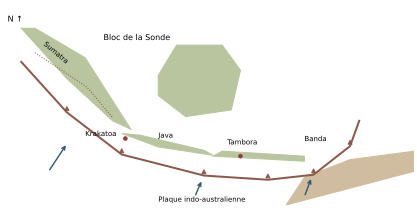
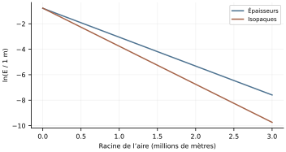
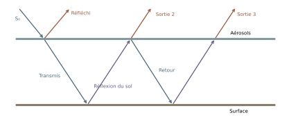

# ENS de Lyon, second concours 2019 — Géosciences · Corrigé brut

*Corrigé rédigé par IA, non officiel. Signalez toute erreur.*

**Rédaction** · GPT-6.2 Astra Ultra · vitesse non renseignée

## 1 — Krakatoa, 1883

### Question 1.1.1 — Convergence dans l’archipel indonésien

Au sud de Java et au sud-ouest de Sumatra, la fosse océanique et la bande de séismes bordent l’arc volcanique de la Sonde. La lithosphère indo-australienne avance vers le nord à nord-est et plonge sous le bloc de la Sonde, solidaire de la marge sud-est asiatique à cette échelle. Le rapprochement est plus oblique le long de Sumatra. Une partie du mouvement parallèle à la marge peut être accommodée par décrochement dextre, l’autre par chevauchement au front. Krakatoa et Tambora appartiennent à l’arc situé en retrait de la fosse.
Vers Timor et Banda, l’arc se recourbe et la marge continentale australienne entre en collision. Plus à l’est et au nord, aux Moluques et vers les Philippines, la distribution des séismes et des mécanismes montre d’autres limites, avec subductions de polarités différentes, collisions et décrochements entre blocs. Les mécanismes projetés sur une seule année illustrent la déformation actuelle sans fixer à eux seuls tous les vecteurs de plaques. Le schéma place fosse, arc, mouvement de rapprochement et changement de géométrie vers l’est.

### Question 1.2.1 — Morphologie de la caldeira du Krakatoa

Avant 1883, un édifice émergé allongé reliait la partie devenue Rakata aux cônes du nord. En 1990, l’essentiel du centre et du nord de l’île a disparu et la partie sud subsiste. Les isobathes y dessinent une cuvette profonde et fermée, à pentes fortes, avec plusieurs dépressions de plusieurs centaines de mètres. L’éruption a détruit une partie de l’édifice et provoqué l’effondrement d’une caldeira. Les hauts-fonds et îlots nouveaux autour peuvent venir des dépôts. Le cône de l’Anak Krakatoa témoigne d’une reconstruction volcanique ultérieure, si bien que la différence entre les deux levés intègre aussi un siècle d’évolution.

### Question 1.2.2 — Origine et effets des tsunamis

**a.** Un tsunami est un train d’ondes de gravité de très grande longueur d’onde produit par la mise en mouvement rapide d’une masse d’eau. En haute mer, il se propage vite sans nécessairement présenter une grande hauteur. Sur les petits fonds, il ralentit, son amplitude et les courants peuvent croître, et l’inondation peut pénétrer loin à terre. Plusieurs vagues successives sont possibles. Exemples documentés, Sumatra en décembre 2004 et Tōhoku au Japon en mars 2011.
**b.** La cause la plus commune des grands tsunamis est un séisme sous-marin peu profond qui déplace verticalement une grande surface du fond, en particulier un mégachevauchement de subduction. Il déforme alors une large colonne d’eau. Un décrochement purement horizontal et sans glissement de terrain déplace en général moins d’eau verticalement.

### Question 1.2.3 — Comparer les mécanismes volcaniques de 1883

**a.** Une coulée pyroclastique entrant dans la mer charge, accélère et refoule l’eau. L’effondrement brutal d’une caldeira abaisse le fond et met en mouvement l’eau qui remplit la dépression. Une explosion volcanique sous-marine peut déplacer très rapidement de l’eau au-dessus de l’évent. La surface ensuite rétablie par la pesanteur rayonne une onde. Ces trois hypothèses concernent des mouvements de volumes importants et leurs signatures temporelles diffèrent.
**b.** À Tandjong Priok, le tracé noir donne un premier maximum positif vers 2,6 h, suivi d’un creux puis d’une nouvelle crête. Le calcul pour les coulées pyroclastiques, tracé rouge PF, reproduit le mieux la première crête et une partie de l’alternance suivante, en sous-estimant l’amplitude. L’effondrement CC ne donne pas cette première crête marquée et le modèle UWE donne surtout de petites oscillations. Un seul marégraphe et les scénarios simplifiés ne permettent pas d’exclure une contribution de plusieurs phénomènes.

### Question 1.3.1 — Série du Krakatoa

**a.** Les produits dessinent une tendance surtout subalcaline, des basaltes et andésites basaltiques vers les andésites puis les dacites. La tendance enrichie en silice avec différenciation est compatible avec une série d’arc. Le TAS seul sépare imparfaitement une affinité calco-alcaline d’une affinité tholéiitique.
**b.** Dans l’arc de subduction indonésien, une série calco-alcaline hydratée est classique. Les fluides libérés par la plaque subduite favorisent la fusion partielle du coin de manteau.
**c.** Les triangles de 1883 sont surtout dacitiques, vers 65–71 % de silice. Une grande partie des produits plus récents de l’Anak Krakatoa est plus basique, vers 50–56 %. La vidange d’un réservoir évolué et la recharge par des liquides moins différenciés expliquent cette évolution, avec possibilité de mélanges et de nouvelle cristallisation fractionnée.

### Question 1.3.2 — Spectres de terres rares

**a.** Chaque élément est rapporté à sa concentration dans une chondrite de référence. Ces rapports sans dimension atténuent l’alternance naturelle entre éléments pairs et impairs et mettent en évidence le fractionnement des terres rares légères et lourdes.
**b.** Les terres rares légères sont enrichies par rapport aux lourdes et la série Gd–Lu est presque plate. Le creux d’Eu par rapport à Sm et Gd constitue une anomalie négative. Un liquide enrichi en éléments incompatibles au cours de la fusion partielle puis de la différenciation est compatible avec la pente. La cristallisation et la séparation de plagioclase, qui incorpore particulièrement $\mathrm{Eu}^{2+}$, peuvent produire le déficit relatif en Eu. Une anomalie héritée de la source est également possible.
**c.** Le verre de mésostase est du liquide résiduel figé. Les courbes de ce verre ont globalement des concentrations plus fortes, particulièrement pour les éléments légers, que les analyses de roche totale. Cette dernière mélange du verre et des phénocristaux souvent pauvres en terres rares. L’abondance de plagioclase, de pyroxènes et d’accessoires module les différences et l’anomalie en Eu.

## 2 — Tambora, 1815

### Question 2.1.1 — Dynamisme du Tambora

Une colonne éruptive très élevée et soutenue, des retombées de cendres à grande distance et la destruction de l’édifice caractérisent une éruption explosive de type plinien, d’intensité exceptionnelle au paroxysme. L’effondrement de la colonne peut engendrer des courants pyroclastiques.

### Question 2.1.2 — Volume de roche disparu

**a.** Une caldeira est une vaste dépression d’effondrement formée lorsque le toit d’un réservoir s’affaisse, souvent après une importante vidange. Un cratère est la dépression directement associée à une bouche éruptive, généralement de dimension moindre.
**b.** Les largeurs données sont des diamètres. Pour le tronc de cône $h=1$ km, $R_b=1$ km, $R_s=1{,}5$ km, le volume vaut $\pi(1+1{,}5+2{,}25)/3=4{,}97\ \mathrm{km^3}$. Au-dessus du niveau actuel de 2 850 m, le sommet supposé conique avait $h'=4{,}30-2{,}85=1{,}45$ km et pour rayon de base 1,5 km. Cela ajoute $\pi(1{,}5)^2(1{,}45)/3=3{,}42\ \mathrm{km^3}$. Le déficit géométrique est donc environ $8{,}4\ \mathrm{km^3}$. Le matériau effondré n’a pas nécessairement été entièrement projeté.

### Question 2.1.3 — Volume obtenu avec les épaisseurs mesurées

Pour les épaisseurs brutes, la droite ajustée est $\ln E=-2{,}27\times10^{-6}\sqrt{\mathcal A}-0{,}78$ en mètres. On lit $E_0=e^{-0{,}78}=0{,}458$ m, une épaisseur extrapolée à l’évent. Avec le module de pente $k=2{,}27\times10^{-6}\ \mathrm{m^{-1}}$, la formule imprimée $b=\ln2/(k\pi^2)$ donne $b=30{,}94$ km, puis $V=13E_0b^2=5{,}70\ \mathrm{km^3}$.
La formule imprimée ne reproduit pas l’intégrale de la loi d’épaisseur de la même question. En posant $x=\sqrt{\mathcal A}$, $\mathrm d\mathcal A=2x\,\mathrm dx$ donne $V_{\rm int}=\int E\,\mathrm d\mathcal A=2E_0/k^2\simeq178\ \mathrm{km^3}$. Avec un dépôt circulaire, le rayon de demi-épaisseur est $\ln2/(k\sqrt\pi)$, soit 172 km. En combinant ce rayon avec le coefficient arrondi 13, on trouve 177 km³. Ces deux lectures sont suivies séparément ci-dessous.

### Question 2.1.4 — Volume obtenu avec les isopaques

L’ajustement des isopaques donne $E_0=e^{-0{,}77}=0{,}463$ m et $k=2{,}99\times10^{-6}\ \mathrm{m^{-1}}$. Avec la formule imprimée, $b=23{,}49$ km et $V\simeq3{,}32\ \mathrm{km^3}$. Avec le rayon géométrique de demi-épaisseur, $b=130{,}8$ km et $13E_0b^2\simeq103\ \mathrm{km^3}$, contre 104 km³ par intégration directe. Dans les deux calculs, la pente plus forte réduit le volume par rapport à celui de la question 2.1.3.

### Question 2.1.5 — Masse de cendres et roche dense équivalente

**a.** Avec le plus petit des deux volumes issus de la formule imprimée, $M=3{,}32\times10^9\times636=2{,}11\times10^{12}$ kg. En suivant la lecture cohérente avec l’intégrale, le plus petit volume, environ $103\ \mathrm{km^3}$, donne plutôt $6{,}55\times10^{13}$ kg.
**b.** Diviser la masse conservée par $2470\ \mathrm{kg\,m^{-3}}$ donne respectivement $0{,}855\ \mathrm{km^3}$ ou environ $26{,}5\ \mathrm{km^3}$ DRE. Le second ordre de grandeur est cohérent avec le fait que le seul panache de la première phase, donné ensuite, représente déjà $11\pm2\ \mathrm{km^3}$ DRE. La cendre en dépôt a une masse volumique plus faible que le magma et occupe davantage de volume.

### Question 2.1.6 — Débits et altitude du panache

**a.** Le volume de roche dense est $(11\pm2)\times10^9\ \mathrm{m^3}$ en $4\times3600=14\,400$ s. Le débit massique est $\dot M=\rho_{\rm mag}V_{\rm DRE}/\Delta t=(1{,}89\pm0{,}34)\times10^9\ \mathrm{kg\,s^{-1}}$. Diviser par 636 donne le débit de cendres en volume de dépôt, $\dot Q=(2{,}97\pm0{,}54)\times10^6\ \mathrm{m^3\,s^{-1}}$. Le débit de magma dense, autre grandeur, vaut $7{,}64\times10^5\ \mathrm{m^3\,s^{-1}}$.
**b.** En introduisant le débit volumique de cendres demandé en mètres cubes par seconde dans la première loi, $H=1{,}67\dot Q^{0{,}259}\simeq79$ km, soit environ 75–83 km suivant la borne de volume. Cette estimation empirique atteint la mésosphère. Si l’étalonnage d’une loi utilise le débit DRE, la substitution de ce débit donne 56 km. Il faut donc préciser la convention.
**c.** La deuxième loi, écrite en fonction du volume en km³ DRE et avec le logarithme décimal, donne $H=25{,}9\log_{10}11\simeq27$ km, environ 25–29 km pour 9–13 km³. Le panache atteint alors la stratosphère au-dessus de la tropopause tropicale. Les deux lois divergent fortement mais conduisent toutes deux à un franchissement de la tropopause. Elles ne justifient pas une altitude unique au kilomètre près.

### Question 2.1.7 — Produits du Tambora et du Krakatoa

**a.** La figure 7 situe les produits de 1815 vers 54–57 % de silice et 9,5–11,5 % d’alcalins, dans la zone trachyandésitique à téphriphonolitique. Ils sont beaucoup plus alcalins et moins riches en silice que les dacites de 1883 au Krakatoa. Les produits pré-1815 du Tambora sont plus dispersés, certains nettement plus basiques, et le point post-1815 est intermédiaire.
**b.** Une évolution par cristallisation fractionnée peut enrichir le liquide résiduel en alcalins et en silice au sein d’une même lignée. Les différences entre volcans suggèrent aussi une différence de source mantellique, de degré de fusion, d’apports liés à la subduction ou d’assimilation. Une recharge ou plusieurs lots de magma peuvent expliquer le retour à des compositions moins évoluées.

### Question 2.1.8 — Contraintes apportées par Sr et Nd

Les produits de 1815 ont des rapports $^{87}\mathrm{Sr}/^{86}\mathrm{Sr}$ regroupés vers 0,7040 et $^{143}\mathrm{Nd}/^{144}\mathrm{Nd}$ vers 0,5128. Les produits anciens sont plus dispersés, avec notamment des valeurs du rapport du Sr atteignant environ 0,7046. Une cristallisation fractionnée à partir d’un liquide parent unique change les concentrations mais très peu ces rapports isotopiques initiaux. Les rapports différents appuient donc un changement de source, un mélange ou une assimilation variable selon les épisodes. La faible dispersion en 1815 est compatible avec un lot de magma plus homogène. Les isotopes seuls ne fixent pas tous les pôles du mélange.

## Soufre et échanges radiatifs

### Question 2.2.1 — Inclusions, verre et dégazage

**a.** Une inclusion de liquide emprisonnée par un cristal peut conserver une composition antérieure au dégazage. La mésostase vitreuse a figé après séparation de gaz, près de la surface. La différence de teneur en S estime une perte de volatil, sous réserve que les inclusions représentent le liquide initial et que la cristallisation et l’altération soient prises en compte.
**b.** Dans ce modèle, la masse du liquide susceptible de dégazer est $M_{\rm mag}(1-W_{\rm cx})$. En fractions massiques, les masses de S initiale et finale contenues dans ce liquide sont proportionnelles à $C_{\rm incl}$ et $C_{\rm verre}$. Leur différence donne $Q_S=M_{\rm mag}(1-W_{\rm cx})(C_{\rm incl}-C_{\rm verre})$. Les concentrations en ppm doivent être multipliées par $10^{-6}$.
**c.** Une mole de S donne une mole de $\mathrm{SO_2}$. Le rapport des masses molaires vaut $64/32=2$, donc $Q_{\mathrm{SO_2}}=2Q_S$. La masse molaire du soufre est 32 g/mol ou 32 kg/kmol. L’unité « 32 kg/mol » imprimée dans la question est erronée, le rapport stœchiométrique restant inchangé.

### Question 2.2.2 — Comparer émission et stocks atmosphériques

**a.** Le contraste moyen de la table 2 est $689-290=399$ ppm. Pour la fourchette de masses de magma, $Q_S=(7{,}4\text{ à }8)\times10^{13}\times0{,}9\times399\times10^{-6}=(2{,}66\text{ à }2{,}87)\times10^{10}$ kg, soit 26,6–28,7 Mt S. On trouve 53,1–57,5 Mt de $\mathrm{SO_2}$ et 79,7–86,2 Mt de $\mathrm{SO_4^{2-}}$ (facteur $96/32=3$). La dispersion des teneurs des échantillons est une incertitude supplémentaire.
**b.** Cette émission équivaut à environ 2,2–3,2 années du flux volcanique moyen de 9–12 Mt S/an. Les stocks du tableau représentent en soufre élémentaire $0{,}7/3+0{,}5/2+0{,}5/3=0{,}65$ Gt S. L’apport vaut donc environ 4–4,5 % de ce stock atmosphérique. Si tout atteint la stratosphère, comparer aux $0{,}5/3=0{,}167$ Gt S déjà présentes sous forme de sulfates. L’augmentation potentielle est d’environ 16–17 %, avant élimination ou dépôt.

### Question 2.2.3 — Flux transmis, rétrodiffusés et réfléchis

**a.** Posons $d=e^{-\tau}$. La fraction qui interagit avec la couche vaut $1-d$. On en déduit $F_a=(1-\omega_0)(1-d)$, $F_r=\beta\omega_0(1-d)$ et $F_t=d+(1-\beta)\omega_0(1-d)$. Leur somme vaut 1.
**b.** Le sol renvoie vers la couche $S_{rs}=\alpha_sF_tS_0$. Dans ce passage vers le haut, le flux qui sort au sommet est $S_t(2)=F_t S_{rs}=\alpha_sF_t^2S_0$. La fraction de retour vers le sol est $S_r(2)=F_r S_{rs}=\alpha_sF_tF_rS_0$.
**c.** Le sol réfléchit de nouveau $S_{rs}(2)=\alpha_sS_r(2)=\alpha_s^2 F_t F_r S_0$. Au passage suivant, $S_t(3)=\alpha_s^2 F_t^2 F_r S_0$ et $S_r(3)=\alpha_s^2F_tF_r^2 S_0$. L’albédo vu du dessus est la somme de $F_r$ et des transmissions ascendantes divisées par $S_0$, soit $\alpha_a=F_r+\alpha_sF_t^2[1+\alpha_sF_r+(\alpha_sF_r)^2+\cdots]$.

### Question 2.2.4 — Couche de sulfate diffusante

**a.** Pour une couche sans absorption dans la bande considérée, $F_a=0$, $\omega_0=1$ et $F_t=1-F_r$. La série géométrique donne
$$\alpha_a=F_r+\frac{\alpha_s(1-F_r)^2}{1-\alpha_s F_r}=\alpha_s+\frac{F_r(1-\alpha_s)^2}{1-\alpha_s F_r}.$$
À surface déjà blanche la variation tend vers zéro. Pour une surface plus sombre, l’albédo planétaire augmente.
**b.** Davantage de rayonnement solaire repart vers le haut et moins d’énergie solaire est absorbée au sol. La surface et les basses couches ont donc tendance à refroidir. Les couches supérieures reçoivent un flux solaire remontant plus important, et peuvent en absorber une partie selon leur composition. Dans ce modèle de diffusion solaire pure, un réchauffement direct de la couche de sulfate ne découle pas du bilan. L’absorption dans d’autres bandes, notamment infrarouges, peut modifier la température stratosphérique réelle.

### Question 2.2.5 — Dépôts globaux modélisés

**a.** La figure 10 utilise 55 Mt de $\mathrm{SO_2}$, dans l’intervalle 53–58 Mt de notre calcul. L’aérosol simulé de 107 Mt contient 75 % d’acide sulfurique et 25 % d’eau. Cela représente environ $107\times0{,}75\times96/98\simeq79$ Mt de groupements sulfate. L’ordre de grandeur concorde avec les 80–86 Mt de sulfate sec estimées en 2.2.2. Comparer directement 107 Mt humides à une masse de sulfate sec serait impropre.
**b.** Après l’injection tropicale à 24–32 km d’altitude, la simulation produit des dépôts dans les deux hémisphères, jusque dans les régions polaires, avec de fortes bandes aux latitudes moyennes et des contrastes régionaux. Circulation stratosphérique et précipitations redistribuent la matière loin de la source. Une grande éruption tropicale peut ainsi exercer un forçage de vaste étendue pendant plusieurs saisons. La couleur indique ici le dépôt intégré, pas directement le refroidissement local.

## Archives et simulations climatiques

### Question 2.3.1 — Pics dans la glace antarctique

Le fond des concentrations sur la figure 12 est souvent proche de 100 ppb. Parmi les pics très élevés, dépassant environ 250 ppb, on distingue en dehors du groupe du Tambora un événement vers 1258–1260 et un autre vers la fin du XVIIIe siècle, près de 1785–1790 sur cette datation. Un maximum juste avant le repère 1815, vers 1808–1810, est également discernable si l’on sépare les deux dépôts très proches. Avec un seuil plus bas, des pics vers 1610 et 1685–1690 dépassent 200 ppb. Le nombre dépend donc du seuil choisi et de la résolution. Une carotte seule ne prouve ni la date exacte d’une éruption ni le nom de son volcan.

### Question 2.3.2 — Singularité de 1783

En 1783 le pic d’injection attribué à l’hémisphère Nord est presque aussi élevé que le pic global, contrairement aux événements largement répartis entre les hémisphères. L’éruption du Laki en Islande, à latitude boréale élevée, explique un transport préférentiel dans l’hémisphère Nord. Les événements donnant un signal fort aux deux pôles sont plus compatibles avec une injection tropicale ayant alimenté les deux branches de la circulation stratosphérique. Cette répartition est un indice de latitude, sans localisation individuelle unique.

### Question 2.3.3 — Genève, moyenne mondiale et climat

**a.** À Genève, durant l’été 1816 la température moyenne à 14 h est proche de 18 °C, contre environ 21–23 °C pour plusieurs étés voisins. Les pluies journalières passent vers 3,8 mm contre environ 1–3 mm pour beaucoup d’autres années. Le signal froid et humide concorde avec les récits. En 1817 puis 1818 la température remonte. Les séries globales et boréales de la figure 15 présentent des anomalies froides au début du XIXe siècle, mais celles-ci s’inscrivent dans une variabilité séculaire et sont moins saillants à cette échelle. Un été à Genève ne représente pas la planète entière.
**b.** Un épisode de pluie ou de gel relève de la météorologie. Une baisse des températures moyennes ou une modification de la probabilité d’étés humides sur plusieurs saisons et régions relève d’une perturbation climatique transitoire. Les observations locales sont compatibles avec ce forçage, sans attribuer chaque épisode météorologique au volcan.

### Question 2.3.4 — Ce que prédit la simulation climatique

L’ensemble des simulations de la figure 16a montre une baisse rapide des températures après 1815, maximale en 1816–1818. L’anomalie moyenne globale est de l’ordre du degré et le refroidissement terrestre est plus intense et plus variable que celui des océans. La carte fait apparaître de larges zones froides et quelques écarts régionaux. L’inertie de l’océan amortit et prolonge sa réponse. La moyenne des précipitations diminue, mais la carte présente des signes opposés suivant les régions. Des étés plus humides à Genève peuvent donc coexister avec une moyenne mondiale plus sèche.
Dans 16b, le refroidissement de l’océan et la baisse des précipitations puis du ruissellement accompagnent la réduction d’énergie disponible pour l’évaporation. La superficie de glace de mer au nord de 45° N augmente pendant plusieurs années avant de décroître. La salinité océanique montre de faibles variations, dont le signe et l’intensité dépendent du moment. L’AMOC présente une variabilité marquée entre réalisations et une réponse moyenne moins nette. Le retour progressif vers le niveau de référence et la dispersion des courbes grises mesurent la durée du signal et la variabilité interne. Il s’agit d’une comparaison de moyennes de simulation, complémentaire aux données de Genève et des carottes.

[Sujet officiel](https://banques-ecoles.fr/cms/wp-content/uploads/2019/06/19_2c_sujet_st.pdf) · [Rapport du jury](https://banques-ecoles.fr/cms/wp-content/uploads/2019/10/19_2CC_rap_eST.pdf)
