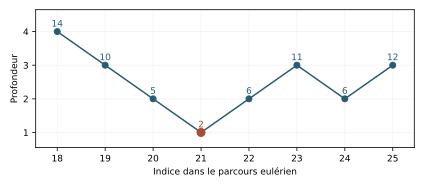
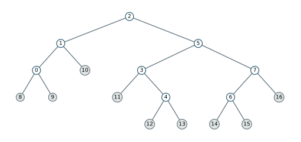

# ENS de Lyon · Second concours · Informatique 2019 · Corrigé brut

*Corrigé rédigé par IA, non officiel. Signalez toute erreur.*

**Rédaction** · GPT-6.2 Astra Ultra · vitesse non renseignée · 24 novembre 2026

## 1 · Algorithmes directs

### Question 1 · Minimum d’un intervalle et réutilisation du recouvrement

**a.** Initialiser le candidat à $i$. Après le traitement de $k$, il est le premier indice de minimum de $[i,k]$, par comparaison du nouveau terme avec le meilleur déjà vu.

```python

def MTI_lin(tab, i, j):
    meilleur = i
    for k in range(i + 1, j + 1):
        if tab[k] < tab[meilleur]:
            meilleur = k
    return meilleur

```

Il y a exactement $j-i$ comparaisons entre éléments, y compris zéro pour un singleton. Le temps est $\Theta(j-i+1)$ et l’espace auxiliaire constant.

**b.** Trouver d’abord le premier minimum $h$ du recouvrement $[i',j]$. Partir de $h$ dans deux calculs indépendants. Dans le premier, parcourir $i'-1,i'-2,\ldots,i$ et remplacer le candidat sur une valeur **inférieure ou égale**, car le nouvel indice est plus petit. Dans le second, parcourir $j+1,\ldots,j'$ et remplacer seulement sur une valeur strictement inférieure. On compte $(j-i')+(i'-i)+(j'-j)=j'-i$ comparaisons. Cette borne au pire est optimale. Lorsque le minimum commun est unique et dans le recouvrement, il faut éliminer de la course au minimum chaque autre indice de l’union, car obtenir les deux réponses identiques certifie aussi le minimum de l’union.

### Question 2 · Terminaison, correction et coût du calcul naïf

La définition initiale de l’ancêtre est stricte. Pour le PPAC, l’algorithme fourni adopte la convention usuelle **inclusive** permettant $PPAC(x,x)=x$ et $PPAC(x,y)=x$ si $x$ est ancêtre de $y$. C’est également la convention exigée par les questions sur les intervalles singletons.

Dans `est_ancêtre(x,y,A)`, la profondeur du deuxième argument décroît à chaque appel. Si $y$ est la racine, il n’a aucun ancêtre strict. Sinon ses ancêtres stricts sont son père puis les ancêtres stricts de son père. Ces deux faits prouvent terminaison et correction par récurrence. Le coût maximal est $O(h)$ pour un arbre de hauteur $h$, donc $O(n)$.

Dans `PPAC_naif`, les candidats sont $x$, puis ses ancêtres dans l’ordre des profondeurs décroissantes. Le test accepte exactement le premier qui est $y$ ou un ancêtre strict de $y$. La racine est toujours acceptée au plus tard. Il n’y a donc jamais d’appel au père de la racine. Le premier candidat accepté est l’ancêtre commun le plus profond. Au pire, jusqu’à $h+1$ candidats coûtent $O(h+1)$ chacun. La borne est $O((h+1)^2)$, et $\Theta(n^2)$ est atteignable sur deux longues branches en peignes sous une même racine, en prenant une feuille profonde de chaque branche. La recherche auxiliaire seule y a un pire cas $\Theta(n)$.

### Question 3 · Marquer un chemin vers la racine

**a.** Considérer la chaîne formée de $y$ puis de ses ancêtres. Le premier $z$ tel que $z=x$ ou $marquage[z]=1$ est le PPAC. Cette condition inclut les cas $x=y$, $y$ ancêtre de $x$ et $x$ racine.

**b.** Une représentation possible donne le père de chaque nœud dans un tableau `pere`, avec la valeur `None` pour la racine.

```python

def PPAC_lin(x, y, pere):
    marque = [False] * len(pere)
    z = x
    while z is not None:
        marque[z] = True
        z = pere[z]
    z = y
    while not marque[z]:
        z = pere[z]
    return z

```

L’initialisation prend $O(n)$ et les parcours ont longueur au plus $h+1$ chacun. Le temps est $O(n)$ et l’espace auxiliaire $O(n)$.

## 2 · Résoudre PPAC avec MTI

### Question 4 · Longueur du parcours eulérien

Un arbre non vide à $n$ sommets possède $n-1$ arêtes. Chacune est empruntée une fois pour descendre vers un fils et une fois pour revenir. À la première occurrence de la racine s’ajoutent les $2(n-1)$ arrivées. La taille vaut donc $2n-1$, y compris $1$ pour l’arbre réduit à sa racine. L’arité n’intervient pas.

### Question 5 · Minimum des profondeurs entre deux premières visites

Échanger $x,y$ si nécessaire pour avoir $R(x)\le R(y)$. Soit $z=PPAC(x,y)$. Entre les deux premières visites, le parcours reste dans le sous-arbre de $z$ car le parcours complet de ce sous-arbre est contigu. Si $z=x$, le premier terme est déjà $z$. Sinon les deux nœuds sont dans des sous-arbres fils distincts de $z$ et le parcours remonte à $z$ pour passer de l’un à l’autre. La plus petite profondeur rencontrée est donc $prof(z)$, et le seul nœud de cette profondeur dans le sous-arbre de $z$ est $z$. Même si $z$ est rencontré plusieurs fois, $E[MTI(PE,R(x),R(y))]=z$. Pour $x=y$, le segment est un singleton.



### Question 6 · Traiter N requêtes de PPAC

Une descente ajoute le fils à $E$ et sa profondeur à $P$. Une remontée ajoute le père et sa profondeur. Mémoriser $R[v]$ seulement à la première rencontre. La version itérative suivante accepte un tableau de listes de fils, aussi pour des arbres très profonds.

```python

def euler(fils, racine):
    E, P = [racine], [0]
    R = [None] * len(fils)
    R[racine] = 0
    pile = [(racine, iter(fils[racine]))]
    while pile:
        v, suite = pile[-1]
        w = next(suite, None)
        if w is None:
            pile.pop()
            if pile:
                E.append(pile[-1][0])
                P.append(len(pile) - 1)
        else:
            R[w] = len(E)
            E.append(w)
            P.append(len(pile))
            pile.append((w, iter(fils[w])))
    return E, P, R

def requetes_ppac(fils, racine, couples, preparer_mti):
    E, P, R = euler(fils, racine)
    mti_ct = preparer_mti(P)
    resultat = []
    for x, y in couples:
        a, b = sorted((R[x], R[y]))
        resultat.append(E[mti_ct(a, b)])
    return resultat

```

L’arbre est parcouru en $\Theta(n)$ et chaque couple coûte $O(1)$. Le total est $O(n+N)$ si le MTI constant est directement disponible comme dans l’hypothèse, ou si sa préparation est linéaire. Si sa préparation effective coûte $T(2n-1)$, il faut explicitement l’ajouter. Les trois tableaux du parcours occupent $O(n)$, hors sortie et stockage propre au MTI.

## 3 · Requêtes de minimum

### Question 7 · Table de tous les intervalles

**a.** Pour $h=MTI(i,j)$, $MTI(i,j+1)=j+1$ si $tab[j+1]<tab[h]$, et $h$ sinon. En cas d’égalité, $h$ est plus à gauche.

**b.** Pour chaque $i$ de $0$ à $m-1$, initialiser $D[i,i]=i$, puis remplir $D[i,j]$ pour $j=i+1,\ldots,m-1$ par la relation précédente. Une requête lit $D[i,j]$. La table triangulaire a $m(m+1)/2$ entrées, chacune calculée en temps constant. Le triplet est $\langle\Theta(m^2),\Theta(m^2),\Theta(1)\rangle$.

### Question 8 · Requêtes par blocs

**a.** Poser $b=m/K$. Calculer les minima des blocs de taille $b$ par un balayage de gauche à droite, en conservant leurs indices absolus. Dans chaque requête, combiner les meilleurs indices par ordre lexicographique des couples $(tab[k],k)$.

```python

def mieux(tab, a, b):
    return a if (tab[a], a) <= (tab[b], b) else b

def preparer_blocs(tab, b):
    return [MTI_lin(tab, k, min(k+b-1, len(tab)-1))
            for k in range(0, len(tab), b)]

def mti_blocs(tab, b, minima, i, j):
    g, d = i // b, j // b
    if g == d:
        return MTI_lin(tab, i, j)
    h = MTI_lin(tab, i, (g+1)*b-1)
    for k in range(g+1, d):
        h = mieux(tab, h, minima[k])
    return mieux(tab, h, MTI_lin(tab, d*b, j))

```


**b.** La préparation visite $m$ cases et stocke $K$ indices, et éventuellement leurs $K$ valeurs. Les deux bords demandent $O(b)$ et l’intérieur $O(K)$. Le triplet est $\langle O(m),O(K),O(m/K+K)\rangle$.

**c.** Le premier coût est déjà linéaire. Le troisième est minimal en ordre de grandeur pour $K\asymp\sqrt m$, ce qui donne $O(\sqrt m)$ par demande. Si $m$ n’a pas de diviseur près de $\sqrt m$, le découpage pratique garde un dernier bloc plus court, ce que le programme accepte. Avec la divisibilité strictement imposée, on minimise $m/K+K$ sur les diviseurs autorisés.

### Question 9 · Préfixes, suffixes et coût moyen

**a.** Les minima préfixes se calculent par $p[0]=0$ puis $p[t]=\operatorname{mieux}(p[t-1],t)$. Les minima suffixes se calculent en sens inverse par $s[m-1]=m-1$, $s[t]=\operatorname{mieux}(t,s[t+1])$. Lire $p[i]$ ou $s[i]$ répond en temps constant. La préparation et les deux tableaux coûtent $O(m)$.

**b.** Appliquer la même méthode à **chaque bloc**. Si $i,j$ sont dans deux blocs différents, les deux morceaux incomplets sont alors un suffixe et un préfixe connus. Il ne reste qu’à combiner leurs deux minima et ceux des blocs intermédiaires. Le texte imprime $i-j>K$, impossible pour $i\le j$. La condition effective est que les blocs diffèrent, notamment si $j-i\ge b$. Pour le choix $K=b=\sqrt m$, cela couvre les intervalles longs visés. Un intervalle intérieur à un bloc est encore balayé.

**c.** Les $m(m+1)/2$ intervalles sont équiprobables. Avec $K$ blocs de taille $b$, la probabilité de rester dans un bloc vaut $K b(b+1)/[m(m+1)]=(b+1)/(m+1)$. Conditionnellement à cette éventualité, la longueur moyenne est $(b+2)/3$. Le coût moyen dû aux balayages internes est donc $\Theta(1+m/K^2)$ à une constante additive près. Si l’on balaie les minima des blocs intermédiaires comme à Q8, une requête traverse en moyenne $\Theta(K)$ blocs pour $K\ge2$. Le triplet avec coût moyen est $\langle O(m),O(m),O(K+m/K^2)\rangle$, soit $O(m^{1/3})$ en prenant $K\asymp m^{1/3}$ et $O(\sqrt m)$ avec le choix de Q8.

On peut aussi prétraiter **tous les intervalles du tableau des $K$ minima de blocs** par Q7. Une requête couvrant plusieurs blocs devient alors constante. Le triplet moyen est $\langle O(m+K^2),O(m+K^2),O(1+m/K^2)\rangle$. Pour $K\asymp\sqrt m$, on obtient une préparation et un espace linéaires et un temps **moyen** constant. Une requête intérieure à un bloc peut encore coûter $\Theta(\sqrt m)$ dans le pire cas.

![Sur l’intervalle [2,9], deux lectures aux frontières encadrent un bloc complet. Les minima donnent des indices absolus du tableau.](figures/q09-blocs.svg)

### Question 10 · Table des longueurs puissances de deux

**a.** Ajouter la ligne $k=0$ des singletons. Un intervalle de longueur $2^k$ est la réunion de ses deux moitiés de longueur $2^{k-1}$. Ne calculer que les cellules dont l’intervalle reste dans le tableau.

```python

def preparer_puissances(tab):
    m = len(tab)
    lignes = [list(range(m))]
    demi = 1
    while 2*demi <= m:
        prec = lignes[-1]
        lignes.append([mieux(tab, prec[i], prec[i+demi])
                       for i in range(m-2*demi+1)])
        demi *= 2
    def requete(i, j):
        k = (j-i+1).bit_length() - 1
        longueur = 1 << k
        return mieux(tab, lignes[k][i], lignes[k][j-longueur+1])
    return requete

```


**b.** Pour $\ell=j-i+1$, $k=\lfloor\log_2\ell\rfloor$ et $2^k\le\ell<2^{k+1}$. Les blocs commençant en $i$ et finissant en $j$, chacun de longueur $2^k$, recouvrent l’intervalle. Le chevauchement est sans effet sur le minimum et sa règle de départage. Le triplet est $\langle O(m\log m),O(m\log m),O(1)\rangle$ sous le modèle de calcul donné. Pour un tableau d’une case, une unique entrée suffit.

## 4 · Résoudre MTI avec PPAC

### Question 11 · Numéroter l’arbre cartésien donné

Il y a huit nœuds internes blancs et neuf feuilles grises. Le parcours infixe impose les indices $0,1,2,3,4,5,6,7$ sur les nœuds internes. La racine a l’indice 2. En attribuant aux nœuds internes les **valeurs** de 1 à 8 dans l’ordre des niveaux, on obtient par exemple

$$
tab_1=[4,2,1,5,7,3,8,6].
$$

Son minimum global est à l’indice 2. Le sous-tableau gauche a sa racine en 1, avec 0 à gauche. Le sous-tableau droit a sa racine en 5, avec les sous-arbres enracinés en 3 et 7. Le nœud 3 a 4 à droite et le nœud 7 a 6 à gauche. Numéroter les feuilles externes de 8 à 16, de gauche à droite, donne le dessin ci-dessous. Les indices de ces feuilles ne désignent aucune case du tableau.



### Question 12 · Le PPAC dans l’arbre cartésien est le MTI

Un sous-arbre cartésien est construit sur un intervalle contigu d’indices et son sommet porte l’indice du minimum de cet intervalle. Pour $i\le j$, soit $z=PPAC(i,j)$ au sens inclusif. Si $z=i$ ou $z=j$, il appartient déjà à $[i,j]$. Sinon $i$ et $j$ sont dans des sous-arbres distincts de $z$. L’ordre infixe entraîne $i<z<j$. Dans les deux cas, $[i,j]$ est inclus dans l’intervalle du sous-arbre de $z$ et contient $z$. Sa valeur est donc le minimum sur $[i,j]$, unique puisque les valeurs sont distinctes. On obtient $MTI(tab,i,j)=z$, notamment pour $i=j$.

### Question 13 · Insérer l’élément suivant par la branche droite

Pour ajouter $t=i+1$, remonter depuis $i$, extrémité de la branche droite, tant que la valeur du sommet est supérieure à $tab[t]$. Soit $s$ le dernier sommet retiré. S’il existe, son sous-arbre devient le fils gauche de $t$. Le dernier sommet conservé reçoit $t$ pour fils droit. Si aucun sommet n’est conservé, $t$ devient la racine. Le fils droit de $t$ est vide. Si aucun sommet n’a été retiré, le fils gauche de $t$ est également vide. L’ordre infixe est préservé, de même que la croissance des valeurs du parent vers ses fils. Ces deux propriétés caractérisent l’arbre cartésien.

Avec une pile contenant la branche droite ou des pointeurs vers les parents, le coût est $O(1+s_i)$ si $s_i$ sommets sont retirés, donc $O(i+1)$ au pire pour cette seule insertion. Un nouvel élément plus petit que tous les précédents après un préfixe croissant réalise ce pire cas. Les feuilles externes peuvent être implicites pendant la construction.

### Question 14 · Préparation linéaire de l’arbre cartésien


```python

def cartesien(tab):
    m = len(tab)
    gauche, droite = [None] * m, [None] * m
    pile = []
    for t in range(m):
        dernier = None
        while pile and tab[pile[-1]] > tab[t]:
            dernier = pile.pop()
        gauche[t] = dernier
        if pile:
            droite[pile[-1]] = t
        pile.append(t)
    return (pile[0] if pile else None), gauche, droite

```

Chaque indice est empilé exactement une fois. Lorsqu’il est dépilé, il reste à gauche d’un indice ultérieur et ne revient jamais dans la pile. Il y a au plus $m$ dépilements, donc la construction entière prend $O(m)$ temps et espace. Si l’algorithme de PPAC attend un arbre plein, ajouter une feuille distincte à chacun des $m+1$ fils vides prend encore $O(m)$, pour un total de $2m+1$ sommets. Pour le tableau vide, on représente une seule feuille externe et il n’y a aucune requête valide.

Appliquer ensuite le prétraitement linéaire de PPAC donné en hypothèse à cet arbre. Pour chaque intervalle $[i,j]$, répondre par $PPAC(i,j)$ en temps constant, ce qui est exact par Q12. Le triplet final est $\langle O(m),O(m),O(1)\rangle$ **au pire**.
