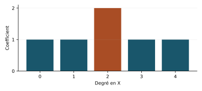

# ENS de Lyon · Second concours · Mathématiques 2019 · Corrigé guidé

*Corrigé rédigé par IA, non officiel. Signalez toute erreur.*

**Rédaction** · GPT-6.2 Astra Ultra · vitesse non renseignée

**Révision** · GPT-6.2 Astra Ultra · vitesse non renseignée · 26 novembre 2026

L’exercice compare deux compositions de fonctions impaires. Le problème établit la formule du binôme pour deux éléments qui commutent à un facteur scalaire près. [Sujet officiel](https://banques-ecoles.fr/cms/wp-content/uploads/2019/06/19_2c_sujet_math.pdf) · [Rapport du jury](https://banques-ecoles.fr/cms/wp-content/uploads/2019/11/19_2CC_rap_eMath.pdf)

## Exercice. Commutation de deux fonctions au voisinage de zéro

### Question E.1

> [!INDICATION]
> Choisir un voisinage que chacune des fonctions envoie dans le domaine de l’autre.

#### Solution

Par continuité en zéro et $f(0)=g(0)=0$, il existe $0<\delta<1$ tel que $|f(x)|<1$ et $|g(x)|<1$ pour $|x|<\delta$. Ainsi $g\circ f$ et $f\circ g$ sont définies et lisses sur ce voisinage, de même que leur différence $H$.

### Question E.2

> [!INDICATION]
> Appliquer successivement la règle de chaîne et celle du produit.

#### Solution

En notant les dérivées de $f$ évaluées en $g(x)$ et celles de $g$ en $x$, on obtient
$$h'=f'(g)g',\quad h''=f''(g)(g')^2+f'(g)g'',$$
$$h'''=f'''(g)(g')^3+3f''(g)g'g''+f'(g)g'''.$$
Le coefficient trois provient des deux dérivations des facteurs $g'$ dans le premier terme de $h''$ et de la dérivation de $f'(g)$ dans le second.

### Question E.3

> [!INDICATION]
> Écrire les premiers termes impairs puis comparer les deux compositions.

#### Solution

Par imparité et lissité, écrivons $f(x)=x+ax^3+O(x^5)$ et $g(x)=x+bx^3+O(x^5)$. Puisque $g(x)=O(x)$ et $g(x)^3=x^3+O(x^5)$, on obtient $f(g(x))=x+(a+b)x^3+O(x^5)$. La partie affichée est symétrique en $a,b$, donc $H(x)=O(x^5)$.

### Question E.4

> [!INDICATION]
> Calculer le premier terme mixte, en degré cinq.

#### Solution

Posons plus précisément $f=x+ax^3+cx^5+O(x^7)$ et $g=x+bx^3+dx^5+O(x^7)$. On a $g^3=x^3+3bx^5+O(x^7)$ et $g^5=x^5+O(x^7)$. Ainsi $f\circ g=x+(a+b)x^3+(c+d+3ab)x^5+O(x^7)$. Ces coefficients sont inchangés par échange des fonctions, d’où $H(x)=O(x^7)$.

### Question E.5

> [!INDICATION]
> Écrire la formule donnée pour les deux compositions, puis retrancher la dérivée de $g\circ f$ de celle de $f\circ g$.

#### Solution

Notons $F=f'''(0)$, $G=g'''(0)$, $C=f^{(5)}(0)$ et $D=g^{(5)}(0)$. Les dérivées d’ordre sept isolées disparaissent dans la différence. Il reste
$$H^{(7)}(0)=14(GC-FD)+70FG(G-F).$$
D’après 4 et Taylor, $H(x)=\big[14(GC-FD)+70FG(G-F)\big]x^7/7!+o(x^7)$.

### Question E.6

> [!INDICATION]
> Intégrer la série géométrique de la dérivée de l’arctangente.

#### Solution

Pour $|x|<1$, $(1+x^2)^{-1}=\sum_{j\ge0}(-1)^j x^{2j}$. En intégrant terme à terme sur un segment compact de $]-1,1[$ et en utilisant $\arctan0=0$, on trouve $\arctan x=\sum_{j\ge0}(-1)^j x^{2j+1}/(2j+1)$. Les dérivées paires en zéro sont nulles, et la dérivée d’ordre $2j+1$ vaut $(-1)^j(2j)!$.

### Question E.7

> [!INDICATION]
> Substituer les quatre dérivées d’ordres trois et cinq dans le premier coefficient susceptible de survivre.

#### Solution

Pour $f=\sin$, $F=-1$ et $C=1$. Pour $g=\arctan$, $G=-2$ et $D=24$. La formule de 5 donne $H^{(7)}(0)=14(-2+24)+70(2)(-1)=168$. Le premier écart apparaît donc au degré sept :
$$\sin(\arctan x)-\arctan(\sin x)\sim x^7/30.$$

On peut vérifier le signe sans la formule de dérivation admise. Puisque $\sin(\arctan x)=x/\sqrt{1+x^2}$, ses coefficients en degrés $1,3,5,7$ sont $1,-1/2,3/8,-5/16$. En remplaçant $u$ par $\sin x$ dans $u-u^3/3+u^5/5-u^7/7$, on obtient les trois mêmes premiers coefficients, puis $-83/240$. Leur différence au degré sept vaut $-5/16+83/240=1/30$.

## Problème. Préliminaires et cas matriciel

### Question P.1

> [!INDICATION]
> Chercher un exemple dont les puissances d’un élément sont linéairement indépendantes.

#### Solution

L’algèbre $\mathbb C[X]$, munie des opérations usuelles et d’unité 1, est commutative. Les monômes $(X^k)_{k\ge0}$ y forment une famille libre infinie, donc sa dimension est infinie.

### Question P.2

> [!INDICATION]
> Regrouper les mots ayant le même nombre de facteurs b.

#### Solution

Comme $a$ et $b$ commutent, les mots comportant $j$ facteurs $b$ dans les $n$ positions valent tous $b^ja^{n-j}$. Il y en a $\binom nj$, d’où $(a+b)^n=\sum_{j=0}^n\binom nj b^ja^{n-j}$.

### Question P.3

> [!INDICATION]
> Comparer deux produits de matrices élémentaires.

#### Solution

L’algèbre $M_2(\mathbb C)$, d’unité $I_2$, a pour base les quatre matrices élémentaires. Ses éléments ne commutent pas tous : $E_{12}E_{21}=E_{11}$ et $E_{21}E_{12}=E_{22}$.

### Question P.4a

> [!INDICATION]
> Multiplier les blocs triangulaires et comparer successivement les quatre entrées.

#### Solution

En notant $I=I_n$, on trouve
$$R=\begin{pmatrix}XI&0\\N&I\end{pmatrix}
\begin{pmatrix}XI&M\\0&X^2I-NM\end{pmatrix}.$$
Le bloc inférieur droit est $NM+X^2I-NM=X^2I$, les autres se lisant immédiatement.

### Question P.4b

> [!INDICATION]
> Prendre le produit des déterminants des blocs diagonaux.

#### Solution

Dans la convention $P_A(T)=\det(TI-A)$, la factorisation de 4a donne $\det R=X^n X^n\det(X^2I-NM)=X^{2n}P_{NM}(X^2)$.

### Question P.4c

> [!INDICATION]
> Éliminer l’autre produit en inversant l’ordre des facteurs triangulaires.

#### Solution

On a également
$$R=\begin{pmatrix}X^2I-MN&M\\0&XI\end{pmatrix}
\begin{pmatrix}I&0\\N&XI\end{pmatrix}.$$
Ainsi $\det R=X^{2n}P_{MN}(X^2)$. La simplification de $X^{2n}$ dans $\mathbb C[X]$ donne $P_{NM}(X^2)=P_{MN}(X^2)$. La substitution $T\mapsto X^2$ étant injective, on conclut $P_{NM}=P_{MN}$.

### Question P.5a

> [!INDICATION]
> Comparer le spectre du produit renversé et celui d’un multiple.

#### Solution

Le produit $MN$ est non nul et $MN=\omega NM$, donc $\omega\ne0$. Par 4c, $MN$ et $NM$ ont même polynôme caractéristique et même spectre. Par ailleurs, multiplier une matrice par le scalaire $\omega$ multiplie son spectre par $\omega$. On obtient $\mathrm{Sp}(NM)=\omega\mathrm{Sp}(NM)$.

### Question P.5b

> [!INDICATION]
> Suivre l’orbite d’une valeur propre non nulle dans l’ensemble fini du spectre.

#### Solution

Si le spectre ne contient que zéro, le polynôme caractéristique est $T^n$ et Cayley-Hamilton donne $(NM)^n=0$. Sinon, pour $\lambda\ne0$ dans le spectre, tous les $\omega^j\lambda$ appartiennent à ce même ensemble fini par 5a. Deux coïncident, disons pour $j>k$. En simplifiant $\omega^k\lambda\ne0$, on obtient $\omega^{j-k}=1$. Les deux propriétés proposées ne s’excluent pas.

### Question P.6a

> [!INDICATION]
> Changer l’échelle du premier vecteur de base.

#### Solution

Pour $D_t=\operatorname{diag}(t,1)$ et $t\ne0$, $D_t$ est inversible et $D_tN_1D_t^{-1}=t N_1=N_t$. Ainsi $N_t$ et $N_1$ sont semblables.

### Question P.6b

> [!INDICATION]
> Employer la même matrice diagonale comme premier facteur du produit.

#### Solution

Pour tout $\omega\ne0$, prenons $M=D_\omega$ et $N=N_1$. Alors $MN=\omega N_1$ et $NM=N_1$. On a bien $MN=\omega NM\ne0$ et $(MN)^2=0$.

### Question P.7

> [!INDICATION]
> Comparer les trois coefficients portés par le cycle de N.

#### Solution

Pour $M=\operatorname{diag}(d_1,d_2,d_3)$, l’égalité équivaut à $d_1=\omega d_2$, $d_2=\omega d_3$ et $d_3=\omega d_1$. Posons $\omega=e^{2\pi i/3}$, $M=\operatorname{diag}(1,\omega^2,\omega)$. Les trois égalités sont satisfaites et les deux facteurs sont inversibles. En particulier $MN\ne0$.

## Problème. Binôme dans une algèbre avec relation de commutation

### Question P.8a

> [!INDICATION]
> Déplacer x à travers les facteurs y un à un.

#### Solution

Pour $k=0$, $xy^0=x=\omega^0y^0x$. Si $xy^k=\omega^k y^kx$, alors $xy^{k+1}=\omega^k y^kxy=\omega^{k+1}y^{k+1}x$. Par récurrence la formule vaut pour tout $k\ge0$.

### Question P.8b

> [!INDICATION]
> Multiplier à gauche par x + y puis remettre les monômes dans l’ordre prescrit.

#### Solution

Partons de $P_{0,0}=1$, avec $P_{r,j}=0$ si $j<0$ ou $j>r$. En multipliant $y^j x^{r-j}$ à gauche par $x$, on obtient $\omega^j y^j x^{r+1-j}$, et en multipliant par $y$, $y^{j+1}x^{r-j}$. Regrouper dans le développement donne
$$P_{r+1,j}(X)=X^jP_{r,j}(X)+P_{r,j-1}(X).$$
Cette formule définit des polynômes et prouve par récurrence $(x+y)^r=\sum_{j=0}^rP_{r,j}(\omega)y^j x^{r-j}$.

### Question P.9

> [!INDICATION]
> Comparer les deux degrés dans la récurrence et utiliser l’absence d’annulation.

#### Solution

Les coefficients sont entiers positifs ou nuls par 8b, à partir de 1. Sur les bords $P_{r,0}=P_{r,r}=1$. Pour $1\le j\le r$, si la formule des degrés vaut à la ligne $r$, les degrés des deux termes à la ligne suivante sont $j+j(r-j)=j(r+1-j)$ et $(j-1)(r+1-j)$, strictement plus petit pour le second. Ainsi $\deg P_{r,j}=j(r-j)$ pour toute la ligne $r$, par récurrence. Si l’on demande la stricte positivité de tous les coefficients du degré zéro au degré maximal, les supports sont des intervalles : ceux de 8b vont respectivement de $j$ au degré maximal et de zéro à $(j-1)(r+1-j)\ge j-1$. Ils se rejoignent sans lacune.

### Question P.10

> [!INDICATION]
> Spécialiser la relation de récurrence en un.

#### Solution

En $X=1$, 8b est la relation de Pascal, avec les mêmes valeurs initiales et la même convention hors de la ligne. Ainsi $P_{r,j}(1)=\binom rj$.

### Question P.11

> [!INDICATION]
> Introduire les entiers géométriques pour ramener les deux termes au même dénominateur.

#### Solution

Écrivons $[k]=1+X+\cdots+X^{k-1}$, $\phi_0=1$, $\phi_k=\phi_{k-1}[k]$. Pour $1\le j\le r$, multiplions 8b par $\phi_j\phi_{r+1-j}$. En supposant vraie la formule à la ligne $r$, on obtient
$$\phi_j\phi_{r+1-j}P_{r+1,j}=\phi_r\bigl(X^j[r+1-j]+[j]\bigr)=\phi_r[r+1]=\phi_{r+1}.$$
Les deux sommes géométriques se juxtaposent aux degrés $j$ et $j-1$. Les bords valent 1 pour $P$, et l’identité y est immédiate, tout comme au départ. Cela prouve $\phi_j\phi_{r-j}P_{r,j}=\phi_r$ sans division par une valeur susceptible de s’annuler.

### Question P.12a

> [!INDICATION]
> Identifier le premier facteur géométrique qui s’annule.

#### Solution

Puisque $\omega$ est d’ordre $r\ge2$, $\omega\ne1$ et $[s](\omega)=(1-\omega^s)/(1-\omega)$. Ce facteur s’annule exactement pour $r\mid s$. Dans le produit de $s=1$ à $\ell$, un tel indice apparaît exactement lorsque $\ell\ge r$. Cela vaut également pour le produit vide $\phi_0=1$.

### Question P.12b

> [!INDICATION]
> Spécialiser l’identité polynomiale dans les colonnes intérieures.

#### Solution

Pour $0<j<r$, les deux valeurs $\phi_j(\omega)$ et $\phi_{r-j}(\omega)$ sont non nulles, alors que $\phi_r(\omega)=0$. Par 11, $P_{r,j}(\omega)=0$. Dans 8b ne demeurent que les deux termes de bord de coefficient un, d’où $(x+y)^r=x^r+y^r$.
