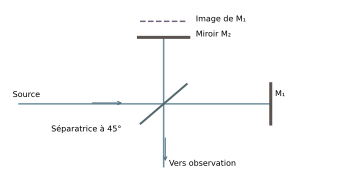
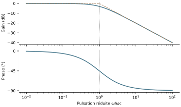
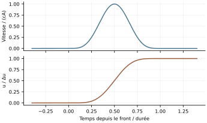
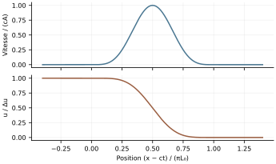

# ENS de Lyon, second concours 2019 — Physique · Corrigé brut

*Corrigé rédigé par IA, non officiel. Signalez toute erreur.*

**Rédaction** · GPT-6.2 Astra Ultra · vitesse non renseignée

## A — Questionnaire de physique

### Question A1 — Oscillateur amorti

Pour un déplacement mesuré depuis l’équilibre, l’équation libre canonique est $\ddot x+2\zeta\omega_0\dot x+\omega_0^2x=0$. La pulsation propre est $\omega_0$ et le taux d’amortissement réduit est $\zeta$. On peut aussi écrire le coefficient de $\dot x$ sous la forme $\omega_0/Q$.

### Question A2 — Michelson en lame d’air

Une séparatrice à 45° partage le faisceau entre deux miroirs dans des bras perpendiculaires. Les faisceaux reviennent par la séparatrice puis interfèrent dans la voie d’observation. Dans la configuration en lame d’air, le miroir d’un bras est parallèle à l’image, par la séparatrice, du miroir de l’autre bras. Leur écart $e$ donne une différence de marche $2e\cos i$ pour les rayons d’inclinaison $i$. Les anneaux d’égale inclinaison s’observent à l’infini, ou dans le plan focal d’une lentille.

### Question A3 — Bode d’un passe-bas du premier ordre

Avec $H=H_0/(1+i\omega/\omega_c)$ et $H_0>0$, le gain vaut $20\log_{10}H_0-10\log_{10}[1+(\omega/\omega_c)^2]$ dB et la phase vaut $-\arctan(\omega/\omega_c)$. Le gain est constant à basse fréquence et sa pente asymptotique à haute fréquence vaut −20 dB/décade. À la coupure, le gain perd 3,01 dB et la phase vaut −45°. La phase passe de 0° à −90°.

### Question A4 — Accélération de Coriolis

Dans la composition des accélérations entre un référentiel relatif $\mathcal R'$ tournant à la vitesse angulaire $\boldsymbol\Omega_{\mathcal R'/\mathcal R}$ par rapport à $\mathcal R$ et le référentiel $\mathcal R$, le terme de Coriolis est $\mathbf a_C=2\boldsymbol\Omega_{\mathcal R'/\mathcal R}\times\mathbf v_{\rm rel}$. La vitesse relative est mesurée dans $\mathcal R'$. Dans l’équation dynamique écrite dans ce référentiel tournant, l’accélération d’inertie correspondante a le signe opposé.

### Question A5 — Moment cinétique d’un système

Par rapport au point $O$, dans un référentiel donné, $\mathbf L_O=\sum_i\overrightarrow{OM_i}\times m_i\mathbf v_i$. Pour un système continu, $\mathbf L_O=\int\overrightarrow{OM}\times\mathbf v(M)\,\mathrm dm$.

### Question A6 — Loi de Laplace

Pour une quantité fixée de gaz parfait soumise à une transformation adiabatique réversible et à rapport des capacités thermiques $\gamma$ constant, $PV^\gamma=\mathrm{constante}$. On en déduit $TV^{\gamma-1}=\mathrm{constante}$.

### Question A7 — Formule de Fresnel

Deux ondes lumineuses cohérentes de même polarisation donnent $I=I_1+I_2+2\sqrt{I_1I_2}\cos\Delta\varphi$. Le terme d’interférence dépend de la différence de phase au point d’observation.

### Question A8 — Loi de Fick

Dans un milieu isotrope avec diffusion ordinaire, le flux de particules est $\mathbf j=-D\nabla n$, où $n$ est la concentration de particules et $D$ le coefficient de diffusion.

### Question A9 — Dimension d’un coefficient de diffusion

$[D]=L^2T^{-1}$, soit des $\mathrm{m^2\,s^{-1}}$.

### Question A10 — Dispersion

Dans une direction donnée, un milieu est dispersif si la vitesse de phase $v_\phi=\omega/k$ varie avec la fréquence. Une relation $\omega=ck$ avec $c$ constant donne un milieu non dispersif. Une autre dépendance de $\omega/k$ fait évoluer différemment les phases des composantes d’un paquet d’ondes.

## B — Contact de Hertz

### Question B1 — Module de Young

En traction uniaxiale dans le domaine élastique linéaire, la contrainte normale et l’allongement relatif sont reliés par $\sigma=E\varepsilon$, où $\varepsilon=\Delta\ell/\ell_0$. Le module de Young se mesure en pascals.

### Question B2 — Célérité dans l’acier

La valeur du modèle fourni est $c_{\rm son}=\sqrt{200\times10^9/7800}\simeq5{,}06\times10^3\ \mathrm{m\,s^{-1}}$.

### Question B3 — Contact hertzien

Les billes peuvent avoir une élasticité locale linéaire, mais l’aire de la zone de contact croît avec l’enfoncement. Géométriquement, le rayon du disque de contact est de l’ordre de $\sqrt{a\delta}$. La contrainte caractéristique est de l’ordre de $E\delta/\sqrt{a\delta}$. Sa multiplication par l’aire d’ordre $a\delta$ donne une force d’ordre $E\sqrt a\,\delta^{3/2}$. L’élargissement du contact explique une raideur croissante.

### Question B4 — Argument dimensionnel

La relation $F=q\delta^{3/2}$ implique $[q]=\mathrm{N\,m^{-3/2}}$. Avec $[E]=\mathrm{N\,m^{-2}}$, le seul produit avec une puissance du diamètre convenable est $q=C E\sqrt a$. Le sujet retient $C=1$.

### Question B5 — Constante de contact

Pour $a=10^{-2}$ m et $E=2\times10^{11}$ Pa, $q=2{,}0\times10^{10}\ \mathrm{N\,m^{-3/2}}$.

### Question B6 — Signification de la constante K

$K=q\sqrt a$ est une échelle de raideur, en N/m. En particulier $F/a=K(\delta/a)^{3/2}$. La raideur tangentielle réelle est $\mathrm dF/\mathrm d\delta=(3/2)K\sqrt{\delta/a}$, qui dépend de la compression et s’annule en contact à peine établi.

### Question B7 — Valeur de K

$K=Ea=2{,}0\times10^9\ \mathrm{N\,m^{-1}}$.

### Question B8 — Compression maximale d’un contact

La deuxième bille est maintenue fixe. Au maximum d’enfoncement, l’énergie cinétique initiale est stockée dans le contact, soit $mv_0^2/2=\int_0^{\delta_M}q\delta^{3/2}\,\mathrm d\delta=(2q/5)\delta_M^{5/2}$. Ainsi $\delta_M=[5mv_0^2/(4q)]^{2/5}$.

### Question B9 — Application pour une chute de 5 cm

$v_0=\sqrt{2gh}\simeq0{,}99\ \mathrm{m\,s^{-1}}$. Avec $m=4{,}0\times10^{-3}$ kg, $\delta_M\simeq9{,}0\times10^{-6}$ m, soit environ $9\ \mu$m ou $9\times10^{-4}$ diamètre.

## Équation d’onde

### Question B10 — Signe du déplacement relatif

$x_n=na+u_n$ donne $\delta_{n+1}=a-(x_{n+1}-x_n)=u_n-u_{n+1}$. Sous l’hypothèse de contact compressif, cette différence est positive ou nulle. Elle est nulle pour un contact sans effort.

### Question B11 — Dynamique discrète

La bille $n$ reçoit une force positive du voisin de gauche et une force négative du voisin de droite. Ainsi
$$m\ddot u_n=q[(u_{n-1}-u_n)^{3/2}-(u_n-u_{n+1})^{3/2}].$$
Multiplier par $\sqrt a/m$ après écriture du bilan des forces donne le coefficient $\Omega_0^2=q\sqrt a/m=K/m$ dans la forme de l’énoncé.

### Question B12 — Échelles de la description

L’équation discrète associe une seule abscisse à chaque bille. Elle suppose que le contact répond presque instantanément suivant la loi de Hertz et que l’on peut négliger la propagation interne à la bille à l’échelle de l’impulsion considérée. Le passage supplémentaire à un champ continu $u(x,t)$ suppose une variation faible sur un pas, soit une largeur caractéristique de l’onde grande devant $a$. Cette dernière condition sera évaluée en B21.

### Question B13 — Développement spatial

Au point $x=na$, posons $w=-u_x>0$. Taylor donne $u_{n-1}-u_n=aw+(a^2/2)u_{xx}+\cdots$ et $u_n-u_{n+1}=aw-(a^2/2)u_{xx}+\cdots$. Pour $f(z)=z^{3/2}$, $f(z+\epsilon)-f(z-\epsilon)\simeq3\sqrt z\,\epsilon$. Le bilan de B11 devient
$$u_{tt}=\frac32\frac q m a^{5/2}\sqrt{-u_x}\,u_{xx}=c_0^2\sqrt{-u_x}\,u_{xx},\qquad c_0=a\sqrt{\frac{3K}{2m}}.$$
$c_0$ a la dimension d’une vitesse. La compression relative $-u_x$ est sans dimension.

### Question B14 — Comparaison avec la vitesse du son dans l’acier

Comme $m=\pi\rho a^3/6$ et $K=Ea$, $c_0^2=9E/(\pi\rho)$ et $c_0=3c_{\rm son}/\sqrt\pi$. L’ordre de grandeur est celui d’une vitesse élastique et le diamètre se simplifie. La vitesse locale qui découle de l’équation de B13 comporte aussi le facteur $(-u_x)^{1/4}$. Une chaîne faiblement comprimée transmet une perturbation bien plus lentement que l’acier massif.

## Soliton

### Question B15 — Propagation du profil

La vitesse de phase est la vitesse d’un point de phase constante. Pour $(x-ct)/L_0$ constant, $\mathrm dx/\mathrm dt=c=\sqrt{24/(5\pi)}\,A^{1/4}c_{\rm son}$. Tout point du profil voyageur se déplace à cette vitesse.

### Question B16 — Dépendance en amplitude

Dans la chaîne non précomprimée, $c$ dépend de l’amplitude de déformation $A$ par $A^{1/4}$. Un contact plus comprimé est plus raide et transmet l’onde plus vite. Le son linéaire d’un milieu usuel suppose au contraire la linéarisation autour d’un état de raideur finie.

### Question B17 — Vitesse matérielle

Avec le déplacement au repos fixé devant l’onde, $u=U(x-ct)$. Donc $u_t=-c u_x=cA\sin^4[(x-ct)/L_0]$ pour $0<x-ct<\pi L_0$, et $u_t=0$ ailleurs. Le profil en vitesse est partout positif dans la compression qui progresse vers $+x$.

### Question B18 — Profil temporel en un point

Pour $x$ fixé, l’impulsion commence à $t_1=(x-\pi L_0)/c$ et finit à $t_2=x/c$. La vitesse suit une seule bosse positive de hauteur $cA$, nulle avant et après. Le déplacement, intégrale de la vitesse, monte de zéro à un plateau $\Delta u$ en une marche lisse, avec pente maximale au milieu de l’impulsion. Une bille conserve son décalage une fois la vitesse redevenue nulle.

### Question B19 — Profil spatial à temps fixé

À gauche, $x<ct$, le passage est terminé, $u=\Delta u$ et $u_t=0$. Dans $ct<x<ct+\pi L_0$, la vitesse donne la même bosse positive, tandis que $u_x<0$ et le déplacement décroît jusqu’à zéro. À droite du front, les billes sont encore au repos en position initiale. La marche de déplacement paraît donc inversée par rapport à la coupe temporelle.

### Question B20 — Largeur du soliton

La portion non nulle des déformations s’étend sur $\Delta x=\pi L_0=\pi\sqrt{5/2}\,a\simeq4{,}97a$. Pour des billes de 1 cm la largeur est donc environ 5 cm.

### Question B21 — Validité du milieu continu

Le soliton mobilise environ cinq espacements. Cette largeur dépasse le pas, mais ne lui est pas très supérieure. L’approximation continue donne une tendance et une forme approchée. La discrétisation et les termes d’ordre spatial supérieur comptent pour la forme précise.

### Question B22 — Déplacement résiduel

Le déplacement acquis par une bille est l’intégrale de sa vitesse pendant l’impulsion. Avec $\xi=(x-ct)/L_0$, $\mathrm dt=-(L_0/c)\mathrm d\xi$. Il vient $\Delta u=A L_0\int_0^\pi\sin^4\xi\,\mathrm d\xi=3\pi A L_0/8$, positif dans le sens de la propagation.

## Analyse de la propagation

### Question B23 — Amplitude et vitesse incidente

Dans l’identification proposée $\Delta u=\delta_M$, substituer $m=\pi\rho a^3/6$ et $q=E\sqrt a$ dans B8. On obtient
$$\Delta u=a\left(\frac{5\pi}{24}\right)^{2/5}\left(\frac{v_0}{c_{\rm son}}\right)^{4/5}.$$
Le rapport des vitesses est sans dimension et le diamètre fixe l’unité de longueur.

### Question B24 — Loi d’échelle de la célérité

B22 donne $A\sim\Delta u/a$ puisque $L_0\sim a$. De B23 résulte $A\sim(v_0/c_{\rm son})^{4/5}$. En l’injectant dans $c\sim A^{1/4}c_{\rm son}$, on obtient $c\sim c_{\rm son}^{4/5}v_0^{1/5}$. Une forte variation de la vitesse incidente produit une variation beaucoup plus modérée de la célérité.

### Question B25 — Valeur numérique de la célérité

La loi sans préfacteur avec $c_{\rm son}\simeq5060\ \mathrm{m\,s^{-1}}$ et $v_0\simeq0{,}99\ \mathrm{m\,s^{-1}}$ donne $c\simeq9{,}2\times10^2\ \mathrm{m\,s^{-1}}$. Il s’agit d’un ordre de grandeur conforme à la convention de B24.

### Question B26 — Lecture du diagramme à une bille incidente

Dans la figure 2, la première bille possède initialement une vitesse proche de 1 m/s. Après le contact elle perd l’essentiel de cette vitesse. Les billes intérieures montrent chacune une impulsion positive brève, décalée vers des temps croissants lorsque le numéro augmente. Les maxima ont une amplitude et une largeur proches au centre de la chaîne, ce qui traduit un profil de compression qui se propage. Les vitesses individuelles reviennent ensuite presque à zéro. À l’extrémité libre, la dernière bille prend une vitesse durable proche de la vitesse incidente et quitte la chaîne. Les petits écarts après collision rendent cette transmission imparfaite.

### Question B27 — Mesure de la célérité sur la simulation

Projeter les crêtes suivant les directions des axes du diagramme en perspective. Entre des traces intérieures distantes d’environ quinze à seize numéros, on lit un délai de l’ordre de 0,15 à 0,17 ms. La distance vaut 0,15 à 0,16 m. Ainsi $c_{\rm graphe}$ est de l’ordre de $(0{,}9\text{ à }1{,}1)\times10^3\ \mathrm{m\,s^{-1}}$. L’accord avec B25 est satisfaisant compte tenu de la lecture et de l’omission des préfacteurs.

### Question B28 — Avant-dernière bille

L’avant-dernière bille est accélérée au passage de la compression puis ralentie en transmettant le mouvement à la dernière. Sur la figure 2, sa trace retombe presque au niveau initial, mais garde une petite vitesse positive après le départ de la dernière. Elle peut donc s’écarter à son tour du reste de la chaîne en restant bien plus lente que la dernière. Le jeu de Newton idéal où une seule bille sort est une approximation.

### Question B29 — Deux billes incidentes

Le doublet jointif continue d’alimenter l’entrée après le début de la première compression. Les contacts se déchargent successivement. La perturbation initiale se sépare en deux impulsions, visibles successivement sur une même trace de la figure 3 et sous deux lignes de crêtes dans la figure 4. La première, plus intense, va plus vite puisque $c\propto A^{1/4}$, et la seconde prend du retard. Les deux dernières billes conservent des vitesses de sortie distinctes. Cette séparation est propre à la réponse non linéaire de la chaîne.

[Sujet officiel](https://banques-ecoles.fr/cms/wp-content/uploads/2019/06/19_2c_sujet_phy.pdf) · [Rapport du jury](https://banques-ecoles.fr/cms/wp-content/uploads/2019/10/19_2CC_rap_ePhy.pdf)
