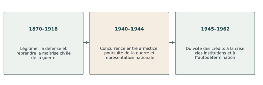

# Diriger la France en temps de guerre, 1870–1962 · Composition d’histoire 2019 · Corrigé guidé

*Corrigé rédigé par IA, non officiel. Signalez toute erreur.*

**Rédaction** · GPT-6.2 Astra Ultra · vitesse non renseignée

La composition commune de six heures porte sur la direction politique de la France. Elle commence avec la guerre franco-allemande et s’achève avec la fin de la guerre d’Algérie. Le rapport du jury de Lyon examine ce sujet aux pages physiques 1 à 5.

## Introduction

> [!INDICATION]
> Prendre au sérieux le verbe « diriger » en identifiant qui peut décider, au nom de qui et par quels moyens.

#### Proposition de réponse

En septembre 1870, la capture de Napoléon III laisse un vide au sommet du commandement et précipite la proclamation de la République. En 1962, le général de Gaulle conduit la France à accepter l’indépendance de l’Algérie, en s’opposant à ceux des militaires et des colons qui avaient attendu de son retour le maintien de l’Algérie française. Un empereur chef d’armée peut perdre toute autorité en une défaite. Un général devenu président peut imposer une décision politique à une partie de l’armée. La concentration des titres militaires et civils ne suffit pas à expliquer l’issue des crises.

Diriger en temps de guerre engage la conduite des opérations mais aussi la définition des buts de guerre, la mobilisation des ressources et la décision de conclure la paix. La France à diriger n’est pas seulement la métropole. Ses territoires coloniaux fournissent des hommes, des ressources, parfois une base de souveraineté, puis deviennent les lieux où se défait l’Empire. Comment les détenteurs du pouvoir obtiennent-ils le droit et les moyens de commander dans ces circonstances, et pourquoi la guerre modifie-t-elle tantôt les pratiques des institutions, tantôt le régime lui-même ?

## I. De 1870 à 1918, rendre la conduite de guerre compatible avec le gouvernement parlementaire

> [!INDICATION]
> Comparer deux transferts d’autorité en distinguant la décision politique et la conduite des opérations.

#### Proposition de réponse

À Sedan, en septembre 1870, la défaite touche personnellement un souverain qui dirige une armée en campagne. La République proclamée à Paris le 4 septembre crée un gouvernement de la Défense nationale présidé par le général Trochu. Gambetta, ministre de l’Intérieur, rejoint en octobre la délégation de Tours et organise la levée d’armées en province. Le siège de Paris fragmente le territoire du commandement. Il oblige à coordonner des autorités séparées, disposant de ressources différentes. L’armistice de janvier 1871 et l’élection de l’Assemblée nationale en février déplacent la décision vers une représentation chargée de trancher la question de la paix. Les Parisiens qui reprochent au pouvoir d’abandonner la défense n’acceptent pas tous cette définition de la légitimité. La Commune, de mars à mai, prend aussi ses racines dans ce conflit. La fin des combats extérieurs n’a donc pas rétabli partout l’autorité du même gouvernement.

Le souvenir de l’Empire rend ensuite suspect le chef militaire exerçant un pouvoir personnel. Sous les lois constitutionnelles de 1875, le président de la République dispose formellement de la force armée. La pratique parlementaire et la responsabilité ministérielle limitent sa direction effective. Une large autonomie opérationnelle revient à l’état-major. Ce partage n’élimine pas la question du contrôle. Les expéditions coloniales engagent elles aussi finances, crédits et responsabilité politique. La crise de Lang Son entraîne en mars 1885 la chute de Jules Ferry dans le contexte de la guerre franco-chinoise. Une opération lointaine peut sanctionner immédiatement un gouvernement à Paris.

En 1914, l’Union sacrée facilite le vote des crédits et l’entrée de socialistes au gouvernement. Le gouvernement se replie un temps à Bordeaux, tandis que Joffre dispose d’une grande latitude sur la conduite militaire. Une guerre prolongée exige pourtant de coordonner production industrielle, transport, ravitaillement, recrutement impérial et coopération avec les alliés. Aucun état-major ne dispose seul de ces moyens. Les commissions parlementaires et les comités secrets permettent aux élus de demander des comptes. La désignation de Clemenceau à la présidence du Conseil en novembre 1917 renforce la direction gouvernementale, avec le portefeuille de la Guerre, sans abolir les chambres devant lesquelles le ministère reste responsable. En 1918, la coordination interalliée confiée à Foch est elle-même le fruit de négociations politiques. L’autorité civile républicaine s’est consolidée par l’effort d’organisation autant que par la personne d’un dirigeant.

## II. De 1939 à 1944, des autorités rivales prétendent engager la même France

> [!INDICATION]
> Expliquer pourquoi poursuivre la guerre, conclure l’armistice et gouverner ne recouvrent plus la même action.

#### Proposition de réponse

En septembre 1939, le gouvernement Daladier engage une République parlementaire aux côtés de la Grande-Bretagne. La délégation de pouvoirs réglementaires et les restrictions aux libertés avaient déjà renforcé l’exécutif dans les années précédentes. La mobilisation ne résout cependant pas les désaccords entre autorité gouvernementale et commandement. La défaite de mai-juin 1940 et l’exode posent une alternative décisive. Un gouvernement pourrait chercher en Afrique du Nord et aux côtés des alliés les moyens de continuer la guerre. Une autre solution consiste à négocier un armistice, en prétendant maintenir la présence de l’État auprès des populations métropolitaines. Pétain succède à Reynaud le 16 juin et demande l’armistice, signé le 22. Le choix de la paix militaire immédiate possède des conséquences de régime dont le vote du 10 juillet, puis les actes constitutionnels de Pétain, fixent la forme autoritaire.

Vichy exerce une administration réelle sous souveraineté fortement entravée par l’occupation. Le gouvernement fait aussi des choix propres, dont l’exclusion antisémite et l’engagement dans la collaboration. Évoquer les contraintes allemandes n’enlève rien à la responsabilité des décisions françaises. À partir de novembre 1942, l’occupation de la zone sud réduit encore l’autonomie territoriale de Vichy. Continuer à faire fonctionner des services ne suffit plus à fonder une légitimité nationale incontestée.

De Londres, de Gaulle revendique au contraire une continuité française par la poursuite du combat. Cette revendication n’a au début ni sanction électorale ni reconnaissance internationale acquise. Les territoires de l’Afrique-Équatoriale française ralliés en 1940 offrent des bases administratives et politiques. En 1943, la constitution à Alger du Comité français de la Libération nationale et la formation en métropole du Conseil national de la Résistance rapprochent des légitimités distinctes, militaire, territoriale et résistante. Le Gouvernement provisoire, formé en 1944, revendique la continuité républicaine et organise le rétablissement des autorités à la Libération. L’ordonnance du 9 août 1944 déclare la nullité de principe des actes constitutionnels de Vichy. Ainsi, la question de savoir qui dirige la France s’est jouée entre Londres, Alger, les territoires coloniaux, Vichy et les résistances intérieures autant qu’à Paris.

## III. De 1945 à 1962, la décolonisation éprouve la direction civile puis transforme le régime

> [!INDICATION]
> Comparer l’autorité financière du Parlement, les pouvoirs délégués et le retour du conflit vers la métropole.

#### Proposition de réponse

La IVe République gouverne dans un contexte de reconstruction et de guerre froide. L’Indochine mobilise un corps expéditionnaire et une aide américaine croissante. Le vote des crédits donne au Parlement une prise sur la poursuite des opérations, sans lui assurer une connaissance égale des choix sur place. Après Diên Biên Phu en mai 1954, Mendès France engage la responsabilité de son gouvernement sur l’issue de la négociation. Les accords de Genève en juillet illustrent la capacité d’un président du Conseil parlementaire à redéfinir politiquement le terme d’une guerre. Ils montrent aussi que l’évolution militaire et les puissances présentes limitent ses choix.

En Algérie, le gouvernement présente longtemps le conflit comme une affaire intérieure, les départements algériens étant juridiquement intégrés à la République. Cette qualification pèse sur le langage des opérations mais n’empêche nullement l’extension des pouvoirs d’exception. L’état d’urgence est institué en 1955. Les pouvoirs spéciaux votés en mars 1956 permettent au gouvernement Guy Mollet d’élargir les moyens de l’administration et de l’armée. L’emploi des appelés lie plus directement familles métropolitaines et guerre coloniale. La délégation de tâches de maintien de l’ordre aux militaires pose la question de la responsabilité politique pour les atteintes aux libertés et pour la pratique de la torture. Un gouvernement civil ne se décharge pas de sa responsabilité en confiant l’exécution à d’autres.

La crise du 13 mai 1958 à Alger et la menace d’une intervention militaire en métropole font peser une contrainte directe sur les institutions. De Gaulle est néanmoins investi par l’Assemblée le 1er juin. La Constitution de la Ve République, approuvée en septembre, renforce l’exécutif, et sa pratique donne au président une position dominante dans le dossier algérien. En septembre 1959, il reconnaît le principe de l’autodétermination. L’appel direct aux citoyens par référendum, puis le recours à l’article 16 lors du putsch d’avril 1961, permettent de faire prévaloir une politique que combattent des militaires et les partisans les plus déterminés de l’Algérie française. Les accords d’Évian de mars 1962, suivis de l’indépendance en juillet, mettent un terme au conflit entre France et FLN, sans mettre fin sur-le-champ aux violences, aux déplacements et aux conséquences pour les populations. La nouvelle direction de l’État se consolide en acceptant la perte d’un territoire qu’une partie de ses soutiens voulait précisément conserver.

## Conclusion

> [!INDICATION]
> Répondre en termes de capacités et de légitimité, sans postuler un renforcement continu de l’exécutif.

#### Proposition de réponse

En temps de guerre, diriger suppose de réunir le commandement, les ressources et une autorité permettant d’engager le pays jusque dans la paix. En 1914–1918, les mécanismes parlementaires soutiennent la mobilisation et finissent par mieux encadrer le commandement. En 1940, la défaite brise l’unicité de la représentation nationale. En 1958, le conflit colonial modifie les institutions métropolitaines avant que celles-ci ne rendent possible une sortie de guerre contraire aux attentes de certains militaires. Ces trajectoires écartent toute loi simple qui ferait de l’autorité personnelle la condition de la victoire. La question décisive est celle des pouvoirs que les dirigeants peuvent effectivement exercer et justifier devant les gouvernés.
