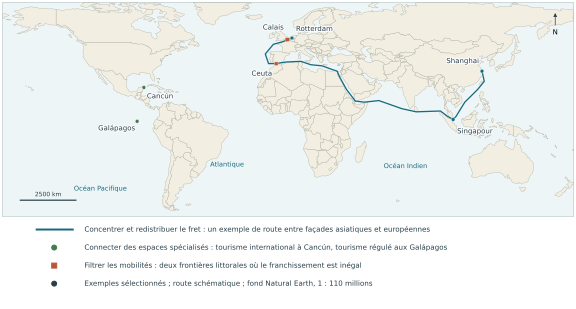

# Les littoraux sont-ils des interfaces de la mondialisation ? · Composition de géographie 2019 · Corrigé brut

*Corrigé rédigé par IA, non officiel. Signalez toute erreur.*

**Rédaction** · GPT-6.2 Astra Ultra · vitesse non renseignée

Le sujet de cinq heures, sans atlas, accompagne son intitulé d’un fond de carte. La composition et le croquis répondent à la forme interrogative. Le rapport disciplinaire de la session consacre à la composition les pages 1 à 3, jusqu’au début de la spécialité.

## Introduction

À Calais, la proximité du littoral britannique alimente l’activité du terminal transmanche. Pour un poids lourd engagé dans une chaîne européenne de livraison et pour une personne qui ne remplit pas les conditions administratives d’entrée au Royaume-Uni, cette proximité ne produit pourtant pas le même effet. Le littoral met en contact des territoires, mais les relations qu’il permet ou empêche dépendent de l’équipement, des décisions politiques et de la position des acteurs.

Un littoral est une bande de terre et de mer dont l’étendue varie suivant les processus considérés. Une interface suppose une mise en relation effective entre espaces différents avec franchissement, transformation ou redistribution. La mondialisation élargit et hiérarchise les réseaux de circulation de marchandises, de capitaux, d’informations et de personnes. Tous les littoraux ont un contact avec la mer. Tous ne transforment pas ce contact en une relation mondiale de même intensité. Dans quelles conditions le rivage devient-il interface, et pour qui peut-il rester une frontière ou un espace tenu à l’écart ?

## I. Les interfaces les plus puissantes associent des routes maritimes à des territoires terrestres

La conteneurisation a facilité le passage d’un mode de transport à un autre et renforcé l’importance d’un petit nombre de terminaux équipés de portiques, de terre-pleins et d’accès en eau profonde. La Shanghai portuaire a pu étendre ses capacités à Yangshan, un site insulaire relié au continent par un pont. Le débouché de la basse vallée du Yangzi et la concentration d’activités industrielles et logistiques donnent au port un arrière-pays important. À l’autre extrémité des lignes Asie-Europe, Rotterdam associe extensions portuaires gagnées sur la mer, vallée rhénane, navigation fluviale, réseaux ferrés et routiers. Ces deux façades connectent des territoires producteurs et consommateurs. Elles transforment également l’espace côtier par leurs emprises et l’extension des zones industrielles.

Singapour illustre un autre mécanisme. Le détroit de Malacca concentre les routes reliant océan Indien et mers d’Asie orientale. Mais une position sur le passage ne suffit pas. La ville-État a investi dans des installations capables de redistribuer des conteneurs vers des lignes régionales, ainsi que dans la réparation, les services aux navires et le financement. La valeur produite dépend des ruptures de charge et des services, et pas seulement du volume qui passe au large. Les ports d’un même détroit peuvent être complémentaires et concurrents. À l’inverse, les littoraux voisins qui ne disposent pas de quais adaptés ou de connexions intérieures restent contournés.

Le croquis suit une route schématique entre Shanghai et Rotterdam par Singapour, l’océan Indien et Suez. Il montre une relation possible, pas le parcours imposé à toute marchandise asiatique. Les armateurs arbitrent entre taille des navires, coûts de passage, délais et durée des escales. Des câbles sous-marins et leurs points d’atterrage, par exemple à Marseille, rappellent enfin que la connexion littorale concerne aussi des flux d’information presque invisibles depuis le rivage.

## II. Le littoral met les personnes en relation selon des modalités très inégales

La mise en tourisme crée une interface même en l’absence de grand port de commerce. À Cancún, sur la côte caraïbe du Mexique, la planification publique a favorisé à partir des années 1970 la construction d’une station, de complexes hôteliers, d’un aéroport et d’infrastructures. Le littoral est accessible depuis des marchés lointains grâce à des liaisons aériennes et à la commercialisation de séjours. Les investissements et les visiteurs circulent à l’échelle internationale. Les employés viennent aussi de territoires intérieurs, souvent pour habiter hors des espaces balnéaires les plus valorisés. L’ouverture à la clientèle mondiale ne garantit donc ni l’accès uniforme aux plages ni une répartition égale des revenus.

Les échanges migratoires font ressortir le caractère sélectif de la même notion. Dans le détroit de Gibraltar, Ceuta se situe sur la rive africaine et appartient à l’Espagne. La frontière avec le Maroc est juridiquement et matériellement organisée. Des navettes légales, des activités de commerce et la présence d’un poste-frontière traduisent l’intensité des relations entre rives. Pour d’autres personnes, les contrôles et les changements de règles produisent des attentes prolongées et des déplacements contraints. À Calais, la continuité offerte par les liaisons maritimes et le tunnel sous la Manche coexiste avec des contrôles britanniques et français. Des campements se sont formés dans ce territoire d’échange. Le littoral est une interface précisément parce que s’y effectue une sélection, avec des coûts humains très inégaux.

L’échelle du quartier importe autant que celle de l’océan. Un salarié des services touristiques, un riverain exposé aux nuisances ou un habitant privé de titre de voyage peuvent rester relativement immobiles dans un lieu réputé très connecté. L’interface doit donc être décrite par les capacités différenciées d’agir, et non par une flèche globale qui additionnerait tous les déplacements.

## III. Une interface peut être régulée, contestée ou réduite à quelques usages

Les infrastructures et les délimitations ont un coût. Les extensions de terminaux transforment vasières, laisses de mer et espaces de pêche. La rentabilité d’une escale à l’échelle d’une compagnie peut entraîner à l’échelle locale du trafic terrestre et un conflit sur l’accès au foncier. À Rotterdam, l’extension sur la mer répond à la recherche de capacités nouvelles mais pose aussi la question des compensations et de la protection des milieux dans le delta. Ces choix sont négociés entre autorités portuaires, collectivités, entreprises et associations. Ils peuvent intensifier une relation ou la déplacer vers un autre site.

Les Galápagos offrent un autre type de rapport au monde. Un environnement protégé attire visiteurs et chercheurs et fournit une image internationalement valorisée. L’accès aux sites et le nombre de visiteurs par itinéraire sont encadrés, de sorte qu’une partie du littoral fonctionne comme une interface touristique sélective tandis que d’autres secteurs demeurent protégés. Un faible trafic local ne signifie donc pas une absence de mondialisation. Il peut résulter d’une politique destinée à éviter la dégradation du milieu qui fonde cette relation. À l’inverse, une côte ouverte et peu équipée peut être longée par un axe mondial sans tirer parti des échanges.

Les États interviennent enfin pour exercer ou affirmer leur souveraineté. Dans un espace de passage comme le détroit d’Ormuz, les circulations énergétiques mondiales et les tensions entre États donnent aux mêmes eaux des fonctions commerciales et politiques. La convention des Nations unies sur le droit de la mer distingue les espaces et les droits qui s’y exercent. Les droits souverains sur les ressources d’une zone économique exclusive ne valent pas fermeture générale à la navigation. La fonction d’interface varie avec les usages, le droit et la conjoncture.

## Conclusion

Une façade industrielle ou portuaire reliée à un large arrière-pays, un terminal de transbordement et une destination touristique peuvent tous fonctionner comme interfaces, mais selon des mécanismes différents. La côte n’acquiert cette fonction que par l’organisation effective de relations. Des littoraux parcourus par les routes mondiales restent localement peu accessibles, tandis qu’un littoral protégé entretient des liens internationaux sélectifs. Ouvrir à certaines marchandises ou personnes peut impliquer de filtrer d’autres usages. C’est cette production géographique de l’ouverture et de la fermeture qui donne son sens au pluriel « les littoraux ».
