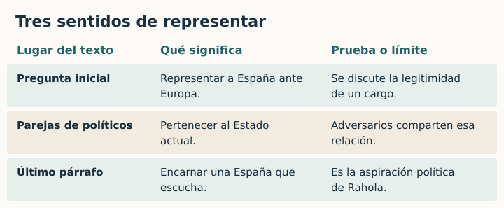

# ENS Paris-Saclay · BEL anglais · Espagnol LV2, oral 2019, sujet 1 — Corrigé guidé

*Corrigé rédigé par IA, non officiel. Signalez toute erreur.*

**Rédaction** · GPT-6.2 Astra Ultra · vitesse non renseignée

## El Estado

Le jury de première année accorde 30 minutes de préparation. Le compte rendu et le commentaire en espagnol ouvrent un oral de 25 à 30 minutes, échange compris. En 2019, le jury a jugé satisfaisante la durée moyenne de 14 minutes pour la présentation. Les questions d’entretien ci-dessous sont des propositions d’entraînement.

## Préparer la prise de parole

Relisez la question de Sánchez-Merlo et relevez le verbe que Rahola reprend dans sa conclusion. Écrivez successivement trois compléments en espagnol sur votre brouillon, *representar ante Europa*, *formar parte del Estado* et *encarnar una España futura*. À chaque ligne, nommez ce qui permettrait de vérifier l’affirmation. La première porte sur une fonction, la deuxième sur l’appartenance politique présente et la troisième sur un idéal. Ce décalage donne son mouvement au commentaire.

Prononcez *quizás* en laissant entendre que l’autrice avance une hypothèse. Entraînez-vous à restituer cette nuance par deux phrases, *Rahola considera que hay varias lecturas de la Constitución. Sugiere que una de ellas protegería mejor ciertos derechos*. Le conditionnel préserve la différence entre la thèse de pluralité et la préférence de la chroniqueuse.

Pour développer le passage comparatif, imaginez que le jury demande *¿En qué se parecen jurídicamente los dos países que cita?* Repartez de ce que vous avez sous les yeux. Rahola oppose des façons de résoudre un conflit territorial. Le texte donne une analogie politique. Un rapprochement juridique détaillé demanderait d’autres données. Vous pouvez alors revenir à la notion de dialogue pour expliquer ce que cette analogie apporte à sa démonstration.

## Síntesis del texto

Pilar Rahola interviene en *La Vanguardia* el 25 de mayo de 2019, a propósito de una pregunta que otro columnista, Luis Sánchez-Merlo, ha formulado en un artículo sobre la suspensión de representantes electos encarcelados. La pregunta apunta a Carles Puigdemont. ¿Con qué legitimidad representaría a España en Europa quien ha actuado contra su Constitución? Rahola reconoce la inteligencia del interlocutor y discute el supuesto que hace posible su pregunta.

Para la columnista, una nación es una construcción política e histórica. Recuerda la imposición del castellano en detrimento del catalán y rechaza que los defensores de la unidad territorial puedan reservarse el nombre de España. Aznar y Puigdemont, Sánchez y Junqueras, pertenecen por igual al Estado del que hablan. La segunda parte afecta a la interpretación de la Constitución. Rahola atribuye a los independentistas una concepción de la democracia que privilegia la consulta y el pacto, y sugiere que esa concepción podría proteger mejor los derechos. En consecuencia, Puigdemont podría representar una España dispuesta a escuchar, aunque, según la autora, esa España todavía está por hacer.

## Comentario

¿En qué sentido puede alguien representar al Estado cuya configuración política quiere cambiar? La columna hace que el verbo *representar* cambie de significado a medida que avanza el razonamiento.

### Del mandato a la pertenencia

La pregunta inicial parece referirse a una función pública ante Europa. El lector puede pensar en los requisitos de un cargo. Rahola cambia la escala y pregunta quién está autorizado a hablar en nombre del país en el debate público. Las parejas de nombres propios realizan ese desplazamiento con economía. Los cuatro políticos sostienen proyectos incompatibles y, sin embargo, el mismo nombre de país los abarca. De este hecho la autora extrae una consecuencia sobre la pertenencia. Defender otro futuro territorial no borra el vínculo presente de un ciudadano con el Estado. La frase sobre lo caro que les sale ese vínculo a los catalanes añade una nota irónica de carácter material a un debate que parecía puramente simbólico. No aporta una contabilidad de las relaciones fiscales.

Un detalle del comienzo permite comprobar esta lectura. Sánchez-Merlo había planteado su pregunta en un texto cuyo tema principal era otro. La columnista lo reconoce expresamente. Por tanto, no disponemos aquí de una exposición completa del razonamiento de su colega. Cuando Rahola dibuja dos trincheras y coloca en una de ellas a unos separatistas supuestamente maliciosos, dramatiza la división que cree descubrir detrás de la pregunta. Esos adjetivos pertenecen al retrato que ella construye de una mirada adversa. Tomarlos por un insulto suyo a los independentistas invertiría la dirección de la ironía. También sería inexacto atribuir sin más todo ese retrato al columnista aludido. Lo que sí puede mostrarse es el efecto de la escena en quien lee. Se le ofrece primero una imagen fácilmente reconocible y enseguida la posibilidad de mirarla desde el otro lado. La columna ensaya con su lector la apertura de perspectiva que al final reclamará del Estado.

El recuerdo de las políticas contra el catalán cumple una función análoga en el tiempo. Rahola remonta su reproche a 1714 para impugnar la idea de que la unidad estatal se haya impuesto siempre por una voluntad compartida. Resultaría difícil verificar una cifra sobre siglos de legislación a partir de una sola columna. Para el comentario basta observar cómo cambia la carga de la prueba. Si una realidad tiene historia, se puede investigar quién la formó y bajo qué condiciones. Quien quiere discutir sus condiciones actuales deja de parecer alguien que ataca una evidencia natural. Ahora bien, el razonamiento también abre una pregunta a la propia autora. Si una nación se ha construido históricamente y admite proyectos diferentes, un futuro Estado catalán tendría igualmente que explicar cómo garantizaría la pluralidad de lenguas, pertenencias y lealtades de sus habitantes. La validez general del principio permite plantear la pregunta sin cambiar de tema.

### Del texto constitucional a las voces que lo interpretan

La metáfora de las trincheras explica la dificultad del debate. Si la Constitución ya está situada a un lado, cualquier objeción parece un ataque desde fuera. La imagen de la propiedad privada transforma ese reparto en una apropiación que el lector puede poner en duda. La apelación a los constitucionalistas introduce la posibilidad de otras lecturas. Ahora bien, el texto no cita un artículo que establezca un procedimiento ni demuestra que cualquier consulta sea jurídicamente válida. La autora plantea una preferencia política por una solución negociada. El condicional y el adverbio *quizás* permiten oír el momento en que pasa de reivindicar la pluralidad a valorar una de sus expresiones. Podríamos compartir la primera tesis y pedir más argumentos para la segunda.

### ¿Qué España cabe en el desenlace?

La comparación entre el Reino Unido y Turquía invita a elegir entre dos modos de responder al desacuerdo territorial. Funciona como un horizonte de conducta. El artículo no examina las respectivas constituciones ni traslada a España un mecanismo concreto. El último párrafo retoma el verbo de la pregunta inicial. Esta vez representar significa encarnar una promesa política. El país que escucharía a Puigdemont pasa a ser el país que Puigdemont supuestamente encarna. La paradoja da fuerza al cierre, pero abre una objeción fértil. Cabe preguntarse quién encarna a los catalanes que desean seguir formando parte de España. Aplicar a ese grupo el principio pluralista de la autora permitiría llevar su argumento más lejos que su propio desenlace.

Hay un segundo cambio de vocabulario que ayuda a escuchar el artículo. Primero se habla de pertenecer al Estado mientras no se tenga uno propio. Esa fórmula admite una situación transitoria y un proyecto de separación. Más tarde aparecen verbos que presuponen interlocutores, como dialogar y pactar. Una persona puede pertenecer al Estado aunque discrepe de quien gobierna. En cambio, nadie pacta por sí solo. El salto de un sentido al otro explica por qué la voluntad de consultar, aunque constituya una razón política a favor de abrir conversaciones, no proporciona de antemano ni los términos del pacto ni su resultado. Una buena lectura puede interrogar esa distancia sin convertir el comentario en un alegato personal a favor o en contra de la independencia.

Otra reserva afecta al término *Europa*. Al comienzo es el espacio ante el cual alguien podría representar a España. Poco después sirve de referencia para juzgar cuáles serían los modelos democráticos más respetuosos. La repetición confiere continuidad al argumento a pesar del cambio de función. ¿Qué entiende la columnista por una democracia homologable? En el fragmento, la respuesta gira en torno a escuchar una demanda territorial y resolverla mediante acuerdo. No desarrolla un inventario completo de criterios europeos. Por eso merece la pena terminar el comentario con el verbo *escuchar*. Obliga a imaginar una relación entre personas que ya están en desacuerdo. Cuanto más convincente resulte esa imagen, más importante será precisar a quiénes habrá que escuchar, en Cataluña y en el resto del Estado, para que aquella promesa democrática pueda ser compartida.

## Conversación con el jurado

**¿La columna considera que ya existe la España que Puigdemont representa?** Su pertenencia al Estado es para Rahola un hecho presente. La España receptiva que él podría encarnar es una aspiración. La última frase funciona precisamente porque permite percibir la distancia entre ambas.

**¿Cómo presentaría usted el vocabulario sobre los presos?** Diría que la columnista los llama *presos políticos*. Esa calificación expresa su interpretación de la situación y contribuye a su argumento sobre las garantías democráticas. Atribuirle la expresión permite explicar su elección de palabras con precisión.

**¿Qué pregunta le haría a la autora?** Si la Constitución admite lecturas más abiertas, ¿cómo se organizaría un acuerdo que ofreciese garantías tanto a los partidarios de la independencia como a sus adversarios? La columna presenta el diálogo como un valor. Sería interesante precisar quién intervendría en él.

## Sources de l’épreuve

[Sujet BEL anglais, deux pages](https://ens-paris-saclay.fr/sites/default/files/CONCOURS/ANNALES_1C/1C_LE_Anglais/2019_Sujet_oraux_LE_Anglais_LV2_Espagnol_01.pdf) · [Rapport du jury de première année, pages 1 et 2](https://ens-paris-saclay.fr/sites/default/files/CONCOURS/ANNALES_1C/1C_LE_Anglais/2019_Rapport_Oraux_LE_Anglais_LV2_Espagnol.pdf)

Les annales BEL anglais et cycle master anglais publient le même feuillet. Cette proposition suit les modalités du rapport d’entrée en première année. [Exemplaire du cycle master anglais](https://ens-paris-saclay.fr/sites/default/files/CONCOURS/ANNALES_2C/2C_Anglais/2019_Sujet_2Canglais_LV2_Espagnol01.pdf)
