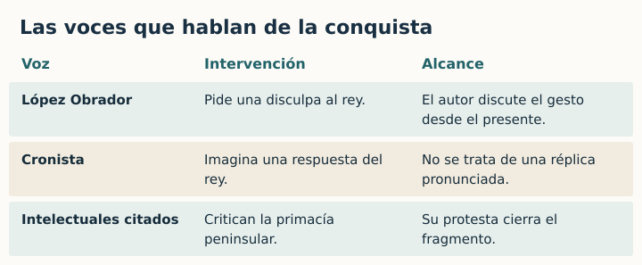

# ENS Paris-Saclay · BEL anglais · Espagnol LV2, oral 2019, sujet 2 — Corrigé guidé

*Corrigé rédigé par IA, non officiel. Signalez toute erreur.*

**Rédaction** · GPT-6.2 Astra Ultra · vitesse non renseignée

## Perdón es una palabra castellana

Le jury de première année accorde 30 minutes de préparation. Le compte rendu et le commentaire en espagnol ouvrent un oral de 25 à 30 minutes, échange compris. En 2019, le jury a jugé satisfaisante la durée moyenne de 14 minutes pour la présentation. Les questions d’entretien ci-dessous sont des propositions d’entraînement.

## Préparer la prise de parole

Sur votre feuille, attribuez chaque parole à son locuteur. AMLO formule une demande, le roi reçoit une réplique imaginaire sous la plume du chroniqueur, Caparrós critique le Tren Maya et les intellectuels argentins dénoncent le congrès. Essayez de raconter ces quatre moments sans répéter *dice*. *Pide que*, *imagina que*, *pronostica que* et *denuncian que* encodent quatre statuts de parole. Après *pide que*, employez le subjonctif, comme dans *pide que el rey reconozca el daño*.

Pour passer du compte rendu au commentaire, prenez deux noms de la série de la page 1. Expliquez à voix haute pourquoi Bolívar et Sor Juana ne sont pas des exemples interchangeables. Le premier permet d’envisager l’indépendance politique, la seconde la création littéraire. Enchaînez sur la contestation du congrès, qui porte sur l’autorité exercée au sein du même espace linguistique.

Le feuillet comprend des coupures signalées. À la dernière ligne, précisez que la dernière voix reproduite est celle du groupe de contestataires. Pour vous exercer à l’entretien, répondez à *¿Se contradice quien denuncia en castellano la dominación del castellano?* Distinguez usage de la langue, choix parfois contraint de cet usage et maîtrise des institutions qui définissent sa norme. Cette distinction permet de discuter l’ironie de Caparrós à partir de son propre exemple.

## Síntesis del texto

El 28 de marzo de 2019, Martín Caparrós comenta en *The New York Times* la petición de Andrés Manuel López Obrador al rey de España para que se disculpe por la conquista. Observa que el presidente mexicano formula esa petición en castellano y que la genealogía de los actuales mexicanos impide repartir a los descendientes entre dos bloques nacionales sencillos. Además, recuerda los aliados indígenas de los conquistadores y las relaciones de dominación anteriores a la llegada de los españoles. Su argumento político inmediato se dirige a AMLO. El autor ve una contradicción entre las palabras de solidaridad con los pueblos indígenas y el proyecto del Tren Maya, que a su juicio subordina la vida de las comunidades a la economía turística.

Caparrós extiende la discusión al deseo de construir una identidad latinoamericana. Ridiculiza la idealización de un pasado indígena unánimemente virtuoso y pregunta qué puede hacer el poder a quien lo ejerce. Finalmente, enumera obras de independencia, de militancia y de literatura escritas en castellano. Durante el congreso de la lengua celebrado en Córdoba, Argentina, algunos intelectuales denuncian la primacía del español peninsular y los intereses comerciales que la acompañan. El fragmento entregado termina con su protesta.

## Comentario

¿Cómo discute Caparrós una disculpa diplomática hasta convertirla en una pregunta sobre quién puede decir «nosotros» en América Latina?

### Los efectos de elegir los antepasados

Al presentar a López Obrador como «un señor» y al rey como alguien a quien su cargo limita, el cronista baja el tono solemne de la escena. La asimetría protocolaria sirve para introducir una respuesta que el rey no pronuncia. Caparrós se permite imaginar lo que podría replicar un escritor como Borges. Es importante distinguir esa voz hipotética de una declaración real de la Corona. Al recordar que hubo aliados indígenas, cuestiona el relato de un choque entre dos pueblos enteramente unidos y ya constituidos. Pero complejizar la composición de los bandos no elimina los efectos de la conquista. La cuestión que queda abierta es si una institución actual puede reconocer daños históricos aun cuando los antepasados de sus interlocutores hayan estado en ambos lados.

La sintaxis del primer párrafo hace visible la operación. Una larga serie de réplicas imposibles tiene al rey por sujeto. El monarca no interviene, pero esa ausencia deja al periodista hablar en su lugar e introducir observaciones incómodas sobre los conquistados. Después llega una frase decisiva sobre los vasallos que quisieron librarse de una dominación y cayeron en otra. Conviene detenerse en ese desenlace. Aunque la ironía se dirija sobre todo contra un relato idealizado del pasado indígena, el cronista tampoco presenta la conquista como la llegada de la libertad. El encadenamiento de las dos dominaciones impide resolver la escena eligiendo un conquistador más benévolo. Obliga a considerar la capacidad de actuar de quienes participaron en aquella alianza y el límite de lo que podían prever sobre sus consecuencias.

La misma atención al sujeto permite leer el pasaje sobre el poder. La burla del «buen salvaje» se dirige contra una imagen fabricada por personas que se eligen ascendencia e identidad. Si alguien atribuye automáticamente virtud a un pueblo porque hoy se encuentra oprimido, corre el riesgo de negarle la complejidad que concede a otros grupos humanos. Un pueblo puede sufrir una injusticia sin que sus miembros hayan de demostrar una inocencia absoluta a lo largo de toda su historia. Esta última formulación permite plantear una reserva al cronista. El reconocimiento de derechos presentes no depende de si un antepasado se comportó como víctima o como verdugo. De este modo es posible aceptar la crítica a la idealización y mantener abierta la discusión sobre los derechos de comunidades e individuos en el México actual.

### Las obligaciones del presente

El ejemplo ferroviario permite cambiar de criterio. En lugar de preguntar a qué grupo pertenecen los antepasados del presidente, el lector puede preguntar quién decide hoy sobre el uso de un territorio y quién obtiene el beneficio. El tren aparece como un proyecto en 2019. La predicción de que convertirá a los habitantes en servidores del turismo es un juicio de Caparrós, no una evaluación posterior del proyecto terminado. Este cambio fortalece su polémica porque permite contrastar un gesto de reconocimiento con una decisión de gobierno. También admite una objeción. El reconocimiento simbólico y la justicia material pueden coexistir. El ejemplo denuncia la contradicción que el autor cree encontrar en este gobierno, sin demostrar que toda disculpa impida una reparación efectiva.

### Una lengua que ha cambiado de manos

El título parecía señalar una ironía a costa de AMLO. Después de la lista que reúne a Bolívar y a Sor Juana, adquiere otro alcance. Personas con proyectos muy diferentes han escrito en la lengua llegada con los conquistadores. El castellano ha servido también para emanciparse, inventar y protestar contra formas de hegemonía. La propia Córdoba argentina lleva un nombre viajero, lo que hace visible una historia de apropiaciones en el lugar del congreso. El «nos» del cronista se incluye en esa historia. Los intelectuales citados al final preguntan, en cambio, quién fija el centro de autoridad de esa lengua compartida. Se puede participar en una comunidad lingüística y discutir simultáneamente el poder de sus instituciones. La aparición de esa voz da al lector un problema más complejo que el de declarar una lengua inocente o culpable.

La distinción entre lengua y poder adquiere cuerpo en los nombres de lugar. Córdoba, en Argentina, remite a Córdoba, en Andalucía. El autor evoca a su vez varios estratos posibles detrás del nombre peninsular. El guiño desacredita la imagen de un origen lingüístico puro al cual pudiera atribuirse cada palabra de una vez por todas. Pero tampoco equivale a decir que todas las influencias pasadas se produjeron en condiciones iguales. Se puede heredar una lengua impuesta, transformarla a lo largo de generaciones y seguir discutiendo las relaciones de poder entre sus hablantes. Volvamos a la protesta final. Lo que preocupa a aquellos intelectuales es el peso que adquiriría una variedad peninsular en decisiones culturales y económicas actuales. La lista de grandes autores hispanoamericanos demuestra vitalidad y capacidad de creación. No mide por sí misma quién financia un congreso ni quién determina las normas que allí se promueven.

La presencia del cronista en ese congreso añade una dificultad productiva. Caparrós se cuenta entre los asistentes y al mismo tiempo se permite dudar de lo que allí se descubrirá. Su pertenencia no exige adhesión. Leída de ese modo, su situación ofrece un paralelo con el título. Hablar una lengua no obliga a suscribir todos los usos históricos e institucionales de esa lengua. También se puede participar en un espacio cultural y discutir sus jerarquías desde dentro. Lo que empezó como una chanza sobre un presidente que pide una disculpa en castellano acaba siendo una pregunta que alcanza al propio escritor. ¿Qué responsabilidades adquiere quien usa en público esa lengua compartida para contar la historia de otros?

## Conversación con el jurado

**¿A quién se atribuye la denuncia sobre los intereses empresariales?** Al grupo de intelectuales que protesta contra el congreso. Caparrós la cita después de expresar sus propias dudas sobre la utilidad intelectual de esas reuniones. Las dos reservas tienen motivos distintos.

**¿Qué aporta el ejemplo de los aliados indígenas?** Recuerda que los pueblos sometidos por los mexicas podían tener intereses propios. Su participación obliga a reconstruir las relaciones de poder de entonces. Por sí sola no zanja quién debería reconocer hoy los daños de la colonización.

**¿Cómo emplearía la palabra *perdón* al concluir?** Diría que la misma palabra sirve para pedir una disculpa y para interrogar la historia del idioma en que se pide. Esa doble función explica el título con más precisión que una observación sobre la nacionalidad de AMLO.

## Sources de l’épreuve

[Sujet BEL anglais, deux pages](https://ens-paris-saclay.fr/sites/default/files/CONCOURS/ANNALES_1C/1C_LE_Anglais/2019_Sujet_oraux_LE_Anglais_LV2_Espagnol_02.pdf) · [Rapport du jury de première année, pages 1 et 2](https://ens-paris-saclay.fr/sites/default/files/CONCOURS/ANNALES_1C/1C_LE_Anglais/2019_Rapport_Oraux_LE_Anglais_LV2_Espagnol.pdf)

Les annales BEL anglais et cycle master anglais publient le même feuillet. Cette proposition suit les modalités du rapport d’entrée en première année. [Exemplaire du cycle master anglais](https://ens-paris-saclay.fr/sites/default/files/CONCOURS/ANNALES_2C/2C_Anglais/2019_Sujet_2Canglais_LV2_Espagnol02.pdf)
