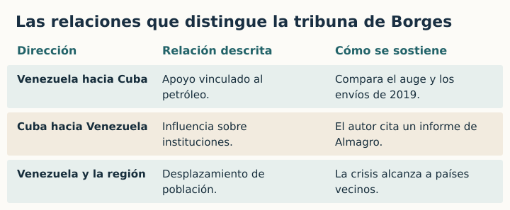

# ENS Paris-Saclay · BEL anglais · Espagnol LV2, oral 2019, sujet 3 — Corrigé guidé

*Corrigé rédigé par IA, non officiel. Signalez toute erreur.*

**Rédaction** · GPT-6.2 Astra Ultra · vitesse non renseignée

## Cuba tiene secuestrada a Venezuela

Le jury de première année accorde 30 minutes de préparation. Le compte rendu et le commentaire en espagnol ouvrent un oral de 25 à 30 minutes, échange compris. En 2019, le jury a jugé satisfaisante la durée moyenne de 14 minutes pour la présentation. Les questions d’entretien ci-dessous sont des propositions d’entraînement.

## Préparer la prise de parole

Tracez deux flèches sur le brouillon. Inscrivez *petróleo* sur celle qui part du Venezuela, *influencia institucional según Borges* sur celle qui part de Cuba. Puis ajoutez à part les pays qui accueillent des personnes parties du Venezuela. Les trois relations vous permettent d’expliquer la portée régionale du texte sans confondre ressource, influence et déplacement humain.

Reformulez le début en trois temps avec *Rodríguez habría dicho*, *Borges entendió que* et *el autor pide que*. Le premier renvoie à un propos rapporté, le deuxième à l’interprétation du témoin et le troisième à une demande au présent. Pour les chiffres, dites *unos veintidós mil según el informe citado por Borges* et *entre cuarenta mil y cincuenta mil barriles diarios según la tribuna*. Un chiffre d’effectif et un flux journalier n’étayent pas la même affirmation.

À l’entretien, préparez la relance *¿Qué aporta el plural nosotros?* Au début, il désigne un groupe de législateurs de l’opposition en négociation. Plus loin, il s’élargit aux Vénézuéliens dont l’auteur prétend défendre les intérêts. Posez alors une question critique en espagnol sur la représentativité d’une tribune signée. Cette question met à profit la position d’énonciation sans effacer la connaissance de première main que le témoin invoque.

## Síntesis del texto

Julio Borges, que habla como miembro de la oposición venezolana, firma esta tribuna publicada el 22 de marzo de 2019 en *The New York Times*. Evoca una negociación celebrada en la República Dominicana en enero de 2018. Según su recuerdo, Jorge Rodríguez deseaba para el Gobierno venezolano el trato internacional que recibía Cuba. Borges interpreta esa aspiración como un deseo de aceptación internacional sin democratización. A continuación sostiene que Cuba ejerce influencia directa sobre instituciones venezolanas, incluidos servicios civiles y militares. En apoyo de esa acusación cita el informe que Luis Almagro presentó en 2018 y que, según Borges, cifraba en unos 22.000 los cubanos infiltrados.

Su explicación retrocede a la pérdida del apoyo económico soviético y al acercamiento entre Fidel Castro y Hugo Chávez. El auge petrolero venezolano facilitó los envíos a Cuba. Estos habrían continuado pese a la caída de la producción y a la crisis venezolana. A diferencia de Cuba, añade Borges, Venezuela comparte fronteras terrestres con otros países. Los desplazamientos de población convierten así la crisis en una cuestión regional. El autor pide que cualquier negociación incluya a los dirigentes cubanos, defiende presiones económicas, reclama investigaciones y exhorta a la izquierda internacional a retirar su apoyo a Nicolás Maduro.

## Comentario

¿Cómo convierte un participante en la negociación una relación entre dos gobiernos en una cuestión de responsabilidad internacional?

### Un testigo construye una interpretación

El comienzo sitúa a Borges alrededor de la misma mesa que el delegado del Gobierno. «Llevábamos» acredita esa proximidad y sitúa al mismo tiempo al narrador en uno de los bandos. El lector recibe el deseo atribuido a Rodríguez a través de quien ahora lo combate. Que un Gobierno quiera recibir determinado trato exterior y que pida ser reconocido como dictadura son proposiciones diferentes. El paso de la primera a la segunda es la interpretación de Borges. Más adelante cambia el tipo de respaldo. La presencia cubana aparece avalada por la mención del secretario general de la OEA y de un informe presentado ante las Naciones Unidas. La atribución precisa importa. El texto cita un informe ante la ONU, no una conclusión adoptada por la ONU.

A esta diferencia entre testimonio e interpretación se añade una cuestión de tiempo. La escena de negociación es anterior a la publicación. En marzo de 2019 se invita al lector a volver sobre una conversación de enero de 2018 como si allí ya pudiera leerse la explicación de una crisis posterior. Tal orden narrativo produce un efecto de revelación. Borges presenta las palabras de su interlocutor como una confesión inesperada. El lector que acepte esa caracterización tenderá a interpretar todo lo que sigue como confirmación de un propósito que se ha descubierto al principio. Cabe invertir el procedimiento para someter la tesis a prueba. ¿Qué nos dirían los datos históricos y económicos si no conociéramos esa frase inicial? Mostrarían relaciones duraderas y decisiones costosas. Todavía tendríamos que preguntar qué margen de decisión conserva cada Gobierno y mediante qué pruebas se puede conocer ese margen.

La cronología económica cumple una función distinta de la confesión. Abarca la pérdida del socio soviético, el encuentro de Castro con Chávez, una fase favorable a las exportaciones venezolanas y un presente de escasez. Vistos en ese orden, los gobiernos no actúan siempre desde la misma posición. Lo que para Venezuela podía representar una ventaja diplomática o un compromiso asumible durante la bonanza pasa a ser para el autor un sacrificio especialmente gravoso durante la crisis. Conviene mantener separados los indicadores que emplea. Los barriles diarios expresan un flujo de suministro. El porcentaje del producto interno bruto de Cuba expresa la importancia relativa de la ayuda en el punto de mayor dependencia que menciona. No hay contradicción automática entre un descenso de los barriles enviados y la persistencia de una relación políticamente importante. Es justamente esa combinación lo que Borges quiere convertir en motivo de alarma.

### Dos dependencias que circulan en sentidos distintos

La imagen del secuestro parece distribuir papeles sencillos entre un captor y un cautivo. Sin embargo, la historia económica que cuenta la tribuna introduce una complicación. Cuba habría necesitado un nuevo proveedor después de perder la ayuda soviética, mientras que los dirigentes venezolanos habrían encontrado en La Habana una referencia política y apoyos institucionales. Los flujos descritos no van en la misma dirección. Borges distingue unos 90.000 barriles diarios durante el auge y entre 40.000 y 50.000 en el momento de escribir. El contraste pretende mostrar tanto la reducción de los volúmenes como la continuidad del compromiso en plena escasez. Por sí solos esos datos no revelan quién tomó una determinada decisión en Caracas. Permiten comprender el coste de la alianza que el autor denuncia.

### Una voz que interpela a públicos distintos

La frase «no somos una isla» empieza como observación geográfica y termina como argumento político. Los efectos de la migración alcanzan a Estados cuyos gobiernos podrían considerar la disputa un asunto interno venezolano. El final reparte tareas entre negociadores, empresas, el Grupo de Lima y movimientos de izquierda. A los primeros les pregunta en la práctica con quién deberían sentarse. A los últimos les reprocha que la afinidad política les impida examinar lo que ocurre. El resultado se parece más a un llamamiento público que a una investigación con derecho de réplica. Al valorar su propuesta cabría preguntar quién asumiría los costes de las sanciones y cómo distinguir sus efectos sobre los gobernantes de sus efectos sobre la población. El artículo fija un destinatario político para la presión, pero deja esa cuestión social abierta.

El léxico de la soberanía también merece examen. *Secuestro*, *invasión* y *coloniaje* no son tres categorías que el texto defina por separado. Todas cuestionan que el poder efectivo coincida con las instituciones formalmente venezolanas. Por eso tienen tanta fuerza en boca de alguien que busca que su país vuelva a decidir por sí mismo. Al mismo tiempo, su sucesión puede dar por resuelta la explicación. Si llamamos colonia a la relación antes de examinar cada decisión, cualquier intercambio de recursos entre los dos países parecerá una prueba suplementaria del dominio que ya habíamos supuesto. Una lectura rigurosa puede reconocer el valor expresivo de esas imágenes y preguntar en qué casos hay cooperación voluntaria, en cuáles dependencia económica y en cuáles coacción demostrable. La tribuna sostiene una respuesta tajante, pero no aporta en el fragmento la documentación necesaria para resolver cada caso.

El cierre convierte esta cuestión de lenguaje en una prueba política dirigida a la izquierda internacional. Borges le pide que examine la experiencia de la población venezolana antes de expresar su solidaridad con un Gobierno. El reproche se entiende mejor si se compara con la primera escena. Al principio, el delegado gubernamental habría deseado una determinada forma de reconocimiento externo. Al final, el autor busca retirar precisamente ese reconocimiento. Los actores internacionales aparecen así a ambos extremos de una historia cuyo título parecía limitarse a dos países. Este desplazamiento explica por qué el artículo no termina al enumerar los envíos de petróleo. Su objetivo es cambiar una relación de legitimidad y las decisiones de quienes contribuyen a sostenerla.

## Conversación con el jurado

**¿Por qué vuelve Borges a la caída de la Unión Soviética?** Para explicar la búsqueda de un nuevo sostén económico desde La Habana. Ese retroceso enlaza las decisiones de Fidel Castro y de Hugo Chávez con la posterior bonanza venezolana y ayuda a entender por qué el petróleo ocupa tanto espacio en la reconstrucción histórica que hace la tribuna.

**¿Quién emplea el lenguaje del secuestro?** Lo emplea el autor. La metáfora concentra su tesis de pérdida de soberanía. Al explicarla conviene añadir las dos relaciones que analiza, porque una dependencia económica cubana puede coexistir en su razonamiento con una influencia política cubana sobre Caracas.

**¿Qué diferencia hay entre negociar y presionar en su propuesta?** Borges quiere incorporar a los dirigentes de La Habana a una negociación porque les atribuye poder de decisión. También quiere que la comunidad internacional ejerza presión sobre ellos. Identificar al interlocutor y escoger los medios para influir sobre él son dos decisiones distintas.

## Sources de l’épreuve

[Sujet BEL anglais, deux pages](https://ens-paris-saclay.fr/sites/default/files/CONCOURS/ANNALES_1C/1C_LE_Anglais/2019_Sujet_oraux_LE_Anglais_LV2_Espagnol_03.pdf) · [Rapport du jury de première année, pages 1 et 2](https://ens-paris-saclay.fr/sites/default/files/CONCOURS/ANNALES_1C/1C_LE_Anglais/2019_Rapport_Oraux_LE_Anglais_LV2_Espagnol.pdf)
