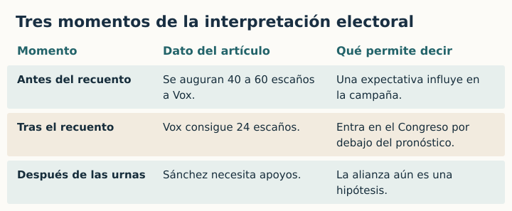

# ENS Paris-Saclay · BEL anglais · Espagnol LV2, oral 2019, sujet 4 — Corrigé brut

*Corrigé rédigé par IA, non officiel. Signalez toute erreur.*

**Rédaction** · GPT-6.2 Astra Ultra · vitesse non renseignée

## El miedo no es tonto

Le jury de première année accorde 30 minutes de préparation. Le compte rendu et le commentaire en espagnol ouvrent un oral de 25 à 30 minutes, échange compris. En 2019, le jury a jugé satisfaisante la durée moyenne de 14 minutes pour la présentation. Les questions d’entretien ci-dessous sont des propositions d’entraînement.

## Síntesis del texto

Martín Caparrós escribe desde Madrid sobre las elecciones generales que ganó el PSOE en abril de 2019. El fragmento de *The New York Times* lleva fecha del 28 de abril. El autor abre con el retrato de cinco candidatos de aspecto parecido y se pregunta cómo pueden dar cuenta de una España diversa. Atribuye el triunfo de Pedro Sánchez en parte a sus adversarios. La competencia entre PP, Ciudadanos y Vox dividió a la derecha. Vox consiguió 24 escaños, por debajo de los 40 a 60 que algunos le auguraban. Aun así, según Caparrós, desplazó la campaña conservadora hacia la derecha y movilizó a electores de izquierda que en otras ocasiones se habían abstenido.

En un sistema parlamentario la victoria socialista deja abiertas varias alianzas. Caparrós contempla un acercamiento a Ciudadanos, aunque considera más probable un entendimiento difícil con Podemos que requeriría además apoyos vascos y catalanes. Imagina que Sánchez querrá presentar su éxito como un renacimiento de la socialdemocracia europea. Cree posibles algunas mejoras en los servicios públicos, la igualdad y el empleo juvenil, pero duda de que cambien sustancialmente la fiscalidad o el reparto de la riqueza. La forma de abordar el conflicto catalán le parece decisiva para el futuro de España y para la evolución de la extrema derecha.

## Comentario

¿Por qué un partido con menos escaños de los previstos puede resultar decisivo para sus adversarios? Caparrós abre esa pregunta al distinguir el resultado de las urnas, el clima de la campaña y el trabajo posterior de construir una mayoría.

### Lo que una fotografía electoral deja fuera

Al comparar a los aspirantes con modelos de un anuncio de colonia, el cronista desplaza por un instante el foco de los programas al cuerpo de quienes aspiran a representar a los demás. La enumeración de las figuras ausentes rompe el molde del candidato joven, masculino y sonriente. El humor plantea así un problema de representación antes de que el lector conozca el reparto de escaños. Sería excesivo concluir que los votantes eligen por el físico. La escena pregunta quién llega siquiera a aparecer en la imagen entre la que se ofrece elegir. También prepara el escepticismo con que el autor juzgará la aparente centralidad personal de Sánchez.

Hay otra particularidad de esa fotografía inicial. El texto dice que España fue a votar y atribuye al país emociones en singular. Sin embargo, en cuanto empieza a explicar el resultado, tiene que descomponer a esa figura colectiva en grupos con motivos distintos. Quien vuelve a votar por miedo a una regresión política, quien se desplaza desde el PP hacia Vox y quien elige una alternativa de centro no siente necesariamente lo mismo. La personificación permite una entrada rápida y expresiva. El desarrollo la vuelve gradualmente más compleja. Algo parecido sucede con el sustantivo «resistencia» que grita un dirigente de Vox una vez conocidos los resultados. Quien acaba de entrar en una institución puede presentarse, pese a ello, como alguien que se defiende de un poder amenazador. El miedo ya no aparece solamente entre los adversarios del partido. Funciona también como recurso de movilización entre sus propios simpatizantes, aunque la crónica analice con mayor detalle los efectos de esa movilización en el otro campo.

El lugar de la exclamación, una plaza madrileña llamada Margaret Thatcher, y el paso inmediato de la plaza a la cifra de diputados ayudan a explicar la diferencia entre visibilidad y representación parlamentaria. Una concurrencia numerosa en una plaza se puede fotografiar. El número de escaños se conoce sólo al traducir votos en representación. La fotografía puede alimentar un pronóstico, pero no sustituir al proceso que permitirá contrastarlo. Este desplazamiento importa porque la influencia indirecta que Caparrós atribuye a Vox podría haber empezado antes de que se contara ningún voto. Cuando un grupo parece capaz de obtener hasta sesenta escaños, otros actores modifican su conducta ante esa expectativa. Que luego consiga veinticuatro no borra retrospectivamente las expectativas ni los comportamientos que pudieron generar.

### Un efecto indirecto puede exceder el resultado propio

Veinticuatro escaños constituyen una entrada real en el Congreso y una decepción sólo en relación con las previsiones mencionadas. El cronista propone dos mecanismos para explicar un efecto adicional. Al intentar evitar una fuga de electores, los partidos conservadores habrían cedido espacio en el centro. Al hacerse más visible la posibilidad de una extrema derecha fuerte, algunos abstencionistas de izquierda habrían regresado a las urnas. El primer mecanismo concierne a las decisiones de los partidos y el segundo a las de los ciudadanos. Ninguno equivale a decir que los votantes de Vox votaron por Sánchez. Sería preciso estudiar transferencias y participación para medir la importancia de cada proceso. La crónica ofrece una interpretación de la noche electoral, no ese estudio.

### Lo que un voto todavía no decide

Caparrós utiliza dos futuros posibles para el mismo elector socialista. Su papeleta puede sostener una alianza con Podemos o una fórmula de centroizquierda con Ciudadanos. El recorrido entre voto y política pública pasa por negociaciones que no controla un solo partido. Hasta el aparente éxito personal de Sánchez queda sometido a esta incertidumbre. La ironía sobre su supuesta falta de inteligencia devuelve al lector la pregunta por los criterios con que juzga a un dirigente. Ganar demuestra una capacidad electoral. No permite atribuirle de antemano una reforma fiscal ni prever cómo resolverá la cuestión catalana. El último párrafo cambia, por tanto, la prueba del éxito. Después de contar escaños habrá que examinar decisiones de gobierno.

El retrato de Sánchez introduce otro desfase entre dos medidas de éxito. Hace dos años, recuerda el autor, había perdido incluso la dirección de su partido. Ahora encabeza la formación con mejores perspectivas para gobernar. El contraste temporal desacredita la seguridad con que algunos lo habían juzgado. Sin embargo, el periodista conserva el término *mediocridad* y lo lleva hasta una disyuntiva irónica sobre la inteligencia del dirigente y la del país que lo elige. Es un pasaje arriesgado. Podría tomarse por desprecio hacia los electores si se leyera sin atender a la burla de las valoraciones previas. También podría parecer una celebración del vencedor si se olvidaran las dudas programáticas del final. Conviene mantener ambas incomodidades. El periodista que denuncia la uniformidad del casting tampoco posee un indicador seguro del mérito político de cada candidato.

Al final se puede volver al verbo *representar* con una pregunta más concreta. ¿Qué compromiso muy distinto podría atribuirse al mismo resultado socialista? Un votante podría desear mejores servicios públicos y otro dar prioridad a una reforma de la fiscalidad. El artículo anticipa más margen en sanidad o educación que en redistribución. Además, los apoyos parlamentarios tendrían sus propias exigencias territoriales y sociales. Estas diferencias permiten explicar por qué una victoria que se puede proclamar en una sola noche se convierte en una tarea difícil de sostener en el tiempo. El miedo es políticamente eficaz para reunir votos orientados a evitar un desenlace. Hacer de esa coincidencia una mayoría capaz de acordar qué quiere construir exige otra clase de trabajo.

## Conversación con el jurado

**¿Por qué importa el miedo del título?** Permite explicar una participación movida por el deseo de evitar un desenlace. Caparrós cree que ciertos electores regresaron a las urnas sin haber recuperado el entusiasmo por sus representantes.

**¿Afirma el texto que Podemos ya entra en el Gobierno?** La columna contempla diversas combinaciones y considera una más probable. Su vocabulario de cábalas y vaticinios sitúa al lector antes de la negociación. Mantendría ese horizonte temporal al resumirla.

**¿Qué escala europea introduce Caparrós?** Imagina que Sánchez querrá encabezar una recuperación de la socialdemocracia tras varias derrotas en Europa. Presenta una ambición que el resultado español hace pensable. Una sola elección no demuestra una tendencia continental.

## Sources de l’épreuve

[Sujet BEL anglais, deux pages](https://ens-paris-saclay.fr/sites/default/files/CONCOURS/ANNALES_1C/1C_LE_Anglais/2019_Sujet_oraux_LE_Anglais_LV2_Espagnol_04.pdf) · [Rapport du jury de première année, pages 1 et 2](https://ens-paris-saclay.fr/sites/default/files/CONCOURS/ANNALES_1C/1C_LE_Anglais/2019_Rapport_Oraux_LE_Anglais_LV2_Espagnol.pdf)

Le sujet imprimé indique le 28 avril 2019, le rapport du jury le 28 mai 2019. La date du feuillet est retenue.

Les annales BEL anglais et cycle master anglais publient le même feuillet. Cette proposition suit les modalités du rapport d’entrée en première année. [Exemplaire du cycle master anglais](https://ens-paris-saclay.fr/sites/default/files/CONCOURS/ANNALES_2C/2C_Anglais/2019_Sujet_2Canglais_LV2_Espagnol04.pdf)
