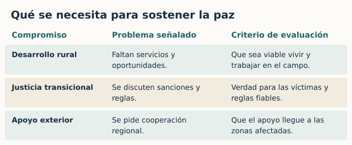

# ENS Paris-Saclay · BEL anglais · Espagnol LV2, oral 2019, sujet 5 — Corrigé brut

*Corrigé rédigé par IA, non officiel. Signalez toute erreur.*

**Rédaction** · GPT-6.2 Astra Ultra · vitesse non renseignée

## La paz colombiana es demasiado valiosa como para abandonarla

Le jury de première année accorde 30 minutes de préparation. Le compte rendu et le commentaire en espagnol ouvrent un oral de 25 à 30 minutes, échange compris. En 2019, le jury a jugé satisfaisante la durée moyenne de 14 minutes pour la présentation. Les questions d’entretien ci-dessous sont des propositions d’entraînement.

## Síntesis del texto

El comité editorial de *The New York Times* defiende el 24 de mayo de 2019 el acuerdo suscrito en 2016 entre el Gobierno de Colombia y las Farc. Después de medio siglo de conflicto y al menos 220.000 muertos, la negociación encabezada por Juan Manuel Santos recibió reconocimiento internacional. Dentro del país persistían dos reservas importantes. Unos temían la impunidad de combatientes y militares. Otros dudaban de que el Estado llevara a las zonas rurales los servicios prometidos.

En 2019 muchos antiguos guerrilleros han entregado las armas y vuelto a la vida civil. Sin embargo, el editorial señala el retraso de las inversiones rurales, el rearme de una parte de los excombatientes, el asesinato de líderes comunitarios y nuevos desplazamientos. Acusa al Gobierno de Iván Duque de haber reducido los fondos para sustituir los cultivos de coca y de pretender endurecer la justicia transicional. A su juicio, cambiar los términos pactados pondría en peligro la confianza en el proceso. El comité se dirige por último a Estados Unidos. Invoca sus inversiones anteriores en seguridad e instituciones y pide a Donald Trump que coopere con socios regionales para sostener el acuerdo y favorecer la inversión en el campo.

## Comentario

¿Por qué considera el editorial que una escuela, un tribunal y un acuerdo diplomático forman parte de la misma paz? Su defensa del pacto se apoya en tres condiciones que sólo producen resultados si perduran juntas.

### Hacer posible una vida civil

Una entrega de armas puede tener una fecha. Conseguir que una familia acceda a la educación, a agua potable y a un empleo requiere servicios que funcionen todos los días. Cuando el editorial menciona carreteras y puentes, el desarrollo rural deja de ser un objetivo abstracto. Cabe imaginar la diferencia entre una cosecha para la que existe un comprador accesible y otra que no puede salir de la región. Ese ejemplo explica por qué la sustitución de cultivos requiere alternativas económicas. No pretende describir un pueblo concreto del artículo. Al retirarse las Farc de ciertas zonas, el texto señala que actores armados y criminales siguieron disputándose las ganancias de la cocaína. La retirada de un actor no establece por sí sola una autoridad pública fiable.

El comienzo del editorial ofrece dos relatos posibles de 2016. En uno, terminar un conflicto de medio siglo parecía casi un milagro y el premio recibido por Santos reconocía la dificultad de lo conseguido. En el otro, las dudas acerca de la impunidad y del cumplimiento de las promesas ya existían antes de la firma. El texto recupera los dos porque se dirige también a lectores que pudieron celebrar el premio y perder luego de vista lo que ocurría sobre el terreno. Decir que el acuerdo está en crisis no demuestra que sus críticos iniciales tuvieran razón en todas sus objeciones. Según la lógica del comité, algunas dificultades se deben precisamente a que no se ha llevado a cabo lo que el acuerdo preveía. Una evaluación debe preguntar primero cuáles de sus compromisos llegaron a ponerse efectivamente a prueba.

La enumeración de las víctimas introduce otra precisión. El editorial habla de líderes comunitarios asesinados y de personas que han tenido que abandonar sus hogares. Esas categorías amplían la perspectiva más allá de un enfrentamiento entre dos antiguos contendientes. Incluso una persona que nunca militó en ningún grupo tiene algo que perder si abandona su lugar de residencia o si su comunidad no puede elegir interlocutores sin temor. Una política que sólo contara a quienes dejaron las armas podría registrar un avance real y pasar por alto un retroceso igualmente real en la vida civil. Estas observaciones aclaran la función de los números. Cada uno llama la atención sobre una población particular, y ninguno puede sustituir al resto como medida única de la paz.

### Mantener una promesa sin borrar las responsabilidades

El reparo inicial sobre la impunidad es serio y el propio comité lo reconoce. El mecanismo que describe pide comparecer tanto a rebeldes como a integrantes de las fuerzas del Estado. Obtener testimonios y establecer responsabilidades responde a necesidades que un recuento de condenas de cárcel no agota. Al mismo tiempo, las víctimas pueden exigir sanciones y garantías efectivas. El editorial menciona excepciones para ciertos delitos, sin ofrecer una exposición completa del régimen jurídico. Su argumento político se refiere al momento en que se cambian las condiciones. Si una persona se desmovilizó contando con un procedimiento pactado, modificarlo unilateralmente podría debilitar la confianza de quienes aún deben colaborar. Sostener el procedimiento y pedir que rinda cuentas son exigencias compatibles.

### La elección del destinatario

Los más de diez mil millones de dólares estadounidenses mencionados cubren dieciocho años e incluyen tanto seguridad como instituciones y programas de paz. La cifra prueba la duración del compromiso. No prueba por sí misma que el gasto fuera eficaz. El comité la utiliza para dirigirse al presidente estadounidense en un lenguaje que atribuye a sus preferencias, el de la inversión y la estabilidad. Espera que otros países de la región lo acompañen. Aquí aparece una tensión interesante. Los recursos internacionales pueden ampliar las opciones de comunidades marginadas, pero el éxito de una escuela o de un programa de cultivos se juzga también desde la vida de quienes lo utilizan. Un balance limitado al capital que llega dejaría fuera los desplazamientos y las amenazas que motivaron el editorial.

En el debate sobre los tribunales también importa la existencia de dos incertidumbres distintas. Una víctima puede preguntarse si conocerá la verdad y si los responsables responderán ante una institución que merece su confianza. Un antiguo combatiente puede preguntarse si se respetarán las condiciones bajo las que aceptó someterse a esa institución. La respuesta a una incertidumbre no exige silenciar la otra. Un proceso que decepcionara sistemáticamente a las víctimas perdería parte de su legitimidad. Un proceso cuyas reglas cambiaran a mitad de camino tendría dificultades para obtener cooperación. El comité teme especialmente esta segunda posibilidad al criticar a Duque, pero sus primeras alusiones a la impunidad muestran que conoce la primera. Esa tensión impide reducir el editorial a una petición de indulgencia hacia los antiguos guerrilleros.

Hay por último una elección reveladora en el pronombre implícito de la recomendación a Washington. Un periódico estadounidense que se dirige a Trump puede apoyarse en la historia del gasto de su propio país y exigir cierta continuidad en su política exterior. Un testimonio de un habitante desplazado habría comenzado probablemente por otra pregunta, la de volver o no a casa en condiciones seguras. Son escalas distintas para formular un mismo problema. El llamado a la inversión tiene sentido en la medida en que sirva para abrir posibilidades a los habitantes del campo. Si sólo permitiera a gobiernos y empresas presentar balances favorables, el editorial perdería la relación entre medios y fines que hace convincente su defensa de la paz. La última condición es, pues, mantener a la población afectada como criterio de evaluación cuando se pasa de Colombia al escenario diplomático regional.

## Conversación con el jurado

**¿Qué cifras podría confundir un lector?** Al menos 220.000 es el balance de muertos de medio siglo de conflicto mencionado al principio. Más de 210.000 corresponde a desplazados desde 2016. La cercanía numérica no permite intercambiar las poblaciones ni los períodos.

**¿El rearme afecta a todos los antiguos guerrilleros?** El editorial cifra en unos tres mil a los que se habrían rearmado y dice que muchos han regresado a la vida civil. Su argumento sobre la fragilidad de la paz depende precisamente de que ambos hechos puedan coexistir.

**¿Qué quiere obtener el editorial de Estados Unidos?** Cooperación con otros países para sostener los compromisos aceptados por Colombia y para favorecer la inversión rural. El comité intenta convencer al lector estadounidense de que consolidar las instituciones también sirve al interés de su país.

## Sources de l’épreuve

[Sujet BEL anglais, deux pages](https://ens-paris-saclay.fr/sites/default/files/CONCOURS/ANNALES_1C/1C_LE_Anglais/2019_Sujet_oraux_LE_Anglais_LV2_Espagnol_05.pdf) · [Rapport du jury de première année, pages 1 et 2](https://ens-paris-saclay.fr/sites/default/files/CONCOURS/ANNALES_1C/1C_LE_Anglais/2019_Rapport_Oraux_LE_Anglais_LV2_Espagnol.pdf)

Les annales BEL anglais et cycle master anglais publient le même feuillet. Cette proposition suit les modalités du rapport d’entrée en première année. [Exemplaire du cycle master anglais](https://ens-paris-saclay.fr/sites/default/files/CONCOURS/ANNALES_2C/2C_Anglais/2019_Sujet_2Canglais_LV2_Espagnol05.pdf)
