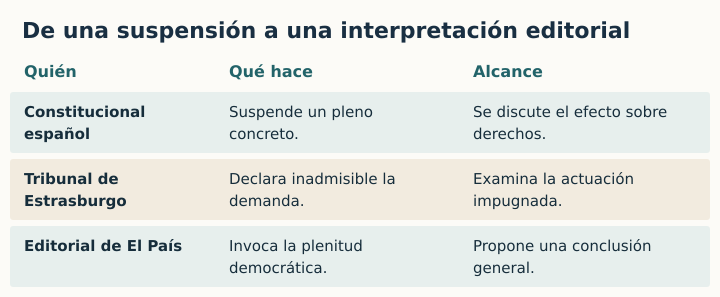

# ENS Paris-Saclay · BEL anglais · Espagnol LV2, oral 2019, sujet 6 — Corrigé brut

*Corrigé rédigé par IA, non officiel. Signalez toute erreur.*

**Rédaction** · GPT-6.2 Astra Ultra · vitesse non renseignée

## Europa protege

Le jury de première année accorde 30 minutes de préparation. Le compte rendu et le commentaire en espagnol ouvrent un oral de 25 à 30 minutes, échange compris. En 2019, le jury a jugé satisfaisante la durée moyenne de 14 minutes pour la présentation. Les questions d’entretien ci-dessous sont des propositions d’entraînement.

## Síntesis del texto

El editorial de *El País* del 29 de mayo de 2019 interpreta una decisión del Tribunal Europeo de Derechos Humanos. Un grupo de diputados independentistas encabezado por Carme Forcadell había recurrido la suspensión de un pleno del Parlamento catalán por el Tribunal Constitucional español. En ese pleno se proponía declarar unilateralmente la independencia. El editorial destaca la unanimidad de los siete magistrados europeos y el carácter de inadmisibilidad de su decisión. La suspensión respondía, según la argumentación que expone el periódico, a la necesidad de proteger los derechos de los demás, incluidas las minorías parlamentarias y sus representados.

El diario recuerda la obligación de cumplir las resoluciones del Constitucional y las garantías que la Comisión de Venecia establece para las consultas. A su juicio, el independentismo buscó en instancias extranjeras el reconocimiento que no consiguió dentro de España. Para alentar esa esperanza habría invocado decisiones sobre la orden europea de detención en varios países y opiniones de organismos especializados. El editorial concluye que el derecho internacional y europeo no ampara la vía unilateral descrita y considera que la decisión de Estrasburgo avala la calidad democrática del Estado español.

## Comentario

¿Cómo pasa el editorial de una demanda concreta a una afirmación general sobre la democracia española? El sujeto del título, «Europa», reúne actores y argumentos que conviene volver a distinguir.

### Dos tribunales y una pregunta delimitada

El Tribunal Constitucional español suspendió el pleno. Los diputados acudieron después al Tribunal Europeo de Derechos Humanos, con sede en Estrasburgo. El derecho de reunión era central en la demanda tal como la presenta el artículo. La respuesta destacada por el editorial explica por qué, en esas circunstancias, el límite impuesto se consideró justificado. Inadmitir la demanda no equivale a organizar la consulta ni a decidir el futuro estatuto territorial de Cataluña. Tampoco interviene aquí el Tribunal de Justicia de la Unión Europea. El nombre «Europa» da al título un alcance que el nombre completo de la institución habría delimitado mejor. Ese ensanchamiento es una de las decisiones persuasivas del texto.

La palabra *unanimidad* merece una pausa. Siete magistrados que coinciden en una decisión dan al editorial una imagen poderosa de acuerdo institucional. Todos los que se pronunciaron en aquel tribunal concurrieron en el resultado que describe el diario. Sin embargo, el número de jueces no cambia el objeto del asunto que se les planteó. Si la decisión versa sobre la admisibilidad de una demanda relativa a una suspensión determinada, el acuerdo entre siete jueces no la convierte por sí solo en un juicio exhaustivo sobre la actuación de todos los poderes del Estado. La precisión es importante también en otro sentido. Acudir al tribunal internacional es en sí un modo de utilizar las garantías de derechos, aunque la demanda no llegue a prosperar. Un lector podría aceptar el resultado y discutir la intención política que el editorial atribuye a quienes recurrieron.

La formulación del primer párrafo da una pista sobre cómo se efectúa el desplazamiento. Parte del derecho de reunión y acaba hablando de los ciudadanos que enviaron al parlamento a los diputados minoritarios. Si pensamos en un parlamento como mera suma de votos, cualquier cuestión parecerá resolverse cuando el grupo más numeroso levanta la mano. Si lo pensamos también como ámbito deliberativo, cuentan el tiempo, la posibilidad de conocer las propuestas y las garantías de intervenir en su tramitación. Estos ejemplos ayudan a entender de forma general por qué una minoría tiene derechos propios. No son una lista de hechos que el editorial documente respecto de cada diputado aquel día. El argumento alcanza su mayor precisión cuando explica una regla general con ayuda del expediente y conserva la diferencia entre los dos.

### Mayorías, minorías y garantías

La columna editorial quiere que el lector cambie de sujeto al pensar en los derechos. Los diputados demandantes se presentaban como titulares del derecho de reunión. El periódico invita a pensar en los diputados de la minoría y en sus votantes. Si una mayoría controla los tiempos y el orden del día, las condiciones para deliberar afectan a la capacidad real de los demás para intervenir. El periódico añade que la mayoría de escaños independentista no implica una mayoría de la población. Son dos argumentos distintos. Uno trata de la diferencia entre representación parlamentaria y respaldo social. El otro seguiría siendo pertinente incluso con un apoyo social mayoritario, porque una mayoría tampoco extingue los derechos de la minoría.

### El crédito político de una decisión judicial

La mención de Alemania, Bélgica y Escocia sirve para reconstruir una estrategia que el editorial atribuye a sus adversarios. Los episodios sobre la euroorden no eran recursos sobre aquel pleno. Agruparlos ayuda a explicar la expectativa de una solución exterior, pero no permite sumar pronunciamientos heterogéneos como si fueran votos a favor o en contra de la secesión. Frente a la estrategia que denuncia, el propio diario obtiene legitimidad europea para su posición. La palabra *plenitud* da un salto especialmente visible. La decisión proporciona un argumento sobre una actuación y unas garantías precisas. Evaluar el conjunto de la democracia exigiría asimismo considerar otras instituciones, derechos y prácticas. Señalar ese salto permite reconocer el contenido jurídico de la noticia y, a la vez, leer críticamente el editorial.

Las marcas de certeza del editorial también merecen comentario. La repetición de que a nadie puede extrañar la decisión presenta la interpretación del periódico como algo que cualquier lector razonable debería anticipar. Esta manera de escribir crea complicidad con quien ya comparte el punto de vista. En cambio, un lector que se pregunte por el equilibrio entre derecho de reunión y protección de terceros puede sentir que su pregunta ha quedado resuelta antes de ser formulada. En un ejercicio oral conviene restituir la pregunta. ¿Qué derecho se invocaba, qué otros derechos podían verse afectados y qué institución debía pronunciarse? Ese recorrido permite explicar la conclusión del diario con más precisión que repetir su tono de evidencia.

El título, por último, omite el complemento directo de *protege*. Durante unos instantes, la fórmula puede parecer aceptable a personas con ideas opuestas sobre el conflicto. Unas confiarán en Europa como protección frente a un supuesto abuso del Estado. Otras confiarán en ella como garantía de que las instituciones territoriales respeten el orden constitucional. El desarrollo especifica a quién da la razón el periódico. La ambigüedad inicial le permite disputar a sus adversarios un valor compartido, el de las garantías europeas. Ahí está el vínculo más interesante entre forma y tesis. Los dos bandos que el texto pone en escena reclaman autoridad en nombre de Europa, pero ni la palabra que comparten ni el resultado de un solo expediente eliminan la necesidad de discutir, en cada caso, las reglas y los derechos de todos los afectados.

## Conversación con el jurado

**¿Por qué menciona la Comisión de Venecia?** Para invocar criterios sobre las garantías de consultas y referendos. El propio texto la identifica como un organismo del Consejo de Europa. No es el tribunal que declaró inadmisible la demanda.

**¿A quién protege Europa según el periódico?** En primer término, a quienes podían verse privados de garantías por el procedimiento parlamentario, incluidas las minorías y sus representados. En la conclusión, el diario amplía la protección hasta convertirla en un aval del orden constitucional español.

**¿Qué respondería a quien diga que Estrasburgo prohibió toda discusión sobre la independencia?** Le pediría que identificara la conducta y el acto sometidos a examen. El editorial habla de suspender un pleno concreto y critica una vía unilateral. Ese expediente por sí mismo no resuelve todos los modos posibles de debatir una reforma territorial.

## Sources de l’épreuve

[Sujet BEL anglais, deux pages](https://ens-paris-saclay.fr/sites/default/files/CONCOURS/ANNALES_1C/1C_LE_Anglais/2019_Sujet_oraux_LE_Anglais_LV2_Espagnol_06.pdf) · [Rapport du jury de première année, pages 1 et 2](https://ens-paris-saclay.fr/sites/default/files/CONCOURS/ANNALES_1C/1C_LE_Anglais/2019_Rapport_Oraux_LE_Anglais_LV2_Espagnol.pdf)

Les annales BEL anglais et cycle master anglais publient le même feuillet. Cette proposition suit les modalités du rapport d’entrée en première année. [Exemplaire du cycle master anglais](https://ens-paris-saclay.fr/sites/default/files/CONCOURS/ANNALES_2C/2C_Anglais/2019_Sujet_2Canglais_LV2_Espagnol06.pdf)
