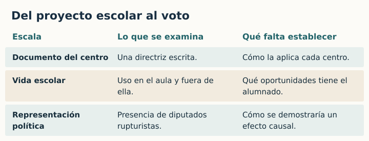

# ENS Paris-Saclay · BEL anglais · Espagnol LV2, oral 2019, sujet 7 — Corrigé brut

*Corrigé rédigé par IA, non officiel. Signalez toute erreur.*

**Rédaction** · GPT-6.2 Astra Ultra · vitesse non renseignée

## Formación del espíritu supremacista

Le jury de première année accorde 30 minutes de préparation. Le compte rendu et le commentaire en espagnol ouvrent un oral de 25 à 30 minutes, échange compris. En 2019, le jury a jugé satisfaisante la durée moyenne de 14 minutes pour la présentation. Les questions d’entretien ci-dessous sont des propositions d’entraînement.

## Síntesis del texto

El 22 de mayo de 2019, un editorial de *El Mundo* interpreta la sesión constitutiva de las Cortes como síntoma de un problema que sitúa en la escuela catalana. A su juicio, la política de inmersión lingüística, que los socialistas catalanes habían promovido con una finalidad integradora, se transformó bajo Jordi Pujol en un instrumento para producir una identidad nacional excluyente. El periódico relaciona la situación de los castellanohablantes con la fuerza de los diputados partidarios de la independencia.

El diario invoca resoluciones judiciales que, según su exposición, amparan la enseñanza de un 25 % de las asignaturas troncales en castellano. Aduce además un informe de la Asamblea por una Escuela Bilingüe que recoge directrices de los proyectos lingüísticos de 2.214 centros, el 95 % del total según el editorial. Dos ejemplos le sirven para denunciar lo que considera una exclusión incluso en los espacios informales. El periódico reparte las críticas entre dirigentes de distinto signo, a quienes acusa de inacción o negación. Termina equiparando el espíritu nacional que atribuye al sistema escolar catalán con el franquista en su incompatibilidad con el pluralismo.

## Comentario

¿Cómo intenta el diario probar que existe un vínculo entre la lengua de la escuela y la representación política? Su argumentación gana intensidad a medida que pasa por tres escalas, pero cada paso exige una prueba diferente.

### De una escena política a una explicación escolar

El editorial comienza en las Cortes, no en un aula. Elige una escena ya cargada de conflicto y promete descubrir sus raíces. El lector ve antes la consecuencia supuesta que la causa propuesta. La Constitución de 1978, cuyo respaldo inicial en Cataluña recuerda el diario, le proporciona un término de comparación temporal. Si antes hubo un amplio acuerdo y ahora se discute la unidad estatal, la explicación del cambio resulta decisiva. El periódico la encuentra en la escuela. Sin embargo, comparar dos momentos no basta para aislar el papel de la enseñanza. También harían falta datos sobre la trayectoria de los ciudadanos, sus entornos y la evolución del sistema político. El propio relato ofrece un indicio de complejidad al distinguir el proyecto de integración inicial del uso político que atribuye a Pujol.

Una expresión del primer párrafo permite acercarse al problema desde la experiencia personal que el editorial imagina. Llama *peaje* a la supuesta exigencia de renunciar a la personalidad castellanohablante para ser aceptado como buen catalán. La imagen de pagar para atravesar una barrera hace inteligible la idea de una pertenencia condicionada. Al mismo tiempo, sugiere que una persona tendría que dejar una identidad a un lado para acceder a la otra. Conocer y utilizar el catalán y conservar el castellano como lengua familiar son posibilidades que merecen considerarse también juntas. La cuestión de los derechos aumenta en precisión si preguntamos quién dispone de opciones reales, en qué circunstancias y con qué garantías. La metáfora denuncia lo que el diario percibe como una elección impuesta. Todavía no demuestra que todos los alumnos bilingües entiendan su experiencia en esos mismos términos.

El argumento sobre el origen del modelo tiene además una consecuencia que el propio editorial no desarrolla. Si en un primer momento se concibió como modo de integrar a hijos de trabajadores, sus defensores entendían que el acceso al catalán podía ampliar oportunidades de incorporación a la vida pública. El diario afirma que después se invirtió esa promesa. Para verificar tal cambio convendría distinguir propósitos declarados, funcionamiento cotidiano y resultados. Una política puede conservar el mismo nombre y aplicarse de forma diferente en centros distintos. Dos alumnos que sigan las mismas asignaturas pueden disponer de recursos lingüísticos muy diferentes fuera de clase. Estas hipótesis no refutan los documentos citados. Explican qué habría que conocer para interpretar su alcance social y valorar con seriedad la denuncia de discriminación.

### Qué muestran los documentos escolares

La extensión del informe citado produce un efecto de exhaustividad. Hay que restituir bien el denominador. El 95 % corresponde a los centros de cuyos documentos proceden las consignas recogidas. No es el porcentaje de alumnos que dicen haber sufrido exclusión ni el de centros donde se haya observado una misma conducta. La directriz sobre la lengua usada delante del alumnado describe una norma escrita concreta. Para pasar de esa prescripción a lo que ocurre en un patio habría que observar las prácticas de alumnos y docentes. Para pasar de esas prácticas a un voto posterior se necesita todavía otra investigación. Esta distinción no elimina la cuestión de derechos que suscita una directriz. Permite formularla con exactitud y apreciar el alcance de las pruebas ofrecidas.

### El coste de un lenguaje de denuncia

El editorial habla de *apartheid*, de adoctrinamiento y de una formación del espíritu nacional comparable a la franquista. Son elecciones polémicas del periódico. La analogía pone en primer plano la posibilidad de imponer desde el poder una única forma de pertenencia. A la vez, la fuerza de esas palabras puede llevar a tratar como equivalentes situaciones históricas e institucionales diferentes. Conviene preguntar cuál es el rasgo preciso que la analogía pretende iluminar. En la conclusión se trata de la incompatibilidad con el pluralismo. El lector puede compartir la exigencia de que todo alumno sea tratado con dignidad y pedir una demostración más sólida del nexo entre el proyecto lingüístico y un resultado electoral. Así se preserva tanto la dimensión normativa de la discusión como la responsabilidad de argumentar sobre hechos.

También resulta revelador el recorrido espacial de las directrices. El editorial imagina un tránsito desde el aula hasta el comedor, el patio o la sala de profesores. ¿Por qué importa tanto esa sucesión? La lengua de una asignatura se decide en parte como cuestión pedagógica. La lengua de una conversación informal tiene que ver también con los vínculos entre personas. Presentar ambos espacios como objeto de una misma política permite al diario denunciar una intervención sobre conductas que un lector tal vez consideraría privadas o espontáneas. Para valorar la inferencia habría que saber a quién se dirige exactamente cada consigna, qué fuerza tiene y cómo se aplica. Una instrucción para el profesorado no demuestra por sí sola que los niños se hayan visto impedidos de hablar su lengua en el recreo. Pero sí permite preguntar cómo entiende un centro su responsabilidad respecto de los usos lingüísticos fuera de la enseñanza formal.

El periódico incluye en su crítica a autoridades vinculadas a partidos diferentes. La amplitud de los reproches sirve para construir su propia imagen de vigilante constante de un problema desatendido por otros. Al recordar que lo viene denunciando desde su fundación, *El Mundo* incorpora su historia editorial a la historia política que relata. Esta autorreferencia permite volver al primer párrafo. Una escena parlamentaria recibe una explicación que el periódico ya defendía antes. Confrontar esa explicación con nuevas pruebas es una exigencia legítima, pero justamente porque ya existía una interpretación previa conviene preguntar qué observaciones podrían obligar a revisarla. La defensa del pluralismo gana credibilidad cuando somete sus propios argumentos al mismo examen que exige a los demás.

## Conversación con el jurado

**¿El diario atribuye la política original a Pujol?** Identifica un impulso inicial de los socialistas catalanes, que buscaban integrar a las clases trabajadoras. Luego atribuye a Pujol una transformación de los fines de aquella política. Distinguir ambos momentos aclara incluso el carácter polémico de su reconstrucción.

**¿Cómo explicaría el 25 % y el 95 %?** El primero se refiere al mínimo de asignaturas troncales en castellano que el editorial atribuye a las resoluciones. El segundo describe la cobertura de centros del material recogido por la asociación. No se pueden comparar como dos medidas de un mismo fenómeno.

**¿Se puede defender el pluralismo lingüístico desde posiciones diferentes?** Sí. Unos prestarán más atención al acceso efectivo al castellano como lengua escolar y otros a las condiciones que permiten usar y transmitir el catalán. Para evaluar un modelo concreto habría que observar qué oportunidades tienen los alumnos en ambas lenguas y qué derechos están en juego.

## Sources de l’épreuve

[Sujet BEL anglais, deux pages](https://ens-paris-saclay.fr/sites/default/files/CONCOURS/ANNALES_1C/1C_LE_Anglais/2019_Sujet_oraux_LE_Anglais_LV2_Espagnol_07.pdf) · [Rapport du jury de première année, pages 1 et 2](https://ens-paris-saclay.fr/sites/default/files/CONCOURS/ANNALES_1C/1C_LE_Anglais/2019_Rapport_Oraux_LE_Anglais_LV2_Espagnol.pdf)

Les annales BEL anglais et cycle master anglais publient le même feuillet. Cette proposition suit les modalités du rapport d’entrée en première année. [Exemplaire du cycle master anglais](https://ens-paris-saclay.fr/sites/default/files/CONCOURS/ANNALES_2C/2C_Anglais/2019_Sujet_2Canglais_LV2_Espagnol07.pdf)
