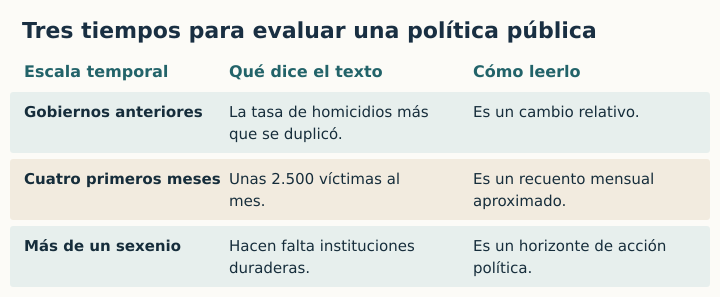

# ENS Paris-Saclay · BEL anglais · Espagnol LV2, oral 2019, sujet 8 — Corrigé brut

*Corrigé rédigé par IA, non officiel. Signalez toute erreur.*

**Rédaction** · GPT-6.2 Astra Ultra · vitesse non renseignée

## México: el violento país que AMLO no tiene bajo control

Le jury de première année accorde 30 minutes de préparation. Le compte rendu et le commentaire en espagnol ouvrent un oral de 25 à 30 minutes, échange compris. En 2019, le jury a jugé satisfaisante la durée moyenne de 14 minutes pour la présentation. Les questions d’entretien ci-dessous sont des propositions d’entraînement.

## Síntesis del texto

En *The New York Times* del 12 de mayo de 2019, José Luis Pardo Veiras vuelve sobre un intercambio entre el periodista Jorge Ramos y el presidente de México, Andrés Manuel López Obrador. La discusión pública se centró en la libertad de expresión. Para el autor, eso dejó en segundo plano la cuestión que motivó la pregunta, la evolución de los homicidios. Reconoce la gravedad de la herencia recibida por AMLO, puesto que la tasa se multiplicó por más de dos durante los dos gobiernos anteriores. Discute en cambio la afirmación presidencial de que la situación ya estaba bajo control. Durante los primeros cuatro meses del nuevo mandato, señala, se registraron alrededor de 2.500 personas asesinadas al mes.

El articulista considera insuficiente explicar este fenómeno por una sola actividad criminal o exclusivamente por la impunidad. Critica la continuidad que ve entre el enfoque militar de los predecesores de AMLO y la creación de la Guardia Nacional. Incluso una desmilitarización gradual y una regulación de las drogas le parecen insuficientes por sí solas. Propone reconocer a los desplazados, fortalecer la independencia de la justicia, profesionalizar la policía y sostener políticas sociales de largo plazo en favor del campo y de los jóvenes. Concluye que en un sexenio pueden sentarse las bases de una respuesta que necesitará más tiempo.

## Comentario

¿Cómo puede un periodista discutir las cifras de un presidente y sostener a la vez que hay que cambiar los términos de la discusión?

### Recuperar la pregunta inicial

La disputa entre Ramos y López Obrador podría contarse como una escena de confrontación entre la prensa y el poder. Pardo Veiras admite que suscitó un debate importante sobre la libertad de expresión. Decide, sin embargo, ocuparse de aquello que se pierde si la escena se convierte en su único tema. ¿Con qué fundamento se anuncia que la violencia está controlada? El dato mensual restituye la escala humana que la fórmula presidencial mantiene fuera de campo. El artículo también impide una atribución inversa demasiado rápida. Reconocer que la violencia precede a AMLO y cuestionar su diagnóstico son actos compatibles. Una cosa es identificar quién heredó una crisis y otra evaluar la fiabilidad de lo que dice un gobierno sobre ella.

La frase del presidente lleva una precisión decisiva, «según nuestros datos». Sugiere que el Gobierno dispone de información que autoriza un diagnóstico distinto del que sostiene el periodista. El artículo no transcribe dos series completas ni ofrece una auditoría de todas las fuentes estadísticas. Lo que puede mostrar es la distancia entre una conclusión categórica y los elementos públicos que se citan para justificarla. En este sentido, el desacuerdo atañe a las condiciones de una afirmación verificable. ¿Qué variable se utilizaría? ¿Con qué período se compararía? ¿Durante cuánto tiempo tendría que observarse una mejora? Formular estas preguntas no obliga a atribuir al presidente una intención que no podemos conocer. Permite evaluar si su manera de hablar hace posible que la ciudadanía compruebe lo que afirma.

También importa a quién se pide prudencia en la escena. Según el artículo, López Obrador elogió con ironía la prudencia de los periodistas después de su discusión con Ramos. Pardo Veiras devuelve la exigencia a su emisor y le recomienda mesura al hablar de homicidios. Este giro es algo más que una réplica ingeniosa. Las palabras de un presidente que declara controlada una situación pueden influir en la percepción de las familias afectadas y en el margen que se concede al debate público. Si una persona sigue esperando que se investigue una muerte, difícilmente le bastará una mejora anunciada en términos generales. La responsabilidad de informar incluye, por tanto, explicar las incertidumbres y reconocer el límite de los datos disponibles en los primeros meses de un mandato.

### Medir una crisis y explicar sus causas

Una tasa de homicidios en varios mandatos, un recuento mensual y una proyección anual cumplen funciones diferentes. La primera informa sobre una evolución relativa, el segundo sobre una magnitud reciente y la tercera anticipa un posible resultado. Ninguna cifra revela por sí sola por qué un joven carece de protección o por qué una familia desplazada no obtiene ayuda. El autor tampoco niega la importancia de la corrupción y la impunidad. Les reconoce un papel y señala que dejan fuera relaciones entre territorio, instituciones y oportunidades de vida. En ese tránsito cobra sentido el lenguaje estructural del artículo. Si el problema fuera sólo perseguir una actividad, bastaría cambiar de objetivo prioritario. Si afecta a las condiciones de la vida cotidiana, exige que varias instituciones funcionen durante un tiempo prolongado.

### Una promesa que se puede someter a prueba

La creación de la Guardia Nacional le parece al autor una contradicción respecto del rechazo presidencial a la militarización. El texto no demuestra todos los efectos futuros de ese cuerpo. Lo analiza como elección de prioridades en los primeros meses del mandato. Su alternativa más fecunda consiste en traducir la palabra *control* en resultados que la ciudadanía podría apreciar. Una persona desplazada podría recibir reconocimiento y protección. Un vecino que denuncia un delito podría confiar en que su denuncia se investigue con independencia. Una política para los jóvenes podría ampliar opciones educativas y laborales. Son ejemplos de lo que significaría en la práctica el horizonte del autor. La conclusión desplaza así la exigencia. Reconoce el límite temporal del mandato, pero hace al presidente responsable de los cimientos que deje durante él.

El contraste entre los gobiernos anteriores y el nuevo se articula mediante una continuidad que el autor juzga paradójica. AMLO reprocha a sus predecesores haber respondido a la violencia con más violencia. La Guardia Nacional ocupa, sin embargo, un lugar central en su propia propuesta. El articulista discute la lógica militar que cree reconocer en esa prioridad. Luego concede que intentar invertirla tampoco resolvería por sí solo el problema. Esta segunda concesión es importante. Un simple cambio de signo sería todavía una explicación basada en una única variable. La propuesta del texto exige pensar en instituciones con funciones complementarias. Una policía que merezca confianza puede facilitar que se denuncien delitos. Una justicia independiente puede investigar incluso cuando se sospechan relaciones entre delincuencia y poder. El reconocimiento de los desplazados atiende a personas cuyo daño no queda recogido adecuadamente en la cifra de homicidios. Cada ejemplo hace visible una parte diferente del problema.

Vista así, la palabra *estructural* no autoriza a declarar inevitable la violencia ni a confundirla con una característica esencial de los mexicanos. Es cierto que el autor utiliza una expresión muy fuerte para describir hasta qué punto la violencia ha penetrado en la vida del país. Pero el conjunto de sus propuestas presupone que las instituciones pueden cambiar y que ese cambio producirá efectos. El horizonte de más de un sexenio tampoco equivale a un aplazamiento indefinido. Se podría examinar durante el mandato si hay mecanismos de protección para los desplazados o si mejoran las condiciones de la policía. Se podría discutir tras él si esas mejoras se sostienen y si disminuye el daño. Con ello, la conclusión deja al lector una forma de exigir responsabilidad inmediata sin creer en soluciones instantáneas.

## Conversación con el jurado

**¿Los 2.500 corresponden al total de los cuatro primeros meses?** Es la cifra aproximada por mes en ese período. El autor distingue ese recuento de la evolución de la tasa bajo los dos gobiernos anteriores y de la proyección para el resto del año.

**¿Qué significa *huachicoleo* en este texto?** Robo de combustible. El periodista lo menciona como una prioridad inicial del gobierno y argumenta que concentrarse en esa sola actividad no explica el conjunto de la violencia.

**¿Qué función cumple la última alusión al presidente?** Imagina un futuro en que un presidente pudiera afirmar con fundamento que la situación está controlada. Recupera así las palabras de AMLO para darles una condición de credibilidad ligada a instituciones y resultados duraderos.

## Sources de l’épreuve

[Sujet BEL anglais, deux pages](https://ens-paris-saclay.fr/sites/default/files/CONCOURS/ANNALES_1C/1C_LE_Anglais/2019_Sujet_oraux_LE_Anglais_LV2_Espagnol_08.pdf) · [Rapport du jury de première année, pages 1 et 2](https://ens-paris-saclay.fr/sites/default/files/CONCOURS/ANNALES_1C/1C_LE_Anglais/2019_Rapport_Oraux_LE_Anglais_LV2_Espagnol.pdf)
