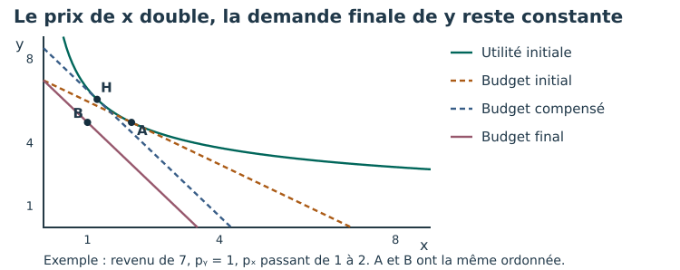
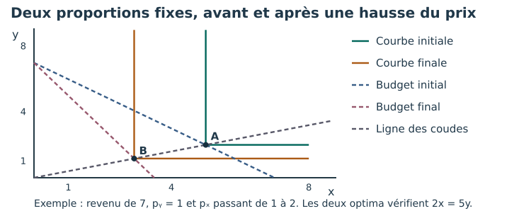

# ENS Paris-Saclay · Analyse économique générale 2019 — Corrigé guidé

*Corrigé rédigé par IA, non officiel. Signalez toute erreur.*

**Rédaction** · GPT-6.2 Astra Ultra · vitesse non renseignée

Banque ENS Paris-Saclay et ENSAI, option économique et de gestion, quatre heures. Les numéros suivent le sujet de la session. Le second fichier intitulé « Sujet D2-1 AEG 2019 » ne contient que la garde. Les quatre pages de « Sujets : Écrits D2 AEG 2019 » portent les trois parties. Le rapport mentionne une II.4, mais le cahier numérote II.1 à II.3.

Au moment de dessiner, vérifier si la consommation finale de y monte, baisse ou reste constante. Pour le bien collectif, noter ce qui est partagé entre habitants et ce que chacun peut consommer intégralement. Le rapport insiste sur ces deux distinctions.

## I. Choix du consommateur et effet-prix

**Signes et coefficients.** Les attachements relatifs déterminent des parts budgétaires $2/7$ et $5/7$. En revanche, le niveau d’utilité demandé dans la fonction de dépense est celui du logarithme initial. Le facteur $e^{u/7}$ en tient compte. Pour la figure, vérifier avec $R=7$ et $p_y=1$. Quand $p_x$ passe de 1 à 2, la quantité de $x$ passe de 2 à 1 et celle de $y$ demeure égale à 5. L’ancienne utilité est rétablie par une dépense multipliée par $2^{2/7}$. Ces trois points déterminent l’ordre des effets.

**I.1. Domaine et ordre.** Une transformation strictement croissante conserve les préférences partout où elle est définie. Pour $U=2\ln x+5\ln y$, $\ln U$ est défini seulement lorsque $x^2y^5>1$. Sur cette partie du domaine, il représente le même ordre. Sur tout le domaine positif du sujet, ce n’est pas une représentation définie partout, par exemple en $(1,1)$.

**I.2. Deuxième fonction.** $x^6y^{15}=\exp(3U)$ est définie et strictement croissante en $U$ pour tous les paniers admis. Elle conserve donc tous les classements.

**I.3. Équilibre graphique.** Les courbes $y=e^{u/5}x^{-2/5}$ sont décroissantes et strictement convexes. La droite $p_xx+p_yy=R$ a pour pente $-p_x/p_y$. Le maximum est intérieur car l’utilité tend vers moins l’infini lorsqu’une consommation tend vers zéro. Le point A de la figure 1 illustre la tangence initiale.

**I.4. Demandes ordinaires.** Les conditions $2/x=\lambda p_x$ et $5/y=\lambda p_y$, avec saturation du budget, donnent $\lambda=7/R$. Ainsi $x=2R/(7p_x)$ et $y=5R/(7p_y)$.

**I.5. Valeur indirecte.** En substituant ces demandes,

$$
V(p_x,p_y,R)=2\ln\!\left(\frac{2R}{7p_x}\right)+5\ln\!\left(\frac{5R}{7p_y}\right).
$$

**I.6. Demandes compensées.** La minimisation de $p_xx+p_yy$ sous $2\ln x+5\ln y\ge u$ atteint la contrainte à l’égalité. La tangence donne $p_xx/p_yy=2/5$. Notons $K=(p_x/2)^{2/7}(p_y/5)^{5/7}$. L’inversion de $V(p_x,p_y,R)=u$ donne le budget nécessaire $7Ke^{u/7}$, d’où $h_x=2Ke^{u/7}/p_x$, $h_y=5Ke^{u/7}/p_y$.

**I.7. Fonction de dépense.** En sommant les dépenses hicksiennes, $E(p_x,p_y,u)=7Ke^{u/7}$. On peut vérifier $E(p_x,p_y,V)=R$ et $\partial E/\partial p_i=h_i$.

**I.8.1. Hausse de $p_x$.** De A à H, l’ancienne utilité est maintenue au nouveau prix relatif. La consommation de $x$ baisse et celle de $y$ augmente. Le retrait de la compensation rapproche H de l’origine jusqu’à B. Par la demande ordinaire de I.4, les ordonnées de A et B sont exactement égales. C’est le trait que le rapport de 2019 demandait de rendre visible.

**I.8.2. Décomposition de Slutsky.** Évaluer les dérivées compensées à l’utilité initiale. Pour $x$, l’effet de substitution est $\partial h_x/\partial p_x=-5x/(7p_x)=-10R/(49p_x^2)$. L’effet de revenu est $-x\partial x/\partial R=-4R/(49p_x^2)$. Leur somme vaut $-2R/(7p_x^2)$. Pour $y$, l’effet compensé est $\partial h_y/\partial p_x=2y/(7p_x)=10R/(49p_xp_y)$. L’effet de revenu $-x\partial y/\partial R=-10R/(49p_xp_y)$ l’annule. L’effet total sur $y$ vaut zéro.

**I.8.3. Substitution.** À utilité constante, le renchérissement de $x$ augmente la demande de $y$. Les biens sont donc des substituts nets. À revenu monétaire constant les demandes croisées sont nulles. Cette indépendance brute est compatible avec un effet de substitution strictement positif.

## II. Biens parfaitement complémentaires

**Remplacer la tangence par un système.** Au panier $2x<5y$, une partie de $y$ est superflue. La réduire libère de quoi augmenter le terme limitant. Ce raisonnement montre pourquoi il faut chercher un coude à l’optimum. Après le changement de prix, le rayon des coudes est identique. Pour calculer une dérivée ou représenter les effets, suivre le nouveau point d’intersection du rayon et du budget.

**II.1. Équilibre au coude.** Pour $Z=\min(2x,5y)$, toute quantité supplémentaire du bien relativement surabondant ne change pas l’utilité. À prix strictement positifs, le choix optimal vérifie $2x=5y$ et sature le budget. Dans le plan $(x,y)$, les courbes d’indifférence ont un coude en $(u/2,u/5)$. A et B sur la figure 2 illustrent deux optima successifs sur le rayon $y=2x/5$.

**II.2. Demandes.** L’absence de dérivée au coude empêche d’appliquer une tangence différentiable usuelle. Résoudre les deux égalités précédentes donne $x=5R/(5p_x+2p_y)$ et $y=2R/(5p_x+2p_y)$. Pour atteindre $u$, il faut simultanément $x\ge u/2$, $y\ge u/5$. À dépense minimale, $h_x=u/2$, $h_y=u/5$ et $E=u(p_x/2+p_y/5)$.

**II.3. Effet de prix.** Posons $D=5p_x+2p_y$. À revenu donné, $\partial x/\partial p_x=-25R/D^2$ et $\partial y/\partial p_x=-10R/D^2$. À utilité compensée, les quantités restent rigoureusement identiques. Tout l’effet provient de la perte de pouvoir d’achat, et les deux quantités reculent dans les mêmes proportions. Sur la figure, une droite parallèle au nouveau budget menée par A soutient le même coude. Le point compensé coïncide avec A.

## III. Production privée et financement collectif

**Vérifier les unités.** Dans l’équilibre privé, $x$ sert à la consommation et à la production. Confondre $14N$ et la seule demande finale ferait disparaître $X$. Les profits entrent dans $R_i$ par un dividende. Pour l’équilibre volontaire, dériver d’abord par rapport à $c_i$ en maintenant les contributions des autres fixes, puis seulement poser $c_i=c$. Imposer la symétrie avant de dériver donne le comportement coordonné, qui relève précisément de la question III.3. Le rapport du jury décrit cette confusion.

**III.1.1. Équilibre général avec bien privé.** Soient $N\ge2$ ménages, détenteurs chacun de 14 unités de $x$ et d’une part égale de la firme. En prix quelconques, celle-ci maximise $p_y\sqrt X-p_xX$, d’où $X=p_y^2/(4p_x^2)$, $Y=p_y/(2p_x)$ et $\pi=p_y^2/(4p_x)$. Le revenu individuel est $R_i=14p_x+\pi/N$ et les demandes sont celles de I.4. Posons $p_x=1$. L’optimum de la firme donne $p_y=2\sqrt X$ et $\pi=X$. L’équilibre du marché de $x$ impose $14N=X+2(14N+X)/7$. Ainsi

$$
X=\frac{70N}{9},\quad Y=\frac{\sqrt{70N}}3,\quad p_y=\frac{2\sqrt{70N}}3,\quad
R_i=\frac{196}{9},\quad x_i=\frac{56}{9},\quad y_i=\frac{\sqrt{70}}{3\sqrt N}.
$$

La quantité $Ny_i$ égale bien la production $Y$. Le dividende individuel est $70/9$.

**III.1.2. Variation avec $N$.** L’input et le profit augmentent proportionnellement à $N$. Le prix de $y$ et sa production augmentent comme $\sqrt N$. Le revenu et la consommation individuelle de $x$ restent constants. La consommation individuelle de $y$ décroît comme $N^{-1/2}$, donc l’utilité de chaque ménage diminue, avec une variation marginale de $-5/(2N)$ en traitant $N$ comme continu.

**III.1.3. Mécanisme.** Doubler les ménages double les dotations et l’input total mais multiplie seulement la production par $\sqrt2$. La production reste répartie entre tous. La baisse du produit marginal du facteur dans cette unique technologie explique le recul par tête.

**III.2.1. Contributions volontaires.** Notons $c_i$ la contribution individuelle, $C_{-i}$ la somme des autres contributions. Chaque agent maximise $2\ln(14-c_i)+(5/2)\ln(c_i+C_{-i})$. À l’intérieur, $5(14-c_i)=4(c_i+C_{-i})$. En symétrie,

$$
c_i=\frac{70}{4N+5},\quad x_i=\frac{56N}{4N+5},\quad
X_v=\frac{70N}{4N+5},\quad \bar y_v=\sqrt{\frac{70N}{4N+5}}.
$$

Les quantités sont strictement positives et chaque objectif est concave dans la contribution propre. Tous consomment la même quantité $\bar y_v$ du bien collectif.

**III.2.2. Efficacité.** Une hausse coordonnée de toutes les contributions à partir de cet équilibre procure un gain de premier ordre à chacun. En effet si tous contribuent $c$, l’utilité vaut $2\ln(14-c)+(5/2)\ln(Nc)$. Sa dérivée en $c$ est $-2/(14-c)+5/(2c)$, strictement positive au choix volontaire car l’agent isolé n’impute à son effort que $5/(2Nc)$. L’équilibre est Pareto-dominé pour $N>1$.

**III.2.3. Variation avec $N$.** L’effort individuel baisse tandis que $x_i$ et $X_v$ augmentent. Le niveau du bien partagé croît vers $\sqrt{70/4}$ et $x_i$ vers 14. Les deux consommations augmentant, l’utilité de chacun s’élève et reste bornée. Ce résultat diffère de III.1 car nul ne doit diviser le bien collectif par $N$.

**III.3.1. Optimum utilitariste.** Pour $X$ donné, l’utilité totale du bien privé est maximisée en égalisant les $x_i=14-X/N$ par stricte concavité. Le planificateur maximise alors $N[2\ln(14-X/N)+(5/2)\ln X]$. La condition du maximum est $-2/(14-X/N)+5N/(2X)=0$. Elle donne $X^*=70N/9$, $x_i^*=56/9$, $\bar y^*=\sqrt{70N}/3$. La même allocation agrégée qu’en III.1 apparaît pour ces formes fonctionnelles et cette pondération. L’usage de $Y$ par chacun est désormais intégral.

**III.3.2. Écart.** Le rapport $\bar y^*/\bar y_v=\sqrt{4N+5}/3$ excède 1 pour $N>1$ et augmente avec $N$. L’écart absolu augmente aussi. Il vaut $\sqrt{70N}\,[1/3-1/\sqrt{4N+5}]$, produit de deux facteurs positifs croissants pour $N>1$. Le niveau volontaire plafonne, alors que l’optimum agrège le bénéfice pour tous les nouveaux usagers.

[Sujet officiel](https://ens-paris-saclay.fr/sites/default/files/CONCOURS/ANNALES_1C/1C_D2_1/2019_Sujets_Ecrits_D2_AEG.pdf) · [Rapport du jury](https://ens-paris-saclay.fr/sites/default/files/CONCOURS/ANNALES_1C/1C_D2_1/2019_Rapport_Ecrits_D2_AEG.pdf)
