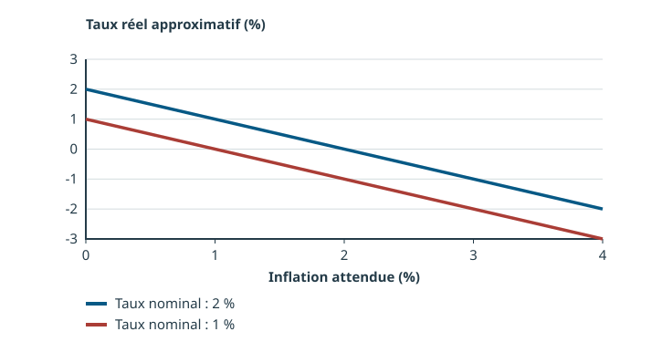

# ENS Paris-Saclay · Analyse monétaire et/ou politique économique 2019 — corrigé guidé

*Corrigé rédigé par IA, non officiel. Signalez toute erreur.*

**Rédaction** · GPT-6.2 Astra Ultra · vitesse non renseignée · 26 novembre 2026

## Sujet

Politique monétaire européenne et cycle économique.

## Construire la copie

### Poser les deux sens de la relation

Tracez deux flèches : le cycle modifie l’inflation attendue et la décision de la BCE ; la décision modifie ensuite le coût du financement, la demande et le déroulement du cycle. Si les taux montent au moment où le PIB monte, vous n’avez donc pas démontré que le relèvement des taux accélère la croissance. Distinguez réaction de la banque centrale et choc de politique monétaire.

### Lire un taux réel

Une PME compare le taux auquel elle emprunte au prix auquel elle espère vendre sa production. En première approximation $r=i-\pi^e$. Pour un même taux bancaire nominal de 2 %, comparez deux régions où les prix progressent de 1 % et 3 % attendus. Puis supposez que la banque d’une région exige une prime de 2 points : l’égalité du seul taux directeur ne suffit plus à comparer les conditions de financement.

### Choisir des épisodes qui testent une proposition

La crise de 2008 permet d’examiner la réaction à une contraction commune ; la crise des dettes souveraines interroge la fragmentation de la transmission. Dans le second exemple, expliquez pourquoi une annonce d’intervention peut réduire les primes avant un achat effectif. Le rapport de jury insiste sur le singulier de « cycle » : la question centrale est la politique de stabilisation du cycle économique européen, et ses difficultés constituent un argument, non tout le sujet.

## Dissertation

En 2012, l’annonce que la Banque centrale européenne est prête à préserver l’euro, suivie de la définition des opérations monétaires sur titres (OMT), contribue à détendre certaines primes souveraines sans que le programme doive acheter un seul titre. Ce fait soulève une question plus large que celle des marchés obligataires. Si la confiance dans la monnaie commune détermine le taux bancaire d’une entreprise et sa décision d’embaucher, la politique monétaire agit sur la durée et l’intensité d’une récession. Mais sa propre décision répond à la situation de l’économie. Le cycle désigne les fluctuations relativement générales de la production, de l’investissement et de l’emploi autour d’une trajectoire de plus long terme ; il ne suppose pas une périodicité fixe. En Europe, depuis 1999, les membres de la zone euro partagent un taux directeur, alors que les autres membres de l’Union gardent leur politique monétaire. Jusqu’en 2019, comment cette politique commune répond-elle au cycle et comment en modifie-t-elle elle-même le cours ?

### I. La stabilité des prix appelle une réaction à de nombreuses fluctuations de l’activité

L’article 127 du traité sur le fonctionnement de l’Union européenne fixe comme objectif principal la stabilité des prix ; sans préjudice de cet objectif, le système européen de banques centrales soutient les politiques économiques générales dans l’Union. En 2019, la définition opérationnelle de la BCE vise une inflation inférieure à, mais proche de, 2 % à moyen terme. Le mandat ne consiste donc pas à atteindre à tout instant une cible précise de croissance. Toutefois, une contraction générale des achats, des investissements et de l’emploi réduit les tensions sur les prix et peut faire baisser les anticipations d’inflation. Réagir à cette contraction sert à la fois la stabilité des prix et celle de l’activité. Inversement, un boom de crédit peut amplifier les pressions de demande.

Lorsque salaires et prix sont temporairement rigides, une modification du taux court nominal agit sur le taux réel auquel les dépenses sont arbitrées. Une baisse de taux réduit le coût d’un investissement et des emprunts à taux variable ; elle peut relever le prix des actifs, desserrer la contrainte de garantie des emprunteurs et modifier le cours de l’euro. Des exportateurs peuvent profiter d’un change plus faible, tandis que les acheteurs de matières importées supportent son renchérissement. L’effet est décalé : un ménage déjà engagé à taux fixe et un entrepreneur sans débouchés ne réagissent pas comme un emprunteur dont le prêt arrive à échéance.

La nature du choc détermine la décision. Une hausse du prix du pétrole importé peut simultanément élever les prix et diminuer l’activité. Réagir immédiatement à la hausse des prix par un durcissement risque alors d’aggraver la contraction. À l’inverse, laisser se désancrer les anticipations peut rendre plus coûteuse la stabilisation ultérieure. Le regard à moyen terme permet de distinguer le premier effet d’une variation de prix relatif d’une diffusion persistante aux salaires et aux autres prix. La politique peut amortir certaines fluctuations nominales et réelles ; elle ne restaure pas le pouvoir d’achat qu’un choc réel défavorable fait perdre à la zone.

### II. La transmission peut amortir un cycle commun et amplifier des mouvements régionaux

La monnaie unique a supprimé le risque de dévaluation entre ses membres et facilité le financement au-delà des frontières nationales. Mais au début des années 2000, une économie en croissance rapide où l’inflation attendue est forte reçoit, à taux nominal commun, un taux réel plus bas qu’une économie peu dynamique. Dans l’exemple de la figure, un taux de 2 % représente environ −1 % réel si les prix devraient croître de 3 %, et +1 % réel si l’inflation anticipée est de 1 %. Un investissement immobilier peut ainsi être encouragé précisément là où la construction est déjà la plus dynamique. Ce calcul ne tient pas compte des primes de crédit : celles-ci accentuent ou compensent la divergence selon les périodes.

La crise internationale de 2008 a frappé de nombreuses économies à la fois. La baisse des taux et l’apport de liquidités ont alors freiné les ventes forcées d’actifs et soutenu le financement des banques. Le cycle immobilier et financier n’est cependant pas une simple copie du cycle de production. Un long essor du crédit peut précéder une récession qui prend sa source dans la correction des garanties et le désendettement des ménages. La chute de la construction et la fragilité du système bancaire espagnol montrent pourquoi la transmission dépend des bilans construits pendant l’expansion. Restaurer la liquidité aide une banque solvable confrontée à des retraits ; cela ne reconstitue pas les fonds propres nécessaires pour absorber des pertes.

Pendant la crise des dettes souveraines, les banques nationales détiennent souvent des titres de leur propre État. Quand la prime souveraine augmente, la valeur des garanties et la capacité de financement des banques se dégradent. La même baisse du taux directeur peut alors à peine atteindre l’entreprise du pays le plus déprimé. Les opérations de refinancement à long terme et l’annonce conditionnelle des OMT visent notamment cette fragmentation. Les achats d’actifs engagés à grande échelle à partir de 2015 agissent aussi sur les rendements longs et la composition des portefeuilles. La communication sur l’orientation future des taux influence les anticipations ; elle est utile à la borne basse, mais elle ne suffit pas si les entreprises ne souhaitent plus emprunter. Ces instruments n’ont donc ni les mêmes bénéficiaires ni exactement le même canal.

### III. Stabiliser la zone suppose des institutions complémentaires

L’Eurosystème observe une inflation et une activité agrégées ; un seul taux ne peut fournir simultanément une relance à une région en récession et un frein à une autre en situation de surchauffe. Les critères de Mundell éclairent les autres mécanismes d’ajustement : mobilité du travail, transferts, flexibilité relative des prix et salaires. En leur absence, un chômage régional peut persister après la disparition du choc commun. Chercher à corriger toutes les divergences par la seule politique monétaire risquerait de déstabiliser les régions sur lesquelles le crédit réagit déjà fortement.

Les budgets nationaux et les stabilisateurs automatiques peuvent soutenir les économies les plus touchées ; les règles communes et la confiance des prêteurs limitent toutefois la capacité des pays très endettés à le faire. Lorsque plusieurs États tentent de réduire simultanément leurs déficits pendant une contraction, ils réduisent aussi les débouchés de leurs partenaires. À l’inverse, attendre de la BCE le financement permanent d’un budget insoutenable peut compromettre la crédibilité de son mandat. Une répartition explicite des rôles et des mesures prudentielles ciblant les excès de crédit locaux peuvent rendre la stabilisation commune plus efficace. Le développement de la supervision bancaire européenne après la crise répond à cette complémentarité.

La politique monétaire européenne réagit donc au cycle tout en en modifiant l’intensité par les taux réels, le crédit et les anticipations. Elle a une prise forte sur un choc commun de demande si la transmission financière fonctionne, et une prise plus inégale sur une crise de bilan ou un choc régional. Juger son action exige de comparer la trajectoire observée à celle qui aurait prévalu avec des conditions financières différentes, et de préciser quels instruments non monétaires restaient nécessaires.

## Sources

[Sujet officiel](https://ens-paris-saclay.fr/sites/default/files/CONCOURS/ANNALES_1C/1C_D2_1/2019_Sujets_Ecrits_D2_AMPE.pdf) · [Rapport du jury](https://ens-paris-saclay.fr/sites/default/files/CONCOURS/ANNALES_1C/1C_D2_1/2019_Rapport_Ecrits_D2_AMPE.pdf)
