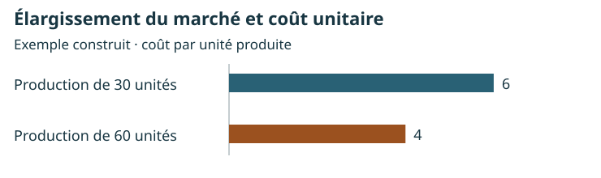

# ENS Paris-Saclay · Dominante économique 2019 — corrigé guidé

*Corrigé rédigé par IA, non officiel. Signalez toute erreur.*

**Rédaction** · GPT-6.2 Astra Ultra · vitesse non renseignée · 26 novembre 2026

## Sujet

Dans quelle mesure peut-on dire que les politiques industrielles françaises, et plus généralement européennes, ont été un succès depuis 1945 ?

## Préparer la dissertation

Écrivez d’abord trois couples « but poursuivi / résultat observable ». Pour le plan Monnet, il s’agit de remettre en service des capacités complémentaires. Pour Airbus, il s’agit de faire entrer un constructeur européen dans une industrie à coûts fixes élevés. Pour une aide à la sidérurgie, le critère dépend du mandat donné à l’État, entre maintien transitoire de l’emploi et viabilité durable d’une installation.

### Reconstruire le mécanisme

Une usine capable de fabriquer des équipements lourds se trouve paralysée si le réseau qui doit l’alimenter en électricité reste endommagé. Expliquez pourquoi l'annonce simultanée de deux investissements réduit le risque de chacun. Posez ensuite la question de l'information dont dispose le planificateur lorsqu’il doit choisir une technologie encore en concurrence avec d’autres.

### Calculer puis discuter un seuil

Posez un coût fixe de 120, un coût variable de 2 par unité et un prix de 5. La marge totale avant coût fixe est de 3 par unité. Il faut vendre 40 unités pour couvrir le coût fixe. À 30 ventes, le projet perd 30. À 60, il gagne 60. Une coopération qui élargit le marché peut changer le signe du résultat. Un acheteur qui préfère un équipement concurrent peut aussi faire manquer le seuil.

### Mettre les cas en regard

Confrontez le choix sectoriel français à la formation professionnelle et aux réseaux de fournisseurs en Allemagne de l’Ouest. Pour la Grande-Bretagne, demandez pourquoi une avance technique n’a pas toujours assuré le succès commercial. Revenez enfin aux bénéficiaires et aux coûts de la restructuration industrielle dans les anciens bassins de production.

## Proposition de dissertation

### De quel succès parle-t-on ?

En 1946, un pays peut manquer en même temps de charbon, d'électricité et de moyens de transport. En 1970, lancer un avion civil engage des dépenses avant que la première compagnie aérienne accepte de l’acheter. Ces deux difficultés appellent des formes différentes d’action publique sur la spécialisation productive. Le succès doit donc se mesurer à l'objectif initial, aux ressources consommées et à ce qui se serait produit sans intervention. La France illustre le rendement d’une coordination publique pendant la reconstruction. L’expérience de ses voisins permet de comprendre pourquoi cette réussite ne se transpose que sous conditions lorsque les économies approchent la frontière technologique.

### Reconstruire un système productif

Le premier plan Monnet, mis en œuvre à partir de 1947, donne priorité à des activités de base. Accroître les capacités sidérurgiques suppose du combustible et des transports disponibles. Un industriel isolé peut différer un investissement pourtant rentable si ses fournisseurs agrandissent simultanément les leurs. La concertation du plan, les entreprises publiques et les financements de modernisation rendent ces décisions compatibles. L’aide Marshall desserre aussi la contrainte de devises pour acheter des équipements. Le remplacement de biens détruits et l’adoption de méthodes américaines offrent des gains de productivité accessibles. Toute la croissance des Trente Glorieuses ne saurait dès lors être imputée au plan.

L’Allemagne de l’Ouest obtient elle aussi un rattrapage rapide. Son ouverture aux débouchés étrangers, son appareil de formation professionnelle, le crédit et ses réseaux de producteurs de biens d’équipement soutiennent une autre forme de coordination. La Communauté européenne du charbon et de l’acier, instituée en 1951, élargit le marché de deux intrants décisifs. Ici, l’ouverture et l’action industrielle peuvent servir le même investissement.

### Choisir des filières au-delà du rattrapage

La coopération aéronautique européenne distribue entre plusieurs pays les coûts de conception et donne accès à un ensemble plus vaste de fournisseurs. Airbus parvient à vendre durablement des avions civils face aux producteurs américains. L’exemple franco-britannique de Concorde précise le critère de succès. La maîtrise du vol commercial supersonique constitue une réalisation technique, mais la série très courte et l’étroitesse du marché limitent le résultat commercial.

Un exemple élémentaire donne la mesure du problème. Pour un coût fixe de 120 et un coût variable unitaire de 2, produire 30 unités coûte 6 par unité. À 60 unités, ce coût tombe à 4. Au prix de 5, la taille du marché change la rentabilité du programme. Les chiffres illustrent le raisonnement sans estimer les comptes d’un avionneur.

### Réorienter les instruments quand la demande change

Après les chocs pétroliers, la sidérurgie européenne affronte surcapacités et concurrence internationale. Différer une fermeture peut laisser le temps de former les salariés et de reconvertir un territoire. Prolonger indéfiniment une capacité qui perd ses débouchés immobilise au contraire crédit et compétences. L’évaluation doit alors suivre le reclassement et les activités de remplacement, en plus des tonnes produites. Dans l’électronique, la rapidité des changements techniques accentue encore le risque d'aider une technologie déjà dépassée.

L’encadrement européen des aides limite les surenchères entre États. Des programmes communs de recherche et des infrastructures accessibles aux entrants répondent aux externalités que le marché sous-finance. Une politique de concurrence peut ainsi favoriser l’apparition de nouveaux producteurs, même si une interdiction de concentration peut contrarier un gouvernement désireux de constituer un champion national. Le bilan est solide pour la reconstruction coordonnée et pour certaines filières à débouché international. Il dépend ensuite de la capacité à interrompre un projet, à partager l’apprentissage et à accompagner les territoires quand la demande se déplace.

## Sources et périmètre

La page 3 du cahier porte l’unique question d’économie. Le rapport du jury, pages 2 et 3, recommande la comparaison des pays, l’analyse du rattrapage et celle des rapports entre politique industrielle et concurrence. L’exemple de coût unitaire est construit pour la démonstration. L’horizon principal va de la reconstruction à la crise de 2008.

[Cahier officiel, page 3](https://ens-paris-saclay.fr/sites/default/files/CONCOURS/ANNALES_1C/1C_D2_1/2019_Sujets_Ecrits_D2_Epreuve_Option.pdf#page=3) · [Rapport du jury de la dominante économique](https://ens-paris-saclay.fr/sites/default/files/CONCOURS/ANNALES_1C/1C_D2_1/2019_Rapport_Ecrits_D2_Option_economique.pdf) · [Index des annales](https://ens-paris-saclay.fr/admission/concours/concours-pre-master/annales-concours-pre-master?field_orientation_1c_target_id%5B%5D=289&field_year_target_id%5B%5D=263&page=1)
