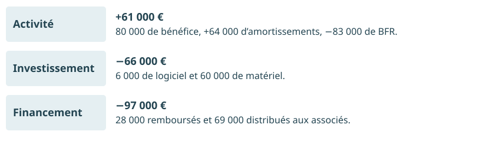

# ENS Paris-Saclay · Épreuve à option — dominante gestion 2019 — corrigé guidé

*Corrigé rédigé par IA, non officiel. Signalez toute erreur.*

**Rédaction** · GPT-6.2 Astra Ultra · vitesse non renseignée · 26 novembre 2026

## Étude de cas

Les trois associés d’ABECO exploitent des bureaux partagés et des services de conseil près d’un incubateur. Les trois parties sont indépendantes. Les annexes 4–7 décrivent un exercice analytique N ; la partie financière se calcule exclusivement avec les comptes 2017–2018 de l’annexe 8.

### Partir des créneaux réellement vendus

L’annexe 1 donne douze observations moyennes, les matins et après-midi des six jours d’ouverture. Ne divisez pas la demande d’une journée de pointe par la seule capacité hebdomadaire. Relevez les creux, les refus et le mélange entre boxes et postes avant de conclure à un manque de surface.

### Refaire une ligne de marge de bout en bout

Pour les boxes, additionnez $300\times20+10\times400+2\times1\,000+1\times2\,000$. Ajoutez les postes. Reportez ensuite les 18 000 de salaire du gestionnaire et les 2 400 d’entretien dans cette activité. Recommencez pour la restauration, en distinguant sa marge après achats de son résultat après salaire imputé. Le résultat total doit rester égal au chiffre d’affaires moins 110 000.

### Retrouver la distribution que le compte de résultat ne donne pas

Une entreprise qui commence avec 83 000 de réserves et gagne 80 000 aurait 163 000 à la clôture si elle gardait tout. Elle termine avec 94 000. Reliez les 69 000 manquants au tableau de financement puis vérifiez la variation de banque.

## Résolution des dossiers

### Partie 1 — Diagnostic d’ABECO

Une matrice SWOT met en regard les facteurs que les associés peuvent modifier et les évolutions de leur marché. Elle oriente les décisions ; les annexes mêlent perceptions, moyennes de fréquentation sur six mois et enquête nationale, dont les périodes et les clientèles diffèrent.

| | Atouts et occasions | Limites et risques |
|---|---|---|
| Organisation interne | Trois expertises complémentaires, proximité immédiate de l’incubateur, confiance née de la présence des fondateurs, espace apprécié pour sa convivialité, sa bibliothèque et sa restauration. | Délais croissants pour l’informatique et le juridique, absence de réservation ou de conseil en ligne, fermeture le dimanche, petit nombre de boxes et dépendance à trois experts. |
| Environnement | Besoins nombreux à la création et lors du développement des entreprises ; demande de conseil pointu mieux rémunérée chez les entreprises déjà lancées ; réseau d’incubateurs et croissance du coworking. | Bureaux proches meilleur marché ou ouverts le dimanche, grandes chaînes, cabinets spécialisés et plateformes juridiques capables d’automatiser rapidement les formalités simples. Les services hétérogènes sont difficiles à comparer. |

L’annexe 1 donne 91 occupations moyennes cumulées pour $12\times16=192$ places-demi-journées, soit **47,4 %**. Le mardi après-midi atteint 12/16 en moyenne, le lundi matin 2/16. Des pointes peuvent expliquer les refus, mais ces moyennes restent sous les 68 % rapportés par l’étude nationale, sous réserve de différences de mesure. Agrandir le site ne résoudrait pas le manque d’heures de conseil. Proposer des rendez-vous experts réservables, des formalités standardisées et des formules ciblant les heures creuses ; suivre les refus par type de siège et par heure avant d’investir. Une création d’entreprise à 1 000 € doit faire apparaître la personnalisation et les formalités incluses face aux forfaits en ligne de l’annexe 3.

### Partie 2 — Pilotage des marges en N

**1. Résultat de N.** Postes : $300\times10+30\times200+4\times500+1\times1\,000=12\,000$. Boxes : $300\times20+10\times400+2\times1\,000+1\times2\,000=14\,000$. Restauration : $3\,000\times2+300\times10=9\,000$. Juridique : $10\times1\,000+40\times100=14\,000$. Informatique : $15\times1\,000+5\times1\,000=20\,000$. Comptabilité et design : $10\times1\,000+60\times100+10\times500=21\,000$. Les ventes totalisent **90 000 €** ; charges 110 000 ; **perte 20 000 €**.

**2. Rentabilité par prestation.** L’annexe 7 groupe les ventes en cinq activités. Marge = CA − coût affecté. On donne à la fois la marge en pourcentage du CA et le taux sur coût, souvent appelé taux de marge en pratique commerciale.

| Catégorie | CA | Coût complet selon l’annexe 7 | Marge € | Marge/CA | Marge/coût |
|---|---:|---:|---:|---:|---:|
| Location | 26 000 | 18 000 + 2 400 = 20 400 | 5 600 | 21,54 % | 27,45 % |
| Restauration | 9 000 | 18 000 + 12 000 = 30 000 | −21 000 | −233,33 % | −70,00 % |
| Juridique | 14 000 | 10 000 + 2 000 = 12 000 | 2 000 | 14,29 % | 16,67 % |
| Informatique | 20 000 | 18 000 + 7 600 + 2 000 = 27 600 | −7 600 | −38,00 % | −27,54 % |
| Comptabilité et design | 21 000 | 18 000 + 2 000 = 20 000 | 1 000 | 4,76 % | 5,00 % |
| **Total** | **90 000** | **110 000** | **−20 000** | **−22,22 %** | **−18,18 %** |

**3. Conclusions.** La restauration perd déjà 3 000 avant rémunération du gestionnaire. Vérifier pertes de denrées, volumes par plat, prix et achats ; mesurer aussi les locations qu’elle aide à fidéliser. Les bureaux ont la contribution complète la plus élevée. L’informatique supporte tout le coût des ordinateurs pourtant proposés aux locataires : cette imputation peut masquer sa rentabilité réelle. Le juridique dégage 2 000 et connaît une file d’attente ; tester un forfait ajusté à la complexité avant d’ajouter des moyens. La marge agrégée de comptabilité et design ne dit rien sur la rentabilité de chaque logo.

**4. Comptabilité de gestion.** Le partage à moitié du salaire entre restauration et location suppose des consommations de temps identiques. Les frais généraux sont répartis par tiers entre trois services et aucun coût informatique n’est attribué à la salle. Une courte campagne de relevés horaires par activité, des journaux de réservation des postes et le suivi des consultations permettraient d’affecter salaires et matériel à des usages observés. Séparer forfaits standard et dossiers exceptionnels, puis mesurer la marge par heure de l’associé saturé. Conserver les charges fixes communes au niveau de l’entreprise pour les décisions de court terme ; vérifier que la somme des marges les couvre à long terme.

**5. Seuil global.** Achats variables 12 000 ; marge sur coûts variables 78 000, soit $78/90=86{,}67\%$. Les charges fixes valent 98 000. À structure de ventes constante il faut $98\,000/(78/90)=\mathbf{113\,076{,}92}$ € de CA, soit 23 076,92 supplémentaires, ou +25,64 %. La restauration consomme en moyenne plus d’achats variables qu’elle ne rapporte de ventes : faire croître uniquement ce segment aggraverait la perte. Le taux moyen suppose un mix et des prix stables, ainsi qu’une capacité suffisante sans nouveau palier de coût.

**6. Tarification.** Vingt journées de poste coûtent un mois à 200 €, mais un semestre n’en coûte que 500, et l’année 1 000. Mesurer le nombre de jours effectivement utilisés par les abonnés longs et la capacité bloquée aux pointes. Préférer des abonnements avec conditions claires de réservation, un tarif de découverte le lundi matin et un prix qui protège les créneaux demandés. Pour le conseil, tester un forfait de base avec options selon le temps expert, la complexité et l’urgence. Afficher le contenu, les délais et les frais externes, afin de rendre les prix comparables.

**7. Réservation en ligne.** Afficher les disponibilités en temps réel réduit les demandes téléphoniques et les déplacements inutiles. Une liste d’attente remplit une annulation ; une garantie de réservation limite les absences ; la suggestion d’un créneau voisin déplace une partie des pointes. Les données de refus par type de poste documentent la décision immobilière. Comparer le supplément de contribution et les heures économisées au coût de la plateforme, vérifier l’accessibilité et conserver un accueil humain pour les clients qui en ont besoin.

**8. Cinq indicateurs non financiers.** (1) Taux d’occupation par type d’espace et demi-journée, pour déplacer la demande. (2) Nombre de réservations refusées faute de place, pour vérifier la demande non servie. (3) Délai médian jusqu’au rendez-vous juridique ou informatique, pour repérer les compétences saturées. (4) Proportion de dossiers livrés au délai convenu, pour préserver la promesse de service. (5) Taux de retour des nouveaux utilisateurs dans les trois mois, pour estimer la fidélisation.

### Partie 3 — Analyse financière d’ABECO en 2018

**1. Tableau des flux, en euros.** À partir de l’annexe 8 seulement. Les immobilisations ne sont pas cédées, le capital est inchangé et aucun emprunt nouveau n’est contracté.

| Flux ou rapprochement | Calcul | Montant |
|---|---|---:|
| Résultat net et amortissements | 80 000 + 64 000 | 144 000 |
| Hausse des créances clients | −(74 000 − 8 000) | −66 000 |
| Baisse des dettes fournisseurs | 8 000 − 25 000 | −17 000 |
| **Flux d’activité** | | **+61 000** |
| Logiciels et matériel | −(30 000 − 24 000) − (120 000 − 60 000) | −66 000 |
| **Flux d’investissement** | | **−66 000** |
| Remboursements des deux financements | −20 000 − 8 000 | −28 000 |
| Dividendes | −(83 000 + 80 000 − 94 000) | −69 000 |
| **Flux de financement** | | **−97 000** |
| **Variation de trésorerie nette** | 61 000 − 66 000 − 97 000 | **−102 000** |
| Solde de départ puis d’arrivée | 27 000 − 102 000 | **−75 000** |

Le découvert est compris dans la trésorerie nette. En le traitant comme un financement à court terme distinct, la trésorerie positive passerait de 27 000 à zéro et le financement inclurait 75 000 de concours bancaire ; l’interprétation économique reste identique.

**2. Parties prenantes.** Les trois associés doivent savoir si le bénéfice finance l’extension ou s’il reste immobilisé chez les clients. Le banquier estime si ABECO peut servir ses échéances sans augmenter le découvert. Les financeurs et fournisseurs examinent également disponibilité et régularité des liquidités.

**3. Dimension mesurée.** Le tableau évalue la production et l’emploi de trésorerie, la capacité de payer aux échéances et l’autonomie financière à l’égard des apporteurs de fonds. Il complète le résultat, qui rattache produits et charges à l’exercice indépendamment du paiement.

**4. Trésorerie à fin 2018.** L’exploitation a produit 61 000 mais laisse 83 000 de plus dans le cycle clients-fournisseurs. La croissance du CA de 78,6 % n’explique pas à elle seule le passage des clients de 8 000 à 74 000. En rapportant les soldes de clôture au CA annuel sur 365 jours, on passe d’environ 15 à 75 jours ; ce repère dépend de la saisonnalité. Les flux d’activité couvrent presque les 66 000 investis. Les 69 000 distribués et les 28 000 remboursés expliquent l’essentiel de la détérioration finale.

**5. Acquisition à 120 000.** Le prix est 800 € par mètre carré, la dotation annoncée 6 000 €/an. Ni ce prix ni l’amortissement ne démontrent la rentabilité. Avec un découvert existant de 75 000, un achat immédiat intégralement payé sur banque porterait le besoin immédiat à 195 000, hors frais et travaux. Étudier une dette longue adossée au local, un apport ou une distribution réduite, et mesurer les encaissements clients réalisables. La suppression du dividende passé aurait limité le découvert final à 6 000 ; elle n’aurait pas financé tout l’achat. Pour les 150 m², chiffrer places réellement louables, loyers encaissés, personnel, entretien, fiscalité, BFR et valeur finale. Comparer la VAN et la capacité à servir l’annuité sous un scénario d’occupation faible ; différer l’engagement en l’absence de demandes fermes ou de financement adapté.

**6. Performance.** L’exploitation est passée de 16 000 à 151 000 et le résultat net d’une perte de 6 000 à un bénéfice de 80 000. Le taux de marge d’exploitation 2018 est $151\,000/359\,000=42{,}1\%$ et la marge nette 22,3 %. En parallèle les capitaux propres ne progressent que de 11 000, la trésorerie se dégrade et l’entreprise recourt au découvert. Une croissance comptablement rentable crée ici une contrainte de financement. Suivre simultanément marges, recouvrement et flux disponible après investissement.

**7. Coût du capital.** Il représente la rémunération exigée par les apporteurs de fonds pour un placement de risque comparable. Pour des flux disponibles avant service de la dette, on peut utiliser un coût moyen pondéré $r=(E/(D+E))r_E+(D/(D+E))r_D(1-t)$, avec pondérations cibles en valeurs de marché et fiscalité cohérente. La VAN est la somme des flux futurs actualisés moins le décaissement initial. Aucun taux de crédit ni flux futurs suffisants ne sont fournis pour la calculer numériquement ici.

## Sources

Épreuve à options 2019, cas ABECO en pages imprimées 1 à 11 de la dominante gestion. Le rapport du jury insiste sur l’analyse critique des clés de charges et sur les recommandations spécifiques à un espace de coworking.

[Sujet de la dominante, p. 5](https://ens-paris-saclay.fr/sites/default/files/CONCOURS/ANNALES_1C/1C_D2_1/2019_Sujets_Ecrits_D2_Epreuve_Option.pdf#page=5) · [Rapport du jury](https://ens-paris-saclay.fr/sites/default/files/CONCOURS/ANNALES_1C/1C_D2_1/2019_Rapport_Ecrits_D2_Option_gestion.pdf) · [Annales institutionnelles](https://ens-paris-saclay.fr/admission/concours/concours-pre-master/annales-concours-pre-master?field_orientation_1c_target_id%5B%5D=289&field_year_target_id%5B%5D=263&page=1)
