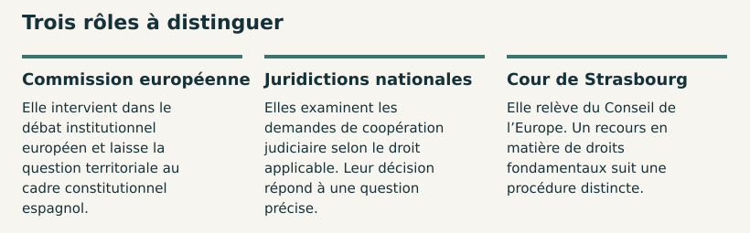

# ENS Paris-Saclay — Économie-gestion option 1 · Espagnol oral 2019 · Corrigé guidé

*Corrigé rédigé par IA, non officiel. Signalez toute erreur.*

**Rédaction** · GPT-6.2 Astra Ultra · vitesse non renseignée

Le jury accordait trente minutes de préparation, recommandait environ quinze minutes de restitution et de commentaire et prévoyait un entretien de quinze minutes au plus. Les extraits duraient entre 4 min 30 et 5 min. Les cinq sujets provenaient d’émissions de Radio 5, Radio Nacional de España et de COPE.

Le rapport donne les titres ou mots clés et les diffuseurs pour l’ensemble de la session. Il ne publie ni fichiers d’épreuve, ni bornes, ni questions individuelles. Les commentaires et les relances répondent aux thèmes attestés. Les archives citées comme points de comparaison ont une attribution distincte de celle des extraits.

> [!INDICATION]
> Pendant la préparation, noter d’abord les acteurs, les lieux, les données datées et les liens entre les idées. Dans la présentation, annoncer ensuite la question que soulève le document et développer une réponse personnelle. Les relances sont des exercices d’interaction rédigés pour cette édition.

## 1. Carlos Herrera opina sobre Torra

> [!INDICATION]
> Herrera est celui qui émet une opinion. Torra, président de la Generalitat, en est l’objet. À l’écoute, noter les mots de Herrera, les éventuelles citations de Torra et les marques d’ironie avant de reformuler chacun des points de vue.

**Commentaire.** ¿Qué significa que el presidente autonómico represente a todos los catalanes cuando hace campaña a favor de una causa que los divide? En 2019, la controversia sobre los lazos amarillos en edificios públicos hizo visible esa diferencia. Un vecino puede llevar un lazo en su chaqueta para expresar solidaridad con los dirigentes encarcelados. Al colgarlo de la sede de la Generalitat, el mensaje se emite desde una institución que también pertenece a quienes discrepan. En periodo electoral, esa diferencia adquiere un peso particular porque los partidos compiten por el voto de todos.

El propio cargo de Torra impone una doble exigencia. Los votantes tienen derecho a saber qué defiende y los adversarios tienen derecho a ser tratados como ciudadanos de pleno derecho por los servicios que dirige. La crítica radiofónica puede aclarar ese conflicto si cita decisiones concretas. Pierde fuerza cuando deduce de lo que ha dicho un presidente lo que supuestamente piensan millones de catalanes. Examinaría por separado el contenido del símbolo y la decisión de exhibirlo en un lugar oficial. [Contexte de mars 2019 dans les archives de RNE](https://www.rtve.es/play/audios/programa/torra-recurre-ante-junta-electoral-para-tratar-evitar-retirada-lazos-amarillos/5066942/)

**Relance proposée.** *¿Implica la neutralidad institucional que el presidente deba guardar silencio?* Puede explicar y defender su proyecto en el Parlamento o en una entrevista. Una oficina electoral o la fachada de una Administración plantean otra cuestión, porque sus usuarios no han elegido asociarse al mensaje.

## 2. Papel de Europa respecto a Venezuela

> [!INDICATION]
> Distinguez gouvernement d’un État membre, Union européenne et groupe de contact international. Relevez l’auteur de chaque proposition. L’archive de Montevideo donne un exemple contemporain de diplomatie, sans désigner l’extrait choisi.

**Commentaire.** ¿Qué puede aportar Europa cuando la legitimidad de las instituciones venezolanas se disputa dentro y fuera del país? El grupo internacional de contacto, reunido en Montevideo en febrero de 2019, muestra una posibilidad. Reunir a Estados europeos y latinoamericanos permite discutir condiciones concretas para una salida electoral y facilitar la ayuda a la población. El valor de esa iniciativa depende de si los compromisos se pueden verificar en Venezuela. Una declaración firmada a miles de kilómetros no permite por sí sola competir a un candidato inhabilitado ni garantiza que un elector pueda votar libremente.

Reconocer a un dirigente, sancionar a un responsable individual y participar en una mediación tienen efectos diferentes. Lo primero envía una señal de legitimidad. Lo segundo busca cambiar el cálculo de quien ejerce poder. Lo tercero requiere que incluso quienes desconfían del mediador mantengan abierta una vía de comunicación. Apoyaría la intervención europea que amplíe las opciones de los ciudadanos venezolanos y haga transparentes sus propias condiciones. Evaluaría por separado los resultados políticos y la llegada de asistencia humanitaria. [Réunion du groupe de contact, RNE](https://www.rtve.es/play/audios/14-horas/montevideo-acoge-grupa-contacto-sobre-venezuela/4973237/)

**Relance proposée.** *¿Dialogar equivale a reconocer que ambas partes tienen razón?* Una negociación necesita interlocutores capaces de asumir compromisos. Aceptar que se sienten a la mesa no obliga a dar el mismo crédito a sus afirmaciones ni impide exigir garantías.

## 3. El procés visto por Europa

> [!INDICATION]
> Précisez ce que recouvre « Europa ». Un correspondant étranger observe un procès, un gouvernement formule une position et un juge tranche une question de droit. Pour la session 2019, ne prêtez pas aux intervenants la connaissance d’une décision postérieure à l’oral.

**Commentaire.** Las consecuencias políticas del proceso independentista catalán atravesaron las fronteras españolas, pero Europa no lo contempló con una sola mirada. La presencia de prensa extranjera en el juicio iniciado en Madrid en febrero de 2019 volvió visibles fuera de España los argumentos de las defensas y de las acusaciones. Informar acerca de una causa judicial ya tiene un efecto público. El periodista selecciona imágenes y explica a un lector extranjero qué instituciones intervienen. Su cobertura tampoco anticipa la sentencia.

La dimensión judicial y la diplomática obedecen a reglas distintas. Un tribunal de otro país puede tener que resolver si se cumplen los requisitos de una petición de entrega. Decide sobre esa solicitud y los hechos pertinentes, sin pronunciarse sobre cuál debería ser el futuro político de Cataluña. Por su parte, un gobierno europeo puede defender la estabilidad del orden constitucional español y seguir atento al respeto de los derechos de los procesados. Me parece importante esta distinción porque ambas partes tienden a presentar cualquier resolución favorable como respaldo internacional a la totalidad de su proyecto. [Couverture de l’ouverture du procès, RNE](https://www.rtve.es/play/audios/las-mananas-de-rne/mananas-rne-inigo-alfonso-comienza-juicio-del-proces-tribunal-supremo-blindado-numerosos-medios-comunicacion/4981591/)

**Relance proposée.** *¿Qué preguntaría a quien afirmase que «Europa ya ha decidido»?* Le pediría que indicara el órgano, la fecha y la cuestión concreta que resolvió. Un titular de prensa y un fallo judicial tienen autores, destinatarios y efectos distintos.

## 4. El verano: época de pateras

> [!INDICATION]
> Le jury a observé des hors-sujets sur l’immigration au Mexique. Situez les arrivées sur les côtes espagnoles, puis distinguez les causes durables des départs, leur concentration à certains moments et la capacité locale d’accueil.

**Commentaire.** Cuando numerosas embarcaciones llegan a un mismo puerto en pocos días, la situación que ve un vecino puede ser muy distinta de la que describen las cifras de todo el país. Un municipio puede tener dificultades para prestar asistencia aunque el sistema nacional disponga de plazas en otro lugar. Por eso preguntaría de qué costa, de qué periodo y de qué servicio se está hablando antes de concluir que la capacidad de acogida está agotada.

El verano puede hacer más visible la travesía marítima y modificar su frecuencia. La estación por sí sola no explica por qué alguien ha decidido marcharse ni qué protección necesita al llegar. La primera respuesta debe asegurar la atención a quienes han sobrevivido al viaje. Después habrá que identificar a menores, tramitar posibles solicitudes de asilo y organizar la acogida entre administraciones. Confundir esas etapas convierte una urgencia de unas horas en una etiqueta que acompaña a la persona durante años. En el debate español de 2018, la pregunta por el supuesto colapso ya mostraba lo importante que resulta elegir bien la escala de comparación. [Dossier de RTVE de juillet 2018](https://www.rtve.es/play/noticias/20180730/oleada-pateras-costas-espanolas-hay-colapso-migratorio/1771522.shtml)

**Relance proposée.** *¿Cómo evaluaría el trabajo de acogida?* Compararía el tiempo de espera para recibir atención, la disponibilidad de intérpretes y las plazas utilizables con los desembarcos de esos días. La cifra anual de entradas no responde por sí sola a esa pregunta.

## 5. Relaciones EE. UU.–México

> [!INDICATION]
> Le mot clé ne précise ni le lieu, ni l’accord, ni la date de l’audio. Prenez une décision bilatérale datée pour développer le commentaire et gardez les deux pays comme acteurs à part entière.

**Commentaire.** La relación entre Estados Unidos y México suele presentarse como una discusión sobre la línea que los separa. También es una relación entre cadenas de producción que cruzan esa línea varias veces. Si se amenaza con encarecer todas las importaciones mexicanas para conseguir un cambio de política migratoria, una empresa estadounidense que use piezas producidas en México tendrá que contar ese coste entre los suyos. La amenaza puede ejercer una presión fuerte y a la vez perjudicar a una parte de quienes supuestamente protege.

La declaración conjunta del siete de junio de 2019 ofrece un ejemplo contemporáneo de negociación migratoria bajo presión comercial. Para juzgar el resultado distinguiría tres cuestiones. ¿Se evitó una confrontación arancelaria inmediata? ¿Qué compromisos asumieron las autoridades a cada lado de la frontera? ¿Quién se hace cargo de las personas que esperan una decisión sobre su solicitud de asilo? Un acuerdo entre ejecutivos puede obtener una respuesta favorable a la primera pregunta y trasladar costes a las ciudades fronterizas o a las propias familias en la tercera. La interdependencia económica tampoco implica que ambos socios dispongan del mismo poder negociador. [Déclaration bilatérale du 7 juin 2019](https://2017-2021.state.gov/mexico-19-607/)

**Relance proposée.** *¿Puede un mismo acuerdo beneficiar y perjudicar a México?* Sí. Evitar aranceles puede proteger puestos de trabajo en la industria exportadora, mientras el coste de atender a personas en tránsito recae en otros presupuestos y municipios.

[Rapport du jury](https://ens-paris-saclay.fr/sites/default/files/CONCOURS/ANNALES_1C/1C_D2_1/2019_Rapport_Oraux_D2_Espagnol.pdf)
