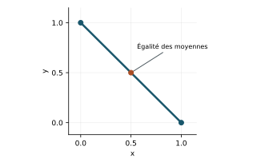

# ENS Paris-Saclay · Économie-gestion D2 · Mathématiques et statistiques 2019 · Corrigé brut

*Corrigé rédigé par IA, non officiel. Signalez toute erreur.*

**Rédaction** · GPT-6.2 Astra Ultra · vitesse non renseignée

**Révision (tour 1)** · GPT-6.2 Astra Ultra · vitesse non renseignée

Les trois problèmes portent sur les matrices idempotentes, la moyenne géométrique et les effets de la dispersion des notes sur la sélection. [Sujet officiel](https://ens-paris-saclay.fr/sites/default/files/CONCOURS/ANNALES_1C/1C_D2_1/2019_Sujets_Ecrits_D2_Math_et_statistiques.pdf) · [Rapport du jury](https://ens-paris-saclay.fr/sites/default/files/CONCOURS/ANNALES_1C/1C_D2_1/2019_Rapport_Ecrits_D2_Maths.pdf)

## Problème 1. Projecteurs du plan

### Question I.1a

Si $Av=\lambda v$ avec $v\ne0$, alors $\lambda^2v=A^2v=Av=\lambda v$. Ainsi $\lambda(\lambda-1)=0$ et les seules valeurs propres possibles sont $0$ et $1$. Chacune apparaît par exemple pour la matrice diagonale $\operatorname{diag}(0,1)$.

### Question I.1b

Pour tout $x\in\mathbb R^2$, $A^2x=Ax$ par hypothèse. Donc $A^2x=0$ équivaut à $Ax=0$ ; les deux noyaux sont égaux.

### Question I.2a

Prenons $x\notin\ker A$. Alors $y=Ax$ est non nul et $Ay=A^2x=Ax=y$. Le vecteur $y$ est donc propre pour la valeur propre $1$.

### Question I.2b

Si $u$ engendre $\ker A$, alors $u$ et le vecteur $y$ de 2a sont propres pour deux valeurs distinctes, donc indépendants. Le couple $(u,y)$ est une base du plan et la matrice de l’endomorphisme dans cette base est $\operatorname{diag}(0,1)$. Cela établit la diagonalisabilité.

### Question I.3

Si $\ker A=\{0\}$, la matrice carrée $A$ est inversible. Multiplier $A^2=A$ à gauche par $A^{-1}$ donne $A=I_2$.

### Question I.4

Sans l’hypothèse initiale de non-nullité, un noyau de dimension deux donne la matrice nulle, un noyau nul donne $I_2$ et un noyau de dimension un donne les matrices $P\operatorname{diag}(0,1)P^{-1}$ avec $P$ inversible. Réciproquement, $0$, $I_2$ et la diagonale $(0,1)$ sont idempotentes et l’idempotence est stable par similitude. La liste est exhaustive.

## Problème 2. Moyennes arithmétique et géométrique

### Question II.1a

On a $C=\{(x,1-x):0\le x\le1\}$. C’est le segment fermé de la droite $x+y=1$ compris entre $(0,1)$ et $(1,0)$, dans le premier quadrant.

### Question II.1b

Sur $C$, $1-2\sqrt{xy}=x+y-2\sqrt{xy}=(\sqrt x-\sqrt y)^2\ge0$. L’égalité est atteinte au milieu $(1/2,1/2)$.

### Question II.1c

Pour $s=x+y>0$, le point $(x/s,y/s)$ appartient à $C$. En 1b, $2\sqrt{xy}/s\le1$, soit $\sqrt{xy}\le(x+y)/2$. Si $s=0$ avec $x,y\ge0$, les deux sont nuls et l’égalité est vraie. Dans tous les cas, l’égalité équivaut à $x=y$.

### Question II.2a

Le simplexe $C$ est compact et le produit continu, donc le maximum est atteint. Sur le bord, une coordonnée au moins est nulle, donc le produit est nul. Au point $(1/3,1/3,1/3)$, le produit vaut $1/27>0$. Tout maximiseur a donc ses trois coordonnées strictement positives.

### Question II.2b

Pour la contrainte $x+y+z=1$, prenons $L(x,y,z,\lambda)=xyz-\lambda(x+y+z-1)$. Les contraintes de positivité sont inactives au maximiseur intérieur trouvé en 2a.

### Question II.2c

Dans l’ordre $(x,y,z,\lambda)$, le gradient est
$$\nabla L=(yz-\lambda,xz-\lambda,xy-\lambda,1-x-y-z).$$

### Question II.2d

Le gradient de la contrainte est $(1,1,1)\ne0$, donc les conditions nécessaires de Lagrange s’appliquent au maximiseur intérieur. Elles donnent $yz=xz=xy=\lambda$, $x+y+z=1$ et $x,y,z>0$.

### Question II.2e

De $yz=xz$ et $z>0$, il vient $y=x$. De $xz=xy$ et $x>0$, on obtient $z=y$. La contrainte impose $x=y=z=1/3$. Comme un maximum existe et satisfait ces conditions, cette unique solution le réalise.

### Question II.2f

La valeur maximale est $(1/3)^3=1/27$.

### Question II.3

Si $s=x+y+z>0$, alors $(x/s,y/s,z/s)\in C$, donc $xyz/s^3\le1/27$. En prenant les racines cubiques, $\sqrt[3]{xyz}\le(x+y+z)/3$. Si $s=0$, les trois nombres sont nuls et l’égalité est vraie. Pour $s>0$, l’égalité exige les trois coordonnées normalisées égales, donc $x=y=z$.

## Problème 3. Sélection sur les notes et estimation

### Question III.1a

On a $E[A]=(9+10+11)/3=10$ et $E[B]=(8+9+10+11+12)/5=10$. Les deux lois ont le même centre.

### Question III.1b

Comme les moyennes sont 10, $\operatorname{Var}(A)=(1+0+1)/3=2/3$ et $\operatorname{Var}(B)=(4+1+0+1+4)/5=2$.

### Question III.2a

Les $3\times5=15$ couples sont équiprobables par indépendance. Les trois couples $(9,9),(10,10),(11,11)$ donnent une égalité. Donc $P(A=B)=3/15=1/5$.

### Question III.2b

Sous $B=10$, Béa gagne si $A<10$, c’est-à-dire $A=9$. Par indépendance, la probabilité conditionnelle est $1/3$.

### Question III.2c

Pour $B=8,9,10,11,12$, le nombre de valeurs possibles de $A$ strictement inférieures est respectivement $0,0,1,2,3$. Les six couples gagnants sur quinze donnent $P(B>A)=6/15=2/5$.

### Question III.2d

Le complément de la victoire d’Alice est la réunion disjointe de l’égalité et de la victoire de Béa. Ainsi $P(A>B)=1-1/5-2/5=2/5$.

### Question III.3a

Le support de $B$ contient cinq notes équiprobables. Donc $P(B=12)=1/5$.

### Question III.3b

Si $B=12$, Alice et Aria ont automatiquement moins de 12. Béa est seule première exactement si $B'<12$. Par indépendance, la probabilité conditionnelle est $4/5$.

### Question III.3c

Au score $A'=9$, Aria ne peut battre Alice. À 10, les trois autres scores sont inférieurs avec probabilité $(1/3)(2/5)^2=4/75$. À 11, cette probabilité est $(2/3)(3/5)^2=18/75$. Les trois scores étant équiprobables, $P(\text{Aria seule première})=(0+4/75+18/75)/3=22/225$.

### Question III.3d

Alice et Aria ont chacune la probabilité $22/225$ d’être l’unique gagnante. Les deux événements sont disjoints. Leur réunion a donc probabilité $44/225$.

### Question III.3e

Si $B=8$ ou 9, Béa ne gagne pas. Pour $B=10,11,12$, les probabilités conditionnelles d’être seule première sont respectivement $(1/3)^2(2/5)$, $(2/3)^2(3/5)$ et $4/5$. En moyennant les cinq cas, on obtient $(2+12+36)/225=50/225$. Bénédicte a même probabilité et les victoires sont disjointes. Ainsi $P(\text{Béa ou Bénédicte sélectionnée})=100/225=4/9$. On peut vérifier la somme par dénombrement direct. Les $3\cdot3\cdot5\cdot5=225$ quadruplets $(A,A^\prime,B,B^\prime)$ sont équiprobables. Parmi eux, 44 ont une gagnante unique du premier type, 100 une gagnante unique du second type et les $225-44-100=81$ autres présentent une égalité en tête.

### Question III.4a

Sachant que la première candidate est de type A, $X_1$ est uniforme sur $\{9,10,11\}$. Chacune de ces notes a probabilité $1/3$, et les autres ont probabilité nulle.

### Question III.4b

Sachant que la première candidate est de type B, $X_1$ est uniforme sur $\{8,9,10,11,12\}$. Chacune de ces cinq notes a probabilité $1/5$.

### Question III.4c

Pour une observation de type aléatoire, $P(B\text{ comme type})=p$ et $P(A\text{ comme type})=1-p$. La formule des probabilités totales donne $P(X_1=k)=p/5$ pour $k=8,12$, et $P(X_1=k)=(1-p)/3+p/5=(5-2p)/15$ pour $k=9,10,11$. Les autres probabilités sont nulles. Si la composition des 100 types est fixée, cette loi est celle d’une position tirée uniformément parmi les 100 ; préciser le type d’une position particulière conduit aux lois de 4a–b.

### Question III.4d

Les deux moyennes conditionnelles valent 10, donc $E[X_1]=(1-p)10+p10=10$.

### Question III.4e

L’écart carré moyen autour de 10 vaut $(1-p)(2/3)+2p$. Comme $E[X_1]=10$, c’est bien la variance, soit $\operatorname{Var}(X_1)=(2+4p)/3$.

### Question III.4f

On lit $n=100$ dans $V=100^{-1}\sum_{i=1}^{100}(X_i-10)^2$. Par linéarité, $E[V]=(2+4p)/3$. Pour une composition fixée de $100p$ candidates du type B et $100(1-p)$ du type A, la même espérance vaut explicitement $[100p\cdot2+100(1-p)\cdot(2/3)]/100$. Ce calcul dispense de supposer identiques les lois individuelles des 100 observations. L’indépendance n’est pas nécessaire pour cette espérance.

### Question III.4g

Prenons $\widehat p=(3V-2)/4$. Alors $E[\widehat p]=(3E[V]-2)/4=p$, ce qui donne l’absence de biais. Autre possibilité, les notes 8 et 12 identifient le type B : leur fréquence empirique a pour espérance $2p/5$, et sa multiplication par $5/2$ donne aussi un estimateur sans biais.
