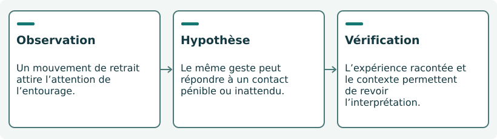

# ENS-PSL · Médecine-Humanités · Autisme 2019 — Corrigé guidé

*Corrigé rédigé par IA, non officiel. Signalez toute erreur.*

**Rédaction** · GPT-6.2 Astra Ultra · vitesse non renseignée

**Révision** · GPT-6.2 Astra Ultra · vitesse non renseignée

Le 14 juin 2019, les candidats disposaient de trois heures pour proposer une lecture croisée de cinq documents. La composition prend pour point de départ la différence entre un geste observé et l’expérience que la personne en rapporte.

## Lire le dossier

- Document 1, p. 2 · Martin Joubert, *À quoi pensent les autistes ?*, 2018. Le clinicien met en regard une hypothèse sur l’imitation et les stratégies d’un jeune patient.
- Document 2, p. 3 · Chaïm Soutine, *L’Idiot de village*, 1919. Le portrait à l’huile mesure 92 × 65 cm. Observer comment le col blanc, les mains et le fond rouge organisent le regard.
- Document 3, p. 4 · Itard, *Mémoire sur les premiers développements de Victor de l’Aveyron*, 1801. Itard rapporte l’examen initial de Pinel. La note signale qu’une proposition diagnostique ultérieure a été contestée.
- Document 4, p. 5 · Temple Grandin, *Ma vie d’autiste*, traduction française de 2000. Une adulte raconte son expérience tactile d’enfant et ce qu’un témoin pouvait en méconnaître.
- Document 5, p. 6 · Brigitte Chamak, *Quaderni*, hiver 2008-2009. L’enquête distingue classifications, associations de parents et associations d’autoreprésentation.

## Ce que dit un geste

**Piste de lecture** · Commencer par une contradiction apparente du document 4. Elle fait naître un problème de connaissance qui pourra être repris dans le portrait, le rapport clinique et l’enquête sociologique.

Une enfant recule lorsque sa maîtresse l’effleure. La scène pourrait être racontée en une phrase par un témoin convaincu qu’elle repousse toute marque d’affection. Temple Grandin, qui se souvient de ce mouvement dans son autobiographie, explique au contraire combien elle désirait de la tendresse. Le geste était observable, mais sa signification n’allait pas de soi. Comment former une connaissance de l’autisme qui tienne compte de ce décalage ? Un examen médical, un portrait peint, un témoignage et une enquête sur les associations ne donnent pas accès aux mêmes choses. Leur rapprochement oblige à demander qui décrit qui et comment une première description peut être rectifiée.

## Du signe visible au jugement sur une vie

**Piste de lecture** · Distinguer deux niveaux d’énonciation, Itard rapportant l’examen de Pinel. Décrire ensuite dans le tableau ce qui dépend du peintre, en particulier le contraste du col et la place des mains. Aucune des deux œuvres anciennes ne fournit à elle seule un diagnostic rétrospectif.

En 1801, Itard rapporte l’examen du jeune Victor de l’Aveyron par Pinel. Les yeux passent d’un objet à l’autre, la musique ne suscite pas la réaction attendue, la main semble seulement saisir. Le compte rendu progresse avec méthode, des organes des sens aux facultés intellectuelles et aux dispositions morales. Pourtant, à mesure que son champ s’élargit, son assurance devient plus problématique. Qu’un examinateur ne reconnaisse aucune intention dans un geste l’autorise-t-il à conclure que l’enfant ne forme aucune intention ? La comparaison finale avec une existence animale franchit ce pas. La notice précise qu’un diagnostic d’autisme a été proposé bien plus tard et contesté. Maintenir cette incertitude permet de poser une question plus féconde que celle d’une étiquette rétrospective. Quelles formes d’attention l’examen de Pinel avait-il les moyens de détecter ? Le pari éducatif d’Itard suppose déjà que l’observation d’un moment ne fixe pas tout l’avenir de Victor.

Le tableau de Soutine soumet le spectateur à une épreuve analogue. Le titre, *L’Idiot de village*, donne d’avance un nom social au modèle. Sur la toile, le col blanc tranche sur le vêtement sombre, deux mains très présentes reposent au premier plan, des touches rouges du fond semblent gagner le visage. La disproportion des traits trouble la tentative de lire immédiatement une expression familière. Ces choix de peinture composent une rencontre avec un individu. En faire les indices d’un trouble déterminé reviendrait à traiter comme un signe clinique ce qui dépend en partie de la touche et du cadrage. Le titre peut donc renseigner sur le regard d’une communauté tout en laissant en suspens ce que cette personne éprouve.

## Une expérience capable de corriger l’interprétation

**Piste de lecture** · Comparer l’imitation sociale décrite par le clinicien et le recul raconté de l’intérieur par Grandin. Dans un cas comme dans l’autre, un même geste se comprend autrement si l’on examine son coût et son contexte.

Le clinicien Martin Joubert expose lui-même les limites d’une déduction. Une difficulté précoce d’imitation peut faire l’objet d’hypothèses neurophysiologiques. Il observe cependant que certains enfants apprennent à reproduire avec soin les conduites d’autrui afin d’être acceptés. Une personne peut réussir le geste attendu au prix d’un effort considérable. Le fait de l’avoir reproduit ne prouve ni la facilité de la rencontre ni la compréhension de ses sous-entendus. À propos de son jeune patient Laurent, Joubert propose de voir dans la nomination minutieuse des aspects concrets du monde une manière de rendre la rencontre supportable. Le passage présente une interprétation clinique située, avec ses questions et son vocabulaire propres.

Grandin modifie la place d’où une telle interprétation peut être discutée. Elle raconte à la fois le désir de contact, le sursaut devant un effleurement imprévu et l’idée enfantine d’une machine dont elle pourrait disposer elle-même. Ce que l’observateur saisit comme un refus global se décompose alors en sensations selon le type de contact et la possibilité de le prévoir. Grandin place côte à côte deux manières de décrire ce qui la séparait des autres. Le score de neuf sur quinze, obtenu à dix ans sur l’échelle de défense tactile, situe une réaction sur une graduation. La comparaison avec une porte coulissante en verre dit autre chose. L’enfant pouvait voir et désirer la proximité des autres tout en éprouvant une séparation qu’un témoin aurait eu peine à percevoir. Réciproquement, le témoignage de Grandin n’explique pas à lui seul l’expérience de Laurent. Il donne une bonne raison de lui ménager, à lui aussi, des moyens de faire connaître les différences qui comptent pour lui.

## Qui peut prendre part à la définition ?

**Piste de lecture** · Chez Chamak, les mots de la classification et les revendications militantes ont une histoire. Situer le mouvement associatif et distinguer les personnes qui défendent une position de la sociologue qui en rapporte l’émergence.

Brigitte Chamak donne une histoire collective à ce déplacement. Les nouvelles classifications des années 1990 ont élargi le champ où des personnes ont pu se reconnaître et témoigner. En même temps que les associations de parents rendaient l’autisme visible comme question de santé publique, des personnes concernées revendiquaient la possibilité de dire elles-mêmes ce qui constituait une difficulté ou une différence. Le document rapporte notamment la position d’Autism Network International, fondé en 1991 aux États-Unis. L’association défend l’idée d’un autre mode de fonctionnement cognitif. La sociologue décrit cette prise de position et les circonstances qui l’ont rendue possible. Elle n’en fait pas une formule obligatoire pour toutes les personnes autistes.

Ces voix peuvent donner lieu à un désaccord réel. Pour une personne qui souhaite des aménagements, être jugée incapable à partir d’un geste est un obstacle. Pour une autre qui a un besoin quotidien d’aide, supposer que la seule reconnaissance publique de sa différence suffira en est un autre. Tenir ensemble ces deux expériences oblige à déplacer la discussion. À côté de la question de la classification, on peut examiner, avec chaque personne et son entourage, ce qui lui permet de communiquer, d’apprendre ou d’éviter une situation pénible.

## Conclusion

**Piste de lecture** · Revenir à la scène initiale pour expliquer ce qu’un observateur peut changer dans la manière de connaître et d’accueillir une personne.

Grandin pouvait vouloir de la tendresse tout en reculant devant une caresse. Faire une place à cette phrase change la responsabilité de celui qui observe. Il lui faut décrire exactement le geste, conserver la possibilité de plusieurs explications et créer les conditions où l’intéressé pourra, autant que possible, les corriger. La connaissance gagne alors une source d’information autant qu’une exigence de respect.

[Sujet](https://docs.google.com/viewerng/viewer?embedded=true&url=https://medecine-humanites.ens.fr/wp-content/uploads/2019/10/Sujet-2-e%CC%81crit-MH2019-ENS.tiff)
