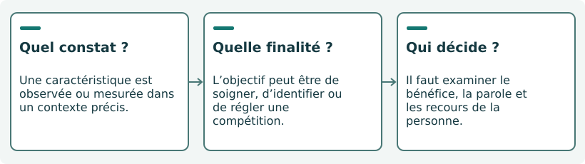

# ENS-PSL · Médecine-Humanités · Intersexuation 2019 — Corrigé guidé

*Corrigé rédigé par IA, non officiel. Signalez toute erreur.*

**Rédaction** · GPT-6.2 Astra Ultra · vitesse non renseignée

**Révision** · GPT-6.2 Astra Ultra · vitesse non renseignée

Écrit du 13 juin 2019. Cinq documents à commenter en trois heures. [Sujet](https://web.archive.org/web/20210214092031id_/http://medecine-humanites.ens.fr/wp-content/uploads/2019/10/Sujet-1-e%CC%81crit-MH2019-ENS.tiff)

## Lire le dossier

- Document 1, p. 2 · Ilana Löwy, *Cahiers du Genre*, 2003. Identifier l’origine sociale de l’urgence dont elle analyse les effets médicaux.
- Document 2, p. 3 · *Hermaphrodite endormi*, Louvre. La photographie montre un corps au repos sur un matelas sculpté. La notice distingue copie romaine, original grec et intervention du Bernin.
- Document 3, p. 4 · Virginia Woolf, *Orlando*, 1928. Les questions successives du narrateur mettent en jeu des attentes liées aux vêtements et aux conduites.
- Document 4, p. 5 · Flora Yacine, *Sciences humaines*, 2012. Le parcours de Laxmi et la reconnaissance administrative au Tamil Nadu permettent d’interroger la portée sociale d’un statut.
- Document 5, p. 6 · *Le Monde* et AFP, 29 mai 2019. Caster Semenya et son avocat s’expriment après la décision du Tribunal arbitral du sport.

## Qui doit s’adapter à la catégorie ?

**Piste de lecture** · Ouvrir sur le verbe « imposer » employé dans la dépêche et sur la déclaration de l’athlète. Ces deux voix rendent immédiatement sensible le conflit, avant toute définition générale.

À qui faut-il expliquer que Caster Semenya est une femme ? Dans l’article du 29 mai 2019, l’athlète prend elle-même la parole. Pourtant, le litige dont elle saisit la justice suisse porte sur une règle sportive qui demande à certaines concurrentes de modifier leur taux de testostérone. Entre ce que Semenya dit d’elle-même et ce que l’institution exige pour courir, le mot « femme » a changé de fonction. Il désigne dans un cas une personne qui parle, dans l’autre une catégorie d’admission. Le dossier invite à suivre ce changement de sens jusque dans la médecine, les arts et l’administration. Comment distinguer ce qu’une classification permet de connaître de ce qu’elle autorise à imposer ?

## Ce que le regard cherche à décider

**Piste de lecture** · Décrire l’angle de la photographie et distinguer le récit de la légende de ce qui est visible. Chez Woolf, relever comment le texte transforme le temps d’habillage et l’équitation en tests absurdes. L’interprétation porte sur le regard qui classe.

Dans la photographie de l’*Hermaphrodite endormi*, le quadrillage sombre et clair du sol rend sensible le volume horizontal du matelas. Le corps repose sur le côté, le visage tourné vers le support, une jambe repliée. Le photographe se place en surplomb du côté du dos. Le quadrillage du sol file en diagonale derrière le support rectangulaire, tandis que le drapé suit le pli des jambes. La page fixe ainsi un angle sur une statue qu’un visiteur du Louvre pourrait contourner. Cette vue permet de décrire une posture. Elle laisse entière la question du regard de la figure sur elle-même. La légende ajoute encore plusieurs temps au regard. Le matelas est l’œuvre du Bernin, au XVIIᵉ siècle, et le corps une copie romaine d’un original grec. Dans la légende, Zeus réunit les deux corps à la demande de Salmacis malgré le refus d’Hermaphrodite. Ce récit impose à la question de l’union une seconde question, celle de savoir qui la demande.

Les « esprits curieux » auxquels Virginia Woolf prête leurs interrogations cherchent eux aussi à trancher. La durée de la toilette d’Orlando, son adresse à cheval ou sa tendresse envers les animaux deviennent autant d’indices supposés. Or une habileté s’acquiert, un habit se change, et le refus de la cruauté n’a rien d’une mesure du sexe. La liste s’allonge précisément parce qu’aucun indice n’emporte la conclusion. La fiction d’une vie qui se prolonge après une métamorphose permet ainsi une expérience hors de portée de la seule image. Le lecteur suit une personne dans le temps, tandis que les observateurs croient pouvoir la classer en un instant. Le mythe, le roman et les variations corporelles étudiées par la médecine sont ici des objets distincts. Ce qu’ils permettent de comparer est l’attente du spectateur devant un corps qu’il voudrait identifier.

## Quand l’embarras social devient une indication d’agir

**Piste de lecture** · Reconstituer la chaîne qui va de la demande sociale à la décision médicale. La mettre ensuite à l’épreuve d’une institution sportive dont le but premier est différent. Maintenir le recours de Semenya au présent du 29 mai 2019.

Ilana Löwy donne une conséquence très concrète à cette attente. Dans son article de 2003, elle oppose le caractère exclusif des deux positions sociales à la diversité des configurations biologiques. Son raisonnement devient particulièrement clair à la naissance. Un entourage réclame une réponse immédiate à la question « garçon ou fille ? ». Puisque la question exige une seule réponse, ce qui échappe à sa forme est facilement décrit comme une urgence. Le déplacement est considérable. On peut s’inquiéter à juste titre pour la santé d’un nouveau-né, mais la difficulté d’une déclaration sociale ne dit encore rien du bénéfice médical d’une intervention précoce. Pour justifier un geste irréversible, il faudrait pouvoir en préciser l’indication pour cet enfant, les conséquences de l’attente et la place que prendra plus tard sa propre parole.

L’article sur Semenya fait apparaître le même déplacement dans une institution très différente. Classer les concurrentes doit permettre la tenue d’une épreuve. De là à demander un traitement à une athlète pour qu’elle y soit admise, on passe d’une règle de compétition à une intervention sur son corps. Le document rapporte un jugement du Tribunal arbitral du sport, le recours de l’athlète et l’argument de son avocat. Il donne accès à une contestation à une date précise. Il ne permet ni d’établir un diagnostic individuel ni de trancher à lui seul la question de l’équité sportive. Il permet en revanche de demander qui supporte le coût de la catégorie et si le médecin intervient dans l’intérêt de la personne qu’il reçoit ou afin de satisfaire un règlement.

## Ce que change une reconnaissance

**Piste de lecture** · Revenir à une trajectoire singulière. La case administrative, la reconnaissance rituelle, l’appartenance choisie et la possibilité de vivre de son travail répondent à des besoins distincts.

Le reportage de Flora Yacine empêche de conclure trop vite qu’une case supplémentaire résoudrait toute difficulté. Au Tamil Nadu, la possibilité, décrite en 2012, de cocher une troisième mention sur des papiers d’identité peut permettre d’obtenir des documents qui correspondent à une place sociale revendiquée. Le parcours de Laxmi, chassée de chez elle enfant puis accueillie par une communauté hijra, montre ce qu’une telle appartenance peut rendre à quelqu’un. Pourtant, la place rituelle accordée aux hijras lors des naissances et des mariages coexiste avec une grande précarité et des violences. Être recherché dans une cérémonie et pouvoir vivre en sécurité le lendemain sont deux réalités différentes. De plus, l’appartenance à cette communauté, l’identité d’une athlète et des variations de caractéristiques sexuelles ne se déduisent pas les unes des autres. Les confondre ferait de la troisième case une nouvelle assignation.

## Conclusion

**Piste de lecture** · Proposer un critère utilisable dans les deux cas contemporains de la naissance et de la compétition. La liberté de contestation et le bénéfice attendu pour la personne en donnent deux dimensions.

Une catégorie se juge à sa finalité, à ses conséquences pour la personne et à la possibilité de la contester. Décrire une variation, ouvrir un droit et décider d’un soin engagent trois responsabilités différentes. L’écoute devient décisive là où le classement menace de transformer celui qui pourrait parler en objet d’une décision prise pour lui.
