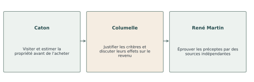

# L’exploitation rurale à Rome selon Caton, Columelle et René Martin · Oral 2019 · Corrigé guidé

*Corrigé rédigé par IA, non officiel. Signalez toute erreur.*

**Rédaction** · GPT-6.2 Astra Ultra · vitesse non renseignée

Le cahier d’études classiques demande une synthèse personnelle des trois textes, en vingt minutes d’exposé suivies de dix minutes d’entretien. Il donne le latin et la traduction des deux traités antiques puis un extrait historiographique publié en 1974.

## Deux moments, une même question d’achat

> [!INDICATION]
> Situer Caton et Columelle avant de chercher ce qui change dans leurs critères.

#### Proposition de réponse

Sous la République, au IIe siècle avant notre ère, Caton s’adresse à celui qui envisage d’acheter un domaine. Au Ier siècle de notre ère, sous le Principat, Columelle présente Caton comme une autorité à commenter. En 1974, René Martin interroge l’usage de ces agronomes comme sources de l’histoire de l’esclavage. Ces trois textes ne forment pas trois témoignages de même nature. Peut-on tirer d’une tradition de conseils aux propriétaires une histoire des transformations du domaine et de ceux qui y travaillent ?

Le premier passage ouvre une séquence d’inspection. « Ne cupide emas », ne pas acheter dans l’empressement. Les visites répétées, l’aspect des exploitations voisines et l’état des pressoirs et récipients servent d’indices à un acheteur qui ne dispose pas d’une comptabilité complète. La valeur d’un fonds dépend ainsi de qualités que l’on doit voir sur place et d’autres que l’on infère de l’environnement. Le latin fait aussi place à la bonne route (« via bona celerisque »), après la mer et la rivière navigable. Le rapprochement avec l’original est ici précieux pour compléter la traduction proposée.

## Lire un paysage comme une économie du domaine

> [!INDICATION]
> Distinguer la production physique, les dépenses et le revenu attendu du maître.

#### Proposition de réponse

Caton recherche un terrain sain, fertile, si possible exposé au midi au pied d’une montagne, pourvu d’eau et de travailleurs disponibles. La proximité d’une ville et des voies de transport situe le domaine dans un ensemble d’échanges. Les pressoirs et les récipients orientent l’acheteur vers des volumes produits et conservés. Mais l’outillage coûte. Une terre très productive et très coûteuse peut laisser peu de revenu. La comparaison avec un homme prodigue formule cette règle sous forme morale.

La hiérarchie finale situe la vigne au premier rang, sous condition de rendement et de bon emplacement, puis le jardin irrigué, l’oseraie, l’olivier, la prairie et seulement ensuite les céréales. La liste comporte aussi des ressources forestières. Elle est énoncée pour une propriété de cent jugères, que la traduction appelle « arpents ». Elle ne recense ni la surface réelle occupée par ces cultures en Italie ni les besoins alimentaires de toute la société romaine. Un classement d’investisseur exprime un point de vue différent de celui d’un cultivateur recherchant d’abord la subsistance.

## Comment Columelle fait travailler l’autorité de Caton

> [!INDICATION]
> Identifier ce que le second auteur reprend et ce qu’il explicite par un exemple.

#### Proposition de réponse

Columelle distingue deux conditions initiales, « salubritatem caeli et ubertatem loci », salubrité et fertilité. Une terre malsaine peut priver son propriétaire de la jouissance même d’une belle récolte. Viennent ensuite chemin, eau et voisin. La bonne route réduit le coût du transport, élève la valeur des produits une fois remisés et favorise la présence du maître. Cette dernière condition implique qu’il peut vivre ailleurs. Le choix entre entretenir des animaux propres et les louer est une comparaison de coûts concrets. Les esclaves qui accompagnent le père de famille apparaissent explicitement, jusque dans leur fatigue de marche.

Le voisin constitue un cas de discussion. Il peut mourir ou changer, mais Columelle refuse d’en déduire qu’il est raisonnable de choisir un mauvais voisinage. De la République à l’Empire, la continuité du modèle est bien établie par la citation de Caton. Ce qui change dans ces pages est surtout la façon de discuter les critères, en explicitant leurs mécanismes et certaines objections. Deux passages sur l’achat ne suffisent pas à établir une évolution générale de la taille des exploitations ou une substitution systématique d’un type de main-d’œuvre à un autre.

## Ce que la prescription révèle du travail contraint

> [!INDICATION]
> Appliquer le raisonnement de René Martin aux détails des deux agronomes.

#### Proposition de réponse

René Martin rappelle que ces écrivains se recopient, laissent des silences et cherchent à modifier des conduites. Deux conseils semblables ne valent donc pas deux observations indépendantes. Son exemple concerne les récompenses vantées par Columelle. Insister sur celles-ci peut signifier qu’elles étaient rares. La discrétion sur les châtiments ne permet pas de conclure que la condition ordinaire des esclaves était douce. Inverser systématiquement tout conseil en description réelle serait tout aussi fragile. Martin avance une hypothèse à tester.

L’exposé peut ainsi dépasser le dossier en indiquant comment vérifier quelques propositions. Les pressoirs, amphores et espaces de stockage fouillés sur des sites datés peuvent éclairer les productions et leurs circuits. Une inscription peut nommer un intendant ou signaler certains statuts. En revanche, un bâtiment ou une chaîne de production ne suffit pas à identifier comme esclave chaque travailleur. L’enquête fait apparaître l’écart entre le territoire idéal que calcule le propriétaire, les infrastructures effectivement laissées dans le sol et l’expérience des hommes dont le traité fait une ressource.
