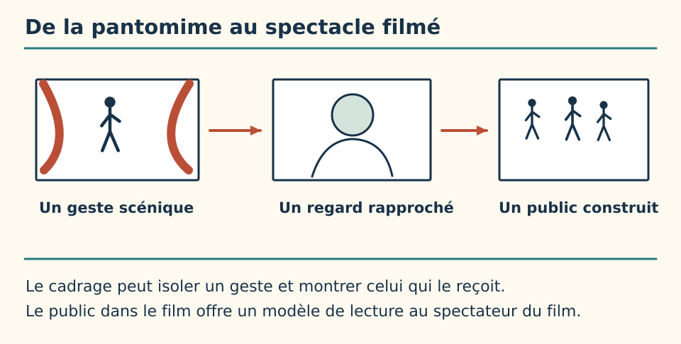

# ENS-PSL · Sélection internationale Lettres · 2019 · Corrigé brut

*Corrigé rédigé par IA, non officiel.*

**Rédaction** · GPT-6.2 Astra Ultra · vitesse non renseignée

**Révision (tour 1)** · GPT-6.2 Astra Ultra · vitesse non renseignée

## Que rend populaire le septième art ?

Pour Badiou, l’emprunt aux autres arts s’accompagne d’une sélection. Un film retiendrait d’une danse, d’une pièce ou d’un morceau de musique ce qui peut s’adresser à tous. Les trois verbes qui décrivent ce filtrage sont plus exigeants qu’une métaphore de synthèse : il faut expliquer ce qui passe au cinéma, ce que le passage transforme et qui peut effectivement s’en saisir.

### Le geste qui traverse la salle

Dans *Les Enfants du paradis* de Marcel Carné (1945), Baptiste mime devant un attroupement le vol dont Garance est accusée. Son jeu distribue à un seul corps plusieurs rôles et reconstitue la chaîne des gestes. Le public de rue en comprend le sens. Le film rend à son tour ce geste intelligible, tout en faisant voir les observateurs et la réaction de Garance. Un spectateur de cinéma peut ainsi passer de l’intérêt pour l’énigme à l’intérêt pour la naissance d’un échange de regards. La pantomime propose un langage du corps accessible sans connaissance du répertoire théâtral. Le découpage ajoute une géographie des spectateurs.

### Le changement de place produit un autre art

Dans *Les Chaussons rouges* de Michael Powell et Emeric Pressburger (1948), le grand ballet s’ouvre dans l’espace d’une représentation scénique. Le danseur et la ballerine peuvent être appréhendés par leur silhouette, leur impulsion et leur rythme. Le film déplace pourtant le point de vue et transforme les décors autour de la danseuse, de sorte qu’aucun siège de la salle ne correspondrait à tout ce que voit le spectateur. L’accessibilité du conte et du geste ne vient donc pas d’un simple prélèvement. La mise en scène invente une expérience de la contrainte qui s’exerce sur le corps, entre élan du spectacle et impossibilité de s’arrêter.

### Le public change aussi l’œuvre empruntée

Le point commun de ces exemples tient à une adresse. Chez Carné, l’attroupement fournit aux spectateurs un premier modèle de lecture, puis la réaction d’un personnage singularise ce que chacun pourrait comprendre. Chez Powell et Pressburger, un conte reconnaissable introduit une chorégraphie exigeante. Il serait réducteur d’attribuer par nature la complexité à une élite et l’impression immédiate aux masses. Une personne peut entrer dans l’œuvre par le plaisir d’une figure et découvrir progressivement les exigences du ballet. La diffusion de copies élargit matériellement l’audience, mais l’accès dépend encore des salles, des versions et des habitudes de lecture.

### Une destination à vérifier

Rien, dans le mot « populaire », n’oblige donc à simplifier l’art emprunté. L’hypothèse la plus féconde de Badiou tient à la capacité d’une œuvre de proposer à des inconnus un point d’entrée commun. La preuve en est chaque fois locale, dans le geste dont le film règle la visibilité et dans les chemins qu’il ouvre ensuite. La fréquentation, à elle seule, ne dirait pas à quoi le public a effectivement eu accès.

## Sources

Le feuillet de 2019 donne une citation d’Alain Badiou publiée dans Critique en janvier-février 2005 et demande de l’illustrer et de la commenter.

[Sujet de l’ENS](https://www.ens.psl.eu/sites/default/files/cinema-sil2019.pdf)
