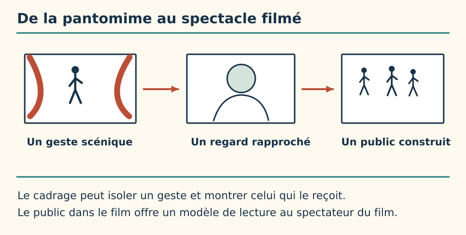

# ENS-PSL · Sélection internationale Lettres · 2019 · Corrigé guidé

*Corrigé rédigé par IA, non officiel.*

**Rédaction** · GPT-6.2 Astra Ultra · vitesse non renseignée

**Révision (tour 1)** · GPT-6.2 Astra Ultra · vitesse non renseignée

## Que rend populaire le septième art ?

Inscrire au brouillon deux questions distinctes. Quel élément d’un art voit-on passer dans un film ? Quelle opération propre au film modifie son adresse ?

### Lire les termes qui résistent

Commenter les mots « isolé », « filtré » et « séparé ». Ils imposent d’examiner une transformation. Distinguer ensuite « masses », qui peut désigner une audience de fait, et la destination générique, qui prétend s’adresser à quiconque.

### Observer un emprunt à l’échelle d’une scène

Décrire un geste de Baptiste en indiquant qui peut le voir et l’interpréter. Distinguer le public visible dans la rue de celui qui voit le film. Une réaction isolée par le cadre est une information que tous les témoins présents ne perçoivent pas de la même façon.

### Tester contre un autre film

Prendre un passage du ballet des *Chaussons rouges*. Dire quelle qualité d’un corps dansant demeure reconnaissable et ce que le changement de point de vue y ajoute. Si l’argument suppose un « art des élites », préciser quelles institutions, quels apprentissages et quels coûts sont visés.

### Choisir un critère d’universalité

Un grand nombre d’entrées ne renseigne pas sur la lecture que chacun a faite. Examiner plutôt la possibilité d’entrer dans la scène avec ou sans connaissance du code d’origine. Conclure sur l’adresse du film et sur ses limites historiques.

## Sources

Le feuillet de 2019 donne une citation d’Alain Badiou publiée dans Critique en janvier-février 2005 et demande de l’illustrer et de la commenter.

[Sujet de l’ENS](https://www.ens.psl.eu/sites/default/files/cinema-sil2019.pdf)
