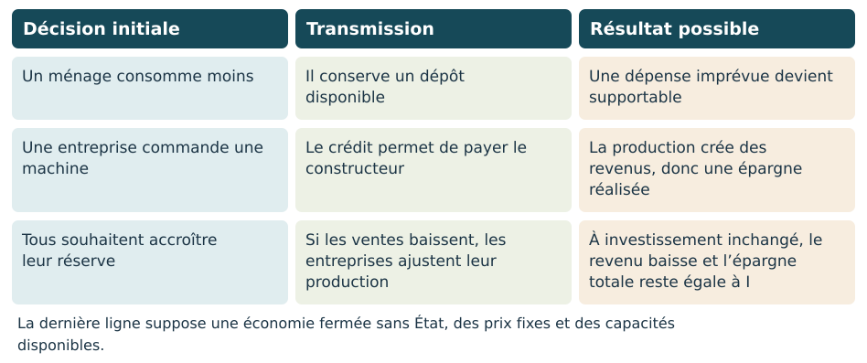

# ENS-PSL · Sélection internationale Lettres — Économie — à quoi sert l’épargne 2019 · Corrigé brut

*Corrigé rédigé par IA, non officiel. Signalez toute erreur.*

**Rédaction** · GPT-6.2 Astra Ultra · vitesse non renseignée

**Autocontrôle** · GPT-6.2 Astra Ultra · vitesse non renseignée

**Révision (tour 2)** · GPT-6.2 Astra Ultra · vitesse non renseignée · 26 novembre 2026

## À quoi sert l’épargne ?

Deux ménages reçoivent la même prime. Le premier en conserve la moitié pour pouvoir réparer sa voiture. Le second achète des actions à un épargnant qui veut précisément payer une réparation. Les deux premiers ménages ont différé une dépense, mais le second achat n’a apporté aucun financement nouveau à l’entreprise dont les actions ont changé de mains. Pour mesurer la portée de l’épargne, il faut d’abord la définir comme un flux, la part du revenu disponible qui n’est pas consommée au cours d’une période. Le patrimoine désigne le stock d’actifs détenus à une date, net des dettes si l’on parle de patrimoine net. Une plus-value peut enrichir le détenteur d’un actif sans qu’il ait épargné davantage. Que rend donc possible le renoncement à consommer un revenu présent, pour celui qui le perçoit et pour la collectivité ?

### I. Disposer de son revenu à une autre date et dans d’autres circonstances

Un salaire est versé chaque mois, une dépense de formation ou un apport immobilier peuvent se concentrer sur un seul. En épargnant pendant les périodes favorables puis en désépargnant, le ménage dissocie le calendrier de sa consommation de celui de ses revenus. Dans la théorie du cycle de vie de Modigliani et Brumberg, ce transfert se comprend à l’échelle de l’existence. Entre la vie active et la retraite, consommer peut rester souhaitable alors que le revenu d’activité a disparu. Le montant d’une pension attendue, les conditions du crédit et la perspective de transmettre une succession modifient l’importance et le calendrier de l’accumulation.

Lorsque le risque entre en jeu, la disponibilité importe autant que le rendement. Un ménage menacé de chômage et qui ne peut compter sur un emprunt rapide conserve un dépôt mobilisable, même faiblement rémunéré. Cette épargne de précaution réduit le coût d’un accident de revenu. L’assurance chômage mutualise ce risque entre ménages, ce qui peut diminuer la réserve individuelle nécessaire. Encore faut-il avoir une marge entre revenu et dépenses incompressibles. Le salarié qui a le besoin de liquidité le plus urgent peut avoir la capacité d’épargne la plus faible. Subventionner indifféremment tous les placements aiderait aussi ceux qui auraient épargné sans aide.

### II. Transférer des capacités de financement et préparer une production future

Une entreprise peut conserver ses bénéfices pour financer son équipement. Un ménage peut souscrire une émission de titres dont le produit finance une usine, ou conserver un dépôt bancaire. L’intermédiation permet notamment de concilier le besoin de liquidité des déposants avec les échéances plus longues des emprunteurs. Elle engage la banque à apprécier la solvabilité des débiteurs et à se procurer la liquidité nécessaire. Une acquisition de titres déjà émis transforme la composition des portefeuilles. Elle facilite éventuellement des émissions futures en rendant les titres plus faciles à revendre, mais la somme versée aujourd’hui revient au précédent détenteur. Il faut suivre le paiement jusqu’à son destinataire pour établir ce qui est financé.

Le financement et la formation de capital réel ont donc des calendriers distincts. Lorsqu’une banque accorde un crédit, l’inscription d’un dépôt au compte de l’emprunteur peut précéder toute épargne nouvelle. La commande d’une machine fournit ensuite des revenus aux entreprises et aux salariés qui la produisent. À l’échelle d’une économie fermée sans État, les emplois de la production donnent $Y=C+I$ et l’affectation du revenu donne $S=Y-C$. On a ainsi $S=I$ après coup, stocks involontaires compris. Cette égalité de flux réalisés laisse ouverte la question de savoir si une hausse des possibilités de financement a stimulé la commande ou si la commande a engendré le revenu sur lequel on a épargné. En économie ouverte, un excédent de l’épargne nationale sur l’investissement intérieur correspond, dans le cadre usuel de ces comptes, à un excédent courant. Une partie des ressources du pays a pour contrepartie une créance nette sur le reste du monde.

### III. La fonction de l’épargne dépend de l’état de l’économie

Au voisinage du plein emploi, consacrer davantage de ressources à la construction de machines suppose d’en soustraire à un autre emploi. Si la consommation présente diminue, des capacités peuvent être réaffectées, à condition que les entreprises prévoient des débouchés et que les compétences ou les équipements soient transférables. Le bénéfice collectif dépend encore du projet choisi. Financer l’isolation d’immeubles et enchérir sur des terrains déjà bâtis ne mobilisent ni les mêmes ressources ni les mêmes gains futurs.

En sous-emploi, si tous réduisent simultanément leur consommation, les commerçants perdent des recettes, les producteurs ajustent leur activité et les revenus diminuent. Supposons que l’investissement prévu reste de 20 et que la consommation représente quatre cinquièmes du revenu. Dans l’équilibre fermé précédent, $Y=0{,}8Y+20$ donne 100, dont 20 épargnés. Avec une propension à consommer de trois quarts, le nouvel équilibre est 80, dont 20 épargnés encore. La volonté d’épargner davantage à revenu donné a contracté la production. Cet exemple keynésien suppose des prix fixes et un investissement insensible à court terme à cette contraction. Une baisse des taux, des dépenses publiques ou des débouchés extérieurs peuvent en modifier l’issue.

L’épargne donne ainsi un pouvoir sur le temps, mais un pouvoir inégalement distribué. Elle protège, transmet et peut soutenir la production future. Son utilité collective se juge à la destination des fonds, à la capacité de l’économie à mobiliser des ressources réelles et à l’effet de la dépense différée sur les revenus d’autrui.

## Vérification sur le sujet

Les deux éditions distinguent flux d’épargne, stock de patrimoine, placement sur un marché secondaire et financement d’un projet. Le modèle fermé à investissement fixé à 20 donne bien un revenu de 100 puis de 80 lorsque la propension à consommer passe de 0,8 à 0,75.

L’ouverture extérieure précise l’emploi des fonds. Dans une économie simplifiée dont le revenu national disponible est 120, la consommation finale 85 et la formation de capital 30, l’épargne nationale vaut 35. Les cinq unités restantes constituent, en l’absence de transferts en capital, une capacité de financement vis-à-vis du reste du monde. L’excédent peut financer l’acquisition d’actifs extérieurs ou réduire des engagements antérieurs. Il ne décrit pas à lui seul la destination de l’épargne d’un ménage particulier.
