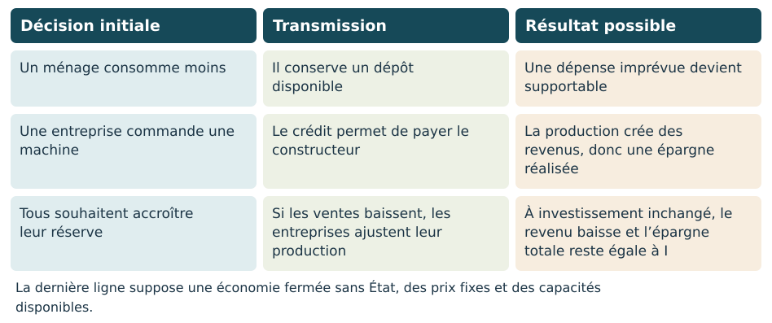

# ENS-PSL · Sélection internationale Lettres — Économie — à quoi sert l’épargne 2019 · Corrigé guidé

*Corrigé rédigé par IA, non officiel. Signalez toute erreur.*

**Rédaction** · GPT-6.2 Astra Ultra · vitesse non renseignée

**Autocontrôle** · GPT-6.2 Astra Ultra · vitesse non renseignée

**Révision (tour 2)** · GPT-6.2 Astra Ultra · vitesse non renseignée · 26 novembre 2026

## Partir d’un relevé de compte

Un ménage débute le mois avec 700 euros de dépôts, reçoit 2 000 euros de revenu disponible et consomme 1 850 euros. Son épargne du mois vaut 150 euros. S’il emploie ces 150 euros à rembourser le principal d’une dette, le solde de son compte revient à 700 euros alors que son patrimoine net a progressé de 150 euros. Un compte bancaire, un patrimoine et une épargne répondent donc à trois questions différentes. Pour introduire le devoir, demander ce que permet la disposition future de ces 150 euros et à quelles conditions leur usage produit un effet chez d’autres agents.

### Construire le premier argument à partir de deux risques

Prenons deux personnes qui travaillent aujourd’hui. La première prévoit une baisse de revenu à une date connue, son départ à la retraite. Elle peut sacrifier une partie de sa consommation courante pour financer des dépenses pendant la retraite. La seconde ignore si elle pourra travailler le mois prochain. Elle a intérêt à conserver une réserve liquide parce que son employeur, ses proches ou sa banque ne garantiront pas nécessairement un revenu de remplacement. Le premier cas conduit au lissage sur le cycle de vie, le second à la précaution. Dans la copie, ajouter une conséquence vérifiable de la distinction. À revenu actuel identique, une pension future plus élevée réduit le besoin de provision pour la retraite, toutes choses égales par ailleurs. Un accès plus facile à une assurance contre les accidents de revenu agit sur le second motif.

Comment introduire la distribution ? Comparer une personne sans marge après paiement du logement et de l’alimentation à une personne disposant d’un surplus régulier. Un faible montant épargné peut signaler une contrainte budgétaire. Une enquête sur les seuls détenteurs d’un produit d’épargne ne renseigne guère sur les besoins de ceux qui n’y ont pas accès. Cette observation permet de passer du choix individuel aux institutions de financement.

### Suivre trois paiements pour identifier ce qui est financé

Imaginons trois usages de 150 euros. Le premier épargnant achète à une entreprise une obligation nouvellement émise. L’entreprise reçoit les fonds, qu’elle pourra consacrer à un équipement ou à refinancer une dette. Le second achète en bourse une obligation déjà émise. C’est le vendeur qui touche les fonds. Le marché secondaire facilite la revente, mais cet échange n’augmente pas immédiatement la caisse de l’entreprise. Le troisième laisse les fonds sur un dépôt. La banque porte des créances dont les échéances diffèrent de celles de ses dépôts, accorde des crédits et doit pouvoir honorer des retraits. La monnaie créée par un nouveau prêt peut circuler avant qu’une épargne supplémentaire soit réalisée. L’exemple permet de distinguer placement, financement et investissement au sens de la comptabilité nationale.

### Mettre à l’épreuve l’argument collectif

Partir d’une économie fermée sans administration. Si la production vaut 100 et les achats de consommation 80, les 20 restants correspondent à l’investissement réalisé. Des marchandises invendues entrent dans les stocks et comptent à ce titre. Écrire ensuite la relation de comportement pour un exercice de pensée. À investissement prévu fixé à 20, avec $C=0{,}8Y$, résoudre $Y=C+20$ conduit à $Y=100$. Refaire le calcul avec $C=0{,}75Y$. On trouve 80 de revenu, 60 de consommation et toujours 20 d’épargne. La diminution des achats fait baisser les revenus jusqu’à ce que l’épargne réalisée rejoigne l’investissement. Présenter le mécanisme par les ventes et l’emploi avant de citer le « paradoxe de l’épargne ».

Changer maintenant une hypothèse. Si des ressources sont déjà entièrement employées, différer certaines dépenses de consommation peut aider à libérer du travail ou des matériaux pour des projets productifs. Si le pays peut prêter au reste du monde, l’épargne nationale peut excéder l’investissement intérieur. Si un prêteur refuse un bon projet faute d’information, une incitation générale à l’épargne n’améliore pas forcément la sélection du projet. Ces variantes permettent de construire une dernière partie argumentée autour de conditions précises.

### Refermer la question

Une conclusion peut repartir des 150 euros du premier ménage. Ils ont amélioré sa capacité à faire face à l’avenir, ici par un désendettement. Pour affirmer qu’ils ont permis à une entreprise de produire davantage, il faudrait encore identifier son financement et ses débouchés. La finalité individuelle est intelligible à partir du budget du ménage. L’effet collectif demande de suivre les paiements, la production et les revenus.

## Vérification sur le sujet

Les deux éditions distinguent flux d’épargne, stock de patrimoine, placement sur un marché secondaire et financement d’un projet. Le modèle fermé à investissement fixé à 20 donne bien un revenu de 100 puis de 80 lorsque la propension à consommer passe de 0,8 à 0,75.

L’ouverture extérieure précise l’emploi des fonds. Dans une économie simplifiée dont le revenu national disponible est 120, la consommation finale 85 et la formation de capital 30, l’épargne nationale vaut 35. Les cinq unités restantes constituent, en l’absence de transferts en capital, une capacité de financement vis-à-vis du reste du monde. L’excédent peut financer l’acquisition d’actifs extérieurs ou réduire des engagements antérieurs. Il ne décrit pas à lui seul la destination de l’épargne d’un ménage particulier.
