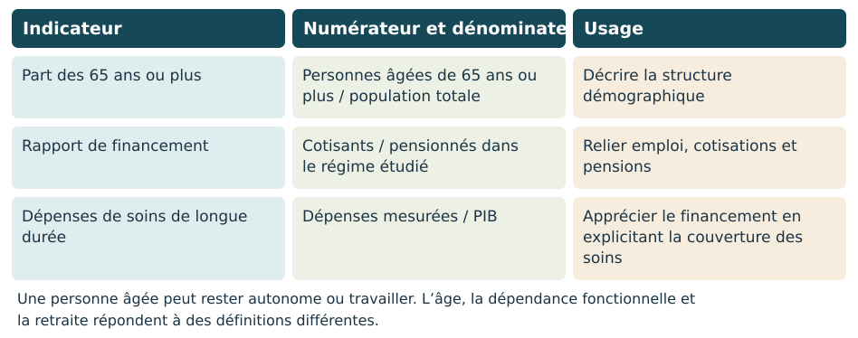

# ENS-PSL · Sélection internationale Lettres — Économie — les défis du vieillissement (oral) 2019 · Corrigé brut

*Corrigé rédigé par IA, non officiel. Signalez toute erreur.*

**Rédaction** · GPT-6.2 Astra Ultra · vitesse non renseignée

**Autocontrôle** · GPT-6.2 Astra Ultra · vitesse non renseignée

**Révision (tour 2)** · GPT-6.2 Astra Ultra · vitesse non renseignée · 26 novembre 2026

## Exposé proposé — Les défis posés par le vieillissement dans les pays développés

Au 1er janvier 2017, les personnes de 65 ans ou plus représentaient 19,4 % de la population de l’Union européenne et 19,2 % de celle de la France, selon le premier document. Ce constat démographique ne dit pas combien de personnes travaillaient, percevaient une pension ou avaient besoin d’aide quotidienne. Le problème économique est de savoir comment une société dont la structure par âge se transforme peut produire, répartir et financer les ressources nécessaires à des vies plus longues.

### 1. Comprendre qui vieillit et sous quelles hypothèses

Une baisse des naissances réduit la taille relative des jeunes générations, tandis qu’une diminution de la mortalité aux grands âges augmente le nombre de survivants. Le passage de générations nombreuses aux âges élevés peut temporairement accélérer la transformation. Migrations, emploi et structure familiale peuvent ensuite en modifier les effets. La pyramide française du document 2 oppose les profils anciens, le profil observé en 2018 et une projection pour 2070. Une coupe large à un âge donné exprime un effectif important dans cette génération. Sa largeur en 2070 dépendra des hypothèses de fécondité, de migration et de mortalité. Elle ne peut être lue avec le même degré de certitude que la coupe de 2018.

L’espérance de vie sans incapacité à 65 ans complète la mesure de la longévité. Les gains de durée de vie peuvent s’accompagner d’années autonomes ou de périodes où l’aide devient nécessaire. La productivité et les emplois accessibles à différents âges dépendent aussi de l’organisation du travail, de la qualification et des conditions de santé. Le défi porte donc à la fois sur les ressources à produire et sur les conditions de participation à cette production.

### 2. Partager les gains de longévité et financer les retraites

Dans un régime par répartition simplifié, la masse des cotisations est le produit du taux de cotisation, du salaire moyen et du nombre de cotisants. Elle finance la pension moyenne multipliée par le nombre de pensionnés. Si le nombre de cotisants par pensionné baisse, maintenir la pension relativement au salaire moyen exige, en l’absence d’autres ressources, une hausse du taux. Augmenter l’emploi, reculer l’âge effectif de sortie, modifier le calcul ou l’indexation des droits et mobiliser d’autres prélèvements ont des conséquences différentes. La hausse de productivité élargit la production à partager, mais ne résout pas à elle seule une tension exprimée en pensions rapportées aux salaires si ces derniers et les pensions progressent au même rythme.

Le document 5 distingue le taux de remplacement théorique net d’un cas type ayant quarante ans de carrière et le taux agrégé brut observé pour des classes d’âge données. Pour la France, le cas type passe de 76 % en 2016 à 68 % projetés en 2056. Il ne représente pas une promesse individuelle et ne se compare pas sans précaution au ratio agrégé. Reporter une borne d’âge a un effet différent pour une personne qui peut garder son poste et pour une personne déjà en chômage ou exposée à la pénibilité. L’équité du financement doit s’apprécier sur des carrières et des durées de retraite inégales.

### 3. Organiser le soin et l’aide quotidienne

Le document 3 mesure la proportion des 65 ans ou plus qui reçoivent des soins de longue durée. Un taux bas peut refléter des besoins différents, une prise en charge familiale ou une offre formelle insuffisante. Selon la note, certains pays ne recensent que les bénéficiaires en établissement, ce qui interdit une comparaison directe avec les pays qui incluent l’aide à domicile. Le document 4 rapproche les projections de part des 80 ans ou plus et celles des dépenses de longue durée rapportées au PIB. Les écarts entre pays dépendent également du financement public, du coût du travail et du périmètre des services. Une personne qui aide bénévolement un parent engage du temps et peut réduire son activité professionnelle sans que tout ce coût soit visible dans la dépense enregistrée.

La prévention et l’adaptation du logement peuvent retarder certaines pertes d’autonomie. Des services de proximité, une offre en établissement et un soutien aux proches répondent à des degrés de besoin différents. Ces services emploient du personnel qualifié dont le temps ne s’accroît pas au même rythme que la demande. Une politique de financement doit être accompagnée de formation, de conditions de travail soutenables et d’une évaluation de l’accès selon le territoire ou le revenu.

Le vieillissement est ainsi la conséquence, en partie heureuse, de la survie de générations plus nombreuses à des âges élevés. Sa traduction en difficultés financières ou en pertes d’autonomie dépend de l’emploi, des institutions de retraite et de la capacité d’organiser les soins. Aucune proportion d’âge unique ne permet de décider comment partager l’effort entre générations et au sein de chacune.

## Vérification sur le sujet

Dans les deux copies, la valeur française initiale du document 5 a été corrigée après lecture du tableau original. Le taux net théorique du cas type passe de 76 % en 2016 à 68 % en 2056. Les autres valeurs présentées ont été confrontées aux cinq documents.

Pour la France, le recul projeté du taux net théorique est de 8 points, soit environ 10,5 % de sa valeur initiale. Dans la colonne agrégée de 2016, le taux brut est déjà de 68 % pour l’ensemble. L’égalité numérique avec le 68 % projeté pour 2056 porte sur deux objets différents. Le premier compare pensions des 65–74 ans et revenus du travail des 50–59 ans. Le second simule une carrière type de quarante ans.
