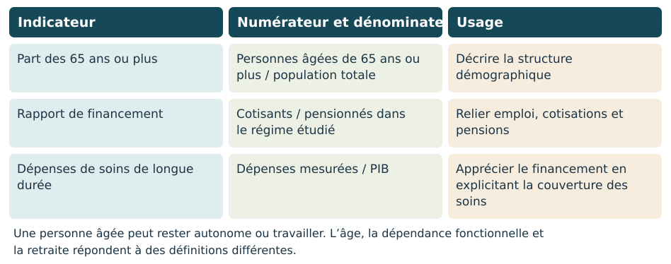

# ENS-PSL · Sélection internationale Lettres — Économie — les défis du vieillissement (oral) 2019 · Corrigé guidé

*Corrigé rédigé par IA, non officiel. Signalez toute erreur.*

**Rédaction** · GPT-6.2 Astra Ultra · vitesse non renseignée

**Autocontrôle** · GPT-6.2 Astra Ultra · vitesse non renseignée

**Révision (tour 2)** · GPT-6.2 Astra Ultra · vitesse non renseignée · 26 novembre 2026

## Organiser le dossier autour de trois dénominateurs

Sur la feuille de préparation, placer en regard la population totale, la population qui cotise et les personnes ayant besoin d’un soin de longue durée. Elles ne se déduisent pas les unes des autres. Une personne de 67 ans peut être autonome et travailler. Une personne plus jeune peut avoir besoin d’une aide quotidienne. Commencer par cette distinction évite de transformer chaque personne âgée en charge uniforme.

### Documents 1 et 2 — Structure et dynamique

Le premier tableau mélange plusieurs dates et unités. Dans l’Union européenne, 19,4 % correspond à la part des 65 ans ou plus au début de 2017. Le solde naturel, l’apport migratoire et la croissance totale de la population en 2017 sont exprimés pour mille. En France, le tableau donne 2,4 pour mille d’accroissement naturel et 1,0 pour mille dû aux migrations, soit 3,4 pour mille ensemble. Une population peut croître tout en vieillissant si les effectifs aux âges élevés croissent proportionnellement plus vite.

Pour la pyramide du document 2, lire l’âge sur l’axe vertical et les effectifs de part et d’autre selon le sexe. Comparer des profils observés à quelques âges fixes, puis qualifier 2070 de projection. Lors d’une relance, proposer deux scénarios. Une hausse de la fécondité élargit d’abord la base et ne crée des cotisants supplémentaires qu’après un délai. Une hausse de la participation des personnes déjà d’âge actif agit plus vite sur le financement. Le scénario choisi doit expliciter population, horizon et mécanisme.

### Document 5 — Mettre une phrase sous l’identité comptable

Imaginons un régime fermé avec deux cotisants par pensionné, chacun gagnant un salaire de 100, et une pension de 50. Les cotisations doivent atteindre 25 % des salaires. Avec 1,6 cotisant par pensionné et le même salaire et la même pension, il faut un taux de 31,25 %. Cet exemple fictif fixe tout le reste. Il isole ce que change le rapport cotisants/pensionnés, puis laisse comparer les leviers possibles. Un transfert budgétaire soulage la caisse, mais reporte le financement sur d’autres recettes. Une hausse de l’emploi élargit l’assiette. Un report de départ peut augmenter les cotisations et raccourcir la période de pension si les personnes affectées travaillent effectivement.

Le cas type français à quarante ans de carrière présenté dans le document 5 passe de 76 % de remplacement net en 2016 à 68 % en projection pour 2056. Le chiffre observé agrégé compare, en brut, les revenus de pension d’une classe d’âge et les revenus du travail d’une autre. Ni les populations ni les conventions ne sont identiques. Une réponse à une question d’équité doit préciser les effets sur les carrières interrompues, les métiers pénibles et les personnes qui peuvent prolonger leur activité en bonne santé.

### Documents 3 et 4 — Séparer le besoin du service effectivement fourni

Le graphique 3 fournit des bénéficiaires, pas une mesure exhaustive de la perte d’autonomie. Repérer les pays qui ne comptent que les établissements avant de comparer. Une prise en charge familiale peut être absente des comptes monétaires, tout en imposant une réduction du temps de travail au proche. Distinguer également la dépense en pourcentage du PIB et la part des 80 ans ou plus dans la population du document 4. Pour les données de départ, la légende du panneau démographique donne 2016 et celle du panneau des dépenses donne 2013. L’horizon de projection est 2060 pour les deux.

**Relance possible.** Peut-on déduire le coût futur du seul nombre de personnes de 80 ans ou plus ? Il faudrait encore connaître la fréquence des besoins à chaque âge, la quantité de services fournis, leur prix et ce qui restera assuré par les familles. Une hausse des besoins sans offre supplémentaire peut faire monter les délais et le travail non rémunéré au lieu d’augmenter dans la même proportion la dépense enregistrée.

Conclure en nommant les marges d’action à chaque niveau. Les évolutions démographiques fixent un contexte. L’emploi et l’organisation des retraites modifient les ressources à partager. La prévention, les services et le soutien aux proches modifient les conditions concrètes de la vieillesse.

## Vérification sur le sujet

Dans les deux copies, la valeur française initiale du document 5 a été corrigée après lecture du tableau original. Le taux net théorique du cas type passe de 76 % en 2016 à 68 % en 2056. Les autres valeurs présentées ont été confrontées aux cinq documents.

Pour la France, le recul projeté du taux net théorique est de 8 points, soit environ 10,5 % de sa valeur initiale. Dans la colonne agrégée de 2016, le taux brut est déjà de 68 % pour l’ensemble. L’égalité numérique avec le 68 % projeté pour 2056 porte sur deux objets différents. Le premier compare pensions des 65–74 ans et revenus du travail des 50–59 ans. Le second simule une carrière type de quarante ans.
