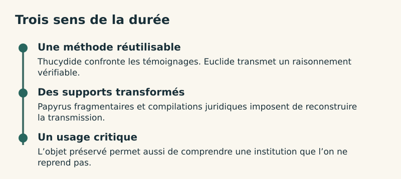

# ENS-PSL — Études classiques — l’héritage grec et latin 2019 · Corrigé brut

*Corrigé rédigé par IA, non officiel. Signalez toute erreur.*

**Rédaction** · GPT-6.2 Astra Ultra · vitesse non renseignée

[Sujet officiel](https://www.ens.psl.eu/sites/default/files/lettres-classiques-archeologie-ecrit-sil2019.pdf)

Le sujet d’écrit part du « bien pour toujours » de Thucydide, I, 22. Il demande jusqu’où cette formule peut s’étendre aux legs grecs et latins dans les lettres, la pensée, la vie pratique et les mœurs.

## Exposé

Un tesson portant le nom d’un homme politique athénien est parvenu jusqu’à nous. Il a beaucoup survécu à l’institution de l’ostracisme à laquelle il servait. Est-il pour autant un bien « pour toujours » ? La durée de l’objet, la durée de son usage et la valeur qu’il prend pour de nouveaux lecteurs se révèlent ici trois choses différentes. Le mot de Thucydide peut éclairer les héritages grecs et latins à condition de conserver la distinction qui lui donne son sens dans son ouvrage et de reconnaître le travail que coûte leur transmission.

### Une enquête faite pour servir à nouveau

Thucydide, en I, 22, oppose l’effet produit sur l’auditeur d’un moment et la possibilité offerte à d’autres de voir clair dans des situations du même ordre. Sa narration a coûté une confrontation de témoignages, notamment parce que la mémoire des acteurs varie avec leurs intérêts. L’expression grecque *ktêma* désigne quelque chose que l’on acquiert et que l’on garde à sa disposition. L’auteur ne se borne donc pas à escompter la célébrité. L’analyse de la guerre civile à Corcyre, au livre III, en fournit l’épreuve. La lutte de factions change jusqu’au prix politique des mots. Une conduite précipitée peut recevoir le nom de courage, une hésitation raisonnable celui de lâcheté. Le lecteur peut ainsi apprendre à examiner les déplacements du vocabulaire dans une crise qu’aucun Grec n’aurait pu prévoir. L’usage durable tient au rapport construit entre plusieurs faits, et nullement à l’identité des situations.

Il en va de même d’un objet de pensée qui fait de la preuve une opération répétable. Dans les *Éléments* d’Euclide, la proposition I, 47 ne se réduit pas à la formule associée au nom de Pythagore. Le diagramme et les constructions donnent un chemin pour établir un rapport entre des aires. Celui qui suit la démonstration peut se l’approprier et la vérifier. C’est donc une manière réglée de faire qui dure, même lorsque les notations d’un manuel moderne paraîtraient étrangères à Euclide.

### Ce qui a survécu a été choisi, transformé, parfois perdu

La présence d’un livre sur nos rayons peut faire oublier les accidents qui l’y ont conduit. Les poèmes de Sappho se lisent tantôt dans des citations d’auteurs anciens, tantôt sur des fragments de papyrus. Dans un cas, la sélection répondait au besoin d’un autre écrivain. Dans l’autre, le support a survécu dans des conditions matérielles particulières. Lire un fragment consiste aussi à prendre acte de son bord. Une restitution entre crochets ne possède pas la même autorité qu’une lettre encore visible. L’héritage nous transmet donc simultanément une voix et la preuve que nous ne pouvons plus l’entendre comme ses premiers auditeurs.

Le droit romain rend la transformation plus manifeste encore. En recueillant dans le *Digeste*, au VIe siècle de notre ère, des fragments de juristes de plusieurs siècles, les compilateurs de Justinien les ont conservés dans une architecture nouvelle. Le lecteur n’a plus entre les mains le traité d’où chaque morceau provenait. La réappropriation médiévale et l’enseignement juridique ont ensuite donné de nouvelles vies à l’ensemble. Répéter que « notre droit vient de Rome » effacerait ce que chaque reprise a fait au matériau. La possession durable suppose ici toute une série de nouveaux propriétaires.

### Pouvoir conserver ce que l’on décide de ne plus pratiquer

Le tesson athénien fait connaître une technique de vote et une conception du danger que peut représenter un citoyen particulièrement puissant. Le remettre en contexte exige qu’on sache aussi quels habitants de l’Attique n’avaient aucune part à ce choix. Une démocratie contemporaine peut examiner à travers lui la tension entre protection collective et droits de l’individu, tout en refusant d’adopter l’ostracisme. De même, l’archéologie des maisons de Pompéi révèle, à travers la position d’une cuisine, les passages de service et les objets de la vie domestique, les conditions concrètes d’un confort que les textes littéraires romains tendent à attribuer au seul maître de maison. Il faut croiser les indices avant d’attribuer une pièce ou un geste à une personne de statut servile. Ce travail peut précisément rendre visibles des vies auxquelles les possesseurs anciens prêtaient peu d’attention.

Oui, le legs antique peut constituer un bien durable, si le terme de « bien » désigne une possibilité d’enquête, d’invention ou de contestation. La perte, la traduction et le refus comptent alors dans l’histoire de ce qui se transmet. Ce qui serait infidèle au projet de Thucydide serait de croire ce trésor impérissable une fois pour toutes et de nous dispenser, au nom même de notre héritage, de l’exercice critique qui lui donne sa valeur.

