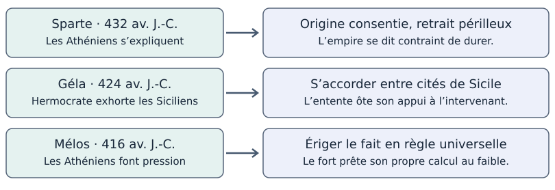

# ENS-PSL · Le principe de puissance chez Thucydide · 2019 — corrigé brut

*Corrigé rédigé par IA, non officiel. Signalez toute erreur.*

**Rédaction** · GPT-6.2 Astra Ultra · vitesse non renseignée · 26 novembre 2026

## Comment une puissance se constitue-t-elle et jusqu’où commande-t-elle les conduites ?

À Sparte, les envoyés d’Athènes se défendent d’avoir voulu un empire. À Mélos, une autre délégation athénienne soutiendra que quiconque dispose de leurs moyens ferait exactement comme eux. Entre ces deux discours, le Syracusain Hermocrate admet lui aussi que les hommes tendent à commander à qui cède. Il en tire pourtant une raison de changer le cours des choses. En confrontant ces paroles, Thucydide nous permet de suivre à la fois la formation d’un pouvoir, le travail de ses justifications et la possibilité d’une résistance.

### La demande d’une alliance crée un commandement qui peut durer

Dans le discours de Sparte, à la veille du conflit de 431, les Athéniens évoquent l’après-guerres médiques. Les Spartiates ont renoncé à poursuivre l’action et des alliés ont demandé à Athènes de les conduire contre les Perses. La demande initiale porte sur une tâche commune. Les envoyés en font un titre de légitimité en rappelant aussi l’intelligence et le courage dont leur cité a fait preuve. Ce récit a un destinataire bien choisi. Les Lacédémoniens qui contestent aujourd’hui la domination ont contribué hier à rendre possible le transfert du commandement.

Comment passe-t-on de ce commandement à l’*archè* impériale ? La nécessité militaire entretient la flotte commune autour d’Athènes. En fournissant un tribut plutôt que des vaisseaux, beaucoup d’alliés accroissent leur dépendance envers la cité qui concentre les moyens navals. L’extrait donne à observer le résultat politique de cette dissymétrie. Des cités qui voulaient faire défection ont été ramenées sous le pouvoir athénien. Les soumettre ajoute à l’hostilité qui rendra le prochain retrait périlleux. La croissance de l’empire produit elle-même une partie des dangers au nom desquels on le maintient.

L’ambassade énonce trois motifs, crainte, honneur et avantage, dont l’ordre varie entre les chapitres 75 et 76. La crainte fait penser aux représailles et au rival spartiate, l’honneur au statut que donnerait l’apparence d’un recul, l’avantage aux bénéfices du commandement. Ce sont des raisons d’agir que les députés changent en plaidoyer. Ils invitent Sparte à s’imaginer dans leur situation. Elle aussi organise les cités du Péloponnèse en fonction de son intérêt. Les envoyés demandent enfin que l’on mesure leur relative modération à ce qu’un autre ferait de la même supériorité. Ce déplacement leur permet d’éviter une question décisive pour l’allié d’hier. A-t-il consenti à rester sujet ?

### Retirer à l’empire l’appui qui le rend possible

À Géla, en 424, Hermocrate s’adresse à des représentants de cités siciliennes divisées. Il conteste un mauvais calcul de sécurité. Certains Chalcidiens, apparentés aux Ioniens, se croient protégés de leurs parents athéniens, tandis que les Doriens seraient seuls exposés. Or l’intérêt d’Athènes, dit-il, porte sur les biens que possèdent les Siciliens. Pour preuve, elle est accourue au secours des Chalcidiens avec plus de zèle que ne le demandait leur traité, eux qui ne s’étaient guère empressés de l’assister. Une sollicitude déséquilibrée peut annoncer le prix à payer demain pour l’aide d’aujourd’hui.

La réponse est à la portée de cités qui, séparément, ont de bonnes raisons de redouter leurs voisines. Les Athéniens s’appuient sur ceux qui les ont appelés. En réglant entre elles leurs différends, les cités de Sicile retireraient à l’intervenant le point d’appui local de son pouvoir. La paix change ainsi le rapport des forces. Même celui qui se croit aujourd’hui lésé aurait davantage à gagner à la sécurité commune qu’à une vengeance incertaine. Hermocrate se garde de garantir le succès au plus juste ou au plus fort. L’avenir demeure assez incertain pour que même un puissant hésite devant des adversaires résolus. Un discours qui reconnaît une disposition humaine à dominer peut donc justifier une politique d’entente.

### De la conduite récurrente à la prétendue loi naturelle

À Mélos en 416, les Athéniens répondent à l’espérance que les dieux favoriseront le juste. Le passage reproduit seulement leur réplique. Ils distinguent ce qu’ils **croient** des dieux de ce qu’ils disent **connaître** des hommes. Ils étendent aux premiers le comportement qu’ils prétendent constater chez les seconds. Partout où le rapport de forces le permet, le plus puissant chercherait à gouverner. Ils auraient trouvé cette loi avant eux et la laisseraient subsister après eux. L’hypothèse finale invite les Méliens à se voir en maîtres et tient pour certain qu’ils agiraient de même. Aucun Mélien n’a besoin d’en être convaincu pour éprouver la pression que cette affirmation exerce sur le choix qui lui reste.

En rapprochant ces scènes, l’historien pose un problème de méthode. Un motif qui revient sous des lèvres adverses aide à comprendre plusieurs situations. Mais à Sparte la régularité invoquée disculpe, à Géla elle mobilise, et à Mélos elle vise à obtenir la soumission. La vérité de l’histoire humaine ne se laisse donc pas extraire d’une formule en détachant celle-ci du moment où quelqu’un avait intérêt à la prononcer. Thucydide explique aussi, en I, 22, qu’il restitue les discours en s’attachant à leur teneur et aux exigences des circonstances. Confronter ces arguments aux événements éclaire ce qu’ils ont permis de prévoir et ce qu’ils laissaient dans l’ombre. L’échec de l’expédition athénienne de Sicile, plus tard, donne un relief particulier à la prudence d’Hermocrate sans en faire un prophète infaillible.

La puissance naît ici d’une relation, s’accroît en concentrant des moyens et transforme les coûts du retrait. Ses bénéficiaires cherchent à faire passer cette histoire pour une nécessité naturelle. Ses adversaires peuvent agir sur les dépendances qui la soutiennent. Voilà ce qui rend les motifs humains intelligibles d’une époque à l’autre tout en laissant à la décision politique son efficacité.

**Question de discussion. La critique d’Athènes vient-elle tout entière de ses ennemis ?** Son propre plaidoyer fournit une pièce critique. La répression des défections et la haine produite par l’empire sont déjà admises par ceux qui veulent qu’on excuse leur conduite.
