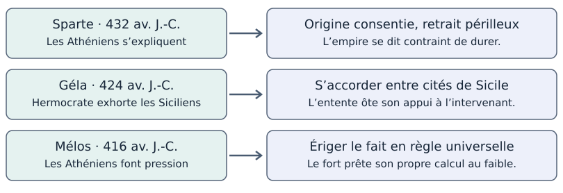

# ENS-PSL · Le principe de puissance chez Thucydide · 2019 — corrigé guidé

*Corrigé rédigé par IA, non officiel. Signalez toute erreur.*

**Rédaction** · GPT-6.2 Astra Ultra · vitesse non renseignée · 26 novembre 2026

## Lire la consigne comme une enquête

Préparer cinq réponses. Il faut établir comment naît, croît, se justifie et se combat une puissance, puis s’interroger sur l’histoire humaine selon Thucydide. Le texte 2 sert au moins à deux de ces fins. Il montre comment une cité se procure des appuis et comment d’autres peuvent les lui retirer. Prévoir vingt minutes d’exposé puis dix minutes de discussion.

### Placer trois scènes sur une ligne de temps

1. **Sparte, 432 av. J.-C., I, 75–76.** Les envoyés athéniens défendent un commandement dont les alliés leur auraient demandé la charge après les guerres médiques. Sparte avait laissé le champ libre en se retirant. Les révoltes réprimées et les soupçons de la rivale rendent désormais dangereux le renoncement au pouvoir.
2. **Géla, 424, IV, 61–62.** Hermocrate de Syracuse presse les cités siciliennes de s’accorder. L’aide apportée à certains Chalcidiens fournit aux Athéniens l’appui local dont ils ont besoin. Une paix entre Siciliens peut le leur enlever.
3. **Mélos, 416, V, 105, 1–2.** Dans le passage choisi, ce sont les Athéniens qui parlent. Leur réplique étend aux dieux et aux hommes la prétention du plus fort à commander. Ils supposent que les Méliens agiraient de même si le rapport des forces s’inversait.

### Démontrer la croissance de l’empire

Si l’on s’en tient à l’idée qu’Athènes veut être puissante, on explique la puissance par elle-même. Intercaler trois opérations. Les alliés lui demandent de les conduire. La direction commune concentre autour de la flotte athénienne des ressources navales et financières. Une fois les défections réduites, Athènes redoute d’autant plus la vengeance des mécontents et leur passage à Sparte. Le consentement initial permet d’expliquer l’entrée dans l’alliance, tandis que la contrainte explique pourquoi il devient si difficile d’en sortir.

Puis relire les deux énumérations des motifs. Dans le chapitre 75, la crainte vient la première, devant l’honneur et l’avantage. Au chapitre 76, l’honneur passe devant la crainte. Il est plus prudent de montrer comment ces motifs se renforcent que d’en faire trois étapes obligées et datables. Une cité soucieuse de son rang interprète plus facilement une défection comme un danger, et les bénéfices accumulés accroissent le coût d’une concession.

### Distinguer une ressemblance et sa fonction

Essayer d’achever la phrase suivante pour chacun des trois orateurs collectifs ou individuels. « Puisque les hommes recherchent habituellement le pouvoir, vous devriez… » À Sparte, la réponse athénienne est « comprendre nos motifs et reconnaître ce que nous aurions pu faire de pire ». À Géla, la réponse d’Hermocrate est « cesser d’offrir aux Athéniens les moyens de vous dominer ». À Mélos, les envoyés pourraient conclure « accepter notre supériorité présente, puisque vous en useriez de même ». Ces reformulations aident à percevoir le travail politique accompli par la même maxime.

Pour préciser la résistance, partir de l’objection d’un Chalcidien. La parenté ionienne pourrait lui inspirer confiance. Hermocrate répond par la disproportion entre les obligations du traité et l’empressement d’Athènes, puis par l’intérêt qu’elle porte à l’ensemble de la Sicile. Il invite aussi les cités à reconsidérer leurs différends intérieurs. Une revendication peut être juste et sa poursuite désastreuse. Quand l’issue demeure ouverte pour tous, l’accord pacifique devient raisonnable même pour une cité ambitieuse.

### Soutenir la conclusion devant le jury

**Comment passer des discours à l’historien ?** Prendre une même affirmation et changer de locuteur. Dans la bouche des envoyés à Mélos, la « loi » du plus fort les dispense de justifier un choix personnel. Hermocrate, qui est proche d’eux dans son appréciation des mobiles humains, rend pourtant aux Siciliens une capacité de décision. En agençant ces circonstances différentes, Thucydide rend des conduites comparables et fait aussi comprendre les conséquences des paroles. Sa méthode de restitution des discours, exposée en I, 22, donne du poids à ce double travail.

**Comment répondre à « Les dieux sont-ils forcément du côté du plus fort ? »** Relire les degrés de certitude dans V, 105. Les Athéniens revendiquent la connaissance lorsqu’ils parlent des hommes et l’opinion lorsqu’ils parlent des dieux. Ils franchissent eux-mêmes la distance entre les deux. L’historien donne à entendre la prétention d’une ambassade en position de force.

**Comment fermer l’exposé ?** Rapprocher la demande d’alliance des cités grecques après les guerres médiques et l’appel des Chalcidiens en Sicile. Une invitation peut accroître la dépendance de ceux qui la lancent. Le conseil de paix d’Hermocrate montre que connaître ce mécanisme fournit aussi un moyen de l’interrompre. La régularité devient chez Thucydide une raison d’examiner les choix encore ouverts.
