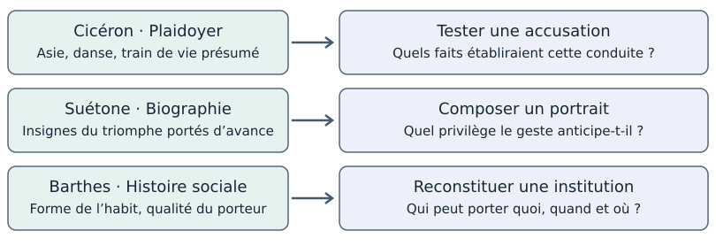

# ENS-PSL · Vêtement et jugement moral à Rome · 2019 — corrigé brut

*Corrigé rédigé par IA, non officiel. Signalez toute erreur.*

**Rédaction** · GPT-6.2 Astra Ultra · vitesse non renseignée · 26 novembre 2026

## À quelles conditions peut-on lire une conduite dans une tenue ?

Les insignes du triomphe peuvent honorer celui qui les porte. Suétone les transforme pourtant en pièce à charge contre Caligula par un simple détail de temps. L’empereur les revêtait déjà avant de partir en expédition. L’étoffe demeure la même, mais sa place dans le déroulement d’une carrière en change la signification. Les trois textes du dossier permettent de montrer comment les Romains faisaient de l’apparence un langage moral et comment nous pouvons étudier les jugements qu’ils formulaient dans ce langage.

### Un Romain honorable se reconnaît-il au premier coup d’œil ?

Dans le *Pro Murena*, Cicéron plaide en 63 av. J.-C. pour le consul désigné Lucius Licinius Murena, accusé de brigue électorale. Caton attaque ses mœurs. L’extrait rapproche d’abord un lieu et un soupçon. Pour un auditoire chez qui l’Asie évoque les séductions du luxe, y avoir séjourné devrait déjà compter à charge. Cicéron conserve le préjugé assez longtemps pour le retourner. Avoir servi avec courage sous les ordres de son père en Asie rend la modération de Murena plus méritoire. Le lieu que l’accusateur chargeait de tous les vices aura fourni l’occasion d’exercer la *virtus* et la *pietas*. Les faits à établir seraient des actes déshonorants commis sur place ou introduits à Rome. Le seul nom d’une province ne les prouve pas.

L’accusation de danse obéit au même mécanisme. Caton nomme Murena *saltator*. Le mot fait apparaître à l’imagination des juges toute une scène de banquet dissolu. Cicéron reprend, pour les besoins de sa cause, la prémisse romaine qui associe la danse d’un magistrat à l’ivresse, aux dépenses et aux plaisirs immodérés. Puis il demande où sont les compagnons, les festins et les profusions que cette accusation supposerait. La défense exploite ainsi la fragilité du raisonnement qui prétend remonter d’une apparence à une vie entière. Elle maintient la sévérité de la norme applicable au futur consul.

Aucune pièce de vêtement de Murena ne figure dans cet extrait. Son apport au sujet tient justement à cette absence. Elle empêche d’inventer une tunique orientale pour l’accusé et rend visible le travail du langage. Un mot chargé comme « danseur » suffit à susciter une apparence sociale avant que le moindre objet soit produit comme preuve.

### Quand le biographe habille le mauvais prince

Dans la *Vie de Caligula*, la tenue s’étend de la chaussure aux gestes de présentation publique. Suétone passe en revue plusieurs appartenances. La tenue attendue est celle d’un Romain, d’un citoyen, d’un homme, et jusqu’à celle d’un être humain. Le latin distingue *virili* et *humano*. La suite de négations transforme la sortie des usages civiques en franchissement des frontières du sexe puis de l’espèce. Les manches et bracelets, les étoffes précieuses et les chaussures de scène, de soldat ou de femme font varier la silhouette. La juxtaposition des signes compte davantage que le prix de tel vêtement. Le prince se montre en public capable de changer à volonté de place et de rôle.

Quand la barbe d’or accompagne le foudre, le trident ou le caducée, ces objets invitent à reconnaître Jupiter, Neptune ou Mercure. Les attributs de Vénus compliquent encore l’identification au masculin impérial. La cuirasse d’Alexandre, apportée du tombeau du conquérant, permet quant à elle au prince de s’approprier le prestige personnel d’un autre. L’insigne du triomphe porté avant l’expédition condense le grief politique. Le signe d’une reconnaissance civique devient un honneur que l’on peut s’attribuer à l’avance. La faute que suggère cette mise en série réside dans la prétention de l’empereur à fixer lui-même tout ce qu’il donne à voir et à se soustraire aux conditions ordinaires du mérite.

Suétone écrit après le règne. Il choisit des détails, ordonne des habitudes et des exceptions, et les réunit sous une rubrique du portrait. Un inventaire de sa garde-robe réelle ne produirait pas spontanément cette gradation. Le portrait révèle donc aussi les attentes du biographe et les lecteurs auxquels ses exemples devaient sembler parlants.

### Avec Barthes, rendre l’indice historique à ses conditions

En 1957, Barthes retrace les façons d’écrire l’histoire du costume. Les peintres et les gens de théâtre romantiques cherchent la couleur locale. D’autres interprètes font de la forme des habits l’expression de l’esprit d’une époque. L’érudition qui se développe vers 1860 apporte des datations et des connaissances de provenance. Elle tend néanmoins à découper le costume en pièces dont chacune aurait son événement de naissance. Restent à reconstruire les relations économiques et sociales, les sensibilités et les institutions qui font qu’une pièce signifie quelque chose pour un groupe.

Appliquons cette demande au triomphe. Dater l’apparition d’un vêtement triomphal ne suffit pas à expliquer le jugement de Suétone. Il faut déterminer qui le porte, devant quel public, à quel moment et sous quelle autorité. Le même raisonnement vaut pour le danseur de Cicéron. Une accusation visant le consul désigné présuppose des exigences de dignité qui tiennent à sa position. Ces auteurs offrent des informations précieuses sur des usages du jugement au sein des élites romaines. Pour attribuer une conduite effective à une personne, d’autres indices seraient nécessaires. On pourrait ainsi confronter un portrait littéraire à une monnaie officielle où le prince choisit les traits et les attributs sous lesquels il souhaite paraître.

Un habit engage donc un jugement moral quand son port intervient dans un système d’attentes partagées et qu’un observateur interprète publiquement l’accord ou l’écart. Deux personnes connaissant le même code peuvent aboutir à des verdicts opposés. Le séjour en Asie le montre déjà. La tâche de l’historien commence à ce point de divergence, lorsqu’il reconstitue qui avait intérêt à rendre telle lecture évidente.

**Relance possible. Un empereur qui adopte les attributs d’un dieu se déclare-t-il toujours dieu ?** L’emploi d’un seul attribut peut aussi proposer une analogie ou revendiquer une qualité. Suétone construit ici l’impression de franchissement par la répétition, la diversité des apparitions et leur association à d’autres privilèges. Il faut préciser l’occasion et la source avant de conclure sur une croyance.
