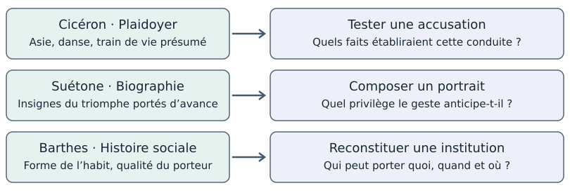

# ENS-PSL · Vêtement et jugement moral à Rome · 2019 — corrigé guidé

*Corrigé rédigé par IA, non officiel. Signalez toute erreur.*

**Rédaction** · GPT-6.2 Astra Ultra · vitesse non renseignée · 26 novembre 2026

## Partir de l’indice le plus précis

Pour l’introduction de l’exposé, imaginer deux apparitions publiques. Dans l’une, un général rentre victorieux revêtu des insignes du triomphe. Dans l’autre, le prince les arbore avant même le départ. Demander à l’auditeur de nommer la différence. Elle tient au moment et à l’autorité qui valide l’honneur. Poser alors sa problématique. Comment l’habit acquiert-il une force de jugement, et comment contrôler la valeur des jugements qu’il provoque ?

### Reconstituer le raisonnement d’un avocat

Chez Cicéron, le premier piège consiste à chercher la description d’un habit de Murena. Le passage présenté porte sur son séjour en Asie auprès de son père, puis sur sa réputation de danseur. Tracer un raisonnement en deux temps.

1. L’accusation joue sur une attente commune. Le nom de l’Asie évoque le luxe et la danse de banquet évoque les excès d’un homme que la dignité du consulat oblige à se maîtriser.
2. La défense exige des faits susceptibles de soutenir cette lecture. En Asie, Murena a fait campagne auprès de son père. Les dépenses, les amours et les beuveries qui donneraient crédit à l’accusation de débauche ne sont pas établies.

La nuance à conserver est que l’avocat se sert du code d’honneur accepté par les juges. Il peut donc gagner en montrant que ses conditions d’application manquent dans cette affaire. Essayer cette transition vers Suétone. « Cicéron démonte l’image suscitée par un mot. Comment un biographe peut-il au contraire produire une image accablante par la seule exposition de détails matériels ? »

### Relire l’ordre de la liste de Suétone

Distinguer les quatre adjectifs *patrio*, *civili*, *virili*, *humano*. La traduction française donnée par le sujet resserre la fin de la série. Le latin permet de distinguer les conventions de masculinité des limites de la condition humaine. Chercher ensuite dans la liste un exemple qui donne son sens à chacune des dernières étapes. Le brodequin féminin et la parure de Vénus travaillent la première de ces frontières. La barbe d’or et les attributs divins travaillent la seconde. La chaussure militaire à côté du cothurne montre aussi combien les signes de fonction se trouvent déplacés.

**Mini-commentaire à développer.** Suétone présente les attributs du triomphe dès avant l’expédition. Le temps est la pièce décisive du témoignage. Le succès attendu comme fondement de l’honneur reste à obtenir, alors que le prince peut déjà se montrer en triomphateur. La cuirasse d’Alexandre, prise à son tombeau, fait apparaître un autre usage du prestige d’autrui. Cette lecture donne une portée politique à la question morale.

**Objection.** Une énumération de vêtements autorise-t-elle une certitude sur le caractère de Caligula ? Le choix du biographe est perceptible dans les indications de fréquence et dans l’accumulation des transgressions. On peut démontrer comment le portrait produit un jugement tout en laissant ouverte la question des intentions de celui qui portait effectivement l’habit.

### Se servir du troisième texte pour tester ses résultats

Barthes distingue d’abord la recherche de couleur locale et la tentative de déduire un esprit d’époque des formes du costume. Puis viennent les archivistes et érudits qui datent l’apparition des pièces. Que faudrait-il ajouter pour expliquer la réaction à Caligula ? L’autorisation de revêtir un habit, les circonstances publiques, les différences entre conditions sociales et l’ensemble des sensibilités qui rendent un écart visible. C’est cette histoire institutionnelle, sociale et économique que le texte de 1957 appelle de ses vœux.

Essayer la méthode sur un exemple indépendant. La toge prétexte peut signaler le rang d’un magistrat ou être portée par un enfant de naissance libre. L’âge, la fonction et la scène d’apparition modifient sa lecture. Le même signe peut ainsi être légitime selon plusieurs règles. Cet exemple renouvelle la conclusion sur le triomphe en montrant combien un habit pris isolément est peu déterminant.

### Préparer une conclusion personnelle et les dix minutes de discussion

Sur les vingt minutes accordées, employer deux minutes à poser le problème, cinq au plaidoyer, six au portrait, cinq à la confrontation avec Barthes et deux à la conclusion. Soutenir une thèse claire. Le vêtement renseigne immédiatement sur les attentes de celui qui l’interprète. Sa valeur comme preuve des mœurs du porteur dépend ensuite de faits qui corroborent cette interprétation.

**Relance sur la représentativité.** Ces passages éclairent deux hommes d’élite, un consul désigné et un empereur, à des époques et dans des genres différents. Pour comprendre l’ensemble de la société romaine, il faudrait aussi des inscriptions, des images et des objets contextualisés. La place du public féminin, par exemple, ne se laisse pas restituer à partir du seul usage polémique que Suétone fait des chaussures dites féminines.

**Relance sur l’utilité de la datation.** L’érudit qui date un vêtement établit une condition précieuse de toute comparaison. Barthes réclame l’étape supplémentaire qui relie cette forme à des usages et à des statuts. Cette étape explique pourquoi un insigne attesté peut recevoir des évaluations différentes dans deux scènes également romaines.
