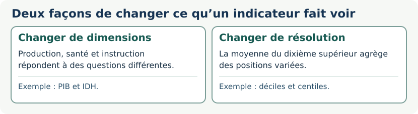
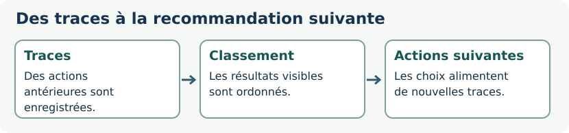

# ENS-PSL · Sélection internationale Lettres · Études politiques — Cardon et les algorithmes (oral) 2019 — Corrigé brut

*Corrigé rédigé par IA, non officiel. Signalez toute erreur.*

**Rédaction** · GPT-6.2 Astra Ultra · vitesse non renseignée

## Comment un nombre devient-il un fait social ?

Partager une population en dix groupes égaux ou en cent groupes égaux paraît une décision de présentation. Pourtant, le choix peut déterminer si l’enrichissement d’une très petite fraction devient un sujet de discussion politique. Dans les pages 14 à 16 de son livre de 2015, Dominique Cardon part de tels exemples pour comprendre ce que les calculateurs font à nos sociétés et ce que les sociétés font pour devenir calculables. Il s’agit d’examiner conjointement des conventions de mesure, leurs usages et les formes d’organisation sociale qui leur donnent prise.

## Une convention rend des réalités comparables

Compter oblige d’abord à décider ce qui comptera comme une unité : une personne, une activité productive ou une action enregistrée. Classer suppose ensuite de déterminer ce que des cas ont en commun et les différences que l’on accepte de laisser de côté. Les techniques statistiques et les choix de représentation prolongent ces décisions. Une opération arithmétique peut être parfaitement exacte sur des catégories dont la pertinence est pourtant discutable. Parler de convention ne signifie pas que chacun puisse produire arbitrairement le chiffre qui lui plaît. Une convention doit être assez stable et partagée pour qu’un résultat soit compris et réutilisé.

La référence au « milieu associé », en lien avec Gilbert Simondon, précise ce point. Un indicateur de revenu suppose des catégories, des pratiques d’enregistrement, des archives comparables et des institutions prêtes à y reconnaître une information pertinente. De même, un service de recommandation tire sa matière d’actions enregistrées dans un environnement où les personnes cherchent, choisissent et cliquent. Le calcul est ainsi un produit de pratiques sociales avant de devenir une manière de les orienter.

## Deux exemples de politique des chiffres

Avec le produit intérieur brut, l’attention se porte sur la production économique réalisée sur un territoire. L’indice de développement humain du PNUD combine des dimensions de revenu, de santé et d’éducation. L’extrait mentionne aussi des travaux plus larges sur la qualité de vie ou le bonheur. Ces dimensions ne sont pas toutes des composantes de l’IDH. Le changement d’indicateur déplace la question : un surcroît de production ne permet pas, à lui seul, de conclure que la population vit plus longtemps ou accède mieux aux études.

Pour les hauts revenus, changer la finesse du regroupement permet de mieux observer ce qui advient à l’intérieur du dixième supérieur. Un décile regroupe ici dix pour cent de la population et un centile un pour cent, si l’on parle des groupes formés par les seuils. Une forte hausse concentrée chez les individus tout en haut peut être atténuée dans la moyenne des dix pour cent les mieux rémunérés. Le centile fait ressortir cette concentration. Cardon relie cette nouvelle visibilité au succès de la formule des « 99 % », reprise dans les mobilisations du début des années 2010. Un calcul devient une ressource collective lorsqu’une catégorie statistique permet à des acteurs de désigner une inégalité et de se reconnaître dans une revendication. Ce lien n’établit pas qu’un tableau serait à lui seul la cause du mouvement.

## Des mesures agrégées aux recommandations personnalisées

Les exemples du moteur de recherche, de la suggestion de livres et de la publicité ciblée déplacent l’analyse. Le service promet d’épargner du temps en ordonnant l’offre à partir de conduites passées. L’anticipation d’une commande de livre est une ambition attribuée à l’entreprise dans le texte de 2015. Elle illustre une promesse d’efficacité. Elle ne constitue pas la preuve d’une capacité sans erreur à connaître les préférences de chaque client.

Un classement modifie ce qui se trouve à portée d’attention. Si une personne choisit parmi les résultats les plus visibles, son action peut ensuite être enregistrée comme un indice renforçant le classement. Ainsi se dessine une boucle possible entre prédiction et conduite, dont l’ampleur doit être étudiée. Les bénéfices attendus de la personnalisation s’accompagnent d’enjeux de confidentialité, de rétrécissement de l’éventail offert et d’assignation à un comportement probable. La méthode de Cardon appelle à regarder les choix effectifs de variables et de présentation, puis leurs effets sur des usages différenciés.

La thèse de la « société des comportements » articule deux mouvements. Des individus soucieux de choisir par eux-mêmes apprécient des services qui s’ajustent à leurs pratiques. Les institutions capables de recueillir leurs traces peuvent, en retour, organiser ce qui leur est proposé. La question politique porte dès lors sur la possibilité de connaître, de discuter et de modifier ces façons de compter. Les controverses sur les indicateurs montrent déjà comment des acteurs peuvent se saisir des nombres pour faire voir autre chose.

[Feuillet de l’ENS](https://www.ens.psl.eu/sites/default/files/sociologie-etudes-politiques-sil2019.pdf) · [Attentes générales du jury, p. 3](https://www.ens.psl.eu/IMG/file/internationale/2008/Lettres/Lettres.pdf#page=3)
