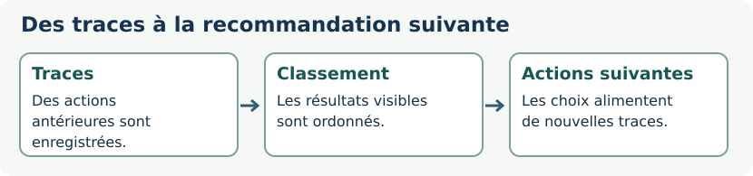

# ENS-PSL · Sélection internationale Lettres · Études politiques — Cardon et les algorithmes (oral) 2019 — Corrigé guidé

*Corrigé rédigé par IA, non officiel. Signalez toute erreur.*

**Rédaction** · GPT-6.2 Astra Ultra · vitesse non renseignée

## Reconstituer le fil du commentaire

Le sujet de février 2019 demande le commentaire d’un extrait de Dominique Cardon publié en 2015. Posez une question qui permette de conserver les deux directions de l’argument : « Quelles pratiques rendent les individus et les groupes calculables, et que change ensuite le calcul dans leurs possibilités d’action ? » Situez les exemples dans le temps du texte. Une aspiration commerciale évoquée en 2015 ne devient pas rétrospectivement une description de tous les services en fonctionnement aujourd’hui.

Pour expliquer l’expression « milieu associé », prenez un classement de revenus. Il exige qu’une institution ait défini le revenu et la période, recueilli des observations et choisi une unité de comparaison. Vérifiez ensuite par qui le classement est lu. Un chiffre déposé dans un tableau et la même catégorie reprise dans une mobilisation collective n’ont pas encore le même effet social.

## Faire soi-même la distinction entre deux opérations

Première opération, changer l’objet de l’indicateur. Lisez le passage sur le PIB et l’IDH : l’un mesure la production sur un territoire, l’autre combine des dimensions de santé, d’éducation et de revenu. Dans la réponse, gardez les exemples du bonheur et de la qualité de vie pour le débat plus large sur les indicateurs. Ce détail empêche d’attribuer à l’IDH une composante qui n’entre pas dans son calcul.

Deuxième opération, changer la résolution d’une même distribution. Imaginez mille personnes. Parmi les cent aux revenus les plus élevés, quatre-vingt-dix touchent 50 unités et dix touchent 500 unités. La moyenne de ce dixième supérieur est de 95 unités. Dans une autre distribution où chacune de ces cent personnes toucherait 95, sa moyenne serait identique. La moyenne des dix personnes situées tout en haut vaut pourtant 500 dans le premier cas et 95 dans le second. Cet exemple pédagogique montre pourquoi un regroupement plus fin apporte une information différente. Le feuillet ne donne pas ces valeurs comme des données historiques.

## Décrire une recommandation sans en présumer le résultat

Choisissez un objet du texte, par exemple un livre suggéré au lecteur. Nommez la donnée d’entrée possible, comme un choix antérieur, puis la sortie, une présentation ordonnée de titres. Que peut faire ce classement ? Il facilite une découverte pertinente, mais peut aussi ramener l’attention vers des contenus déjà proches de ceux qui ont été choisis. Une consultation ultérieure donne une trace supplémentaire. L’utilisateur peut refuser la suggestion ou chercher ailleurs. Présentez la boucle comme un mécanisme à étudier, dont la force varie avec le dispositif et les usages.

**Pourquoi les intérêts des plateformes ne suffisent-ils pas à l’explication ?** Ils éclairent une partie des finalités. Pour expliquer les effets, il faut examiner ce qui est compté, comparé, montré et repris par les personnes concernées. Des entreprises poursuivant un objectif de rentabilité peuvent construire des classements différents ; inversement, une statistique peut être mobilisée contre la hiérarchie qu’un autre indicateur rendait évidente.

## Répondre à une objection sur la liberté de choix

Le jury peut demander si la personnalisation est compatible avec l’autonomie. Partez de l’attente d’un service ajusté à chacun. Examinez ensuite qui définit les catégories et les résultats visibles et avec quelles données personnelles. Cardon rapproche ces deux dimensions dans sa thèse sur la société des comportements. Pour discuter cette thèse, il faudrait observer la diversité des suggestions reçues et des choix effectivement réalisés, puis les comparer à un autre mode de présentation. Cette proposition de recherche permet de conclure en revenant au pouvoir des conventions de calcul.

[Feuillet de l’ENS](https://www.ens.psl.eu/sites/default/files/sociologie-etudes-politiques-sil2019.pdf) · [Attentes générales du jury, p. 3](https://www.ens.psl.eu/IMG/file/internationale/2008/Lettres/Lettres.pdf#page=3)
