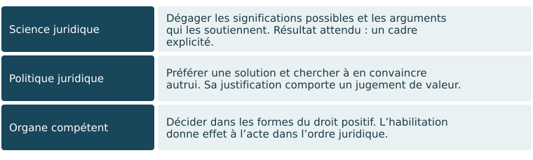

# ENS-PSL · Histoire et philosophie du droit — l’interprétation selon Hans Kelsen (oral) 2019 — corrigé guidé

*Corrigé rédigé par IA, non officiel. Signalez toute erreur.*

**Rédaction** · GPT-6.2 Astra Ultra · vitesse non renseignée · 26 novembre 2026

## Sujet

Commenter le passage de Hans Kelsen, *Théorie pure du droit*, deuxième édition allemande de 1960, traduction française de Charles Eisenmann (1962), sur l’interprétation par la science juridique et par les organes de l’ordre juridique.

## Préparer le commentaire

**Partir des verbes du texte.** Relever « dégager », « opter », « décider » et « influer ». Une personne peut accomplir plusieurs de ces opérations, mais elles n’ont pas le même fondement. Un professeur décrit deux lectures possibles, préconise ensuite la première, puis peut éventuellement participer à un organe habilité à trancher. Dans chaque phrase de l’exposé, préciser la fonction qu’il exerce.

**Se servir d’une hypothèse simple.** Un règlement interdit les « véhicules » dans un parc. Le terme peut soulever un doute pour une bicyclette. Présenter des arguments de sens et de contexte pour les deux lectures, expliquer laquelle on préférerait et pour quelle raison, puis demander quelle autorité peut décider en droit positif. Cet exemple sert à distinguer trois questions qui peuvent recevoir trois réponses différentes.

**Préparer l’objection décisive.** Reconnaître plusieurs interprétations entraîne-t-il une insécurité totale ? Reprendre le dernier mouvement. Une analyse qui montre les cas litigieux renseigne les destinataires et permet à l’autorité d’améliorer la rédaction. La sécurité juridique est un résultat institutionnel qui admet des degrés.

## Commentaire proposé

Qui peut dire ce que signifie une norme, et à quel titre ? Dans cet extrait, Kelsen dissocie la connaissance des significations d’un texte, la préférence pour une solution et la compétence d’édicter une décision. Son argument ne porte pas seulement sur les outils de lecture. Il explique pourquoi un même commentaire prend une valeur différente selon la fonction de celui qui le prononce.

### Le passage de la connaissance à l’acte

L’interprétation de la science juridique détermine intellectuellement les sens qu’une norme en vigueur peut recevoir. Elle établit un cadre. Une norme supérieure laisse parfois à l’organe qui l’applique une marge liée aux mots employés ou à la situation à régler. L’analyse du vocabulaire, du contexte et de la construction de l’ordre juridique peut réduire cette marge. Lorsque plusieurs possibilités subsistent, une déduction supplémentaire ne les départage pas nécessairement. Les présenter toutes établit une connaissance positive de l’indétermination.

Dans le vocabulaire de Kelsen, une interprétation est « authentique » lorsqu’elle émane d’un organe compétent et prend effet dans l’ordre juridique. L’authenticité désigne donc une habilitation. Le juge qui rend un jugement produit une norme individuelle pour l’affaire, dans les conditions du système et sous réserve des voies de recours. L’autorité de cette décision ne garantit pas une supériorité scientifique de ses motifs sur tout autre commentaire. Le savant peut démontrer qu’un argument du juge manque sa cible sans annuler la décision.

### Le cas des lacunes et les rôles du juriste

La critique de la jurisprudence des concepts vise l’idée que l’on tirerait du droit nouveau par le seul développement logique de notions déjà en vigueur. Pour Kelsen, qualifier une situation de lacunaire signale souvent qu’aucune solution existante ne satisfait une attente. Si une autorité compétente introduit une solution nouvelle, cette intervention est créatrice. L’admettre permet d’identifier qui dispose du pouvoir et répond de son exercice. Le doctrinaire qui préconise de combler la lacune peut influencer cette décision sans l’édicter lui-même.

L’exemple de l’avocat précise cette frontière. Son rôle consiste à présenter au tribunal une lecture favorable à son client. De même, l’auteur d’un commentaire peut estimer une lecture meilleure pour la sécurité des personnes ou l’efficacité d’une règle. Kelsen appelle cette activité « politique juridique » dans la mesure où elle cherche à orienter le droit. L’activité est légitime. La difficulté survient si une raison de préférer est donnée comme la preuve objective que toute autre lecture est impossible.

### La sécurité juridique à l’épreuve de l’ambiguïté

La doctrine traditionnelle peut être tentée de présenter une interprétation exacte pour protéger la confiance dans la prévisibilité du droit. Kelsen retourne l’argument. Une loi ou un traité peut admettre, par sa rédaction, une lecture contraire aux attentes politiques de son auteur. L’intention du législateur constitue un élément à examiner, sans garantir qu’elle épuise les sens possibles du texte. Une étude qui rend l’ambiguïté visible permet de corriger le dispositif à l’avenir. À l’inverse, traiter une préférence comme une nécessité peut exposer les destinataires à une décision inattendue.

Reste une difficulté féconde. Il faut encore argumenter sur les limites du cadre lui-même. Le choix des méthodes et la qualification des faits peuvent faire débat. Cela ne supprime pas la distinction entre la force d’une raison et l’autorité d’une décision. Le mot « pure » désigne ici l’exigence d’indiquer ce que fait l’analyste lorsqu’il décrit le droit positif. La modestie revendiquée pour la science juridique a un effet pratique exigeant. Elle oblige le décideur à assumer son choix et rend au rédacteur les moyens d’améliorer la clarté du texte.

## Source

[Sujet officiel](https://web.archive.org/web/20240802144158id_/https://www.ens.psl.eu/sites/default/files/droit.pdf)
