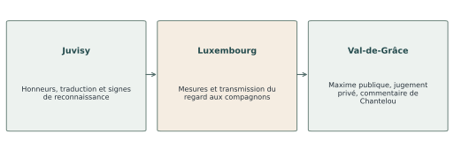

# Le Bernin à Paris, les conditions d’un jugement artistique · Oral 2019 · Corrigé guidé

*Corrigé rédigé par IA, non officiel. Signalez toute erreur.*

**Rédaction** · GPT-6.2 Astra Ultra · vitesse non renseignée

Le document donne trois moments de 1665 tirés du journal de Paul Fréart de Chantelou, cité « Chatelou » dans l’en-tête. Les extraits, présentés dans une anthologie de 1995, racontent la réception et les visites de Gian Lorenzo Bernini, le Bernin.

## Un roi attire à sa cour un artiste du pape

> [!INDICATION]
> Relever ce que le narrateur sait de sa mission et ce qu’il rapporte comme rumeur.

#### Proposition de réponse

En mai 1665, à Saint-Germain-en-Laye, les conditions de la venue du Bernin font déjà parler la cour. Les 3 000 pistoles sont un bruit rapporté. On ne peut les inscrire au compte des paiements établis par cet extrait. Ce qui prend ensuite une forme précise est le dispositif de réception. Le 1er juin, Colbert fait venir Chantelou et lui transmet un choix du roi. Le courtisan doit entretenir et accompagner l’artiste. La distinction avec le « maître d’hôtel » donne à sa mission une place qui dépasse le logement et la table. La conversation est elle-même un service rendu au souverain.

L’appel du Bernin pour le projet du Louvre met Paris en relation avec le foyer romain du mécénat pontifical. La permission du pape Alexandre VII, dont le Bernin se dit le sujet, rappelle la pluralité des fidélités. Dans la version que rapporte son interlocuteur, la réputation de Louis XIV comme « honnête homme » aurait décidé l’artiste au-delà des ordres et des honneurs. Cette formule flatte le souverain tout en laissant à l’artiste le mérite d’un choix. Il serait hasardeux d’y lire un accès direct à ses motivations privées.

## Un interprète revendique sa place dans le récit

> [!INDICATION]
> Observer la rencontre à Juvisy et les formes de légitimité que revendique l’accompagnateur.

#### Proposition de réponse

Le 2 juin, le carrosse de Colbert et la litière du Bernin s’arrêtent. Les deux hommes descendent. Le compliment en français échoue, puis la conversation reprend en italien. Les gestes règlent la préséance, mais il faut un interlocuteur capable de refaire le compliment dans une autre langue. Chantelou évoque à cette occasion les dessins d’après le modèle vivant reçus à Rome et les maximes qu’il a retenues de l’artiste au sujet des portraits en marbre. Il se construit en amateur averti et en intermédiaire déjà connu du visiteur.

Cette mise en scène éclaire la nature de la source. L’auteur dit « je », s’adresse à un destinataire familier en parlant de « votre fils », rappelle le rôle de ses frères et mentionne sa participation aux travaux du noviciat. Le lecteur suit les déplacements du Bernin mais aussi l’affirmation d’un groupe français qui désire faire reconnaître son goût. Les paroles italiennes du visiteur nous parviennent traduites ou résumées dans ce journal français.

## Comment établir une proportion ?

> [!INDICATION]
> Comparer la conversation savante de la voiture et les gestes d’examen du 13 juin.

#### Proposition de réponse

Le Bernin rattache la beauté aux proportions du corps, dont Adam offre l’origine divine. Il associe la variété des ordres aux différences corporelles. Ce sont des propositions théoriques sur l’architecture, rapportées par Chantelou, et une manière de faire de l’artiste un interlocuteur savant. Le 13 juin, la visite du Luxembourg donne au propos une forme expérimentale. L’artiste fait mesurer la largeur des loges et attire l’attention de ses compagnons sur la façade. Au Val-de-Grâce, il monte jusqu’à la coupole pour regarder la peinture de Mignard. Au noviciat des jésuites, il avance une attribution au Poussin. L’extrait conserve le caractère hypothétique de cette reconnaissance.

La journée articule aussi dévotion et sociabilité. Les messes à l’Oratoire et chez les jésuites, la visite du nonce et les rencontres d’architectes dessinent des parcours où les églises servent de lieux de culte, de commande et de jugement. Le carrosse royal rend matériels les honneurs accordés au visiteur, tout en organisant son accès aux sites et aux personnes.

## Le tact en public, la critique en privé

> [!INDICATION]
> Suivre le destinataire du propos sur la coupole et celui de la formule sur la calotte.

#### Proposition de réponse

Face à Tubeuf et au modèle de l’autel, le Bernin répond par une maxime de Michel-Ange sur l’utilité des dessins. De retour chez lui, il explique à Chantelou son silence. Gabriel Le Duc a soutenu la comparaison du dôme avec Saint-Pierre de Rome et a répondu que chacun avait son goût. Le visiteur s’abstient en public d’énumérer les défauts qu’il discerne. À un autre interlocuteur, il risque l’image d’une « petite calotte sur une grosse tête ». Chantelou termine en déclarant le défaut facile à voir. Une opinion esthétique dépend ici des circonstances dans lesquelles elle est prononcée et de celui qui la transmet.

Le dénouement ultérieur du dossier du Louvre, où le projet du Bernin ne sera pas réalisé, aide à comprendre les enjeux des échanges franco-romains. Il ne transforme pas la visite de juin en chronique anticipée d’un échec. Le texte montre plus précisément comment la monarchie cherche un jugement prestigieux et combien ce jugement devient délicat lorsque les artistes et officiers concernés sont présents.
