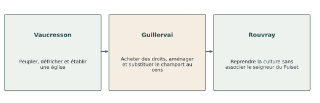

# Administrer les terres de Saint-Denis avec Suger · Oral 2019 · Corrigé brut

*Corrigé rédigé par IA, non officiel. Signalez toute erreur.*

**Rédaction** · GPT-6.2 Astra Ultra · vitesse non renseignée

Dans trois extraits du De rebus in administratione sua gestis, Suger, abbé de Saint-Denis de 1122 à 1151, rend compte de son administration. Le sujet renvoie à l’édition de Lecoy de La Marche de 1867. Les notices entre crochets et les localisations en note relèvent de l’édition du sujet.

## Des lieux qui doivent servir Dieu et rapporter à l’abbaye

Comment Suger fait-il de la mise en valeur des terres une preuve de bon gouvernement ? Le texte parle au nom de l’abbé et de son institution. Il associe régulièrement l’avantage de l’église et l’honneur des saints martyrs. Son récit procède d’un bilan, avec un avant caractérisé par le faible rapport et un après occupé par des hommes, des bâtiments et des revenus. Cette composition nous apprend autant sur les critères selon lesquels un abbé veut être jugé que sur les opérations effectivement décrites. Les ellipses interdisent d’en faire un inventaire intégral de la seigneurie.

À Vaucresson, la fondation d’un village accompagne la construction d’une église, d’une maison (« domus ») et l’introduction de la charrue. Près de soixante hôtes sont déjà présents. Ces hôtes sont des habitants installés, dont le chiffre ne donne pas le total des personnes, enfants compris. D’autres souhaiteraient venir à condition de trouver qui y pourvoie. Mettre une terre en culture suppose donc une capacité d’accueil et d’organisation.

## Transformer le désert en lieu chrétien

Les bois proches de Vaucresson apparaissent comme un abri pour les voleurs. La présence antérieure de personnes que l’abbé juge indésirables montre que « désert » et « inculte » qualifient surtout l’absence d’occupation productive et contrôlée aux yeux du seigneur. L’implantation des frères doit faire croître roseaux et joncs là où habitaient des dragons, évocation biblique de la terre rendue féconde. Le service divin, le peuplement et le défrichement sont présentés comme les faces d’une même restauration. La date du 31 mars 1146 est celle de la charte de fondation indiquée par l’éditeur. Elle ne date pas chacun des gestes racontés.

À Guillervai, près de Saclas, l’argument commence à l’inverse par l’ancienneté d’un titre. Un diplôme attribué à Dagobert exprime la profondeur de la possession revendiquée. Il ne suffisait pourtant ni à loger l’abbé ni à lui assurer une réserve importante. Pour mettre fin à une querelle de plus de quarante ans, Saint-Denis paie les deux adversaires et fait établir une charte. Acquérir une terre exige ici de régler des droits concurrents, puis de produire un écrit opposable.

## Lire le rendement avec le prélèvement qui le produit

Une cour close, une maison défendable, des granges et un vivier s’ajoutent aux acquisitions. Le choix d’un site proche des sources permet de répondre à la sécheresse du plateau de Beauce. « Charmée » traduit une mesure agraire liée à la charrue. Le texte distingue terre ancienne et défrichements. Quant aux redevances, les vingt-cinq petites mesures du cens initial correspondaient, dit Suger, à quatre de ses muids au plus. Le revenu annoncé après les changements atteint cinquante muids de grain et davantage. Les unités locales diffèrent. Surtout, comparer ces deux nombres mesure une progression du prélèvement abbatial. Cela ne mesure pas directement la multiplication du rendement à l’hectare.

Le champart, quote-part de récolte, remplace un faible cens fixe. L’abbaye participe ainsi à l’augmentation éventuelle des récoltes et aux variations de l’année. La charmée du fief du maire est préservée. En contrepartie, cet officier local doit apaiser les « murmures » et l’opposition paysanne. Les changements de coutume affectent des intérêts que le bilan triomphant de l’abbé laisse brièvement entendre. Le maire est un relais négocié de l’autorité seigneuriale.

## À Rouvray, refuser une opération pourtant rémunératrice

La destruction du château du Puiset ouvre une possibilité de remettre en culture les terres de Rouvray-Saint-Denis. Hugues propose une association avec partage des revenus. Des conseillers la jugent avantageuse. Suger refuse de s’associer à celui dont les corvées et celles de ses ancêtres auraient ruiné le domaine. Le récit défend une continuité des droits de l’abbaye et une autonomie dans le travail de restauration. Il laisse entrevoir un désaccord à l’intérieur même du groupe dirigeant.

Les trois opérations ne se réduisent donc pas à une recette unique de croissance. Fonder et peupler, acheter des droits et changer le prélèvement, refuser un partage de souveraineté locale sont trois manières d’assurer les ressources d’une communauté monastique. Elles associent une politique d’investissement à une justification religieuse. Pour mesurer ce que les habitants doivent à ces décisions, il faudrait confronter la voix de l’abbé aux chartes de coutume et aux états de redevances.
