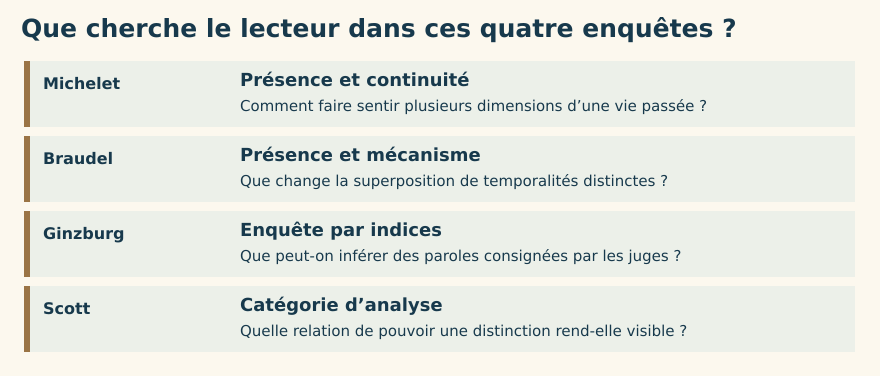

# ENS-PSL · Sélection internationale Lettres — Histoire — les figures de l’historien 2019 · Corrigé brut

*Corrigé rédigé par IA, non officiel. Signalez toute erreur.*

**Rédaction** · GPT-6.2 Astra Ultra · vitesse non renseignée

**Autocontrôle** · GPT-6.2 Astra Ultra · vitesse non renseignée

La feuille cite Jacques Revel, Un moment, des histoires (2018), p. 32. Elle demande de tester sa bipartition à partir de lectures de travaux d’historiens, puis de dégager d’autres types.

## Un portrait des historiens ou deux questions à poser à leurs livres ?

Un livre sur la Méditerranée peut-il à la fois porter la marque d’un profond attachement à une mer et démonter les relations entre ses marchés, ses réseaux marchands et ses rythmes de navigation ? En rangeant Fernand Braudel du côté des historiens dont l’imagination est portée par un rapport sensible au passé, Jacques Revel invite presque le lecteur à cette objection. Il prend d’ailleurs soin d’annoncer le caractère extrême de sa simplification. La formule des « mécanos » ne désigne pas des érudits sans écriture. Elle suggère un intérêt premier pour le fonctionnement de ce qui arrivait. Reste une difficulté logique. L’attachement qualifie souvent ce qui met une enquête en mouvement. Le mécanisme qualifie ce qu’elle cherche à rendre intelligible. Ces deux propriétés peuvent-elles vraiment distribuer les historiens en deux groupes exclusifs ?

## Deux promesses de lecture reconnaissables

Chez Michelet, l’entrée en relation avec les morts est davantage qu’un ornement de style. La *Préface de 1869* à l’*Histoire de France* présente rétrospectivement son entreprise comme une restitution de la vie dont les connaissances partielles ne livrent que des éléments dispersés. L’historien ne s’acquitte pas de sa tâche en déposant l’un à côté de l’autre une institution, une œuvre et une bataille. Il cherche une continuité d’existence sensible pour le lecteur. Les pronoms, le rythme du récit et le passage d’un destin individuel à une histoire collective contribuent à produire cette présence. Ils comportent aussi un risque. Quand la France reçoit une voix et une personnalité, la pluralité des groupes et de leurs conflits peut passer au second plan. Le premier portrait de Revel aide à interroger ce que cette écriture rend présent et ce qu’elle unifie peut-être trop vite.

On peut à l’inverse lire *Les Rois thaumaturges* de Marc Bloch en demandant d’abord comment un pouvoir royal de guérison se perpétue. Que des rois aient touché des malades est une chose. Que la croyance au pouvoir du geste résiste à ses échecs en est une autre. Le rapprochement entre France et Angleterre fait varier les conditions politiques et rituelles d’une attente comparable. La question porte sur un fonctionnement social qui excède les intentions d’un seul acteur. Elle donne une idée précise de ce qu’un « mécano » pourrait chercher à comprendre.

Dans ce dernier cas, pourtant, aucune lecture du seul dispositif comparatif ne donne accès au degré d’attachement personnel de Bloch envers les gens qu’il étudie. Il serait téméraire d’inférer d’une procédure explicative un tempérament froid. La typologie décrit déjà mieux des attentes de lecture que la vie affective des auteurs.

## Braudel oblige à croiser les deux axes

Dans *La Méditerranée et le monde méditerranéen à l’époque de Philippe II* (1949), le point de départ même relève d’une invention de l’objet. La mer et ses périphéries deviennent le premier sujet d’une histoire que l’on aurait pu faire avancer au rythme des décisions royales. L’ouvrage fait sentir les distances, les contraintes saisonnières et la différence entre la vie des montagnes et celle des plaines. Cette capacité d’imaginer un monde tient de la première figure définie par Revel.

Or la construction en durées différenciées est également une hypothèse sur le fonctionnement du monde méditerranéen. Les cadres géographiques de longue durée, les mouvements des économies et des sociétés, puis les événements politiques se répondent sans être réductibles les uns aux autres. Pour apprécier la portée du livre, il faut se demander ce qu’une variation conjoncturelle explique d’une décision et ce qu’elle laisse ouvert. L’imagination de l’espace a ici fourni un moyen de découvrir des mécanismes. Et l’effort d’explication a transformé le tableau sensible de la mer. Les deux propriétés ne sont ni incompatibles ni simplement juxtaposées.

Il devient alors possible de préciser la distinction initiale. Deux questions se séparent. Qu’est-ce qui fait choisir aux historiens cet objet et selon quel mode le rendent-ils perceptible ? Par quelles opérations construisent-ils une explication contestable par leurs collègues ? Un même livre peut apporter une réponse forte à chacune. Aucune de ces réponses ne vaut preuve de l’autre. Une image saisissante ne démontre pas une causalité et une comparaison rigoureuse ne prouve pas une indifférence affective.

## D’autres figures apparaissent lorsque la preuve ou les catégories deviennent le problème

Carlo Ginzburg, dans *Le Fromage et les vers*, suit les traces de Menocchio, meunier frioulan du XVIe siècle, à travers les procès de l’Inquisition. Il importe de rendre à cet homme l’étrangeté de ses questions et de ses lectures. Il faut aussi comprendre comment des rencontres entre culture orale et livres ont pu produire une cosmogonie singulière. Mais le problème le plus immédiat du lecteur est d’un troisième ordre. Comment passer d’une parole consignée par les juges, dans une situation dissymétrique, à une affirmation sur les raisonnements de celui qu’ils interrogent ? On voit apparaître l’historien enquêteur, attentif au statut et à la convergence d’indices. Il ne suffit ni d’éprouver de la sympathie pour Menocchio ni de chercher la règle que suivraient tous les meuniers. La singularité du cas impose de rendre visibles les degrés de la preuve.

Le travail de Joan W. Scott sur le genre, dans son article de 1986, suggère une autre figure encore, celle de l’historienne qui reprend les catégories de l’enquête. Ajouter à un récit existant les femmes qu’il a omises peut être nécessaire. Demander comment la différence entre les sexes sert à signifier et à organiser des rapports de pouvoir change la construction même de l’objet. On peut alors regarder une institution politique ou un discours sur l’autorité que ses auteurs ne présentaient pas comme une affaire de femmes. Cette proposition théorique ne suffit à prouver d’avance aucune interprétation particulière. Elle permet de soumettre à l’enquête des distinctions qui semblaient aller de soi.

Les historiens que j’ai retenus sont donc susceptibles d’entrer dans la bipartition à titre de dominantes, pour autant qu’on désigne des gestes repérables dans leurs écrits. Ils lui échappent aussitôt qu’elle prétend mesurer le rapport intime d’une personne au passé ou faire du récit et de l’explication des vocations exclusives. Aux questions « qui veut faire revivre ? » et « qui veut comprendre comment cela marche ? » il faut au moins ajouter « de quoi peut-on faire la preuve ? » et « avec quelles catégories a-t-on appris à voir ? ». Ces questions désignent des exigences que tout livre peut combiner différemment.

[Feuille de l’écrit](https://www.ens.psl.eu/sites/default/files/histoire-ecrit-sil2019.pdf) · [Michelet, préface de 1869](https://fr.wikisource.org/wiki/Histoire_de_France_%28Jules_Michelet%29/Tome_1/Pr%C3%A9face) · [Fernand Braudel, notice de la BnF](https://catalogue.bnf.fr/ark:/12148/cb31866731s) · [Carlo Ginzburg, The Cheese and the Worms](https://press.jhu.edu/books/title/53948/cheese-and-worms) · [Joan W. Scott, article de 1986](https://warwick.ac.uk/fac/arts/history/students/modules/archive/sexuality_and_the_body/bibliography/joan_scott_gender_1986.pdf)
