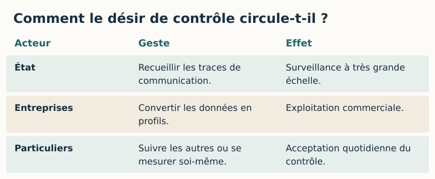

# ENS-PSL · Sélection internationale Lettres · Langue française — la surveillance 2019 — Corrigé guidé

*Corrigé rédigé par IA, non officiel. Signalez toute erreur.*

**Rédaction** · GPT-6.2 Astra Ultra · vitesse non renseignée

Alain Damasio, « 701 000 heures de garde à vue », janvier 2014.

## Compréhension · 4 points

**« Révélations glaçantes ».** Ce qui a été dévoilé sur l’étendue de la surveillance devrait saisir d’effroi les personnes concernées. L’adjectif donne à la peur une manifestation presque physique, qui rend d’autant plus surprenante la faiblesse des réactions.

**Une surveillance « opaque et dissymétrique ».** La personne observée ignore à quels moments et de quelle manière ses échanges sont examinés. Celui qui peut les consulter possède sur elle un savoir auquel elle n’a aucun accès équivalent.

**« Une cage souple ».** L’environnement technique promet confort et sécurité. Ses contraintes s’adaptent si bien à nos habitudes que nous les acceptons, au risque de renoncer à des gestes libres. La douceur du dispositif contribue à son efficacité.

**« Notre reflet flou ».** L’agence américaine nous renvoie une image grossie de nos propres désirs de contrôle. Nous surveillons parfois un proche ou enregistrons nos gestes. La ressemblance avec la surveillance institutionnelle nous apparaît de manière confuse, sans que les pouvoirs de chacun soient identiques.

## Résumé · 8 points

Nous savions la surveillance possible. Les révélations sur les capacités de la NSA en établissent désormais l’ampleur. L’agence peut recueillir nos communications, mais aussi les indices qui dessinent nos habitudes. Comment expliquer le peu d’indignation que suscite cette intrusion, alors que des opérations politiques de moindre étendue ont autrefois fait scandale ?

Les instruments de suivi se sont glissés dans les gestes ordinaires et nous nous sommes habitués à eux. Surtout, nous aimons pouvoir mesurer nos performances, localiser nos proches ou nous renseigner sur des inconnus. Notre participation quotidienne à cette surveillance donne un appui au pouvoir des États et des entreprises. Nous acceptons à notre tour de vivre sous un regard constant pour obtenir la sécurité et le confort promis.

Il faut donc réaffirmer une liberté toujours susceptible de reculer. Une relation intime demande la certitude de pouvoir choisir ses destinataires. Ignorer si quelqu’un nous observe suffit déjà à nous faire modifier notre conduite. Nos échanges devraient également pouvoir échapper à la transformation de nos préférences en bénéfices publicitaires. Enfin, il faut pouvoir oublier et évoluer sans que les traces de notre passé nous assignent un avenir. Une vie entière exposée à ce contrôle ressemblerait à une détention permanente.

*200 mots, comptés par espaces. La consigne fixe 200 mots à 10 % près.*

## Rédaction · 8 points

Le contrôle devient une manière de vivre quand une décision autrefois discutée se transforme en réflexe. On peut convenir avec une amie de la prévenir à son arrivée après un voyage. Si, la fois suivante, elle exige de voir le trajet entier sur son téléphone, quelque chose a changé. L’intention protectrice demeure et chacun peut avoir accepté le service. Mais désormais il faut expliquer pourquoi l’on souhaite interrompre ce regard. L’analyse de Damasio me convainc lorsqu’elle montre comment un pouvoir peut s’étendre à partir des demandes ordinaires de personnes qui tiennent les unes aux autres.

Ce pouvoir ne se réduit pas à la connaissance d’un déplacement. Une personne qui se sent observée peut renoncer à un détour parfaitement innocent, simplement pour éviter une interrogation à son retour. Elle perd alors une liberté qu’aucune interdiction formelle ne lui a retirée. Un autre changement survient lorsque les informations conservées pour un usage en servent un deuxième. Quelqu’un peut souhaiter garder le souvenir de ses lectures et refuser que ses hésitations soient utilisées pour décider des prochains livres qui lui seront proposés. Le droit de maîtriser une information comporte donc celui de choisir son destinataire et sa durée de conservation.

Il serait toutefois excessif de confondre toute possibilité de mesure avec une mise sous tutelle. Une personne qui suit sa rééducation peut trouver dans un carnet numérique une manière de constater un progrès trop lent pour être perceptible d’un jour à l’autre. Si elle choisit les mesures, peut les effacer et décide seule de les montrer à son médecin, l’instrument augmente sa capacité de jugement. Le danger réapparaît si un tiers impose le suivi ou exige les résultats comme prix d’accès à un service essentiel.

Je partagerais donc l’inquiétude de Damasio à condition de regarder la relation créée par chaque usage. Qui pose la question ? Qui voit la réponse ? Peut-on quitter le dispositif sans être puni ? La liberté se reconnaît ici à des possibilités concrètes, celle de garder un secret, de changer ses habitudes et de demander à une personne de nous faire confiance sans exiger une preuve à chaque instant.

*351 mots, comptés par espaces. Minimum demandé : 300.*

## Construire les réponses

**Passer de l’inventaire à l’explication.** L’ouverture établit l’ampleur de la collecte et pose une énigme, la faiblesse des réactions. Deux éléments la résolvent : l’accoutumance, puis notre participation volontaire au désir de contrôle. Le résumé peut alors restituer les trois droits que l’auteur rattache à la liberté, sans énumérer les applications qu’il prend pour exemples.

**Tester l’opposition entre protection et surveillance.** Dans la rédaction, le message d’arrivée et le partage permanent du trajet répondent à une inquiétude comparable. La différence tient à l’étendue de l’observation et à la possibilité d’y mettre fin. La rééducation fournit un autre cas où le même critère permet de préciser la conclusion.

[Sujet officiel et texte intégral](https://www.ens.psl.eu/sites/default/files/sil_2019_-_sujet_langue_francaise.pdf)
