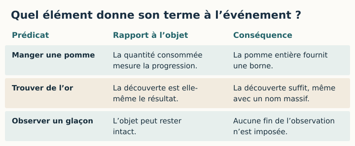
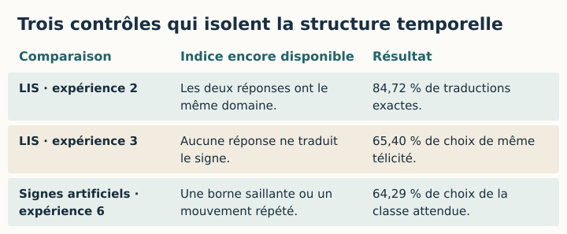

# ENS-PSL · Sélection internationale Lettres · Linguistique — la télicité (oral) 2019 — Corrigé brut

*Corrigé rédigé par IA, non officiel. Signalez toute erreur.*

**Rédaction** · GPT-6.2 Astra Ultra · vitesse non renseignée

## Partie I · Télicité et structure de l’événement

### 1. Diviser un événement ou en additionner deux

Supposons que John réfléchisse à un problème pendant dix minutes. En considérant les quatre premières minutes, on peut déjà dire qu'il a réfléchi au problème. En prolongeant cette réflexion pendant cinq minutes supplémentaires, on décrit encore l'ensemble comme une réflexion. C'est en ce sens que le prédicat atélique est divisible et cumulatif, à sujet et à objet constants et à l'échelle temporelle pertinente pour une activité.

Supposons maintenant que John ait mangé une pomme entière en sept minutes. Après la première bouchée, il a commencé, mais il n'a pas encore mangé une pomme entière. S'il recommence avec une deuxième pomme, la somme des deux événements correspond à deux pommes entières. Le prédicat télique avec son décompte d'une seule pomme ne s'applique ni à la première partie prise isolément ni au tout ainsi formé. Sa description impose un point d'aboutissement. Tout événement a un dernier instant lorsqu'il cesse. Seul le prédicat télique impose que cet instant réalise un résultat déterminé pour que la description soit vraie.

### 2. La victoire unique et l'habitude de gagner

La première phrase présente une compétition singulière. La victoire valide « gagner le championnat » et *en moins de deux heures* mesure le délai jusqu'à ce résultat. Dans la seconde, les cinq années ne sont pas le temps nécessaire pour remporter une seule compétition. Elles constituent la période pendant laquelle les victoires se répètent au rythme pertinent, ici d'une édition à l'autre.

La divisibilité stricte échoue. Carlsen ne remporte pas le tournoi chaque mardi de la période. La cumulativité convient mieux à l'habitude. S'il remporte toutes les éditions sur deux années puis sur les trois années immédiatement suivantes, il remporte toutes les éditions sur leur réunion. Cette addition porte sur le prédicat habituel avec une même fréquence et des périodes compatibles. La circonstance « exactement cinq ans », prise isolément, n'est évidemment pas cumulative.

### 3. Boue, voitures et mobilier

Une portion de boue réunie à une autre reste de la boue et une portion assez petite pour être détachée est encore de la boue, tant qu'on reste à l'échelle où le matériau existe comme tel. Avec *une voiture*, la réunion de deux exemplaires fait deux voitures et une moitié de voiture n'est pas une voiture. Il faut cependant prendre au sérieux le pluriel de *many cars*. Réunir deux collections de voitures donne bien des voitures. Découper l'une d'elles n'en donne pas d'autres.

*Furniture* se construit avec *much* malgré les unités reconnaissables de sa dénotation. Un fauteuil et une armoire sont ensemble du mobilier, mais un fragment de pied de fauteuil ne constitue pas à lui seul du mobilier. La cumulativité est donc compatible avec des atomes. La divisibilité sans restriction ne définit pas tous les noms massifs, et le nombre grammatical compte dans la comparaison.

### 4. Quelle propriété de l'objet mesure la progression ?

Dans *manger une pomme*, une moitié de l'objet consommée correspond normalement à une partie de l'événement et l'épuisement de la pomme fournit le terme. L'objet est un thème incrémental. Avec *manger du riz*, chaque nouvelle quantité de riz peut prolonger l'activité sans changer sa description. *Manger toute la portion de riz* rétablit une borne avec le même aliment.

*Trouver* impose déjà l'atteinte d'un résultat. On peut découvrir de l'or comme un diamant, et une période de recherche sans découverte ne suffit dans aucun cas. Avec *observer*, chaque portion du temps passée à observer peut porter sur le même glaçon intact. L'objet délimité ne fournit donc pas une mesure de l'observation. De même, pousser une charrette ne s'achève pas lorsque la charrette est « épuisée ». En revanche, tracer un cercle comporte une progression jusqu'à la fermeture du tracé. C'est le lien entre une échelle de progression et l'événement qui explique l'effet éventuel du complément.

## Partie II · Signes et frontières gestuelles

### 1. Résultats de Strickland et ses collègues

Des anglophones qui ne connaissent pas les langues des signes choisissent entre deux significations anglaises pour un signe filmé. Pour les signes italiens (LIS), ils choisissent la bonne traduction dans 90,51 % des cas lorsque les domaines des réponses diffèrent, et dans 84,72 % lorsque la réponse concurrente est sémantiquement proche. Même lorsque les deux traductions proposées sont fausses et relèvent d'un autre domaine, ils choisissent celle qui a la télicité du signe dans 65,40 % des cas. La même tâche donne 71,96 % en langue des signes des Pays-Bas et 72,22 % en langue des signes turque, contre 50 % en cas de choix au hasard. Un contrôle néerlandais remaniant les paires de réponses retrouve l'effet (73,23 %).

La forme temporelle du geste fournit un indice possible. Un arrêt brusque, un contact final ou une modification soudaine de la configuration de la main peuvent rendre une borne perceptible. Une répétition sans borne saillante suggère plutôt une activité prolongeable. Avec dix-huit signes artificiels construits pour opposer ces propriétés, les participants choisissent la classe attendue dans 64,29 % des cas. Dans les expériences 7 à 10, d'autres observateurs évaluent la borne et la répétition sur des échelles de 1 à 7. Ces évaluations prédisent les choix dans le sens attendu. On a une correspondance perceptible au-delà du hasard, avec une variabilité réelle selon les signes et les personnes.

### 2. Peut-on simplement deviner ce que la main représente ?

Un signe exécuté près du front pourrait faire deviner une activité mentale. Ce repère suffit moins bien à départager deux activités mentales opposées par leur télicité dans l'expérience 2. Le contrôle le plus révélateur vient de l'expérience 3. Pour le signe italien de « oublier », on peut devoir départager « mourir » et « courir ». Aucun des deux ne traduit le signe. Reconnaître « tête » ou même « oublier » ne désigne donc aucune réponse par ressemblance de domaine. Choisir « mourir » conserve en revanche la présence d'un aboutissement. Les données sur les signes artificiels renforcent l'argument. Une iconicité plus abstraite demeure justement au cœur de l'hypothèse, celle d'une correspondance entre la borne du geste et celle de l'événement.

### 3. Départager morphème vivant et héritage lexical

Il faut interroger la compétence de signeurs natifs, langue par langue. Je présenterais des situations ne différant que par l'atteinte d'un résultat, avec les mêmes participants et la même racine verbale. Je demanderais d'abord aux signeurs de décrire ces situations librement, puis de juger des formes avec et sans borne ajoutée. Une alternance régulière qui change systématiquement l'interprétation et s'étend à une racine inventée serait un argument pour une opération grammaticale productive. Il faut contrôler le simple mime de l'action ainsi que les possibilités phonologiques de la racine.

Si les formes restent essentiellement fixes mot par mot et qu'une addition de borne à des verbes nouveaux est mal acceptée ou n'entraîne aucun sens stable, une famille de formes lexicalisées d'origine iconique devient plus plausible. Des attestations anciennes documenteraient l'origine des formes. Elles ne suffiraient pas à décrire leur analyse actuelle par les signeurs. L'expérience sur les non-signeurs, à elle seule, ne tranche pas davantage.

### 4. Verbes à télicité variable

Courir jusqu'au magasin impose l'atteinte du magasin, alors que courir de long en large peut continuer. Pour *manger*, c'est la quantité spécifiée de l'objet qui peut apporter un terme. Les signes isolés de l'expérience sont compatibles avec une interprétation préférée, particulièrement nette pour des verbes tels que « décider ». La correspondance observée ne prévoit pas que chaque racine ait une télicité invariable.

Il faudrait faire produire et comprendre des phrases entières contenant la même racine de mouvement ou de consommation. On peut prévoir que la trajectoire soit modifiée dans le contexte borné, qu'un signe de destination ou de quantité fournisse à lui seul la borne, ou que la langue emploie une marque aspectuelle distincte. Si le verbe isolé a deux lectures courantes, les choix des non-signeurs pourraient se rapprocher du hasard. Une manipulation du contexte permet de distinguer une ambiguïté de la racine d'une absence générale d'indices visuels.

[Sujet officiel, 9 pages](https://www.ens.psl.eu/sites/default/files/sil_linguistique_2019_oral_fr.pdf) · [Article joint, Strickland et al. (2015)](https://doi.org/10.1073/pnas.1423080112)
