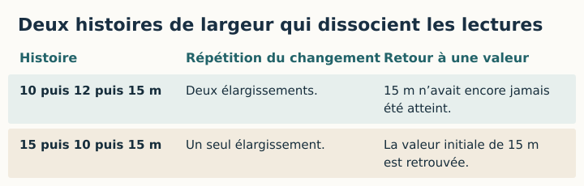
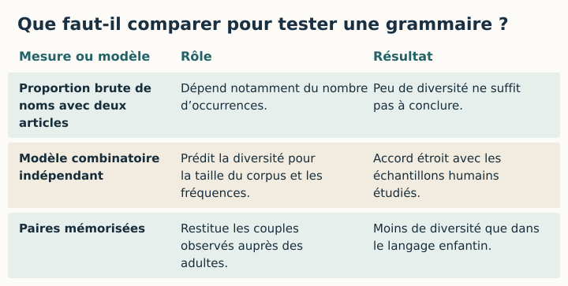

# ENS-PSL · Sélection internationale Lettres · Linguistique 2019 — Corrigé guidé

*Corrigé rédigé par IA, non officiel. Signalez toute erreur.*

**Rédaction** · GPT-6.2 Astra Ultra · vitesse non renseignée

## Portée des adverbes et changement d’état

### 1. Les deux implications

Si la serviette a séché auparavant, elle a auparavant atteint l'état sec. L'inférence (1a) implique donc (1b), avec le sens d'accomplissement retenu par l'énoncé. La réciproque est fausse. Une serviette fabriquée sèche peut avoir été mouillée pour la première fois ce matin. En séchant aujourd'hui, elle retrouve un état ancien, sans répéter un séchage antérieur.

### 2. Deux représentations ou une description peu précise ?

Avec *child*, savoir que John a un enfant laisse ouverte une caractéristique de cet enfant. Avec *bank*, le choix oppose deux dénotations du nom. Pour la serviette, le point délicat est que les situations de répétition appartiennent aussi à celles où l'état sec a déjà existé. Les seuls jugements positifs sur ces situations n'excluent donc pas une lecture unique faible, éventuellement renforcée par le contexte.

Une expérience pourrait faire varier séparément l'histoire de l'objet, la place de l'adverbe et l'accentuation. Un changement systématique d'interprétation lié à sa position serait un indice de deux portées. On peut aussi chercher un autre prédicat pour lequel les deux lectures ont des conditions de vérité indépendantes. Le cas de la rivière à la question 6 offre précisément ce diagnostic. L'analyse qui suit adopte, comme le demande le sujet, l'hypothèse de deux représentations.

### 3. Deux analyses de *again*

Dans l'analyse lexicale, la structure reste *AGAIN₁(DRY)* ou *AGAIN₂(DRY)*. La première entrée requiert un séchage antérieur. La seconde demande le changement inverse d'un séchage, c'est-à-dire un passage de sec à mouillé. Cela assure qu'un état sec a déjà existé. La présence de ce changement inverse est une exigence particulière de la définition lexicale donnée dans le sujet.

Dans l'analyse structurale, *AGAIN(BECOME(DRY))* porte sur le changement entier. La serviette devient sèche et un tel événement est antérieur. Dans *BECOME(AGAIN(DRY))*, le même adverbe porte seulement sur l'état résultant. Le changement se produit maintenant, l'antériorité porte uniquement sur le fait d'être sec. Une différence de parenthésage évite ici de doubler le sens de l'adverbe.

### 4. Deux lectures de *almost*

On pourrait définir deux entrées, « peu s'en est fallu que l'activité commence » et « l'activité a commencé et peu s'en est fallu que le résultat soit atteint ». On pourrait aussi décomposer l'action en mise en route, processus de peinture et résultat, la clôture entièrement peinte. À portée haute, *ALMOST(COMMENCER À PEINDRE…)* place John tout près de se lancer. À portée basse, *PEINDRE JUSQU'À PRESQUE(ENTIÈREMENT PEINT)* décrit un travail engagé mais interrompu à proximité de son terme.

Ce second exemple renforce l'intérêt d'une structure interne des événements, qui autorise différents adverbes à distinguer les étapes ou le résultat. Il ne prouve pas à lui seul une position syntaxique particulière. Des sens lexicaux distincts resteraient possibles si leurs restrictions étaient établies indépendamment.

### 5. Que changent les données françaises et anglaises ?

Dans les lectures imposées par l'exercice, *encore fermé* n'offre que la répétition de la fermeture, *refermé* autorise cette lecture et le rétablissement de l'état fermé, tandis que *rebuilt* rétablit un château construit. Cette dernière lecture n'exige pas que les archéologues, eux, aient déjà bâti le château. Une entrée lexicale propre à chaque forme peut stipuler les disponibilités, mais doit expliquer pourquoi les mêmes deux types de sens reparaissent. Une analyse structurale peut faire varier les sites d'attachement accessibles à chaque marque. Elle doit expliquer pourquoi le préfixe français a deux possibilités alors que le préfixe anglais de l'exemple n'en a qu'une. La variation interdit donc de déduire la portée de la seule distinction entre adverbe et préfixe. Elle ne décide pas entre les théories sans hypothèse indépendante.

### 6. Deux histoires pour la rivière

Première histoire, la largeur passe de 10 à 12 mètres, demeure à 12, puis passe à 15 après la pluie. La rivière s'élargit une seconde fois, mais ne retrouve pas sa largeur antérieure de 12 mètres. Supposons qu'elle n'ait jamais mesuré 15 mètres auparavant. Deuxième histoire, la rivière mesure 15 mètres dès l'origine, se resserre jusqu'à 10 et, après la pluie, revient à 15. Elle retrouve bien sa largeur d'autrefois et pourtant il s'agit du premier élargissement. Chacune des lectures peut ainsi être vraie lorsque l'autre est fausse.

### 7. Décomposer *widen*

Une rivière étroite peut passer de deux à trois mètres en restant très étroite. « Devenir large » impose donc à tort un seuil absolu. « Devenir plus large » rend correctement le changement par rapport à la largeur de départ. Appliquer *again* au changement comparatif entier fournit la répétition d'un accroissement, indépendamment de sa taille.

À portée basse, l'analyse avec *wide* rend seulement le retour à la qualité d'être large, et prédirait qu'un élargissement défini comme passage à « large » entraîne déjà cette qualité. Cette asymétrie reproduirait à tort le cas de la serviette. Avec *wider*, il faut préciser le terme de comparaison. Dire simplement « être de nouveau plus large qu'un certain repère » ne garantit pas le retour à **la même** largeur. Si le repère est 10 mètres, 12 et 15 sont tous deux plus grands que 10. Une représentation plus précise distingue le degré initial, le degré final plus élevé et l'état « avoir pour largeur ce degré final ». C'est sur ce dernier état qu'agit l'adverbe restitutif. On obtient les deux histoires de la question 6 sans supposer qu'une qualité absolue « large » a été atteinte.

### Vérifier le raisonnement

**Vérifier une implication par un contre-modèle.** Garder vrai l'énoncé de départ tout en rendant fausse la conséquence supposée. La serviette fabriquée sèche permet de distinguer un état initial d'un événement antérieur. Pour la rivière, écrire trois largeurs successives rend visible la différence entre une direction de changement et une valeur exacte.

**Dessiner les deux portées.** Encadrer d'abord « devenir sec », puis « sec » seul. Faire pointer le même adverbe successivement sur les deux cadres. Recommencer avec une grandeur mesurable, en inscrivant cette fois deux valeurs numériques. On voit pourquoi l'analyse comparative exige plus qu'une simple étiquette « large ».

## Article de Charles Yang

### 1. L'argument en faveur de la mémorisation

Les enfants produisent très peu de combinaisons manifestement impossibles de noms et de déterminants. De plus, dans les premiers corpus, seuls 20 à 40 % des noms singuliers apparaissent à la fois avec *a* et avec *the*. On a donc proposé que l'enfant restitue des groupes entiers entendus chez l'adulte. L'exactitude des groupes et le petit nombre de variantes s'expliqueraient ensemble par ce stockage.

### 2. Prédictions du modèle

Dans une version stricte, l'enfant qui n'aurait enregistré que *the dog* pourrait restituer ce groupe, mais le stock seul ne lui permettrait pas de produire *a dog*. La fréquence des productions dépendrait des couples déjà rencontrés et de leur fréquence, au-delà de la fréquence des noms et des déterminants pris séparément. À taille d'échantillon égale, la diversité devrait être compatible avec celle d'un répertoire de couples appris et réemployés.

### 3. Le rôle de l'échantillonnage

Une règle productive autorise plusieurs groupes sans exiger qu'ils figurent tous dans une conversation. Un nom prononcé une seule fois ne saurait apparaître avec les deux articles dans ce relevé. Même avec deux occurrences, on peut tirer deux fois le déterminant le plus fréquent. Les fréquences lexicales sont très inégales, approximativement selon une loi de Zipf. Dans le corpus Brown de textes adultes, seul un quart environ des noms apparaît avec les deux articles. En conclure que des auteurs adultes ignorent la règle serait absurde. Il manque une prédiction quantitative adaptée au nombre d'occasions réellement offertes.

### 4. Le test de Yang

Yang estime la diversité attendue si le choix d'un nom et celui d'un déterminant sont indépendants au niveau du modèle de combinaison, avec les fréquences observées ou estimées et la taille effective du corpus. Il compare ensuite cette attente à neuf échantillons d'enfants anglophones au stade des deux mots et à un échantillon d'écrits adultes. La concordance est de 0,977. Le modèle concurrent, qui stocke et restitue des paires tirées de 1,1 million d'énoncés adressés aux enfants, produit une diversité systématiquement trop faible. La règle qui combine des catégories rend donc mieux compte des données étudiées. Ce résultat laisse à la mémoire son rôle dans l'apprentissage des mots et dans la conservation de certaines expressions.

### 5. Le contraste avec Nim

Nim Chimpsky a appris des signes et en a combiné deux. Yang examine huit constructions possibles en demandant quelle diversité devrait produire une combinaison indépendante des catégories, étant donné les occasions dont disposait Nim. La diversité observée reste inférieure à ce niveau. Les nombreuses répétitions autour de peu de types de signes rendent particulièrement trompeuse une comparaison des pourcentages bruts avec ceux des enfants. Le résultat concorde davantage avec l'imitation de couples et de routines qu'avec la règle testée. Cette conclusion porte sur les productions documentées de Nim. Les langues des signes humaines ont bien une grammaire.

### 6. Portée pour l'évolution du langage

Si enfants et chimpanzé partageaient un même stade de combinaisons mémorisées, on pourrait y voir une analogie entre le développement individuel et une étape évolutive préalable à la grammaire humaine. Or les profils, comparés à leur propre référence statistique, diffèrent dès les premières combinaisons enfantines étudiées. Cet argument précis en faveur d'une continuité graduelle perd donc son assise empirique. Une comparaison de ces corpus ne reconstitue ni les étapes historiques de l'évolution ni le moment d'apparition du langage. Elle écarte une analogie trop rapide et impose de tester la productivité avant de conclure à une faculté commune.

### Vérifier le raisonnement

**Simuler trois occurrences.** Si un enfant dit une fois *a boat* et deux fois *the dog*, la diversité observée est nulle. Elle ne démontre aucune incapacité à produire *the boat* ou *a dog*. Le modèle doit prédire un taux à partir de nombreux échantillons comparables avant que la différence entre absence fortuite et contrainte grammaticale puisse être discutée.

[Sujet officiel et document scientifique annexé](https://www.ens.psl.eu/sites/default/files/sil_linguistique_2019_ecrit_eng.pdf)
